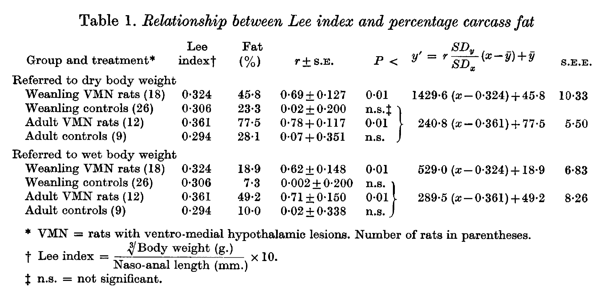

<!-- página 1 | impresa: 527 | encabezado: J. Endocr. (1968), 40, 527–528 / Printed in Great Britain / 527 | pie: 34-2 -->

SHORT COMMUNICATIONS

# CORRELATION BETWEEN ‘LEE INDEX’ AND CARCASS FAT CONTENT IN WEANLING AND ADULT FEMALE RATS WITH HYPOTHALAMIC LESIONS

L. L. BERNARDIS AND B. D. PATTERSON[^1]

*Neurosensory Laboratory and Department of Pathology, State University of New York at Buffalo, Buffalo, New York,* 14214, *U.S.A.*

(*Received* 11 *November* 1967)

Experimental lesions in the ventro-medial hypothalamus of the adult rat produce a type of obesity associated with considerable gains in body weight (Hetherington & Ranson, 1940) and body fat (Montemurro & Stevenson, 1957). However, the destruction of the ventro-medial hypothalamic area in weanling rats rarely results in increased body weight (Bernardis, Box & Stevenson, 1963; Han, Lin, Chu, Mu & Liu, 1965; Bernardis & Skelton, 1966). Yet body composition studies by Han *et al.* (1965) have shown that weanling rats can become obese.

A rapid means of determining obesity was described by Hetherington (1943) and has been recently revived by Szentagothai, Flerko, Mess & Halasz (1962) and Bernardis & Skelton (1966, 1967). It consists of dividing the cube root of the body weight by the naso-anal length. The resulting figure, referred to as ‘Nutritive Ratio’ (Lee, 1928) or ‘Lee Index’ is a measure of obesity. A figure of about 0·300 is considered normal (Lee, 1928). Szentagothai *et al.* (1962) multiplied the cube root divided by the naso-anal length by a factor of 1000 while Lee originally has not done this. Thus, a ‘normal’ value in Lee’s original expression is 0·300 but 300 according to the Hungarian group. We have adhered to Lee’s way of expressing the index and have thus multiplied our quotient by ten, since the naso-anal length was expressed in mm. rather than cm. However, a correlation between the ‘Lee Index’ and the results of body fat determinations had not been established. The present communication shows such a correlation.

Weanling Holtzman rats, weighing 62–80 g., received bilateral electrolytic lesions in the ventro-medial hypothalamic nuclei; sham-operated rats served as controls. The lesions were placed with a stereotaxic instrument (Baltimore Instrument Co.), using a stainless steel electrode of 0·25 mm. diameter, enamel-coated and bared at the tip. An anodal current of 1·5 mA and 10 sec. duration was applied. The coordinates had been previously established (see Bernardis & Skelton, 1965).

The animals were maintained for 21 days on Teklad Lab Chow (Teklad, Monmouth, Ill.; 24 % (min.) crude protein, 6 % (min.) crude fat and 5 % (max.) crude fibres, plus all essential accessory food factors) and water *ad libitum* and killed by decapitation. Carcass fat was determined by the method of Han *et al.* (1965) and expressed as <!-- página 2 | impresa: 528 | encabezado: 528 / L. L. BERNARDIS AND B. D. PATTERSON --> percentage of dry or wet carcass weight. Correlation coefficients and linear regression lines and equations were calculated. The localization of the lesions was determined according to the atlas of De Groot (1959).

<!-- NOTA-CONV: nota al pie impresa en la página 1 -->

[^1]: \* The Nichols School, Buffalo, New York, U.S.A.

Table 1. *Relationship between Lee index and percentage carcass fat*

<table>
<thead>
<tr><th>Group and treatment*</th><th>Lee index†</th><th>Fat (%)</th><th><em>r</em> ± S.E.</th><th><em>P</em> &lt;</th><th>$y' = r\,\frac{SD_y}{SD_x}\,(x-\bar{y})+\bar{y}$</th><th>S.E.E.</th></tr>
</thead>
<tbody>
<tr><td colspan="7">Referred to dry body weight</td></tr>
<tr><td>Weanling VMN rats (18)</td><td>0·324</td><td>45·8</td><td>0·69±0·127</td><td>0·01</td><td>1429·6 (<em>x</em>−0·324)+45·8</td><td>10·33</td></tr>
<tr><td>Weanling controls (26)</td><td>0·306</td><td>23·3</td><td>0·02±0·200</td><td>n.s.‡</td><td rowspan="3">240·8 (<em>x</em>−0·361)+77·5</td><td rowspan="3">5·50</td></tr>
<tr><td>Adult VMN rats (12)</td><td>0·361</td><td>77·5</td><td>0·78+0·117</td><td>0·01</td></tr>
<tr><td>Adult controls (9)</td><td>0·294</td><td>28·1</td><td>0·07+0·351</td><td>n.s.</td></tr>
<tr><td colspan="7">Referred to wet body weight</td></tr>
<tr><td>Weanling VMN rats (18)</td><td>0·324</td><td>18·9</td><td>0·62±0·148</td><td>0·01</td><td>529·0 (<em>x</em>−0·324)+18·9</td><td>6·83</td></tr>
<tr><td>Weanling controls (26)</td><td>0·306</td><td>7·3</td><td>0·002±0·200</td><td>n.s.</td><td rowspan="3">289·5 (<em>x</em>−0·361)+49·2</td><td rowspan="3">8·26</td></tr>
<tr><td>Adult VMN rats (12)</td><td>0·361</td><td>49·2</td><td>0·71±0·150</td><td>0·01</td></tr>
<tr><td>Adult controls (9)</td><td>0·294</td><td>10·0</td><td>0·02±0·338</td><td>n.s.</td></tr>
</tbody>
</table>

<!-- NOTA-CONV: en el original, una llave agrupa las filas 2 a 4 de cada bloque y apunta a una sola ecuación de regresión y un solo S.E.E.; aquí se representa con rowspan="3" -->

\* VMN = rats with ventro-medial hypothalamic lesions. Number of rats in parentheses.

† Lee index $= \dfrac{\sqrt[3]{\text{Body weight (g.)}}}{\text{Naso-anal length (mm.)}} \times 10$.

‡ n.s. = not significant.

Imagen original

Adult female rats, weighing 229–251 g., were treated similarly except that they were killed 37 days postoperatively. Histological verification was not deemed necessary since adult rats fail to become obese when such lesions are asymmetrical or unilateral.

Table 1 shows that rats with ventro-medial hypothalamic lesions produced shortly after weaning showed a significant correlation between Lee index and carcass fat content. This holds true whether the index is referred to wet or dry weight. A similar relationship could be shown in rats with hypothalamic lesions produced during adulthood.

These results suggest that the Lee index may be used as a fairly accurate and rapidly obtainable index of obesity in rats with hypothalamic lesions.

The authors are grateful to Mr Michael Bahorsky and Mrs Luise Bohacek for their excellent technical assistance. They would like to express their thanks also to Dr Floyd R. Skelton for his support in this investigation and to Dr Paul W. Han for the detailed description of the fat extraction method. The investigation was supported by U.S.P.H.S. Grant HE 06975 from the National Heart Institute.

## REFERENCES

Bernardis, L. L., Box, B. M. & Stevenson, J. A. F. (1963). *Endocrinology* **72**, 684–692.

Bernardis, L. L. & Skelton, F. R. (1965). *Am. J. Anat.* **116**, 69–74.

Bernardis, L. L. & Skelton, F. R. (1966). *Neuroendocrinology* **1**, 265–275.

Bernardis, L. L. & Skelton, F. R. (1967). *J. Endocr.* **39**, 777–778.

De Groot, J. (1959). The rat forebrain in stereotaxic coordinates. *Verh. K. ned. Akad, Wet., Afd. natuurk.* **52**, no. 4.

Han, P. W., Lin, C. H., Chu, K. C., Mu, J. Y. & Liu, A. C. (1965). *Am. J. Physiol.* **209**, 627–631.

Hetherington, A. W. (1943). *Am. J. Physiol.* **140**, 89–92.

Hetherington, A. W. & Ranson, S. W. (1940). *Anat. Rec.* **78**, 149–172.

Lee, M. O. (1928). *Am. J. Physiol.* **89**, 24–33.

Montemurro, D. G. & Stevenson, J. A. F. (1957). *Metabolism* **6**, 161–168.

Szentagothai, J., Flerko, B., Mess, B. & Halasz, B. (1962). *Hypothalamic control of the anterior pituitary.* Budapest: Akademiai Kiado.
