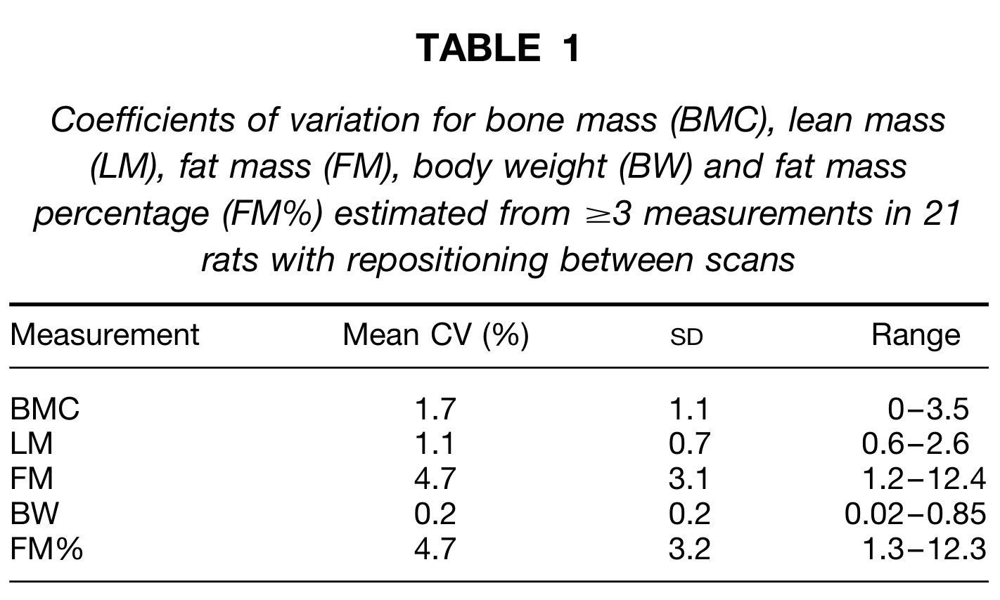
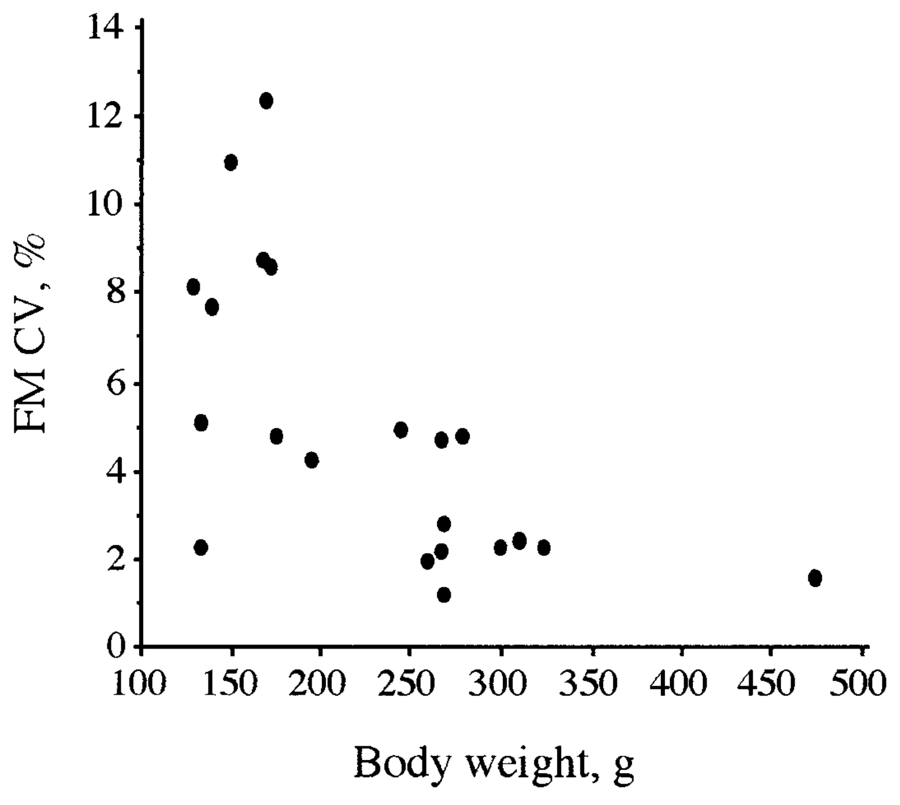
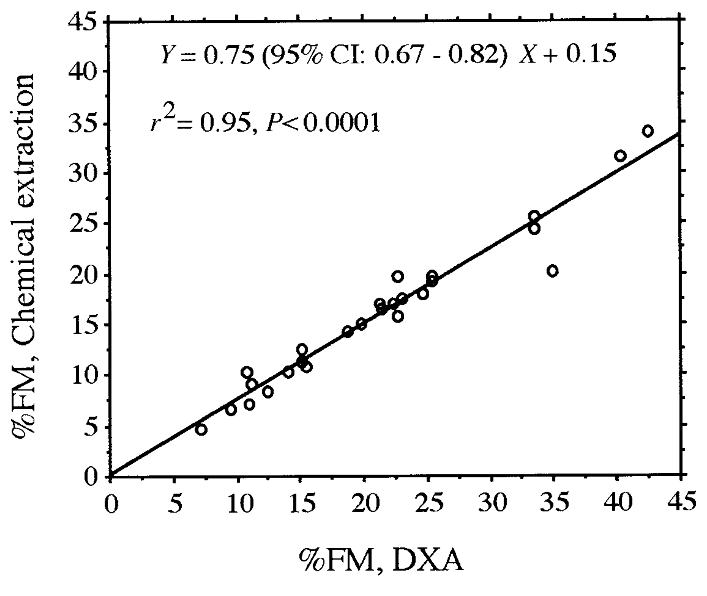
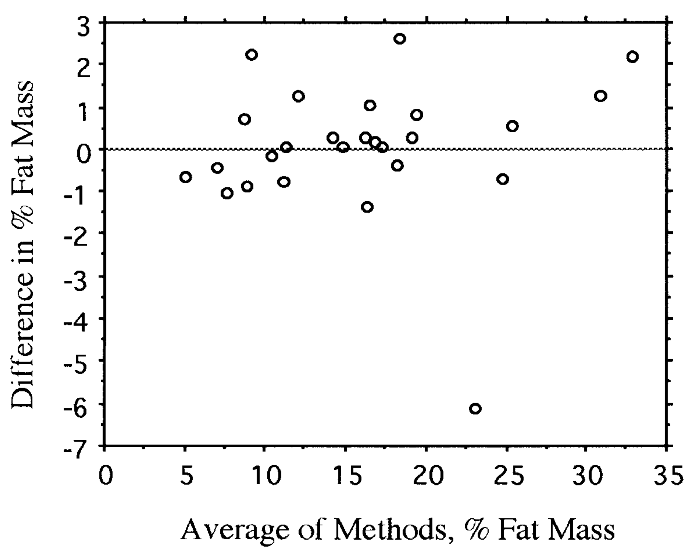
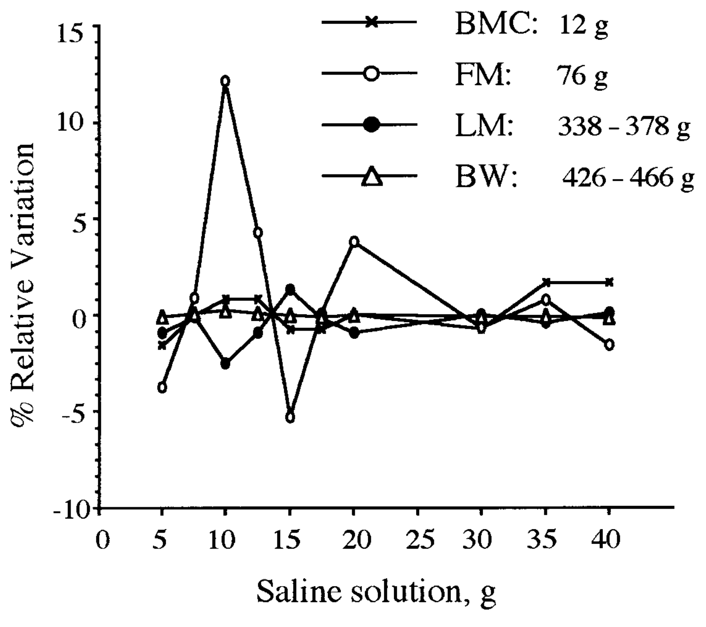

<!-- página 1 | impresa: 1550 | pie: 1550 -->

Nutritional Methodology-Body Composition

# Evaluation of Dual-Energy X-Ray Absorptiometry for Body-Composition Assessment in Rats[^1],[^2]

Eric Bertin,[^3] Jean-Charles Ruiz,\* Jacques Mourot,† Philippe Peiniau† and Bernard Portha

*Laboratoire de Physiopathologie de la Nutrition, CNRS-ESA 7059, Université Paris 7/D. DIDEROT, 75251 Paris Cedex 05, France; \*Département de Gynécologie, Hôpital Cochin, 75014 Paris, France; and* †*Station de Recherche Porcine, INRA, 35590 St. Gilles, France*

ABSTRACT Recent developments in dual-energy X-ray absorptiometry (DXA) have rendered feasible the determination of whole-body composition in small laboratory animals by directly measuring fat, fat-free and mineral bone masses. Our aim was to evaluate this technique by cross-calibrating the DXA method with the carcass chemical analysis in a heterogeneous population of nondiabetic Wistar and diabetic GK rats (21 animals were used for precision error and reproducibility determinations and 26 were used for accuracy studies). We report that this technique is optimized for weights >200 g. The respective CV for lean mass, fat mass and percentage of fat mass determined in short-term or transversal studies was 1.1 ± 0.1, 3.0 ± 1.3 and 3.1 ± 0.4% (mean ± SD) respectively. Further, this technique is valid for rats weighing from 130 to 200 g by using three successive scans. In longitudinal studies, daily calibrations significantly increased the percentage of fat mass CV to 6.6 ± 3.3%, but it was significantly decreased to 3.0 ± 2.7% by the use of triplicate scans. The accuracy for DXA was excellent in reference to the chemical extraction technique ($r^2$ = 0.95 for percentage of fat mass, *P* &lt; 0.0001), using an adjustment factor of 0.75 (limits of agreement between the two methods for percentage of fat mass = −1.7–2.3%). Mimicry of longitudinal changes in body composition with intraperitoneal injections of saline solution demonstrated a satisfactory detection of body component changes (≤2% of error for each final component analyzed, when increasing total lean mass by 11.8%). We conclude that DXA is appropriate for rat whole-body composition determination, allowing reliable long-term follow-up of individual animals for the first time. J. Nutr. 128: 1550–1554, 1998.

KEY WORDS: • *dual-energy X-ray absorptiometry* • *rats* • *body composition* • *fat content* • *in vivo technique*

Body composition is rarely taken into account in rats, despite their extensive use as models in nutritional studies. This is probably due mainly to the techniques available, which are often tedious and/or provide an indirect and unreliable measurement of fat mass [hydrodensitometry (Dahms and Glass 1982), total body water measure with isotopic dilution techniques (Culebras et al. 1977, Sheng and Huggins 1979) or total bioelectric conductivity (Stenger and Bielajew 1995, Trocki et al. 1995)]. A better way to determine precise rat body composition is by direct carcass analysis with chemical extraction. Analysis provides the protein, fat, ash and water contents of animals and is considered to be the ‘‘gold standard’’ (Frisch et al. 1977, Marshall et al. 1959). It is, however, time consuming and requires killing the rat, thereby increasing costs and number of experimental animals in longitudinal studies.

Dual-energy X-ray absorptiometry (DXA)[^4] is a potential noninvasive alternative technique. Greatly used in osteoporosis studies on rats and humans, it has been validated for global and segmental body composition measurement in humans (Going et al. 1993, Jensen et al. 1995, Wellens et al. 1994).In spite of specific software and procedures, first generation instruments have provided unreliable measurements of rat body composition (Jebb et al. 1996 and unpublished personal data). However, several recent developments such as the use of a fan with beam attenuation measured by 252 semiconductors instead of a pencil beam with only one and an improved voltage stability have rendered it applicable for determination of fat mass and nonmineral lean mass in addition to bone mineral mass in rats.

<!-- NOTA-CONV: notas al pie 1 a 4 impresas al pie de la columna izquierda de la página 1 -->

[^1]: Supported in part by a grant from the Ministère de l’Education Nationale, de l’Enseignement Supérieur et de la Recherche (n° 95-G-0103; programme interministériel ‘‘Aliment Demain’’).

[^2]: The costs of publication of this article were defrayed in part by the payment of page charges. This article must therefore be hereby marked ‘‘advertisement’’ in accordance with 18 USC section 1734 solely to indicate this fact.

[^3]: To whom correspondence should be addressed.

[^4]: Abbreviations used: BMC, bone mass content; BW, body weight; DXA, dual-energy X-ray absorptiometry; FM, fat mass; LM, lean mass.

The aim of this study was therefore to determine the reproducibility, accuracy and precision of this technique for whole-body composition assessment in rats.

## MATERIALS AND METHODS

***Animals and analytic procedures.*** All studies were performed in agreement with the university’s review committee for the proper treatment of animals. Wistar and GK [a genetic model of noninsulin-dependent diabetes mellitus (Portha et al. 1991)] rats of each sex, aged 2–24 mo, were used in the experiments. All rats were bred in our colony and consumed pelleted food ad libitum (UAR, ref. 113, Ville-moisson-sur Orge, France).

<!-- NOTA-CONV: las dos líneas siguientes están impresas a todo lo ancho al pie de la página 1, debajo de las dos columnas -->

0022-3166/98 \$3.00 © 1998 American Society for Nutritional Sciences.

Manuscript received 29 September 1997. Initial review completed 30 December 1997. Revision accepted 16 May 1998.

<!-- página 2 | impresa: 1551 | encabezado: RAT BODY COMPOSITION ASSESSMENT BY DXA / 1551 -->

For evaluation of short-term variability and reproducibility, we scanned in triplicate (or more) 21 rats weighing from 130 to 468 g (mean body weight ± SD: 226 ± 83 g). Standard conditions of utilization as in transversal studies were maintained by systematic removal and rigorous repositioning of each rat between scans. Experiments were done on seven different occasions over several months to avoid a bias due to time fluctuations.

Long-term reproducibility, which is particularly useful for longitudinal studies, was then determined according to the daily recalibration requirements. For this reason, we tested the calibration effect on technique variability using three rats (weighing 250, 260 and 275 g). Each rat was scanned in triplicate in two different ways in 1 d as follows: three consecutive scans within the same calibration (animals removed from the scan table between each of the three scans) and three separate scans preceded by a systematic extinction and therefore recalibration of the instrument. The order of procedure was systematically different for each rat (three consecutive scans done at random before, between or after scans with recalibration). Moreover, each rat was scanned on a separate day in relation to others to avoid a systematic bias due to time fluctuations in calibration variability.

The accuracy of DXA was determined by comparison with the chemical extraction technique. Rats (*n* = 26) ranging in weight from 130 to 492 g were used, and each rat was subjected to three consecutive scans in 1 d. All measurements were done within 5 d. After scanning, rats were immediately killed with a sodium pentobarbital intraperitoneal injection, put in airtight plastic bags and kept frozen at −30°C until chemical extraction analysis.

A further experiment was also conducted to test the accuracy and reliability of detection of rat body composition modifications in vivo; different amounts of saline solution (9%°) ranging from 5 to 40 mL were sequentially administered by peritoneal injections in a 426-g rat that was scanned after each injection.

***DXA measurements.*** A Hologic QDR 4500 instrument (Hologic, Waltham, MA) was used with a specific software (version V8–19a) and an internal standard adapted for rat measurements. This system works with a pulsed, dual-energy X-ray source (70 and 140 kV). The X-ray beam passes through a calibration disk and scans the rat longitudinally. A detector passing simultaneously under the rat feeds a computer with the absorption data recorded as pixel by pixel. For each pixel corresponding to a surface of 0.151 cm length × 0.064 cm width, weight, fat mass percentage and mineral bone mass are determined from beam attenuation analysis, which depends on the relevant tissue composition (Pietrobelli et al. 1996). The fat mass percentage of each pixel is calculated in reference to internal standards of variable thickness, simulating various fat mass percentages. Their attenuation coefficient is standardized with those of a stearate (standard of acrylic resin) and of a water-stearate mixture (standard of acrylic resin with aluminum overlapping). The sum of all pixel values gives the whole-body composition in terms of fat mass, boneless lean mass and mineral bone mass. A daily calibration with reference to internal standards is required. According to the manufacturer, the software is optimized for adult rats weighing from 200 to 750 g.

For scanning, all of the rats were placed on the same area of the platform and in the same body geometry, i.e., straight and flat on ventral face, limbs spread, tail lying on the side. The scan was always initiated in the center position and lasted ∼3 min.

***Chemical extraction technique.*** After obtaining a homogeneous mixture of the carcass by using a mechanical grinder, the water content of the carcass was determined by weight loss after drying 1-g samples for 18 h in a 103°C oven. Total lipid content was determined on three aliquots after extraction with a mixture of chloroform/methanol (2:1) as previously described (Folch et al. 1957). Chemical composition data were expressed as grams per 100 g fresh weight. Body weight was determined just before scanning with a precision of 0.1 g.

***Anesthesia.*** All rats were sedated with sodium pentobarbital (60 g/L) by intraperitoneal injection before scanning. Rats used for reproducibility and accuracy analyses were given 80 *µ*L/100 g body weight. After scanning, rats subjected to chemical extraction were given a second, lethal injection of 0.2 to 0.5 mL according to weight. Injected volumes were taken into account for data analysis.

***Statistical methods.*** Short-term CV for each rat body component were estimated from triplicate (or more) measurements by ANOVA. The mean CV obtained for 21 rats was then weighted according to the number of scans for each rat. Moreover, considering the large fluctuations of individual CV, a Pearson correlation analysis was carried out. For long-term variability, calibration effect was determined by comparing within-group variances for the three rats scanned in triplicate with and without recalibration. The *F*-ratio was constructed with intercalibration variance as the numerator and intracalibration variance as the denominator. Then, triplicate scan CV due to changes of calibration were obtained for each mass by dividing the SD for differences in triplicate scan means (intercalibration mean − intracalibration mean for each rat) by the absolute mean of each mass for the three rats.

<!-- NOTA-CONV: Tabla 1 impresa en la página 2, arriba de la columna derecha; el párrafo anterior empieza al pie de la columna izquierda y continúa debajo de la tabla -->

**TABLE 1**

*Coefficients of variation for bone mass (BMC), lean mass (LM), fat mass (FM), body weight (BW) and fat mass percentage (FM%) estimated from ≥3 measurements in 21 rats with repositioning between scans*

| Measurement | Mean CV (%) | SD | Range |
|:---|:---:|:---:|---:|
| BMC | 1.7 | 1.1 | 0–3.5 |
| LM | 1.1 | 0.7 | 0.6–2.6 |
| FM | 4.7 | 3.1 | 1.2–12.4 |
| BW | 0.2 | 0.2 | 0.02–0.85 |
| FM% | 4.7 | 3.2 | 1.3–12.3 |

Imagen original

Accuracy analysis was performed using chemical extraction data as the independent variable and DXA data as the dependent variable in a linear regression model. Residual variance was determined by using $r^2$. The same procedure was used for gravimetric weight and DXA weight. In addition, we used the approach proposed by Bland and Altman (1986) to analyze the agreement between the two techniques. When testing the technique under conditions of body composition modifications with the addition of saline solution, results were expressed as percentages of relative variation (difference in mass/initial mass) for each component after subtracting the saline solution mass from lean mass and weight. Thus, we could directly determine the influence of in vivo (though not physiologic) modifications on the accuracy of the technique and its reliability. All analyses were performed with a computer software package (Statview SE, version 1.03; Abacus Concepts, Berkeley, CA). Differences with a probability level ≤0.05 were considered significant.

## RESULTS

***Short-term precision.*** Triplicate or more DXA measurements were performed in each of 21 rats, with rigorous repositioning between the scans, but without changing calibration for the same rat. Means and extreme values of within-calibration weighted CV for bone mass content (BMC), fat mass (FM), lean mass (LM) and body weight (BW) are shown in **Table 1**. The short-term CV for FM percentage (%FM) was 4.7% but ranged from 1.3 to 12.3. These large differences in %FM CV were not significantly related to any other body component CV. However, FM CV and %FM CV were negatively correlated with BW ($r^2$ = −0.40, *P* &lt; 0.002). Because the two above-mentioned CV were very similar, only FM CV results are shown. There was an inverse relationship between FM CV and weight (*r* = −0.63, *P* &lt; 10−3), but it was nonlinear: FM CV was &lt;5% in each of the 12 rats with weight ≥194 g, and >7% in 6 of 9 rats with weight &lt;175 g **(Fig. 1)**. Excluding the rats with weight &lt;175 g from the analysis decreased the FM CV to 3.0 ± 1.3% (3.1 ± 0.4% for %FM CV) and eliminated the FM CV relationship to BW.

***Long-term precision.*** Each of three rats was scanned in triplicate in two different ways on 1 d, with three consecutive scans obtained within one calibration and three other separate <!-- página 3 | impresa: 1552 | encabezado: 1552 / BERTIN ET AL. --> scans with systematic recalibration after turning off the instrument. Whatever the variable considered, the mean CV of the three rats were higher with rather than without systematic recalibration before scanning. However, the difference was not systematic and was largely variable. Within-group variances of data differing in calibration before scanning were significantly different for weight (*P* &lt; 0.02) and for % FM (*P* &lt; 0.05). Thus, %FM CV was 6.6 ± 3.3 and 3.2 ± 1.2% with and without recalibration, respectively. Analysis of calibration effect on technique variability by taking into account the mean values of triplicate scans gave much smaller differences. Mean CV (±SD) for triplicate scans corresponding to daily calibration such as in longitudinal studies was as follows: 0.7 ± 0.3% for BMC, 3.7 ± 1.9% for FM, 1.3 ± 0.5% for LM, 0.08 ± 0.07% for BW and 3.0 ± 2.7% for %FM.

<!-- NOTA-CONV: Fig. 1 impresa en la página 3, arriba de la columna izquierda -->

**FIGURE 1** Relationship between coefficient of variation for fat mass (FM CV) and total body weight in 21 rats (means of ≥3 scans with systematic repositioning).

<!-- texto en la figura: eje y: FM CV, % · eje x: Body weight, g -->

***Accuracy.*** Regression analysis conducted on a population of 26 rats exhibiting wide variations of weight and fat mass and scanned on 7 different days within a period of several months demonstrated that the mean results of three scans per rat for BW, FM and %FM, were closely and linearly correlated with the corresponding values obtained by gravimetry or chemical extraction analysis. DXA body weight was highly correlated with gravimetric weight with $r^2$ = 1. However, a slight but significant difference was highlighted, with DXA overestimating the whole-body weight by 2.1 g on average. The difference in measuring weight was positively correlated with BW with *r* = 0.81 (*P* &lt; 0.0001) and could be estimated as 0.8% of BW.

Concerning the more discriminant variable, %FM, regression was strictly linear and the residual variance was extremely weak with $r^2$ = 0.95 (*P* &lt; 0.0001), the intercept value was not significantly different from zero (0.146) and the slope of the regression line was 0.75 (limits for the 95% CI: 0.67–0.82) in reference to the chemical extraction technique **(Fig. 2)**. This slope was not affected by sex, weight and age of the rats, as assessed by analysis of covariance. Results were similar and even better when considering absolute value of FM ($r^2$ = 0.97, slope = 0.73). Thus, DXA appeared to overestimate FM in a proportion depending on BW but not on other variables, especially LM, hydration fraction of fat-free mass and total body water. It should be pointed out that the value obtained for one rat was quite far from the straight line. We have no satisfactory explanation for this discrepancy because the rat’s BW, hydration fraction of fat-free mass and FM were not different from corresponding values in the other rats whatever technique was used. Excluding this rat from the analysis improved the value of $r^2$ for %FM to 0.98.

<!-- NOTA-CONV: Fig. 2 impresa en la página 3, arriba de la columna derecha -->

**FIGURE 2** Linear regression analysis of fat mass percentage (%FM) in 26 rats obtained after chemical extraction as independent variable and %FM obtained after dual energy X-ray absorptiometry (DXA) as dependent variable.

<!-- texto en la figura: eje y: %FM, Chemical extraction · eje x: %FM, DXA · anotaciones: Y = 0.75 (95% CI: 0.67 - 0.82) X + 0.15 · r²= 0.95, P< 0.0001 -->

Considering the precision of the chemical extraction analysis, the CV from the analysis of the three aliquots after obtaining the homogeneous mixture was 3.6 ± 2.0% (range: 0.5–7.4) for lipid content and 0.60 ± 0.35% (range: 0.04–1.34) for fat-free mass.

There was an obvious lack of agreement between DXA and the chemical extraction data, but the features of the regression between the two techniques allowed the reanalysis of DXA results after adjustment by a factor of 0.75 (see Bland and Altman 1986). The precision of the agreement was then calculated <!-- página 4 | impresa: 1553 | encabezado: RAT BODY COMPOSITION ASSESSMENT BY DXA / 1553 --> by plotting the difference between the methods against their mean **(Fig. 3)**. The mean difference between chemical extraction and adjusted DXA results was 0.04 ± 1.6% for %FM.

<!-- NOTA-CONV: Fig. 3 impresa en la página 3, al pie de la columna derecha -->

**FIGURE 3** Difference from the mean for fat mass percentage data in 26 rats (chemical extraction results vs. dual energy X-ray absorptiometry results adjusted by a factor of 0.75).

<!-- texto en la figura: eje y: Difference in % Fat Mass · eje x: Average of Methods, % Fat Mass -->

<!-- NOTA-CONV: Fig. 4 impresa en la página 4, arriba de la columna izquierda -->

**FIGURE 4** Percentages of relative variations for bone mass content (BMC), fat mass (FM), lean mass (LM) and body weight (BW) in a 426-g rat subjected to intraperitoneal injections of saline solution. The data are related to the preinjection situation after subtracting the added mass from LM or BW.

<!-- texto en la figura: leyenda (línea con marcador ×) BMC: 12 g · (marcador ○) FM: 76 g · (marcador ●) LM: 338 - 378 g · (marcador △) BW: 426 - 466 g · eje y: % Relative Variation · eje x: Saline solution, g -->

***Detection of in vivo body composition modifications.*** Successive intraperitoneal injections of saline solution in the same rat were conducted to modify the hydration of the animal artificially and determine if it was taken into account by the technique as LM. We added equivalents of 1.4–11.8% of the initial LM (338 g) in this experiment; the results are shown in **Figure 4**. Except for FM determination in one scan out of a total of nine, the percentages of relative variations for various masses were very near the zero line (≤2% error in each final body component determination, differences not significant) and not correlated with injected volumes.

## DISCUSSION

DXA provides body composition measurement with a division of the fat-free mass into mineral bone mass and non-bone lean mass, in addition to fat mass. Another useful feature of this technique is the direct measurement of FM, which is not calculated from the difference between body weight and lean mass. It should be stressed that apart from the chemical extraction method, other available techniques allow only indirect estimation of FM based on LM measurements (Culebras et al. 1977, Dahms and Glass 1982, Sheng and Huggins 1979, Stenger and Bielajew 1995, Trocki et al. 1995). Low fluctuations of the LM value greatly affect the FM value (low in proportion) because it is obtained by subtraction (FM = BW − LM).

This study shows that the DXA method using a Hologic QDR 4500 instrument allows accurate, reliable and noninvasive determination of rat body composition. Previous studies have illustrated the efficiency of DXA in measuring bone mass content and bone mass density in rats, but few reports are available concerning its use for rat whole-body composition. The feasibility of this approach has been emphasized in a previous study, but this method was not validated (Rikans et al. 1993). In another report of adult rats weighing from 140 to 600 g and killed before triplicate scanning with a first generation instrument (Hologic QDR 1000W), DXA results were compared with those obtained by chemical extraction (Jebb et al. 1996). The FM CV was found to be very low (&lt;1%), an observation that could not be confirmed in our laboratory despite the use of either the same instrument (QDR 1000) or a QDR 2000. With both instruments, we observed an unavoidable drift due mainly to technical features of these instruments that did not allow us to obtain reliable measurements, despite assistance from the manufacturer. Nevertheless, in their study, Jebb et al. (1996) highlighted a moderate overestimation of body weight and a significant overestimation of fat mass as obtained by DXA vs. chemical extraction. We found the same results in this study.

The accuracy of measurements by DXA must be discussed in comparison to chemical extraction, which is still considered the ‘‘gold standard’’ technique. In this study, we analyzed the accuracy of DXA for soft tissue but not for BMC measurement. The bone ash weight determination was not feasible in conjunction with the chemical extraction procedure. Nevertheless, BMC determination has been validated in rats with the use of previous versions of the instrument (Mitlak et al. 1994).

By using a quite large and heterogeneous population of either normal or diabetic rats, we found a significant difference in FM measurement obtained with DXA vs. chemical extraction. However, the regression was linear and the *y*-intercept was not different from zero. Moreover, residual variance was only 5%, thus allowing the possibility of adjusting the DXA data to the chemical extraction data by using a mean correction factor of 0.75. In this situation, the agreement between the two methods made it acceptable to interchange them for %FM and thus for FM and fat-free mass determination in individual rat values (limits of agreement = −1.7–2.3% when excluding the isolated value quite far from the regression line).

Under these conditions, the DXA data were valid for rats in a range from 130 to 492 g for body weight and from 4.75 to 34% for FM. According to the manufacturer, the technique is optimized for weights ranging from 200 to 750 g. It is important to note that these limits are provided for one scan per rat. Our short-term variability analysis, which highlights an inverse nonlinear regression between FM CV and BW, confirms that a single scan is sufficient to obtain accurate measurements in rats weighing >200 g. This is further demonstrated by the comparison of DXA results to those of chemical extraction: above the 200-g weight limit, no significant difference was detectable in the agreement with a single scanning vs. a triplicate scanning (%FM relative difference for a single scan: 1.2%). In rats weighing &lt;200 g, however, the agreement between the two techniques was significantly different, on the basis of the scan number. Below this weight, three successive scans of the rat are thus required. Above 500 g, a bias in the value of the correction factor is unlikely because the relative difference of FM between the two techniques is independent of either BW or %FM.

To ascertain whether DXA overestimates FM and to exclude a bias linked to chemical extraction, we compared in both cases the hydration fraction of fat-free mass by dividing water content (obtained by desiccation before lipid extraction) with fat-free mass obtained by subtracting FM from BW. The hydration fraction ranged from 65 to 74% with the chemical extraction procedure, and from 65 to 82% with the DXA procedure. The highest values found with DXA method seemed to be overestimated compared with the data obtained previously from rats tested under physiologic conditions <!-- página 5 | impresa: 1554 | encabezado: 1554 / BERTIN ET AL. --> (Sheng and Huggins 1979). Therefore, this observation tends to confirm that DXA gives an overestimation of FM. This is probably due to the use of inappropriate equations in the current DXA software for calculation of body composition.

Reproducibility determined during short-term variability experiments is obviously satisfactory, particularly for FM determination (assuming that the rats are not too small as discussed above). Animal positioning does not increase significantly the variability of the data, whatever the parameter determined (data not shown). Because it does not require calibration change, this DXA procedure is thus convenient for performing transversal studies aimed at comparing different groups of rats on the same day. Further, the determination is not time-consuming, with a maximal time of only 3 min for a whole-body rat scan. Therefore, in the case in which few rats and/or rats with low weight are tested, one may use several scans for each rat to improve the reliability of the data.

On the other hand, when performing longitudinal studies, variability is elevated because of required daily recalibration. Attempts to avoid this limitation have been made by using as a reference an internal standard device, oblong in shape to avoid refraction problems and with a weight of 247 g (31 g of FM). Adjustment of different calibration determinations using such a standard did not improve reproducibility and this procedure was not appropriate for a possible selection of calibrations. Nevertheless, when scanning rats in triplicate with a systematic calibration between each scan, the FM CV was found to be as low as 3.7 ± 1.9%, a value that validates the use of DXA under these conditions for longitudinal studies. When testing the accuracy of DXA vs. chemical extraction by scanning 26 rats (8 animals &lt;175 g) over seven different days, despite the absence of systematic recalibration for triplicate scans, it is noteworthy that regression linear analysis showed a satisfactory $r^2$ value of 0.95. We have no satisfactory explanation concerning an individual value out of a total of 26 values that clearly diverges from the regression line. The body composition of this rat as measured by chemical analysis was similar to that of other age-related individuals and its desiccated value fell within expected values after calculating the hydration fraction of fat-free mass.

Our intraperitoneal saline injection protocol sought to mimic wide modifications of body composition in vivo by artificially increasing the LM and thus decreasing the fat mass percentage. The results indicated that ∼15% variation for total body water content does not significantly interfere with the determination of the different masses. This agrees with data in humans that demonstrated, using previous DXA instruments, an appropriate determination of fat mass and body weight despite changes in the hydration fraction of lean mass (Horber et al. 1992). Moreover, it is interesting to note that small modifications of LM (&lt;2%) can be clearly detected.

In conclusion, this study highlights for the first time the usefulness and the features of DXA for measurement of rat body composition. Reproducibility and accuracy of this technique are excellent for fat mass and fat-free mass determination, as long as rigorous rules are followed (careful positioning and triplicate scans for small rats and for longitudinal studies). The use of an adjustment factor that has to be confirmed could be integrated by the manufacturer to standardize DXA/chemical extraction results. With these prerequisites, this technique, currently used in clinical studies, should contribute to an easier and more reliable determination of rat body composition.

## REFERENCES

Bland, J. M. & Altman, D. G. (1986) Statistical methods for assessing agreement between two methods of clinical measurement. Lancet. 8: 307–310.

Culebras, J. M., Fitzpatrick, G. F., Brennan, M. F., Boyden, C. M. & Moore, F. D. (1977) Total body water and the exchangeable hydrogen II— a review of comparative data from animals based on isotope dilution and desiccation, with a report of new data from the rat. Am. J. Physiol. 232: R60–R65.

Dahms, W. T. & Glass, A. R. (1982) Correlation of percent body fat with body specific gravity in rats. J. Nutr. 112: 398–400.

Folch, J., Lee, M. & Sloane Stanley, G. H. (1957) A simple method for the isolation and purification of total lipides from animal tissue. J. Biol. Chem. 226: 497–509.

Frisch, R. E., Hegsted, D. M. & Yoshinaga, K. (1977) Carcass components at first estrus of rats on high-fat and low-fat diets: body water, protein, and fat. Proc. Natl. Acad. Sci. U.S.A. 74: 379–383.

Going, S. B., Massett, M. P., Hall, M. C., Bare, L. A., Root, P. A., Williams, D. P. & Lohman, T. G. (1993) Detection of small changes in body composition by dual-energy X-ray absorptiometry. Am. J. Clin. Nutr. 57: 845–850.

Horber, F. F., Thomi, F., Casez, J. P., Fonteille, J. & Jaeger, Ph. (1992) Impact of hydration status on body composition as measured by dual energy X-ray absorptiometry in normal volunteers and patients on haemodialysis. Br. J. Radiol. 65: 895–900.

Jebb, S. A., Garland, S. W., Jennings, G. & Elia, M. (1996) Dual energy X-ray absorptiometry for the measurement of gross body composition in rats. Br. J. Nutr. 75: 803–809.

Jensen, M. D., Kanaley, J. A., Reed, J. E. & Sheedy, P. F. (1995) Measurement of abdominal and visceral fat with computed tomography and dual-energy X-ray absorptiometry. Am. J. Clin. Nutr. 61: 274–278.

Marshall, M. W., Hildebrand, H. E., Dupont, J. L. & Womack, M. J. (1959) Effect of dietary fats and carbohydrates on digestibility of nitrogen and energy supply, and on growth, body composition and serum cholesterol of rats. J. Nutr. 69: 371–382.

Mitlak, B. R., Schoenfeld, D. & Neer, R. M. (1994) Accuracy, precision, and utility of spine and whole-skeleton mineral measurements by DXA in rats. J. Bone Miner. Res. 9: 119–126.

Pietrobelli, A., Formica, C., Wang, Z. & Heymsfield, S. B. (1996) Dual-energy X-ray absorptiometry body composition model: review of physical concepts. Am. J. Physiol. 271: E941–E951.

Portha, B., Serradas, P., Bailbe, D., Suzuki, K.-I., Goto, Y. & Giroix, M.-H. (1991) B-cell insensitivity to glucose in the GK rat, a spontaneous non-obese model for type II diabetes. Diabetes 40: 486–491.

Rikans, L. E., Venkataraman, P. S. & Cai,Y. (1993) Evaluation by dual-energy X-ray absorptiometry of age-related changes in body composition of male rats. Mech. Aging. Dev. 71: 155–158.

Sheng, H.-P. & Huggins, R. A. (1979) A review of body composition studies with emphasis on total body water and fat. Am. J. Clin. Nutr. 32: 630–647.

Stenger, J. & Bielajew, C. (1995) Comparison of TOBEC-derived total body fat with fat pad weights. Physiol. Behav. 57: 319–323.

Trocki, O., Baer, D. J. & Castonguay, T. W. (1995) An evaluation of the use of total body electrical conductivity for the estimation of body composition in adult rats: effect of dietary obesity and adrenalectomy. Physiol. Behav. 57: 765–772.

Wellens, R., Chumlea, W. C., Guo, S., Roche, A. F., Reo, N. V. & Siervogel, R. M. (1994) Body composition in white adults by dual-energy X-ray absorptiometry, densitometry, and total body water. Am. J. Clin. Nutr. 59: 547–555.
