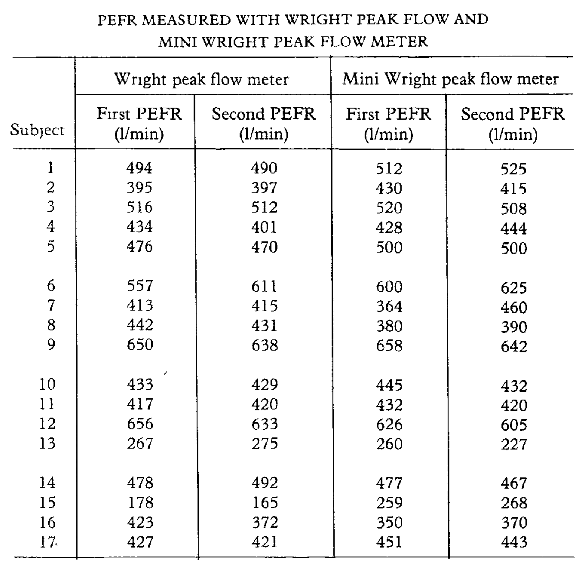
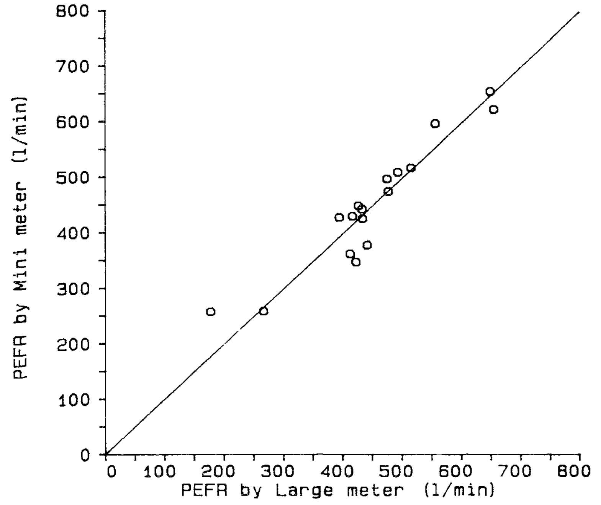
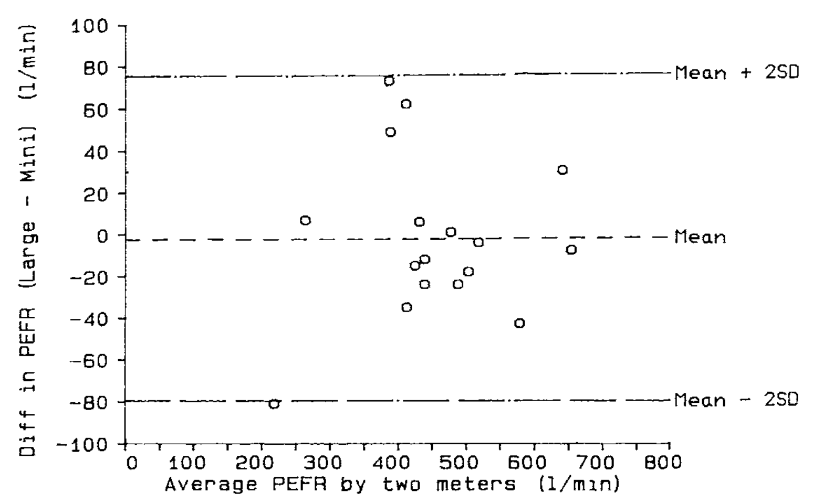
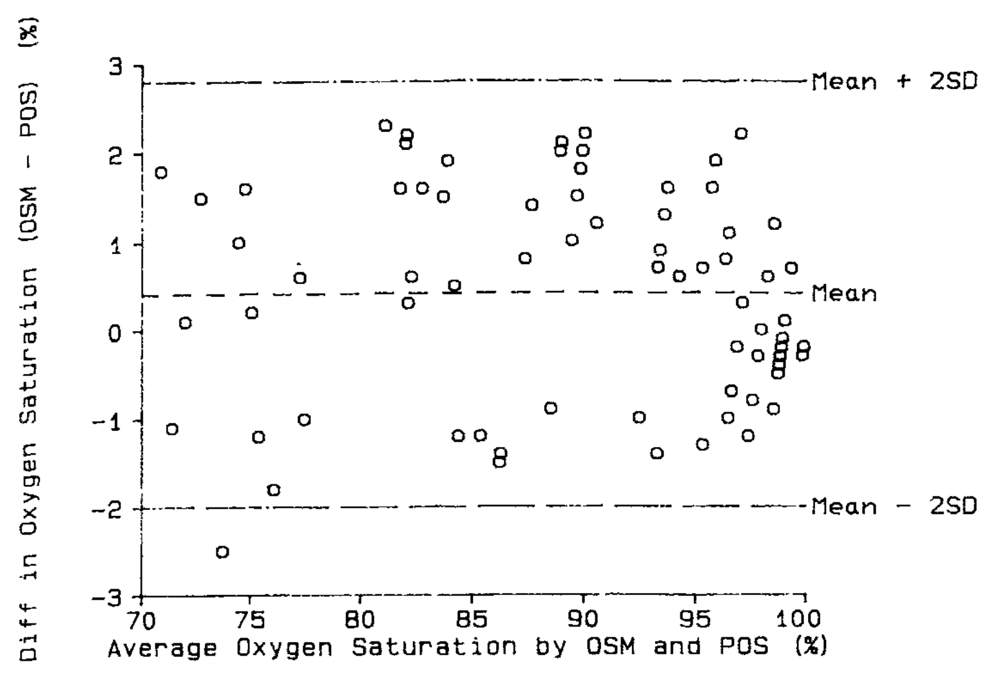
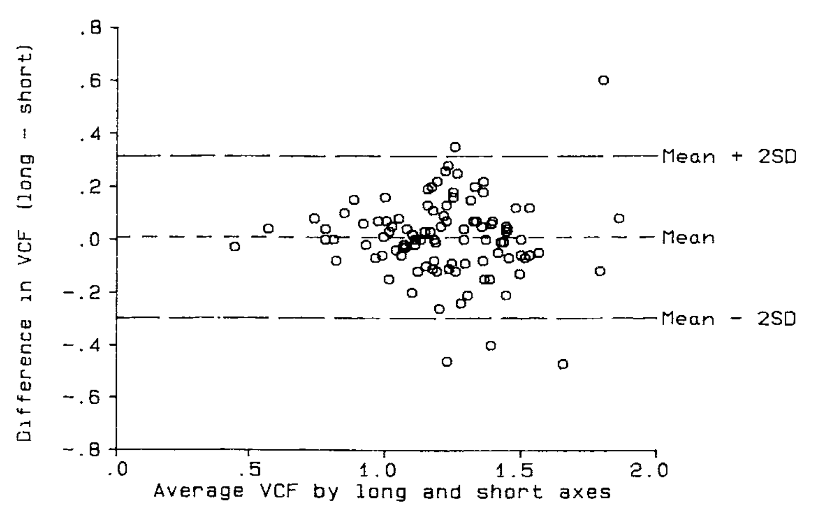
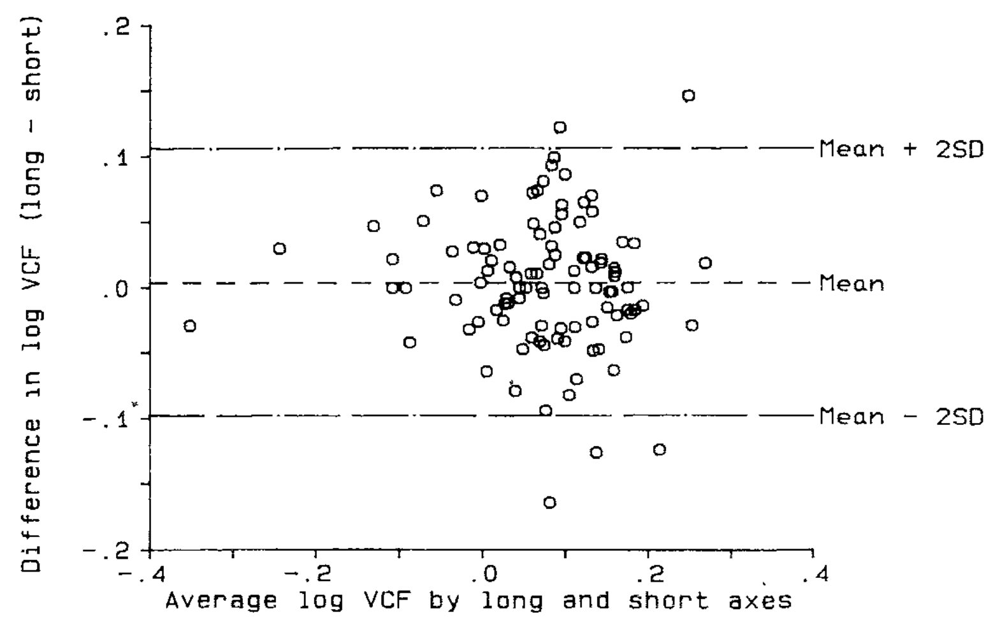
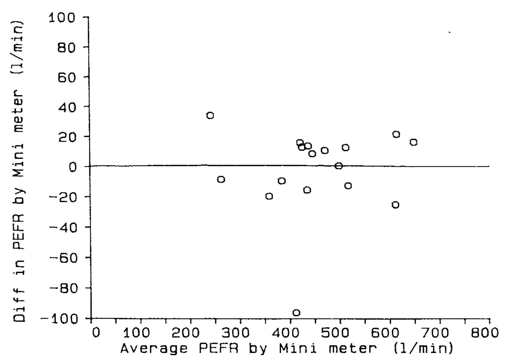

<!-- página 1 | impresa: 307 | encabezado: THE LANCET, FEBRUARY 8, 1986 / 307 -->

Measurement

# STATISTICAL METHODS FOR ASSESSING AGREEMENT BETWEEN TWO METHODS OF CLINICAL MEASUREMENT

J. MARTIN BLAND

DOUGLAS G. ALTMAN

*Department of Clinical Epidemiology and Social Medicine, St George’s Hospital Medical School, London SW17; and Division of Medical Statistics, MRC Clinical Research Centre, Northwick Park Hospital, Harrow, Middlesex*

***Summary*** In clinical measurement comparison of a new measurement technique with an established one is often needed to see whether they agree sufficiently for the new to replace the old. Such investigations are often analysed inappropriately, notably by using correlation coefficients. The use of correlation is misleading. An alternative approach, based on graphical techniques and simple calculations, is described, together with the relation between this analysis and the assessment of repeatability.

## INTRODUCTION

CLINICIANS often wish to have data on, for example, cardiac stroke volume or blood pressure where direct measurement without adverse effects is difficult or impossible. The true values remain unknown. Instead indirect methods are used, and a new method has to be evaluated by comparison with an established technique rather than with the true quantity. If the new method agrees sufficiently well with the old, the old may be replaced. This is very different from calibration, where known quantities are measured by a new method and the result compared with the true value or with measurements made by a highly accurate method. When two methods are compared neither provides an unequivocally correct measurement, so we try to assess the degree of agreement. But how?

The correct statistical approach is not obvious. Many studies give the product-moment correlation coefficient (r) between the results of the two measurement methods as an indicator of agreement. It is no such thing. In a statistical journal we have proposed an alternative analysis,1 and clinical colleagues have suggested that we describe it for a medical readership.

Most of the analysis will be illustrated by a set of data (table) collected to compare two methods of measuring peak expiratory flow rate (PEFR).

## SAMPLE DATA

The sample comprised colleagues and family of J. M. B. chosen to give a wide range of PEFR but in no way representative of any defined population. Two measurements were made with a Wright peak flow meter and two with a mini Wright meter, in random order. All measurements were taken by J. M. B., using the same two instruments. (These data were collected to demonstrate the statistical method and provide no evidence on the comparability of these two instruments.) We did not repeat suspect readings and took a single reading as our measurement of PEFR. Only the first measurement by each method is used to illustrate the comparison of methods, the second measurements being used in the study of repeatability.

PEFR MEASURED WITH WRIGHT PEAK FLOW AND MINI WRIGHT PEAK FLOW METER

<table>
<thead>
<tr><th rowspan="2">Subject</th><th colspan="2">Wright peak flow meter</th><th colspan="2">Mini Wright peak flow meter</th></tr>
<tr><th>First PEFR (l/min)</th><th>Second PEFR (l/min)</th><th>First PEFR (l/min)</th><th>Second PEFR (l/min)</th></tr>
</thead>
<tbody>
<tr><td>1</td><td>494</td><td>490</td><td>512</td><td>525</td></tr>
<tr><td>2</td><td>395</td><td>397</td><td>430</td><td>415</td></tr>
<tr><td>3</td><td>516</td><td>512</td><td>520</td><td>508</td></tr>
<tr><td>4</td><td>434</td><td>401</td><td>428</td><td>444</td></tr>
<tr><td>5</td><td>476</td><td>470</td><td>500</td><td>500</td></tr>
</tbody>
<tbody>
<tr><td>6</td><td>557</td><td>611</td><td>600</td><td>625</td></tr>
<tr><td>7</td><td>413</td><td>415</td><td>364</td><td>460</td></tr>
<tr><td>8</td><td>442</td><td>431</td><td>380</td><td>390</td></tr>
<tr><td>9</td><td>650</td><td>638</td><td>658</td><td>642</td></tr>
</tbody>
<tbody>
<tr><td>10</td><td>433</td><td>429</td><td>445</td><td>432</td></tr>
<tr><td>11</td><td>417</td><td>420</td><td>432</td><td>420</td></tr>
<tr><td>12</td><td>656</td><td>633</td><td>626</td><td>605</td></tr>
<tr><td>13</td><td>267</td><td>275</td><td>260</td><td>227</td></tr>
</tbody>
<tbody>
<tr><td>14</td><td>478</td><td>492</td><td>477</td><td>467</td></tr>
<tr><td>15</td><td>178</td><td>165</td><td>259</td><td>268</td></tr>
<tr><td>16</td><td>423</td><td>372</td><td>350</td><td>370</td></tr>
<tr><td>17</td><td>427</td><td>421</td><td>451</td><td>443</td></tr>
</tbody>
</table>

<!-- NOTA-CONV: la tabla no tiene número ni etiqueta en el original; en el original las filas están separadas por espacio en blanco en bloques de 5, 4, 4 y 4 sujetos, aquí representados con cuatro tbody -->

Imagen original

## PLOTTING DATA

The first step is to plot the data and draw the line of equality on which all points would lie if the two meters gave exactly the same reading every time (fig 1). This helps the eye in gauging the degree of agreement between measurements, though, as we shall show, another type of plot is more informative.

## INAPPROPRIATE USE OF CORRELATION COEFFICIENT

The second step is usually to calculate the correlation coefficient (r) between the two methods. For the data in fig 1, r=0·94 (p&lt;0·001). The null hypothesis here is that the measurements by the two methods are not linearly related. The probability is very small and we can safely conclude that PEFR measurements by the mini and large meters are related. However, this high correlation does not mean that the two methods agree:

\(1) r measures the strength of a relation between two variables, not the agreement between them. We will have perfect agreement only if the points in fig 1 lie along the line of equality, but we will have perfect correlation if the points lie along any straight line.

**Fig 1—PEFR measured with large Wright peak flow meter and mini Wright peak flow meter, with line of equality.**

<!-- texto en la figura: eje y: PEFR by Mini meter (l/min) · eje x: PEFR by Large meter (l/min) · ambos ejes de 0 a 800 -->

<!-- página 2 | impresa: 308 | encabezado: 308 / THE LANCET, FEBRUARY 8, 1986 -->

\(2) A change in scale of measurement does not affect the correlation, but it certainly affects the agreement. For example, we can measure subcutaneous fat by skinfold calipers. The calipers will measure two thicknesses of fat. If we were to plot calipers measurement against half-calipers measurement, in the style of fig 1, we should get a perfect straight line with slope 2·0. The correlation would be 1·0, but the two measurements would not agree—we could not mix fat thicknesses obtained by the two methods, since one is twice the other.

\(3) Correlation depends on the range of the true quantity in the sample. If this is wide, the correlation will be greater than if it is narrow. For those subjects whose PEFR (by peak flow meter) is less than 500 l/min, r is 0·88 while for those with greater PEFRs r is 0·90. Both are less than the overall correlation of 0·94, but it would be absurd to argue that agreement is worse below 500 l/min and worse above 500 l/min than it is for everybody. Since investigators usually try to compare two methods over the whole range of values typically encountered, a high correlation is almost guaranteed.

\(4) The test of significance may show that the two methods are related, but it would be amazing if two methods designed to measure the same quantity were not related. The test of significance is irrelevant to the question of agreement.

\(5) Data which seem to be in poor agreement can produce quite high correlations. For example, Serfontein and Jaroszewicz2 compared two methods of measuring gestational age. Babies with a gestational age of 35 weeks by one method had gestations between 34 and 39·5 weeks by the other, but r was high (0·85). On the other hand, Oldham et al3 compared the mini and large Wright peak flow meters and found a correlation of 0·992. They then connected the meters in series, so that both measured the same flow, and obtained a “material improvement” (0·996). If a correlation coefficient of 0·99 can be materially improved upon, we need to rethink our ideas of what a high correlation is in this context. As we show below, the high correlation of 0·94 for our own data conceals considerable lack of agreement between the two instruments.

## MEASURING AGREEMENT

It is most unlikely that different methods will agree exactly, by giving the identical result for all individuals. We want to know by how much the new method is likely to differ from the old; if this is not enough to cause problems in clinical interpretation we can replace the old method by the new or use the two interchangeably. If the two PEFR meters were unlikely to give readings which differed by more than, say, 10 l/min, we could replace the large meter by the mini meter because so small a difference would not affect decisions on patient management. On the other hand, if the meters could differ by 100 l/min, the mini meter would be unlikely to be satisfactory. How far apart measurements can be without causing difficulties will be a question of judgment. Ideally, it should be defined in advance to help in the interpretation of the method comparison and to choose the sample size.

The first step is to examine the data. A simple plot of the results of one method against those of the other (fig 1) though without a regression line is a useful start but usually all the data points will be clustered near the line and it will be difficult to assess between-method differences. A plot of the difference between the methods against their mean may be more informative. Fig 2 displays considerable lack of agreement between the large and mini meters, with discrepancies of up to 80 l/min; these differences are not obvious from fig 1. The plot of difference against mean also allows us to investigate any possible relationship between the measurement error and the true value. We do not know the true value, and the mean of the two measurements is the best estimate we have. It would be a mistake to plot the difference against either value separately because the difference will be related to each, a well-known statistical artefact.4

**Fig 2—Difference against mean for PEFR data.**

<!-- texto en la figura: eje y: Diff in PEFR (Large - Mini) (l/min) · eje x: Average PEFR by two meters (l/min) · rótulos de las líneas horizontales: Mean + 2SD · Mean · Mean - 2SD -->

For the PEFR data, there is no obvious relation between the difference and the mean. Under these circumstances we can summarise the lack of agreement by calculating the bias, estimated by the mean difference ($\bar{\mathrm{d}}$) and the standard deviation of the differences (s). If there is a consistent bias we can adjust for it by subtracting $\bar{\mathrm{d}}$ from the new method. For the PEFR data the mean difference (large meter minus small meter) is −2·1 l/min and s is 38·8 l/min. We would expect most of the differences to lie between $\bar{\mathrm{d}}-2\mathrm{s}$ and $\bar{\mathrm{d}}+2\mathrm{s}$ (fig 2). If the differences are Normally distributed (Gaussian), 95% of differences will lie between these limits (or, more precisely, between $\bar{\mathrm{d}}-1{\cdot}96\mathrm{s}$ and $\bar{\mathrm{d}}+1{\cdot}96\mathrm{s}$). Such differences are likely to follow a Normal distribution because we have removed a lot of the variation between subjects and are left with the measurement error. The measurements themselves do not have to follow a Normal distribution, and often they will not. We can check the distribution of the differences by drawing a histogram. If this is skewed or has very long tails the assumption of Normality may not be valid (see below).

Provided differences within $\bar{\mathrm{d}}\pm 2\mathrm{s}$ would not be clinically important we could use the two measurement methods interchangeably. We shall refer to these as the “limits of agreement”. For the PEFR data we get:

$$
\begin{aligned}
\bar{\mathrm{d}}-2\mathrm{s}&=-2{\cdot}1-(2\times 38{\cdot}8)=-79{\cdot}7\ \mathrm{l/min}\\
\bar{\mathrm{d}}+2\mathrm{s}&=-2{\cdot}1+(2\times 38{\cdot}8)=75{\cdot}5\ \mathrm{l/min}
\end{aligned}
$$

Thus, the mini meter may be 80 l/min below or 76 l/min above the large meter, which would be unacceptable for clinical purposes. This lack of agreement is by no means obvious in fig 1.

## PRECISION OF ESTIMATED LIMITS OF AGREEMENT

The limits of agreement are only estimates of the values which apply to the whole population. A second sample would give different limits. We might sometimes wish to use standard errors and confidence intervals to see how precise our estimates are, provided the differences follow a distribution which is approximately Normal. The standard error of d is $\surd(\mathrm{s}^2/\mathrm{n})$, where n is the sample size, and the standard error of d−2s and d+2s is about $\surd(3\mathrm{s}^2/\mathrm{n})$. 95% confidence intervals can be calculated by finding the appropriate point of the t distribution with n−1 degrees of freedom, on most tables the column marked 5% or 0·05, and then the confidence interval will be from the observed value minus t standard errors to the observed value plus t standard errors.

For the PEFR data s=38·8. The standard error of $\bar{\mathrm{d}}$ is thus 9·4. For the 95% confidence interval, we have 16 degrees of freedom and <!-- página 3 | impresa: 309 | encabezado: THE LANCET, FEBRUARY 8, 1986 / 309 --> t=2·12. Hence the 95% confidence interval for the bias is −2·1−(2·12×9·4) to −2·1+(2·12×9·4), giving −22·0 to 17·8 l/min. The standard error of the limit $\bar{\mathrm{d}}-2\mathrm{s}$ is 16·3 l/min. The 95% confidence interval for the lower limit of agreement is −79·7−(2·12×16·3) to −79·7+(2·12×16·3), giving −114·3 to −45·1 l/min. For the upper limit of agreement the 95% confidence interval is 40·9 to 110·1 l/min. These intervals are wide, reflecting the small sample size and the great variation of the differences. They show, however, that even on the most optimistic interpretation there can be considerable discrepancies between the two meters and that the degree of agreement is not acceptable.

<!-- NOTA-CONV: Fig 3 impresa en la página 3, arriba de la columna izquierda -->

**Fig 3—Oxygen saturation monitor and pulsed oximeter saturation.**

<!-- texto en la figura: eje y: Diff in Oxygen Saturation (OSM - POS) (%) · eje x: Average Oxygen Saturation by OSM and POS (%) · rótulos de las líneas horizontales: Mean + 2SD · Mean · Mean - 2SD -->

## EXAMPLE SHOWING GOOD AGREEMENT

Fig 3 shows a comparison of oxygen saturation measured by an oxygen saturation monitor and by pulsed oximeter saturation, a new non-invasive technique.5 Here the mean difference is 0·42 percentage points with 95% confidence interval 0·13 to 0·70. Thus pulsed oximeter saturation tends to give a lower reading by between 0·13 and 0·70. Despite this, the limits of agreement (−2·0 and 2·8) are small enough for us to be confident that the new method can be used in place of the old for clinical purposes.

## RELATION BETWEEN DIFFERENCE AND MEAN

In the preceding analysis it was assumed that the differences did not vary in any systematic way over the range of measurement. This may not be so. Fig 4 compares the measurement of mean velocity of circumferential fibre shortening (VCF) by the long axis and short axis in M-mode echocardiography.6 The scatter of the differences increases as the VCF increases. We could ignore this but the limits of agreement would be wider apart than necessary for small VCF and narrower than they should be for large VCF. If the differences are proportional to the mean, a logarithmic transformation should yield a picture more like that of figs 2 and 4, and we can then apply the analysis described above to the log-transformed data.

<!-- NOTA-CONV: Fig 4 impresa en la página 3, al pie de la columna izquierda -->

**Fig 4—Mean VCF by long and short axis measurements.**

<!-- texto en la figura: eje y: Difference in VCF (long - short) · eje x: Average VCF by long and short axes · rótulos de las líneas horizontales: Mean + 2SD · Mean · Mean - 2SD -->

Fig 5 shows the log-transformed data of fig 4. This still shows a relation between the difference and the mean VCF, but there is some improvement. The mean difference is −0·008 on the log scale and the limits of agreement are −0·226 and 0·243. However, although there is only negligible bias, the limits of agreement have somehow to be related to the original scale of measurement. If we take the antilogs of these limits we get 0·80 and 1·27. However, the antilog of the difference between two values on a log scale is a dimensionless ratio. The limits tell us that for about 95% of cases the short axis measurement of VCF will be between 0·80 and 1·27 times the long axis VCF. Thus the short axis measurement may differ from the long axis measurement by 20% below to 27% above. (The log transformation is the only transformation giving back-transformed differences which are easy to interpret, and we do not recommend the use of any other in this context.)

Sometimes the relation between difference and mean is more complex than that shown in fig 4 and log transformation does not work. Here a plot in the style of fig 2 is very helpful in comparing the methods. Formal analysis, as described above, will tend to give limits of agreement which are too far apart rather than too close, and so should not lead to the acceptance of poor methods of measurement.

**Fig 5—Data of fig 4 after logarithmic transformation.**

<!-- texto en la figura: eje y: Difference in log VCF (long - short) · eje x: Average log VCF by long and short axes · rótulos de las líneas horizontales: Mean + 2SD · Mean · Mean - 2SD -->

## REPEATABILITY

Repeatability is relevant to the study of method comparison because the repeatabilities of two methods of measurement limit the amount of agreement which is possible. If one method has poor repeatability—ie, there is considerable variation in repeated measurements on the same subject—the agreement between the two methods is bound to be poor too. When the old method is the more variable one, even a new method which is perfect will not agree with it. If both methods have poor repeatability, the problem is even worse.

The best way to examine repeatability is to take repeated measurements on a series of subjects. The table shows paired data for PEFR. We can then plot a figure similar to fig 2, showing difference against mean for each subject. If the differences are related to the mean, we can apply a log transformation. We then calculate the mean and standard deviation of the differences as before. The mean difference <!-- página 4 | impresa: 310 | encabezado: 310 / THE LANCET, FEBRUARY 8, 1986 --> should here be zero since the same method was used. (If the mean difference is significantly different from zero, we will not be able to use the data to assess repeatability because either knowledge of the first measurement is affecting the second or the process of measurement is altering the quantity.) We expect 95% of differences to be less than two standard deviations. This is the definition of a repeatability coefficient adopted by the British Standards Institution.7 If we can assume the mean difference to be zero this coefficient is very simple to estimate: we square all the differences, add them up, divide by n, and take the square root, to get the standard deviation of the differences.

<!-- NOTA-CONV: Fig 6 impresa en la página 4, arriba de la columna izquierda -->

**Fig 6—Repeated measures of PEFR using mini Wright peak flow meter.**

<!-- texto en la figura: eje y: Diff in PEFR by Mini meter (l/min) · eje x: Average PEFR by Mini meter (l/min) -->

Fig 6 shows the plot for pairs of measurements made with the mini Wright peak flow meter. There does not appear to be any relation between the difference and the size of the PEFR. There is, however, a clear outlier. We have retained this measurement for the analysis, although we suspect that it was technically unsatisfactory. (In practice, one could omit this subject.) The sum of the differences squared is 13 479 so the standard deviation of differences between the 17 pairs of repeated measurements is 28·2 l/min. The coefficient of repeatability is twice this, or 56·4 l/min for the mini meter. For the larger meter the coefficient is 43·2 l/min.

If we have more than two repeated measurements the calculations are more complex. We plot the standard deviation of the several measurements for that subject against their mean and then use one-way analysis of variance,8 which is beyond the scope of this article.

## MEASURING AGREEMENT USING REPEATED MEASUREMENTS

If we have repeated measurements by each of two methods on the same subjects we can calculate the mean for each method on each subject and use these pairs of means to compare the two methods using the analysis for assessing agreement described above. The estimate of bias will be unaffected, but the estimate of the standard deviation of the differences will be too small, because some of the effect of repeated measurement error has been removed. We can correct for this. Suppose we have two measurements obtained by each method, as in the table. We find the standard deviations of differences between repeated measurements for each method separately, $\mathrm{s}_1$ and $\mathrm{s}_2$, and the standard deviation of the differences between the means for each method, $\mathrm{s}_\mathrm{D}$. The corrected standard deviation of differences, $\mathrm{s}_\mathrm{c}$, is $\surd(\mathrm{s}_\mathrm{D}^2+\text{¼}\mathrm{s}_1^2+\text{¼}\mathrm{s}_2^2)$. This is approximately $\surd(2\mathrm{s}_\mathrm{D}^2)$, but if there are differences between the two methods not explicable by repeatability errors alone (ie, interaction between subject and measurement method), this approximation may produce an overestimate. For the PEFR we have $\mathrm{s}_\mathrm{D}$=33·2, $\mathrm{s}_1$=21·6, $\mathrm{s}_\mathrm{c}$=28·2 l/min. $\mathrm{s}_\mathrm{c}$ is thus $\surd(33{\cdot}2^2+\text{¼}\times 21{\cdot}6^2+\text{¼}\times 28{\cdot}2^2)$ or 37·7 l/min. Compare this with the estimate 38·8 l/min which was obtained using a single measurement. On the other hand, the approximation $\surd 2\mathrm{s}_\mathrm{D}^2$ gives an overestimate (47·0 l/min).

## DISCUSSION

In the analysis of measurement method comparison data neither the correlation coefficient (as we show here) nor techniques such as regression analysis1 are appropriate. We suggest replacing these misleading analyses by a method that is simple both to do and to interpret. Further, the same method may be used to analyse the repeatability of a single measurement method or to compare measurements by two observers.

Why has a totally inappropriate method, the correlation coefficient, become almost universally used for this purpose? Two processes may be at work here—namely, pattern recognition and imitation. A likely first step in the analysis of such data is to plot a scatter diagram (fig 1). A glance through almost any statistical textbook for a similar picture will lead to the correlation coefficient as a method of analysis of such a plot, together with a test of the null hypothesis of no relationship. Some texts even use pairs of measurements by two different methods to illustrate the calculation of r. Once the correlation approach has been published, others will read of a statistical problem similar to their own being solved in this way and will use the same technique with their own data. Medical statisticians who ask “why did you use this statistical method?” will often be told “because this published paper used it”. Journals could help to rectify this error by returning for reanalysis papers which use incorrect statistical techniques. This may be a slow process. Referees, inspecting papers in which two methods of measurement have been compared, sometimes complain if no correlation coefficients are provided, even when the reasons for not doing so are given.

We thank many of our colleagues for their interest and assistance in the study of measurement method comparison, including Dr David Robson who first brought the problem to us; Dr P. D’Arbela and Dr H. Seeley for the use of their data; and Mrs S. Stevens for typing the manuscript.

Correspondence to J. M. B., Department of Clinical Epidemiology and Social Medicine, St George’s Hospital Medical School, Cranmer Terrace, London SW17 0RE. Reprints from D. G. A., MRC Clinical Research Centre, Northwick Park Hospital, Watford Road, Harrow, Middlesex HA1 3UJ.

## REFERENCES

1\. Altman DG, Bland JM. Measurement in medicine: the analysis of method comparison studies. *Statistician* 1983; **32:** 307–17.

2\. Serfontein GL, Jaroszewicz AM. Estimation of gestational age at birth: comparison of two methods. *Arch Dis Child* 1978; **53:** 509–11.

3\. Oldham HG, Bevan MM, McDermott M Comparison of the new miniature Wright peak flow meter with the standard Wright peak flow meter *Thorax* 1979, **34:** 807–08

4\. Gill JS, Zezulka AV, Beevers DG, Davies P. Relationship between initial blood pressure and its fall with treatment. *Lancet* 1985, i: 567–69

5\. Tytler JA, Seeley HF. The Nellcor N-101 pulse oximeter. *Anaesthesia* (in press)

6 D’Arbela PG, Silayan ZM, Bland JM. Comparability of M-mode echocardiography long axis and short axis left ventricular function derivatives. Unpublished.

7\. British Standards Institution. Precision of test methods I. Guide for the determination and reproducibility for a standard test method (BS 5497, part 1). London: BSI, 1979

8 Armitage P. Statistical methods in medical research. Oxford. Blackwell Scientific Publications, 1971: chap 7
