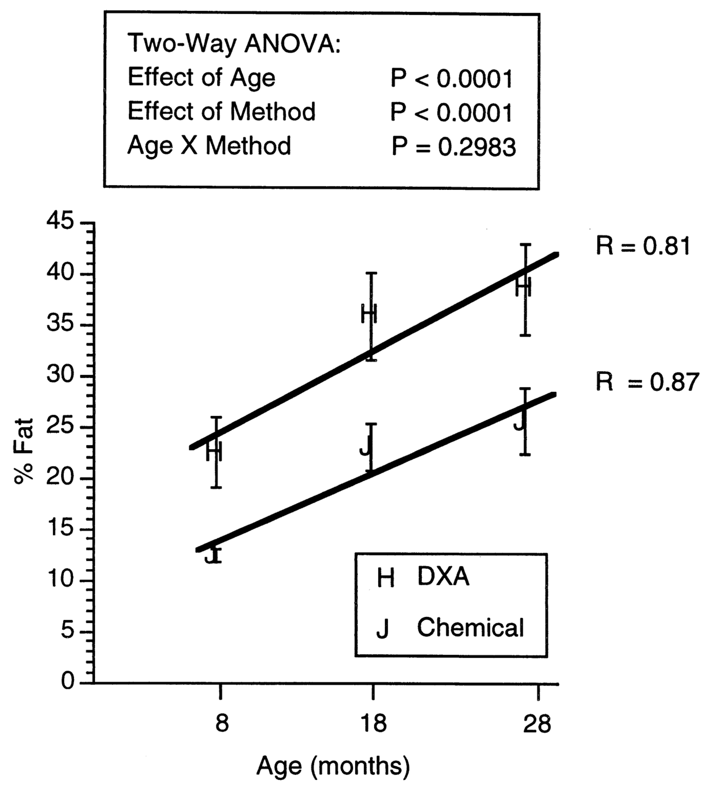
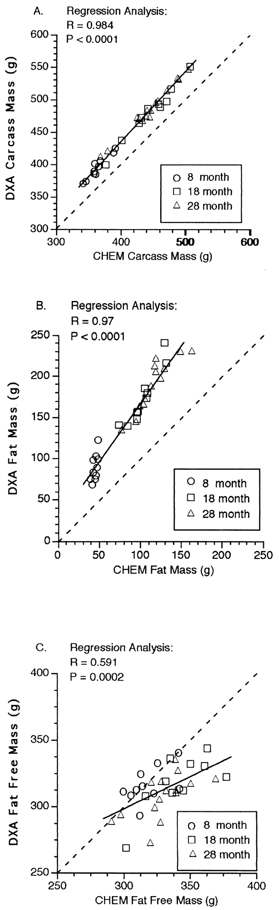
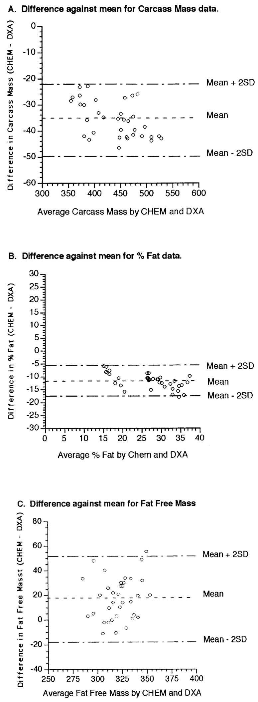
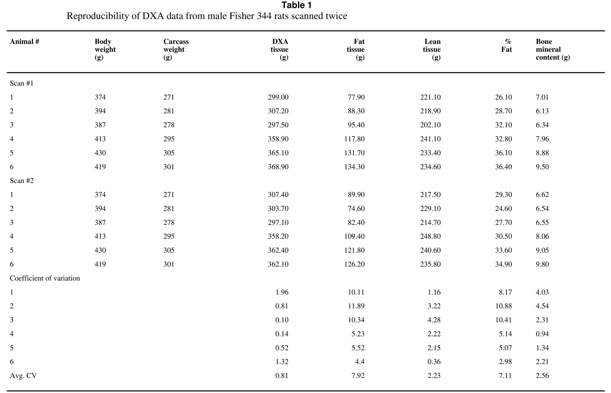
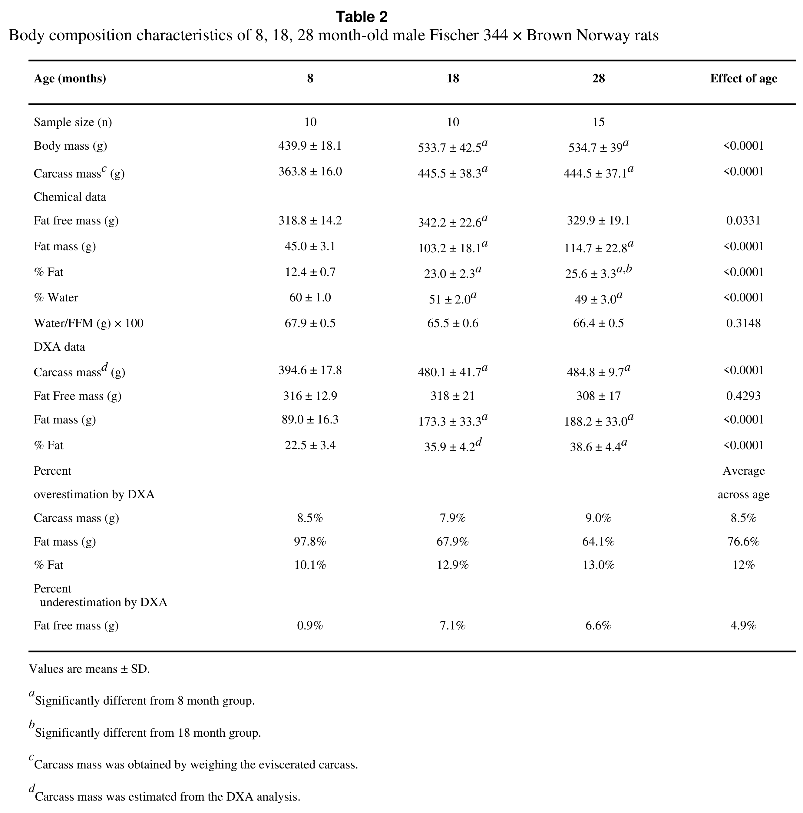
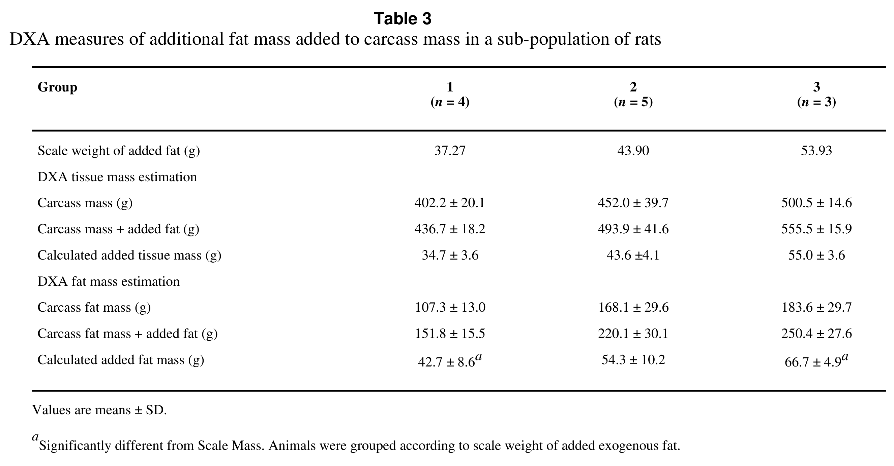

<!-- página 1 | encabezado: NIH Public Access / Author Manuscript / Exp Gerontol. Author manuscript; available in PMC 2009 June 10. / NIH-PA Author Manuscript / NIH-PA Author Manuscript / NIH-PA Author Manuscript -->

Published in final edited form as:

*Exp Gerontol*. 2000 May ; 35(3): 417–427.

# Chemical versus dual energy x-ray absorptiometry for detecting age-associated body compositional changes in male rats[^1]

**Rebecca. S. Feely**a, **Lisa M. Larkin**b,[^2], **Jeffrey B. Halter**a,b,c, and **Donald R. Dengel**a,b,c

a*Geriatric Research, Education, and Clinical Center, Department of Veterans Affairs Medical Center, University of Michigan, CCGCB, 5302, 1500 East Medical Center Drive, Ann Arbor, MI 48109-0940, USA*

b*Division of Geriatric Medicine, University of Michigan, CCGCB, 5302, 1500 East Medical Center Drive, Ann Arbor, MI 48109-0940, USA*

c*Department of Internal Medicine, and Institute of Gerontology, University of Michigan, CCGCB, 5302, 1500 East Medical Center Drive, Ann Arbor, MI 48109-0940, USA*

## Abstract

Aging is associated with increases in body mass and fat mass (FM), whereas fat-free mass (FFM) either decreases or remains unchanged. The purpose of this study was to determine whether dual-energy X-ray absorptiometry (DXA) accurately detects age-associated changes in male Fischer 344 × Brown–Norway rats ages 8, 18, and 28 months. Eviscerated animal carcasses were first examined via the Lunar DPX-IQ DXA (small animal software version 1.0; HiRes (0.6 × 1.2 mm) medium mode). Eviscerated carcasses were then weighed, autoclaved, homogenized, and fat isolated from aliquots of homogenate via methanol/chloroform extraction. In both chemical (CHEM) and DXA analysis, carcass mass (CM), FM, and % fat were significantly higher (*P* &lt; 0.0001) in the 18 and 28 versus 8-month-old rats. CHEM showed greater FFM in the 18 versus 8 months-old rats but not the 28 months-old animals. DXA was unable to detect the age-associated changes in FFM. Regression analysis showed a strong correlation between CHEM and DXA methods for CM (*r* = 0.98, *P* &lt; 0.0001) and FM (*r* = 0.97, *P* &lt; 0.0001), but less strong for FFM (*r* = 0.59, *P* = 0.0002). In conclusion, compared to CHEM, DXA consistently overestimated CM and FM across the age groups by 9% and 77%, respectively, and underestimated FFM by 5%.

### Keywords

Lean body mass; Fat free mass; Fat mass; Dual-energy x-ray absorptiometry

## 1. Introduction

Although dual energy X-ray absorptiometry (DXA) is currently an accepted method for obtaining body composition data in humans, its use in small animals is relatively recent. Chemical analysis (CHEM) has long been considered the gold standard in body composition research (Marshall et al., 1959; Frisch et al., 1977). However, the CHEM method is very tedious and can only be performed as an end measure of an intervention. In contrast, DXA analysis <!-- página 2 | impresa: 2 | encabezado: Feely et al. / Page 2 | pie: Exp Gerontol. Author manuscript; available in PMC 2009 June 10. --> provides a non-invasive, non-traumatic method for determining body composition in small animals. DXA methodology is also markedly easier and more expedient to use than other methodologies. But, perhaps most importantly, DXA allows for serial measures of body compositional changes, especially advantageous in tracking longitudinal changes in aging studies. Although other methods have been used to determine body composition in various small animals, these processes have either been inaccurate, expensive, or troublesome to execute. Thus, DXA remains the most promising method for serial measures of body composition in small animals.

<!-- NOTA-CONV: notas al pie y aviso de copyright impresos al pie de la página 1, en este orden: nota ☆, línea de copyright, nota * -->

[^1]: ☆This research was supported in part by the Core Facility for Aged Rodents of the Claude Pepper Older Americans Independence Center at the University of Michigan (Grants AG08808, AG00710, and AG10821); and Geriatric Research, Education, and Clinical Center, Ann Arbor Department of Veterans Affairs Medical Center.

© 2000 Elsevier Science Inc. All rights reserved.

[^2]: \*Corresponding author. Tel.: +1-313-936-8181; fax: +1-313-936-9220. *E-mail address:* E-mail: llarkin@umich.edu (L.M. Larkin).

The Fischer 344X × Brown–Norway rat strain is a promising new model for aging studies in rodents, because it is devoid of many of the age-associated complications observed in other rat strains. Furthermore, it has been shown that the weight of major fat pads increases with age (Larkin et al., 1994). However, to date, no studies have been done to assess age-associated changes in total body composition, and no DXA data have been reported on these rats.

The purpose of this study was to: 1) determine whether Lunar DPX-IQ small animal software version 1.0 could accurately detect age-associated body composition changes in FM and FFM in male Fischer 344 × Brown–Norway rats aged 8, 18, and 28 months, and 2) examine the accuracy of this Lunar program in recognizing the addition of exogenous fat.

## 2. Methods

### 2.1. Animals and animal care

Male Fischer 344 × Brown–Norway (F344 × BN) F1 hybrid rats ages 8 (young, mature), 18 (middle-aged), and 28 months (senescent) were obtained from the National Institute on Aging’s animal colony maintained by Harlan Sprague–Dawley Laboratory (Indianapolis, IN). Rats were acclimated to our colony conditions, light cycle (12:12, light:dark) and temperature (20–22°C), for 2 weeks before experimentation. Rats were sheltered in a specific pathogen free facility and housed individually in hanging plastic cages (28 × 56 cm) and had free access to Purina Rodent Chow 5001 laboratory chow and water. All animal care and experiments were in accordance with The Guide for Care and Use of Laboratory Animals (UPHS, NIH Publication No. 85–23): the experimental protocol was approved by the University of Michigan’s Committee for the Use and Care of Animals.

Although necropsy and microbiological examinations were not performed routinely, animals were inspected daily for “overt” external signs of disease. Gross necropsy was performed at the time of dissection and only rats with no “overt” signs of disease were used in this study.

### 2.2. Dual energy x-ray absorptiometry (DXA) analysis

Rats were euthanized with sodium pentobarbital, shaved, eviscerated, and the eviscerated carcasses stored at −20°C before evaluation of body composition. All animals were sacrificed within three days of each other, stored at −80°C for the same length of time and defrosted for the same length of time to normalize for water loss due to freezer storage. Carcasses were weighed before freezing and again just before CHEM analysis to assess water loss in the freezer. All rats were analyzed by using a Lunar DPX-IQ DXA (Lunar Corporation, Madison, WI, USA), by using Lunar’s Small Animal Software Version 1.0 set in the HiRes (0.6 × 1.2 mm) Medium mode &lt;0.5 kg. The carcasses were placed in the prone position on the DXA scanning table. DXA carcass mass (CM) represents tissue mass values as reported by DXA. DXA FFM was calculated by adding DXA LBM + DXA BMC.

To assess the reproducibility of the Lunar DPX-IQ to detect body compositional changes, a pilot study was done on a separate group of six rats. As with the rats in the main study, each rat was euthanized with sodium pentobarbital, shaved, eviscerated, and the eviscerated <!-- página 3 | impresa: 3 | encabezado: Feely et al. / Page 3 | pie: Exp Gerontol. Author manuscript; available in PMC 2009 June 10. --> carcasses stored at −20°C before evaluation of body composition. Before the DXA analysis, the carcasses were thawed and scanned using the same DXA equipment setting as the main study. The carcass was then removed from the DXA equipment, repositioned and scanned a second time. The data and coefficient of variation (CV) for each pair of scans are presented in Table 1. The data in Table 1 indicate that the reproducibility of total tissue, lean mass and bone mineral content are fairly accurate with less than a 3% CV. Fat mass and % fat varied from 7.11–7.92% CV, with the greatest degree in variance occurring in the rats with the least amount of body fat.

To assess the reliability of the Lunar DPX-IQ to detect changes in fat, a subset of twelve rats were scanned a second time after insertion of a lard fat pack (37.27–53.93 g) into the abdominal cavity weighing approximately 10% (6.5–11.7%) of their initial scale carcass weight.

### 2.3. Chemical analysis

After determination of body composition by DXA, the eviscerated carcasses were assessed via chemical analysis. A methanol/chloroform extraction using a modification of the technique of Folch et al. (Folch et al., 1957), was used to determine the lipid content of the carcass homogenates. Briefly, carcasses were weighed at the time of dissection and re-weighed at the time of CHEM analysis to assess water loss in freezing. The appropriate amount of water was added to the carcass to adjust for loss in freezing and then the carcass was autoclaved at 124° C for 5 h. After the autoclave process, each carcass was re-weighed to assess water loss during autoclaving and water (to replace the loss) plus water (a volume equal to twice the weight of the original carcass) were added to the carcass and homogenized using a Waring blender (Model 38BL61 Waring Products Division, Hartford, CT, USA) for 4 min on high speed. Triplicate aliquots of homogenate (3 ml) were added to 10 ml of methanol and 20 ml of chloroform and allowed to equilibrate for 72 h. The chloroform layer was extracted and evaporated for isolation and determination of lipid content. Additionally, triplicate aliquots of homogenate were dried in an oven at 90°C for 72 h. Pans were then weighed and analyzed for dry mass. Dry mass was then used for calculation of water content. FFM (calculated as CM – FM) and water mass for Table 2 were calculated using scale weight of eviscerated carcass.

### 2.4. Statistics

Statistical analysis was performed using a Statview 4.01 program (SAS Institute, Berkeley, CA, USA). A 2 × 3 ANOVA was utilized to examine between group differences. Regression analysis was done to determine the relationship between DXA and CHEM methods. All data are reported as the mean + SD. When a significant main effect was found, the Fisher’s LSD post hoc test was performed to determine age-associated differences. Differences were considered significant at *P* &lt; 0.05.

## 3. Results

Body composition characteristics for 8, 18, and 28 month old Fischer 344 × Brown–Norway rats are shown in Table 2. In both CHEM and DXA analysis, carcass mass (CM), fat mass (FM), and % fat were significantly higher in the 18 and 28 versus 8 months-old rats, with no age-related change in fat free mass (FFM) in DXA analysis. In CHEM analysis, FFM was significantly higher in the 18-month-old compared to the 8-month-old rats but was not different from the 28-month-old animals. The ratio of water to FFM did not differ between the age groups. In addition in CHEM analysis, percent water was significantly lower in the 18 and 28 versus 8-month-old rats. Furthermore, both CHEM and DXA showed mean increases of FM and %fat from 18 to 28 months, but only the increase in %fat by CHEM reached statistical significance. The age-associated increases in %fat by CHEM and DXA methods are illustrated in Fig. 1. Across all age groups, there was a consistent overestimation of %fat by the DXA <!-- página 4 | impresa: 4 | encabezado: Feely et al. / Page 4 | pie: Exp Gerontol. Author manuscript; available in PMC 2009 June 10. --> methodology (*P* &lt; 0.0001; Fig. 1). There was no interaction between method and age in %fat (*P* = 0.2983).

Regression analysis showed a significant correlation between CHEM and DXA methods with respect to CM (Fig. 2A: *r* = 0.98, *P* &lt; 0.0001), FFM (Fig. 2B: *r* = 0.59, *P* = 0.0002), and FM (Fig. 2C: *r* = 0.97, *P* &lt; 0.0001). However, compared to CHEM analysis, the Lunar DPX-IQ small animal software consistently overestimated CM and FM by approximately 8.5% and 76.6%, respectively, and underestimated FFM by 4.9% (Table 2). In addition, DXA overestimated percent body fat by approximately 12% across the age groups, (*P* &lt; 0.0001) compared to CHEM analysis. A regression analysis done between CHEM and DXA %fat values demonstrates a strong correlation (*r* = 0.943, *P* &lt; 0.0001). Bland–Altman plots were used to assess agreement between DXA and CHEM methods for measurements of carcass mass, % fat, and FFM (Fig. 3). According to these plots, there is good agreement between the two methods in the determination of carcass mass, % fat, and FFM.

The Lunar DPX-IQ small animal software version 1.0 is capable of measuring exogenous mass as an increase in tissue mass and/or further classifying the exogenous mass as either additional lean or fat tissue. It was found that in the animals where additional exogenous fat mass was added, DXA was more accurate at classifying that additional weight as tissue mass and not as fat mass (Table 3). All DXA FM calculations of added fat were found to be statistically different from the actual scale masses. The lard used in the fat packs was chemically analyzed and found to be 91.84% actual fat. This conversion is accounted for in the DXA fat (g) calculation. Once again, the data indicate that DXA has the tendency to overestimate fat mass.

## 4. Discussion

This study’s purpose was to assess the Lunar DPX-IQ DXA’s (small animal software version 1.0) ability to detect age-associated body compositional changes in FFM and FM. This study is unique in that it is the first to assess body composition changes via Lunar DXA across a range of both increasing age and adiposity. Furthermore, this study examined the ability of Lunar DPX-IQ small animal software version 1.0 to detect the addition of exogenous fat to the abdominal region in a sub-population of the animals. To date, three studies (Jebb et al., 1996; Bertin et al., 1998; Rose et al., 1998) have compared DXA analysis versus CHEM analysis in rats to determine FFM and FM in cross-sectional protocols without respect to age. All three of the studies utilized a DXA manufactured by Hologic (Waltham, MA, USA), which uses fan beam versus pencil beam technology. In addition, each study used different software programs in their analysis. Although positive correlation’s of DXA to the CHEM measures of CM and FM were statistically significant, all three of the above studies observed an overestimation of CM and FM by DXA compared to chemical analysis. In agreement with these previous studies (Jebb et al., 1996; Bertin et al., 1998; Rose et al., 1998), the present study, in eviscerated carcasses, observed DXA’s overestimation of carcass mass (8.5%) and fat mass (76.6%) in comparison to CHEM values in eviscerated carcasses, (Table 2). The overestimation of carcass mass increased as the animal aged (weight of the animal increased). This study also found that Lunar DPX-IQ small animal software version 1.0 detected FFM across age groups within 5% (compared to CHEM data) and there was a significant positive correlation between DXA and CHEM measures of CM, FFM, and FM in eviscerated carcasses.

Lu et al. (1994), using this same Lunar small animal software version (1.0) in 146 to 247 g female Sprague–Dawley rats observed less overestimation of body weight (3.5%) by DXA compared to this study that observed a 14.5% overestimation in F344 × BN rats ranging from 410 to 600 g (Lu et al., 1994). In both studies, significant correlation between the DXA and CHEM measures were observed [(Lu et al., 1994), $r^2$ = 0.99; present study, $r^2$ = 0.97]).

<!-- página 5 | impresa: 5 | encabezado: Feely et al. / Page 5 | pie: Exp Gerontol. Author manuscript; available in PMC 2009 June 10. -->

It seems that there is greater overestimation of CM with increasing age. Examining our DXA CM percent overestimation’s across the age groups demonstrates this: 8 months-old, 8.5%, 18 months-old, 7.9%, 28 months-old, 9.0% (however, 18 months versus 28 months. was not significant, see Table 2). It seems that in studies in which changes in carcass mass occur with time, as seen with aging, DXA is not a reliable method for obtaining CM values.

It has been suggested that the inaccuracy in detecting accurate carcass mass by DXA analysis is that the dual energy X-ray projection technique relies on a photon’s differential absorption at two energy levels within soft tissue and bone (Lu et al., 1994). The attenuation of the 38-keV versus 70-keV energy levels allows to distinguish between soft tissue (FFM and FM) and bone (Lunar, 1996). These two energy levels were originally designed for use in human subjects. The analysis of soft tissue in small animals is accomplished by using the same energy levels and altering the software component of the equipment. In rats, the bones are much thinner and less dense than in humans and the ability for these two energy levels to discriminate between soft tissue and bone may be significantly diminished (Lu et al., 1994). The diminished ability of the DXA to accurately determine body composition in lighter animals is demonstrated by the increased variability between DXA scans of the lighter animals compared to the heavier animals (Table 1).

Additionally, it was found that this Lunar DXA small animal software program consistently overestimated fat mass (FM) by approximately 12% compare to CHEM analysis. However, in using the Lunar DPX- IQ small animal body software version 1.0 to determine FFM, we found no significant differences between measures of FFM compared to CHEM measures. Therefore, the FM discrepancies are most likely due to a software miscalculation using overestimated CM values. We found, as did Bertin et al., that accurate FM values can be calculated by subtracting FFM from CM determined by using a scale (Bertin et al., 1998). The three previous studies done by Rose, Jebb and Bertin, analyzing various Hologic small animal software, found much larger %fat overestimation’s by DXA (∼30%, ∼33%, and ∼30%, respectively) versus the 12% found in the present study in eviscerated carcasses (Jebb et al., 1996; Bertin et al., 1998; Rose et al., 1998). Therefore, it seems that the Lunar DPX- IQ small animal body software version 1.0 may be the most accurate of the DXA software packages available to date for determining qualitative values of %fat. However, because there was little fluctuation in the %fat overestimation across age groups (8 months-old, 10.1%, 18 months-old, 12.9%, 28 months-old, 13.0%), and there was a strong correlation between the two methods, crude change in % fat across age groups may be determined accurately via this DXA program as observed in another study (Rikans et al., 1993).

Pietrobeli et al. (1998), suggest that error is fat estimation may be explained by changes in the hydration of LBM (Pietrobeli et al., 1998). In the Pietrobeli study, increased hydration of LBM led to underestimation of FFM by DXA compared to CHEM analysis. However, % water was significantly less in the 18 and 28 months-old rats compared to the 8 months-old rats, 51% and 49% respectively, versus 60%. This decrease in water content indicates a decrease in the hydration of FFM. Baer et al. (1993) similarly found a decrease in the mean hydration of FFM (*r* = −0.59, *P* &lt; 0.0001) with age (Baer et al., 1993). Therefore, as suggested by Pietrobeli et al., the overestimation of fat content may be explained by a decrease in the FFM hydration.

In this study, we observed a greater decrease in the % water than normally seen in studies of hydration in aging rodents (McDonald, 1988 #13; McDonald, 1988 #14). However, the Fischer 344 rat is generally used for aging studies in rodents. In the Fischer 344 rat strain, the percent body fat is less than the Fisher Brown Norway strain and does not change with age (McDonald, 1988 #13; McDonald, 1988 #14), unlike the Fisher Brown–Norway strain that increases the percentage of body fat with age. This increase in body fat with age would lead to less FFM <!-- página 6 | impresa: 6 | encabezado: Feely et al. / Page 6 | pie: Exp Gerontol. Author manuscript; available in PMC 2009 June 10. --> and decreased % water observed with age in the Fischer Brown-Norway strain used in this study.

The present study also investigated the ability of Lunar DXA to detect the addition of exogenous fat packs to a sub-population of animals from each age group. The data indicates that DXA was able to correctly detect the additional weight, however, it was more accurate at classifying the exogenous fat as an increase tissue mass rather than fat mass. Once again, there was significant overestimation of the weight of the exogenous fat pack by DXA compared to the actual scale masses. Bertin et al. also simulated body composition changes by using intraperitoneal (i.p.) saline injections to a sub-population of their Wistar and GK rats (Bertin et al., 1998). The injected saline was used to increase FFM and decrease fat mass. Bertin et al., found that the Hologic DXA was able to detect small modifications of FFM (&lt;2%) and that small fluctuations of FFM greatly altered DXA’s calculations of FM (Bertin et al., 1998). Therefore, both of our studies indicate that DXA is able to detect changes in body composition. However, these studies also demonstrate that the changes are not accurately classified into appropriate tissue classifications.

In conclusion, we found that this DXA software program consistently overestimated CM and FM across the age groups compared to CHEM analysis. The 8.5% overestimation of CM by the Lunar DPX-IQ small animal software version 1.0 may be due, in part, to an inaccurate software attenuation. In addition, the ability of the Lunar DPX-IQ small animal software version 1.0 to detect FFM in aging animals was fairly accurate and precise (&lt;5% error) when compared to CHEM data. Therefore, it seems that the Lunar DPX-IQ small animal software version 1.0 may be an appropriate method for determining changes in FFM in aging small animals. However, due to the inaccurate determination of both fat mass and total body mass by the Lunar DPX-IQ, it is recommended that the small animal be weighed on an accurate scale and that fat mass be determined by subtracting Lunar DPX-IQ (small animal software version 1.0) LBM from total body scale weight.

## Acknowledgments

The authors thank Scott Glickman, Rebecca Cleland, and Eric Kozfkay for their technical assistance.

## References

Baer DJ, Rumpler WV, Barns RE, Kressler LL, Howe JC, Haines TE. Measurement of body composition of live rats by electromagnetic conductance. Physiol & Behavior 1993;53:1195–1199.

Bertin E, Ruiz JC, Mourot J, Peiniau P, Portha B. Evaluation of dual x-ray absorptiometry for body-composition assessment in rats. J Nutr 1998;128:1550–1554. [PubMed: 9732318]

Folch J, Lees M, Stanley GHS. A simple method for the isolation and purification of total lipides from animal tissue. J Biol Chem 1957;226:497–509. [PubMed: 13428781]

Frisch RE, Hegsted DM, Yoshinaga K. Carcass components at first estrus of rats on high-fat and low-fat diets: body water, protein, and fat. Proc Natl Acad Sci USA 1977;74:379–383. [PubMed: 13368]

Jebb SA, Garland SW, Jennings G, Elia M. Dual energy x-ray absorptiometry for the measurement of gross body composition in rats. Br J Nutr 1996;75:803–809. [PubMed: 8774226]

Larkin LM, Supiano MA. Interaction of aging and obesity on GLUT-4 glucose transporter content in skeletal muscle of Fischer 344 × Brown-Norway rats. Diabetes 1994;43:69A.

Lu PW, Briody JN, Howman–Giles R, Trube A, Cowell CT. DEXA for bone density measurement in small rats weighing 150 to 250 g. Bone 1994;15:199–202. [PubMed: 8086238]

Lunar, C. Lunar DPX-IQ User’s Manual. Madison, WI: 1996.

Marshall MW, Hildebrand HE, Dupont JL, Womack MJ. Effect of dietary fats and carbohydrates on digestibility of nitrogen and energy supply, and on growth, body composition and serum cholesterol of rats. J Nutr 1959;69:371–382. [PubMed: 14421546]

<!-- página 7 | impresa: 7 | encabezado: Feely et al. / Page 7 | pie: Exp Gerontol. Author manuscript; available in PMC 2009 June 10. -->

Pietrobeli A, Wang Z, Formica C, Heymsfield SB. Dual-energy x-ray absorptiometry: fat estimation errors due to variation on soft tissue hydration. Am J Physiology 1998;274:E808–E816.

Rikans L, Venkataraman P, Cai Y. Evaluation by dual-energy X-ray absorptiometry of age-related changes in body composition of male rats. Mech Ageing Dev 1993;71:155–158. [PubMed: 8309280]

Rose BS, Flatt WP, Martin RJ, Lewis RD. Whole body composition of rats by dual energy x-ray absorptiometry is correlated with chemical analysis. J Nutr 1998;128:246–250. [PubMed: 9446851]

<!-- página 8 | impresa: 8 | encabezado: Feely et al. / Page 8 | pie: Exp Gerontol. Author manuscript; available in PMC 2009 June 10. -->

**Fig. 1.**

Percent body fat from both chemical and DXA analysis in 8 (*n* = 10), 18 (*n* = 10), and 28-month-old male (*n* = 15) F344 × BN rats. Values are means + SD.

<!-- texto en la figura: recuadro superior: Two-Way ANOVA: · Effect of Age P < 0.0001 · Effect of Method P < 0.0001 · Age X Method P = 0.2983 · eje y: % Fat (0 a 45) · eje x: Age (months) (marcas 8, 18, 28) · rótulos a la derecha de las dos rectas: R = 0.81 (recta superior) · R = 0.87 (recta inferior) · recuadro de leyenda: H DXA · J Chemical (los puntos del gráfico están dibujados con las letras H y J) -->

<!-- página 9 | impresa: 9 | encabezado: Feely et al. / Page 9 | pie: Exp Gerontol. Author manuscript; available in PMC 2009 June 10. -->

**Fig. 2.**

Correlation between CHEM and DXA analysis of A, carcass mass; B, fat free mass; and C, fat mass in 8 (*n* = 10), 18 (*n* = 10), and 28-month-old male (*n* = 15) F344 × BN rats.

<!-- texto en la figura: panel A. · Regression Analysis: R = 0.984 P < 0.0001 · eje y: DXA Carcass Mass (g) (300 a 600) · eje x: CHEM Carcass Mass (g) (300 a 600) · leyenda: ○ 8 month · □ 18 month · △ 28 month · panel B. · Regression Analysis: R = 0.97 P < 0.0001 · eje y: DXA Fat Mass (g) (0 a 250) · eje x: CHEM Fat Mass (g) (0 a 250) · leyenda: ○ 8 month · □ 18 month · △ 28 month · panel C. · Regression Analysis: R = 0.591 P = 0.0002 · eje y: DXA Fat Free Mass (g) (250 a 400) · eje x: CHEM Fat Free Mass (g) (250 a 400) · leyenda: ○ 8 month · □ 18 month · △ 28 month -->

<!-- página 10 | impresa: 10 | encabezado: Feely et al. / Page 10 | pie: Exp Gerontol. Author manuscript; available in PMC 2009 June 10. -->

**Fig. 3.**

Bland–Altman Plots for assessing agreement between CHEM and DXA analysis of A. carcass mass, B. fat free mass, and C. fat mass in 8 (*n* = 10), 18 (*n* = 10), and 28-month-old male (*n* = 15) F344 × BN rats.

<!-- texto en la figura: panel A. Difference against mean for Carcass Mass data. · eje y: Difference in Carcass Mass (CHEM - DXA) (−60 a 0) · eje x: Average Carcass Mass by CHEM and DXA (300 a 600) · rótulos de las líneas horizontales: Mean + 2SD · Mean · Mean - 2SD · panel B. Difference against mean for % Fat data. · eje y: Difference in % Fat (CHEM - DXA) (−30 a 30) · eje x: Average % Fat by Chem and DXA (0 a 40) · rótulos: Mean + 2SD · Mean · Mean - 2SD · panel C. Difference against mean for Fat Free Mass · eje y: Difference in Fat Free Masst (CHEM - DXA) (−40 a 80) · eje x: Average Fat Free Mass by CHEM and DXA (250 a 400) · rótulos: Mean + 2SD · Mean · Mean - 2SD -->

<!-- página 11 | impresa: 11 | encabezado: Feely et al. / Page 11 | pie: Exp Gerontol. Author manuscript; available in PMC 2009 June 10. -->

<!-- NOTA-CONV: la Tabla 1 está impresa apaisada, girada 90° en sentido antihorario sobre la página 11 (se lee de abajo hacia arriba); se transcribe en el orden natural de lectura y su recorte se giró 90° en sentido horario -->

**Table 1**

Reproducibility of DXA data from male Fisher 344 rats scanned twice

<table>
<thead>
<tr><th>Animal #</th><th>Body weight (g)</th><th>Carcass weight (g)</th><th>DXA tissue (g)</th><th>Fat tissue (g)</th><th>Lean tissue (g)</th><th>% Fat</th><th>Bone mineral content (g)</th></tr>
</thead>
<tbody>
<tr><td colspan="8">Scan #1</td></tr>
<tr><td>1</td><td>374</td><td>271</td><td>299.00</td><td>77.90</td><td>221.10</td><td>26.10</td><td>7.01</td></tr>
<tr><td>2</td><td>394</td><td>281</td><td>307.20</td><td>88.30</td><td>218.90</td><td>28.70</td><td>6.13</td></tr>
<tr><td>3</td><td>387</td><td>278</td><td>297.50</td><td>95.40</td><td>202.10</td><td>32.10</td><td>6.34</td></tr>
<tr><td>4</td><td>413</td><td>295</td><td>358.90</td><td>117.80</td><td>241.10</td><td>32.80</td><td>7.96</td></tr>
<tr><td>5</td><td>430</td><td>305</td><td>365.10</td><td>131.70</td><td>233.40</td><td>36.10</td><td>8.88</td></tr>
<tr><td>6</td><td>419</td><td>301</td><td>368.90</td><td>134.30</td><td>234.60</td><td>36.40</td><td>9.50</td></tr>
<tr><td colspan="8">Scan #2</td></tr>
<tr><td>1</td><td>374</td><td>271</td><td>307.40</td><td>89.90</td><td>217.50</td><td>29.30</td><td>6.62</td></tr>
<tr><td>2</td><td>394</td><td>281</td><td>303.70</td><td>74.60</td><td>229.10</td><td>24.60</td><td>6.54</td></tr>
<tr><td>3</td><td>387</td><td>278</td><td>297.10</td><td>82.40</td><td>214.70</td><td>27.70</td><td>6.55</td></tr>
<tr><td>4</td><td>413</td><td>295</td><td>358.20</td><td>109.40</td><td>248.80</td><td>30.50</td><td>8.06</td></tr>
<tr><td>5</td><td>430</td><td>305</td><td>362.40</td><td>121.80</td><td>240.60</td><td>33.60</td><td>9.05</td></tr>
<tr><td>6</td><td>419</td><td>301</td><td>362.10</td><td>126.20</td><td>235.80</td><td>34.90</td><td>9.80</td></tr>
<tr><td colspan="8">Coefficient of variation</td></tr>
<tr><td>1</td><td></td><td></td><td>1.96</td><td>10.11</td><td>1.16</td><td>8.17</td><td>4.03</td></tr>
<tr><td>2</td><td></td><td></td><td>0.81</td><td>11.89</td><td>3.22</td><td>10.88</td><td>4.54</td></tr>
<tr><td>3</td><td></td><td></td><td>0.10</td><td>10.34</td><td>4.28</td><td>10.41</td><td>2.31</td></tr>
<tr><td>4</td><td></td><td></td><td>0.14</td><td>5.23</td><td>2.22</td><td>5.14</td><td>0.94</td></tr>
<tr><td>5</td><td></td><td></td><td>0.52</td><td>5.52</td><td>2.15</td><td>5.07</td><td>1.34</td></tr>
<tr><td>6</td><td></td><td></td><td>1.32</td><td>4.4</td><td>0.36</td><td>2.98</td><td>2.21</td></tr>
<tr><td>Avg. CV</td><td></td><td></td><td>0.81</td><td>7.92</td><td>2.23</td><td>7.11</td><td>2.56</td></tr>
</tbody>
</table>

Imagen original

<!-- página 12 | impresa: 12 | encabezado: Feely et al. / Page 12 | pie: Exp Gerontol. Author manuscript; available in PMC 2009 June 10. -->

**Table 2**

Body composition characteristics of 8, 18, 28 month-old male Fischer 344 × Brown Norway rats

<table>
<thead>
<tr><th>Age (months)</th><th>8</th><th>18</th><th>28</th><th>Effect of age</th></tr>
</thead>
<tbody>
<tr><td>Sample size (n)</td><td>10</td><td>10</td><td>15</td><td></td></tr>
<tr><td>Body mass (g)</td><td>439.9 ± 18.1</td><td>533.7 ± 42.5<em>a</em></td><td>534.7 ± 39<em>a</em></td><td>&lt;0.0001</td></tr>
<tr><td>Carcass mass<em>c</em> (g)</td><td>363.8 ± 16.0</td><td>445.5 ± 38.3<em>a</em></td><td>444.5 ± 37.1<em>a</em></td><td>&lt;0.0001</td></tr>
<tr><td colspan="5">Chemical data</td></tr>
<tr><td>Fat free mass (g)</td><td>318.8 ± 14.2</td><td>342.2 ± 22.6<em>a</em></td><td>329.9 ± 19.1</td><td>0.0331</td></tr>
<tr><td>Fat mass (g)</td><td>45.0 ± 3.1</td><td>103.2 ± 18.1<em>a</em></td><td>114.7 ± 22.8<em>a</em></td><td>&lt;0.0001</td></tr>
<tr><td>% Fat</td><td>12.4 ± 0.7</td><td>23.0 ± 2.3<em>a</em></td><td>25.6 ± 3.3<em>a</em>,<em>b</em></td><td>&lt;0.0001</td></tr>
<tr><td>% Water</td><td>60 ± 1.0</td><td>51 ± 2.0<em>a</em></td><td>49 ± 3.0<em>a</em></td><td>&lt;0.0001</td></tr>
<tr><td>Water/FFM (g) × 100</td><td>67.9 ± 0.5</td><td>65.5 ± 0.6</td><td>66.4 ± 0.5</td><td>0.3148</td></tr>
<tr><td colspan="5">DXA data</td></tr>
<tr><td>Carcass mass<em>d</em> (g)</td><td>394.6 ± 17.8</td><td>480.1 ± 41.7<em>a</em></td><td>484.8 ± 9.7<em>a</em></td><td>&lt;0.0001</td></tr>
<tr><td>Fat Free mass (g)</td><td>316 ± 12.9</td><td>318 ± 21</td><td>308 ± 17</td><td>0.4293</td></tr>
<tr><td>Fat mass (g)</td><td>89.0 ± 16.3</td><td>173.3 ± 33.3<em>a</em></td><td>188.2 ± 33.0<em>a</em></td><td>&lt;0.0001</td></tr>
<tr><td>% Fat</td><td>22.5 ± 3.4</td><td>35.9 ± 4.2<em>d</em></td><td>38.6 ± 4.4<em>a</em></td><td>&lt;0.0001</td></tr>
<tr><td>Percent</td><td></td><td></td><td></td><td>Average</td></tr>
<tr><td>overestimation by DXA</td><td></td><td></td><td></td><td>across age</td></tr>
<tr><td>Carcass mass (g)</td><td>8.5%</td><td>7.9%</td><td>9.0%</td><td>8.5%</td></tr>
<tr><td>Fat mass (g)</td><td>97.8%</td><td>67.9%</td><td>64.1%</td><td>76.6%</td></tr>
<tr><td>% Fat</td><td>10.1%</td><td>12.9%</td><td>13.0%</td><td>12%</td></tr>
<tr><td>Percent underestimation by DXA</td><td></td><td></td><td></td><td></td></tr>
<tr><td>Fat free mass (g)</td><td>0.9%</td><td>7.1%</td><td>6.6%</td><td>4.9%</td></tr>
</tbody>
</table>

Values are means ± SD.

*a*Significantly different from 8 month group.

*b*Significantly different from 18 month group.

*c*Carcass mass was obtained by weighing the eviscerated carcass.

*d*Carcass mass was estimated from the DXA analysis.

Imagen original

<!-- página 13 | impresa: 13 | encabezado: Feely et al. / Page 13 | pie: Exp Gerontol. Author manuscript; available in PMC 2009 June 10. -->

**Table 3**

DXA measures of additional fat mass added to carcass mass in a sub-population of rats

<table>
<thead>
<tr><th>Group</th><th>1 (<em>n</em> = 4)</th><th>2 (<em>n</em> = 5)</th><th>3 (<em>n</em> = 3)</th></tr>
</thead>
<tbody>
<tr><td>Scale weight of added fat (g)</td><td>37.27</td><td>43.90</td><td>53.93</td></tr>
<tr><td colspan="4">DXA tissue mass estimation</td></tr>
<tr><td>Carcass mass (g)</td><td>402.2 ± 20.1</td><td>452.0 ± 39.7</td><td>500.5 ± 14.6</td></tr>
<tr><td>Carcass mass + added fat (g)</td><td>436.7 ± 18.2</td><td>493.9 ± 41.6</td><td>555.5 ± 15.9</td></tr>
<tr><td>Calculated added tissue mass (g)</td><td>34.7 ± 3.6</td><td>43.6 ±4.1</td><td>55.0 ± 3.6</td></tr>
<tr><td colspan="4">DXA fat mass estimation</td></tr>
<tr><td>Carcass fat mass (g)</td><td>107.3 ± 13.0</td><td>168.1 ± 29.6</td><td>183.6 ± 29.7</td></tr>
<tr><td>Carcass fat mass + added fat (g)</td><td>151.8 ± 15.5</td><td>220.1 ± 30.1</td><td>250.4 ± 27.6</td></tr>
<tr><td>Calculated added fat mass (g)</td><td>42.7 ± 8.6<em>a</em></td><td>54.3 ± 10.2</td><td>66.7 ± 4.9<em>a</em></td></tr>
</tbody>
</table>

Values are means ± SD.

*a*Significantly different from Scale Mass. Animals were grouped according to scale weight of added exogenous fat.

Imagen original

