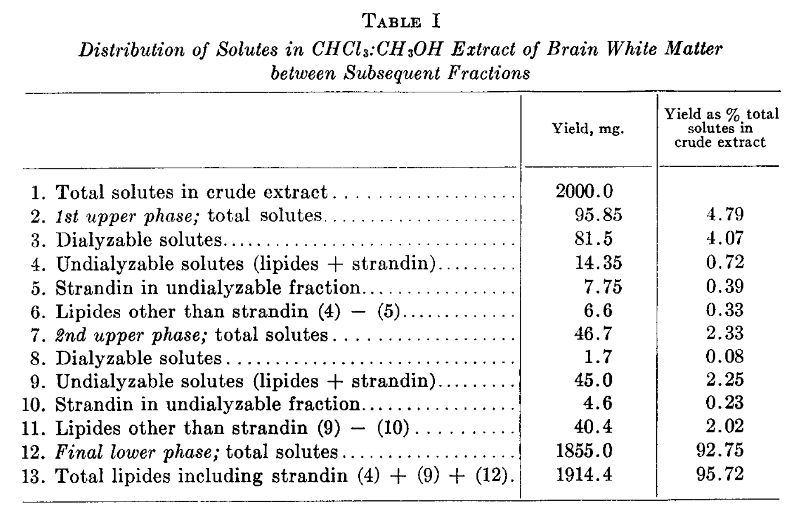
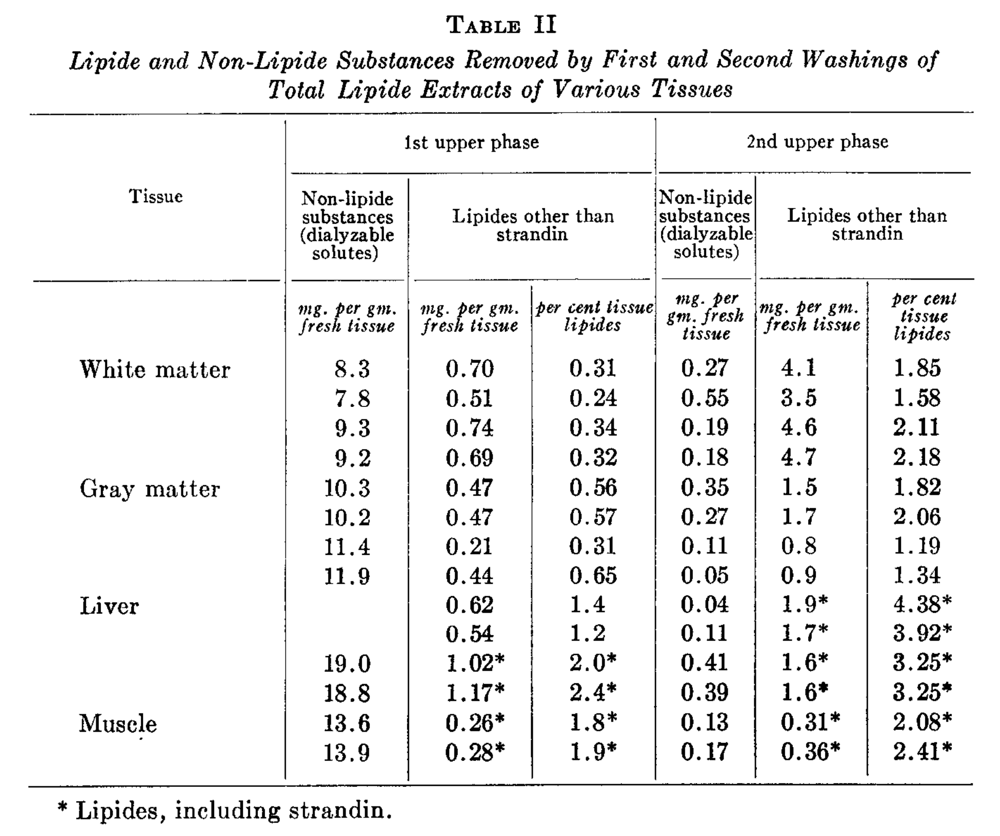
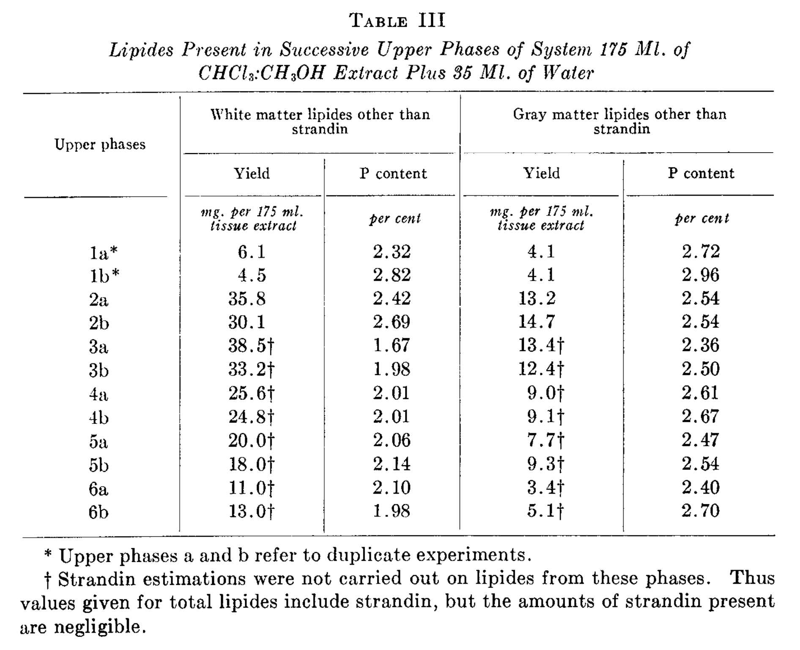
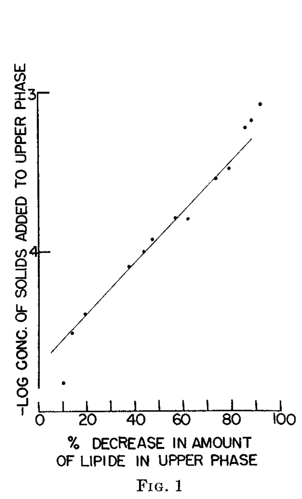
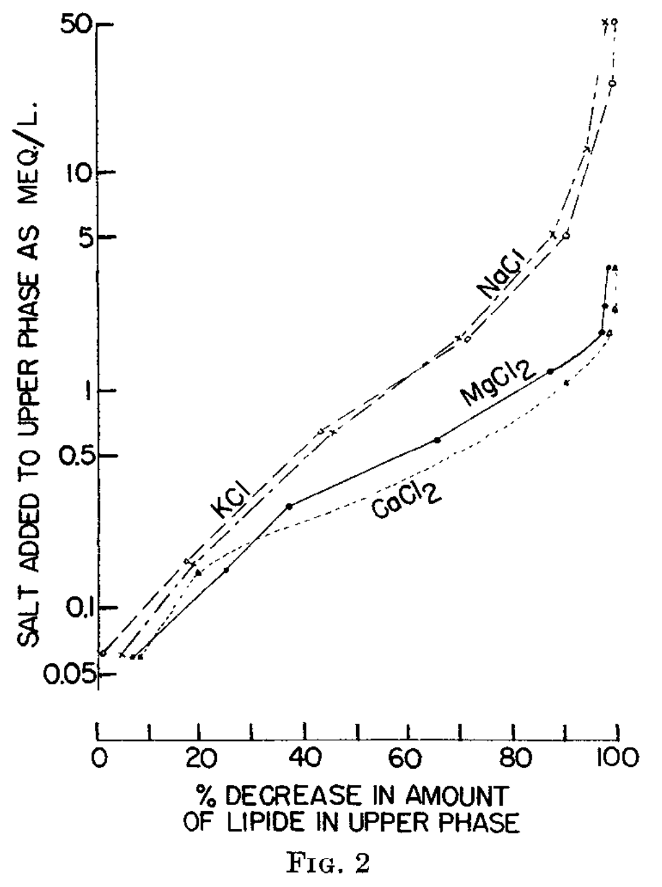
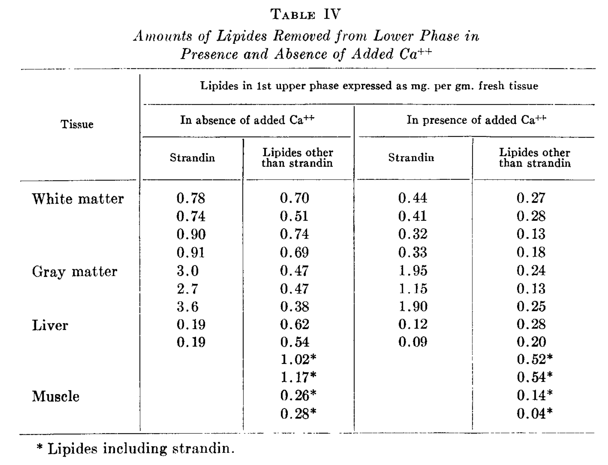
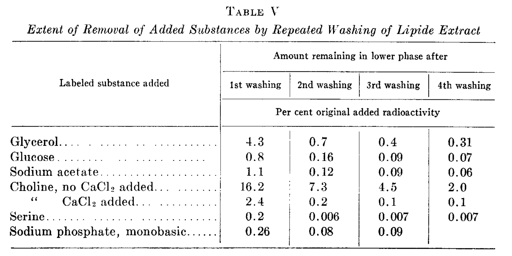

<!-- página 1 | impresa: 497 | pie: 497 / This is an Open Access article under the CC BY license. -->

# A SIMPLE METHOD FOR THE ISOLATION AND PURIFICATION OF TOTAL LIPIDES FROM ANIMAL TISSUES[^1]

BY JORDI FOLCH, M. LEES,[^2] AND G. H. SLOANE STANLEY[^3]

(*From the McLean Hospital Research Laboratories, Waverley, and the Department of Biological Chemistry, Harvard Medical School, Boston, Massachusetts*)

(Received for publication, August 23, 1956)

Work from this laboratory resulted in the development of a method for the preparation and purification of brain lipides (1) which involved two successive operations. In the first step, the lipides were extracted by homogenizing the tissue with 2:1 chloroform-methanol (v/v), and filtering the homogenate. In the second step, the filtrate, which contained the tissue lipides accompanied by non-lipide substances, was freed from these substances by being placed in contact with at least 5-fold its volume of water. This water washing entailed the loss of about 1 per cent of the brain lipides.

This paper describes a simplified version of the method and reports the results of a study of its application to different tissues, including the efficiency of the washing procedure in terms of the removal from tissue lipides of some non-lipide substances of special biochemical interest. It also reports some pertinent ancillary findings. The modifications introduced into the method pertain only to the washing procedure. A chloroform-methanol extract of the tissue, prepared as described in the original version of the method, is mixed with 0.2 its volume of water to which, for certain purposes, different mineral salts may be added. A biphasic system without any interfacial fluff is obtained (2). The upper phase contains all of the non-lipide substances, most of the strandin, and only negligible amounts of the other lipides. The lower phase contains essentially all the tissue lipides other than strandin. In comparison with the original method, the present version has the advantage of being simpler, of being applicable to any scale desired, of substantially decreasing the losses of lipides incidental to the washing process, and, finally, of yielding a washed extract which can be taken to dryness without foaming and without splitting of the proteolipides (3).

[^1]: \* This work has been aided by grant No. B-130 from the United States Public Health Service.

[^2]: † Fellow of the American Cancer Society, 1951–53.

[^3]: ‡ Eli Lilly Traveling Fellow in Medicine, 1953–55.

<!-- página 2 | impresa: 498 | encabezado: 498 / ISOLATION OF TOTAL TISSUE LIPIDES -->

## Procedure

*Reagents*—

*Chloroform.* Reagent grade.

*Methanol.* Reagent grade. For use with tissues relatively poor in lipides, such as muscle or blood plasma, both the chloroform and methanol must be redistilled.

*Chloroform-methanol mixture.* 2:1 by volume.

*Pure solvents upper phase and pure solvents lower phase.* Chloroform, methanol, and water are mixed in a separatory funnel in the proportions 8:4:3 by volume. When the mixture is allowed to stand, a biphasic system is obtained. The two phases are collected separately and stored in glass bottles. It has been found that the approximate proportions of chloroform, methanol, and water in the upper phase are 3:48:47 by volume. In the lower phase, the respective proportions are 86:14:1. Either of the phases may be prepared directly by making use of the above proportions.

*Pure solvents upper phase containing 0.02 per cent CaCl2, 0.017 per cent MgCl2, 0.29 per cent NaCl, or 0.37 per cent KCl.* These solutions can be prepared in one of two ways. One is to shake the appropriate amount of salt with pure solvents upper phase in a glass-stoppered vessel until solution is complete. The other is to proceed as for the preparation of pure solvents upper and lower phases except that, instead of water, 0.04 per cent aqueous CaCl2, 0.034 per cent aqueous MgCl2, 0.58 per cent aqueous NaCl, or 0.74 per cent aqueous KCl is used.

*Extraction of Lipides*—For the purposes of this description, the volume of a tissue sample will be computed on the assumption that the tissue has the specific gravity of water; *i.e.*, the volume of 1 gm. of tissue is 1 ml. The tissue or tissue fraction is homogenized with 2:1 chloroform-methanol mixture (v/v) to a final dilution 20-fold the volume of the tissue sample; *i.e.*, the homogenate from 1 gm. of tissue should be diluted to a volume of 20 ml. For amounts of tissue up to 1 gm., the homogenization is carried out in a Potter-Elvehjem type of homogenizer, the tube of which has been weighed, and calibrated at the volume of the final dilution of the particular tissue homogenate. Thus, the tissue sample can be weighed and the homogenate diluted to volume without a transfer. For brain or tissues of similar consistency, 3 minutes suffice for complete homogenization. Tougher tissues will require lengthier homogenization, and some organs rich in connective tissue, *e.g.* peripheral nerve, may require special handling such as grinding with a mortar and pestle at the temperature of dry ice before homogenization with the solvent mixture. For amounts greater than 1 gm., the tissue is homogenized in an adequate blendor with about a 17-fold volume of solvent mixture; the balance of solvent mixture required to dilute the homogenate to final volume is used to insure the quantitative transfer of the homogenate into a volumetric flask. After temperature <!-- página 3 | impresa: 499 | encabezado: J. FOLCH, M. LEES, AND G. H. SLOANE STANLEY / 499 --> equilibration and final volume adjustment, the homogenate is filtered through a fat-free paper into a glass-stoppered vessel. For the purposes of computation, this extract corresponds to 0.05 its volume of tissue; *i.e.*, 1 ml. of extract corresponds to 0.05 gm. of tissue.

<!-- NOTA-CONV: la palabra "tem-/perature" está partida entre las páginas 2 y 3; el marcador de la página 3 va después de la palabra completa -->

*Washing of Crude Extract*—The crude extract is mixed thoroughly with 0.2 its volume of either water or an adequate salt solution (see “Experimental”), and the mixture is allowed to separate into two phases, without interfacial fluff, either by standing or by centrifugation. The volumes of the upper and lower phases are, respectively, 40 and 60 per cent of the total volume of the system. As much of the upper phase as possible is removed by siphoning, and removal of its solutes is completed by rinsing the interface three times with small amounts of pure solvents upper phase in such a way as not to disturb the lower phase. Finally, the lower phase and remaining rinsing fluid are made into one phase by the addition of methanol, and the resulting solution is diluted to any desired final volume by the addition of 2:1 chloroform-methanol mixture.

The procedure can be run on any scale that is otherwise technically feasible, and the actual details of operation will vary according to the amount of extract being washed. For instance, if 10 ml. of crude extract are to be washed, the extract is placed in a 15 ml. centrifuge tube. To it are added 2 ml. of either water or salt solution, the two liquids are mixed with a stirring rod, the rod is then rinsed into the tube with a minimal amount of pure solvents lower phase, and the tube is capped with aluminum foil and centrifuged until complete separation of the system into two phases without any interfacial fluff is obtained. The duration of centrifugation varies from about 20 minutes at 2400 r.p.m. for white matter extracts to a very short time for blood plasma. The volumes of the upper and lower phases are 4.8 and 7.2 ml., respectively. The upper phase is removed as completely as possible with a pipette or with a suction arrangement such as the one described by Van Slyke and Rieben (4). Next, the inside wall of the tube is rinsed with about 1.5 ml. of pure solvents upper phase, which are allowed to flow gently from a pipette so that the washing fluid collects on top of the lower phase without any mixing of the two phases. The tube is rotated gently to insure mixing of the rinsing fluid with the remaining original upper phase, and the mixture is removed. This rinsing of the tube wall and interphase with pure solvents upper phase is repeated twice. Finally, the lower phase is diluted to a volume of 10 ml. as outlined above. With tissues poor in proteolipides, *e.g.* muscle, plasma, and liver, or if time is no object, centrifugation may be omitted from the washing procedure. Instead, the extract plus water mixture can be allowed to separate into two phases by prolonged standing. In that case, it is more convenient to carry out the washing in glass-stoppered cylinders.

*Permissible Departures from Procedure*—The technique described can be <!-- página 4 | impresa: 500 | encabezado: 500 / ISOLATION OF TOTAL TISSUE LIPIDES --> changed in many details if so indicated by the size and nature of the tissue sample or by the particular problem under study. Thus, if necessary, in the preparation of the crude extract, the tissue homogenate can be diluted to more than 20-fold the volume of tissue. Also, centrifugation can be used in preference to filtration as a means of obtaining a clear extract. Centrifugation of the homogenate itself is unsatisfactory because the specific gravity of the solvent mixture is too close to the density of the suspended material. Therefore, if centrifugation is to be used, it is necessary to lower the specific gravity of the homogenate by the addition of methanol. Usually, the addition of 0.2 its volume of methanol suffices for the purpose. The amount of methanol added must be noted.

In the washing procedure described, chloroform, methanol, and water are present in the system tissue extract plus water in the proportions 8:4:3 by volume, as can be computed if account is taken of the fact that the extract contains all the water from the tissue. These proportions are critical and must be kept constant. Therefore, in cases in which the tissue extraction has been substantially changed, it is necessary to modify the washing procedure in a way that will restore the required proportions of solvents. For instance, if the homogenate has been diluted to 40-fold the volume of tissue, the water contributed to the extract by the latter will be half as much as in the standard 20-fold dilution; *i.e.*, it will be 2 per cent of the extract as compared to the usual 4 per cent. Therefore, the amount of water added to the extract for washing should be 22 per cent instead of the usual 20 per cent. If methanol has been added to the extract, twice as much chloroform must also be added and the amount of water adjusted accordingly.

## EXPERIMENTAL

*Analytical Methods*—Most of the methods used in this study have been described elsewhere (3, 5).

*Degree of Completeness of Extraction of Tissue Lipides*—Earlier work had shown that the extraction procedure removes all lipides from brain (1) and blood plasma (6), with the exception of a specific fraction of lipides which is combined to tissue proteins by a linkage which withstands the action of neutral solvents. In the present study, the completeness of extraction of lipides from liver and muscle was studied by reextracting the residue with hot solvent and determining the amount of lipides in the second extract. The original extraction can be considered complete if the second extract contains no more lipides than can be accounted for by the aliquot of first extract left wetting the residue. The experiment was carried out as follows: The tissue was homogenized with chloroform-methanol as described, and the homogenate filtered through a previously weighed Büchner funnel, <!-- página 5 | impresa: 501 | encabezado: J. FOLCH, M. LEES, AND G. H. SLOANE STANLEY / 501 --> filtration being stopped before the insoluble residue became dry. The filter was weighed again and the weight of the wet residue it contained was computed by difference. Next, the residue was reextracted with a new portion of solvent mixture by boiling under reflux for 24 hours, the suspension was filtered, and the twice extracted residue collected and dried to constant weight. The amount of first extract left wetting the tissue residue could then be computed from the equation, ml. of extract in residue = (weight of wet residue after first extraction minus weight of dried residue)/(specific gravity of first extract). In the case of liver, 40 gm. of tissue were extracted as outlined above in succession with 760 ml. and 400 ml. of solvent mixture. The first extract contained 2.46 mg. of lipides per ml., while 28.8 ml. of extract with a computed total lipide content of 71 mg. were left in the residue. The second extract contained a total of 69 mg. of lipides; *i.e.*, the amount to be expected from the aliquot of the first extract in the residue. In an identical experiment with muscle tissue, the first extract contained 0.743 mg. of lipides per ml., while 24.3 ml. of extract with a total lipide content of 18.1 mg. were left wetting the residue. The second extract contained a total of 21.6 mg. of lipides; *i.e.*, 3.5 mg. more than were to be expected from the aliquot of the first extract remaining in the residue. This difference, which amounts to &lt;0.5 per cent of total tissue lipides, cannot be considered significant.

*Study of Washing Procedure*—The washing procedure has been studied by (*a*) determining the amount of lipides lost during the washing, (*b*) determining the amount of non-lipide substances remaining in the lower phase, (*c*) investigating an effect of certain non-lipide substances upon the distribution of lipides between the two phases formed during the washing procedure, (*d*) determining the effect of mineral salts on the distribution of lipides in this particular biphasic system, and finally (*e*) ascertaining the efficiency of the washing procedure in relation to some substances of importance in metabolic studies by the use of radioisotopes.

*Loss of Lipides Incidental to Washing Procedure and Degree of Removal of Non-Lipide Contaminants*—Since lipides are undialyzable, the amount of undialyzable substances in the upper phase would represent the maximal amount of lipides lost, and the dialyzable substances would, of necessity, represent non-lipide contaminants. In a typical experiment, 175 ml. of brain white matter extract were washed with 35 ml. of water. The upper phase, which had a volume of 84 ml., was collected quantitatively. The lower phase was equilibrated with 84 ml. of pure solvents upper phase, and the resulting second upper phase was collected. Both upper phases were concentrated to dryness by vacuum distillation of the solvents, the residues were each dissolved in 10 ml. of water, and the solutions were dialyzed exhaustively. The dialyzable and undialyzable fractions thus obtained were <!-- página 6 | impresa: 502 | encabezado: 502 / ISOLATION OF TOTAL TISSUE LIPIDES --> dried and analyzed. The solutes in the undialyzable fractions were completely soluble in chloroform-methanol, indicating that they were all lipides. The pertinent results are given in Table I. Thus, the values for the first upper phase show that no more than 0.3 per cent of the tissue lipides other than strandin was lost in the washing. Also, since the second upper phase contained only negligible amounts of dialyzable substances, the conclusion is warranted that, after one washing, the lower phase is essentially free from non-lipide substances. The same type of experiment has been carried out with white matter, gray matter, liver, and muscle, with the results given in Table II. In all the tissues studied, one washing was found sufficient for removing all the non-lipide contaminants from the crude extract. In the case of gray matter, lipides other than strandin lost in the course of the first washing amounted to no more than 0.6 per cent of the tissue lipides; for liver and muscle, the values were somewhat higher, ranging up to 2 per cent.

<!-- NOTA-CONV: la Tabla I está impresa en la página 6 dentro del párrafo anterior, entre "suffi-" y "cient"; se coloca al terminar ese párrafo -->

TABLE I

*Distribution of Solutes in CHCl3:CH3OH Extract of Brain White Matter between Subsequent Fractions*

<table>
<thead>
<tr><th></th><th>Yield, mg.</th><th>Yield as % total solutes in crude extract</th></tr>
</thead>
<tbody>
<tr><td>1. Total solutes in crude extract</td><td>2000.0</td><td></td></tr>
<tr><td>2. <em>1st upper phase;</em> total solutes</td><td>95.85</td><td>4.79</td></tr>
<tr><td>3. Dialyzable solutes</td><td>81.5</td><td>4.07</td></tr>
<tr><td>4. Undialyzable solutes (lipides + strandin)</td><td>14.35</td><td>0.72</td></tr>
<tr><td>5. Strandin in undialyzable fraction</td><td>7.75</td><td>0.39</td></tr>
<tr><td>6. Lipides other than strandin (4) − (5)</td><td>6.6</td><td>0.33</td></tr>
<tr><td>7. <em>2nd upper phase;</em> total solutes</td><td>46.7</td><td>2.33</td></tr>
<tr><td>8. Dialyzable solutes</td><td>1.7</td><td>0.08</td></tr>
<tr><td>9. Undialyzable solutes (lipides + strandin)</td><td>45.0</td><td>2.25</td></tr>
<tr><td>10. Strandin in undialyzable fraction</td><td>4.6</td><td>0.23</td></tr>
<tr><td>11. Lipides other than strandin (9) − (10)</td><td>40.4</td><td>2.02</td></tr>
<tr><td>12. <em>Final lower phase;</em> total solutes</td><td>1855.0</td><td>92.75</td></tr>
<tr><td>13. Total lipides including strandin (4) + (9) + (12)</td><td>1914.4</td><td>95.72</td></tr>
</tbody>
</table>

<!-- NOTA-CONV: en el original los rótulos de las filas van seguidos de puntos guía hasta la primera columna de valores; no se transcriben -->

Imagen original

*Recognition of Lipide Distribution-Altering Factor*—It can be seen from Table II that the second upper phases contained more lipides than the corresponding first upper phases. This unexpected finding was investigated by preparing in duplicate six successive upper phases from aliquots of white and gray matter extracts, as described above. The lipides from each phase were recovered and analyzed (Table III). It was found in both cases that the amount of lipides increased markedly from the first to the second upper phase; it remained unchanged from the second to the <!-- página 7 | impresa: 503 | encabezado: J. FOLCH, M. LEES, AND G. H. SLOANE STANLEY / 503 --> third, and then decreased from the third through the sixth by a fairly constant factor which corresponded to the distribution of a group of lipides exhibiting a distribution coefficient of about 2.7 in favor of the lower phase. The negligible amount of lipides in the first upper phase could be explained only by assuming that some unknown “distribution coefficient altering” factor had been in operation in the washing of the original extract. The effect of this factor was still evident in the second equilibration, most likely because of contamination of the system by first upper phase.

<!-- NOTA-CONV: la Tabla II está impresa en la página 7 dentro del párrafo anterior, entre "The" y "effect"; se coloca al terminar ese párrafo -->

TABLE II

*Lipide and Non-Lipide Substances Removed by First and Second Washings of Total Lipide Extracts of Various Tissues*

<table>
<thead>
<tr><th rowspan="2">Tissue</th><th colspan="3">1st upper phase</th><th colspan="3">2nd upper phase</th></tr>
<tr><th>Non-lipide substances (dialyzable solutes)</th><th colspan="2">Lipides other than strandin</th><th>Non-lipide substances (dialyzable solutes)</th><th colspan="2">Lipides other than strandin</th></tr>
<tr><th></th><th><em>mg. per gm. fresh tissue</em></th><th><em>mg. per gm. fresh tissue</em></th><th><em>per cent tissue lipides</em></th><th><em>mg. per gm. fresh tissue</em></th><th><em>mg. per gm. fresh tissue</em></th><th><em>per cent tissue lipides</em></th></tr>
</thead>
<tbody>
<tr><td rowspan="4">White matter</td><td>8.3</td><td>0.70</td><td>0.31</td><td>0.27</td><td>4.1</td><td>1.85</td></tr>
<tr><td>7.8</td><td>0.51</td><td>0.24</td><td>0.55</td><td>3.5</td><td>1.58</td></tr>
<tr><td>9.3</td><td>0.74</td><td>0.34</td><td>0.19</td><td>4.6</td><td>2.11</td></tr>
<tr><td>9.2</td><td>0.69</td><td>0.32</td><td>0.18</td><td>4.7</td><td>2.18</td></tr>
<tr><td rowspan="4">Gray matter</td><td>10.3</td><td>0.47</td><td>0.56</td><td>0.35</td><td>1.5</td><td>1.82</td></tr>
<tr><td>10.2</td><td>0.47</td><td>0.57</td><td>0.27</td><td>1.7</td><td>2.06</td></tr>
<tr><td>11.4</td><td>0.21</td><td>0.31</td><td>0.11</td><td>0.8</td><td>1.19</td></tr>
<tr><td>11.9</td><td>0.44</td><td>0.65</td><td>0.05</td><td>0.9</td><td>1.34</td></tr>
<tr><td rowspan="4">Liver</td><td></td><td>0.62</td><td>1.4</td><td>0.04</td><td>1.9*</td><td>4.38*</td></tr>
<tr><td></td><td>0.54</td><td>1.2</td><td>0.11</td><td>1.7*</td><td>3.92*</td></tr>
<tr><td>19.0</td><td>1.02*</td><td>2.0*</td><td>0.41</td><td>1.6*</td><td>3.25*</td></tr>
<tr><td>18.8</td><td>1.17*</td><td>2.4*</td><td>0.39</td><td>1.6*</td><td>3.25*</td></tr>
<tr><td rowspan="2">Muscle</td><td>13.6</td><td>0.26*</td><td>1.8*</td><td>0.13</td><td>0.31*</td><td>2.08*</td></tr>
<tr><td>13.9</td><td>0.28*</td><td>1.9*</td><td>0.17</td><td>0.36*</td><td>2.41*</td></tr>
</tbody>
</table>

<!-- NOTA-CONV: en el original el nombre de cada tejido aparece solo en la primera fila de su grupo; aquí se representa con rowspan -->

\* Lipides, including strandin.

Imagen original

The lipides from white matter upper phases 3 through 6 were pooled and analyzed, in per cent: S 1.4, P 1.9, N 1.5, NH2-N 0.54, α-amino acid N 0.54, carbohydrate, as galactose, 7.9, S + P/N atomic ratio 0.98, atoms S per moles of galactose 1.00, choline none. Thus, the lipides affected by the distribution-altering factor consisted of a mixture of 40 per cent sulfatides, 35 per cent phosphatidyl serine, and 25 per cent other phosphatides; *i.e.*, they were mainly, if not exclusively, acidic lipides.

*Identification of Lipide Distribution-Altering Factors*—The observed facts might be explained by assuming that the distribution of water, chloroform, <!-- página 8 | impresa: 504 | encabezado: 504 / ISOLATION OF TOTAL TISSUE LIPIDES --> and methanol between the two phases had changed significantly between the first and subsequent equilibrations. This possibility was investigated by determining the volume and the specific gravity of both phases through the procedure of preparation of six upper phases (see above). No changes were observed. Thus, it can safely be assumed that the composition of the phases had remained essentially constant.

TABLE III

*Lipides Present in Successive Upper Phases of System 175 Ml. of CHCl3:CH3OH Extract Plus 35 Ml. of Water*

<table>
<thead>
<tr><th rowspan="2">Upper phases</th><th colspan="2">White matter lipides other than strandin</th><th colspan="2">Gray matter lipides other than strandin</th></tr>
<tr><th>Yield</th><th>P content</th><th>Yield</th><th>P content</th></tr>
<tr><th></th><th><em>mg. per 175 ml. tissue extract</em></th><th><em>per cent</em></th><th><em>mg. per 175 ml. tissue extract</em></th><th><em>per cent</em></th></tr>
</thead>
<tbody>
<tr><td>1a*</td><td>6.1</td><td>2.32</td><td>4.1</td><td>2.72</td></tr>
<tr><td>1b*</td><td>4.5</td><td>2.82</td><td>4.1</td><td>2.96</td></tr>
<tr><td>2a</td><td>35.8</td><td>2.42</td><td>13.2</td><td>2.54</td></tr>
<tr><td>2b</td><td>30.1</td><td>2.69</td><td>14.7</td><td>2.54</td></tr>
<tr><td>3a</td><td>38.5†</td><td>1.67</td><td>13.4†</td><td>2.36</td></tr>
<tr><td>3b</td><td>33.2†</td><td>1.98</td><td>12.4†</td><td>2.50</td></tr>
<tr><td>4a</td><td>25.6†</td><td>2.01</td><td>9.0†</td><td>2.61</td></tr>
<tr><td>4b</td><td>24.8†</td><td>2.01</td><td>9.1†</td><td>2.67</td></tr>
<tr><td>5a</td><td>20.0†</td><td>2.06</td><td>7.7†</td><td>2.47</td></tr>
<tr><td>5b</td><td>18.0†</td><td>2.14</td><td>9.3†</td><td>2.54</td></tr>
<tr><td>6a</td><td>11.0†</td><td>2.10</td><td>3.4†</td><td>2.40</td></tr>
<tr><td>6b</td><td>13.0†</td><td>1.98</td><td>5.1†</td><td>2.70</td></tr>
</tbody>
</table>

\* Upper phases a and b refer to duplicate experiments.

† Strandin estimations were not carried out on lipides from these phases. Thus values given for total lipides include strandin, but the amounts of strandin present are negligible.

Imagen original

Another explanation could be that the factor was one or more of the solutes in the crude extract which would be removed by the washing procedure, and therefore would be found in the first upper phase. This was shown to be the case by the following type of experiment. A stock of lower phase was prepared by washing crude white matter extract once with water. The solutes from the upper phase were recovered. Identical aliquots of lower phase were mixed with equal volumes of pure solvents upper phase. Different amounts of first upper phase solutes were added to some of the mixtures. After centrifugation, the upper phases were analyzed for P content, which had been shown to be a reliable indicator of the total amount of lipides present. It was found that the amount of lipides in the upper phases was decreased by the presence of the added <!-- página 9 | impresa: 505 | encabezado: J. FOLCH, M. LEES, AND G. H. SLOANE STANLEY / 505 --> solutes in proportion to the logarithm of the concentration (Fig. 1), an observation which provided a means for measuring the distribution-altering effect of any material. Thus, it was possible to trace this effect quantitatively from the first upper phase solutes to their dialyzable fraction and to the ash therefrom; *i.e.*, the effect was caused by the mineral salts present in the crude extract.

<!-- NOTA-CONV: las Figs. 1 y 2 están impresas lado a lado en la página 9, dentro del párrafo anterior, entre "and to" y "the ash"; cada una lleva debajo el rótulo "FIG. 1" o "FIG. 2", y las dos leyendas van juntas debajo de ambas. Se colocan al terminar ese párrafo, cada imagen seguida de su leyenda -->

FIG. 1. Effect of solutes from the upper phase of the biphasic system white matter chloroform-methanol extract plus 0.2 its volume of water on the distribution of lipides between the two phases of a system of identical solvent composition.

<!-- texto en la figura: eje y: −LOG CONC. OF SOLIDS ADDED TO UPPER PHASE (marcas 3 y 4) · eje x: % DECREASE IN AMOUNT OF LIPIDE IN UPPER PHASE (marcas 0, 20, 40, 60, 80, 100) · rótulo bajo la gráfica: FIG. 1 -->

FIG. 2. Effect of different salts on the distribution of lipides between the two phases of the same solvent composition as those obtained from the system white matter chloroform-methanol extract plus 0.2 its volume of water; ○, KCl; ×, NaCl; ●, MgCl2; △, CaCl2.

<!-- texto en la figura: eje y (logarítmico): SALT ADDED TO UPPER PHASE AS MEQ./L. (marcas 0.05, 0.1, 0.5, 1, 5, 10, 50) · eje x: % DECREASE IN AMOUNT OF LIPIDE IN UPPER PHASE (marcas 0, 20, 40, 60, 80, 100) · rótulos de las curvas: NaCl, MgCl2 (2 en subíndice), KCl, CaCl2 (2 en subíndice) · rótulo bajo la gráfica: FIG. 2 -->

By the same procedure, the distribution-altering effect of different concentrations of NaCl, KCl, CaCl2, and MgCl2 was determined (Fig. 2). It was found that virtual absence of lipides from the upper phase could be obtained by the addition to it of CaCl2 or MgCl2 at a concentration of 0.003 N, or of NaCl or KCl at a concentration of 0.05 N.

*Comparison between Amounts of Lipides Lost upon Washing with Water or with Mineral Salt Solutions*—This comparison has been made by washing crude extracts of various tissues in parallel with either water or aqueous <!-- página 10 | impresa: 506 | encabezado: 506 / ISOLATION OF TOTAL TISSUE LIPIDES --> solutions of different salts at various concentrations, and determining the amount of lipides in the first upper phase. Table IV gives the comparative data for water and for 0.05 per cent CaCl2 which result in a concentration of Ca++ in the upper phase of 3.8 m.eq. per liter. It can be seen that the use of the latter decreases the loss of lipides incidental to the washing. In cases in which the use of CaCl2 is contraindicated, as when an insoluble Ca salt might be formed, a similar result can be obtained with 0.04 per cent MgCl2, 0.73 per cent NaCl, or 0.88 per cent KCl. The procedure is exactly as described for water.

<!-- NOTA-CONV: la Tabla IV está impresa en la página 10 dentro del párrafo anterior, entre "0.04 per cent" y "MgCl2"; se coloca al terminar ese párrafo -->

TABLE IV

*Amounts of Lipides Removed from Lower Phase in Presence and Absence of Added Ca++*

<table>
<thead>
<tr><th rowspan="3">Tissue</th><th colspan="4">Lipides in 1st upper phase expressed as mg. per gm. fresh tissue</th></tr>
<tr><th colspan="2">In absence of added Ca++</th><th colspan="2">In presence of added Ca++</th></tr>
<tr><th>Strandin</th><th>Lipides other than strandin</th><th>Strandin</th><th>Lipides other than strandin</th></tr>
</thead>
<tbody>
<tr><td rowspan="4">White matter</td><td>0.78</td><td>0.70</td><td>0.44</td><td>0.27</td></tr>
<tr><td>0.74</td><td>0.51</td><td>0.41</td><td>0.28</td></tr>
<tr><td>0.90</td><td>0.74</td><td>0.32</td><td>0.13</td></tr>
<tr><td>0.91</td><td>0.69</td><td>0.33</td><td>0.18</td></tr>
<tr><td rowspan="3">Gray matter</td><td>3.0</td><td>0.47</td><td>1.95</td><td>0.24</td></tr>
<tr><td>2.7</td><td>0.47</td><td>1.15</td><td>0.13</td></tr>
<tr><td>3.6</td><td>0.38</td><td>1.90</td><td>0.25</td></tr>
<tr><td rowspan="4">Liver</td><td>0.19</td><td>0.62</td><td>0.12</td><td>0.28</td></tr>
<tr><td>0.19</td><td>0.54</td><td>0.09</td><td>0.20</td></tr>
<tr><td></td><td>1.02*</td><td></td><td>0.52*</td></tr>
<tr><td></td><td>1.17*</td><td></td><td>0.54*</td></tr>
<tr><td rowspan="2">Muscle</td><td></td><td>0.26*</td><td></td><td>0.14*</td></tr>
<tr><td></td><td>0.28*</td><td></td><td>0.04*</td></tr>
</tbody>
</table>

<!-- NOTA-CONV: en el original el nombre de cada tejido aparece solo en la primera fila de su grupo; aquí se representa con rowspan -->

\* Lipides including strandin.

Imagen original

*Study of Efficiency of Repeated Washing*—While one washing is sufficient to purify lipides for the usual analytical purposes, in the case of metabolic studies involving the use of substances labeled with radioisotopes, it is often necessary to free lipides from non-lipide contaminants possessing specific activities 1000-fold or more that of the lipides. Such a degree of purification can be reached by equilibrating the lower phase repeatedly with portions of pure solvents upper phase containing salt. The procedure is as follows: The crude extract is washed with water or with an appropriate salt solution, as already described. After quantitative removal of the upper phase, a portion of pure solvents upper phase containing the appropriate <!-- página 11 | impresa: 507 | encabezado: J. FOLCH, M. LEES, AND G. H. SLOANE STANLEY / 507 --> salt is added, the two phases are stirred, and the tube is capped. After centrifugation, the upper phase is removed quantitatively. The equilibration with fresh portions of pure solvents upper phase containing mineral salt is repeated as many times as is indicated by *ad hoc* experiments of the type reported below.

<!-- NOTA-CONV: la palabra "appro-/priate" está partida entre las páginas 10 y 11; el marcador de la página 11 va después de la palabra completa -->

A study of the efficiency of repeated washings has been carried out in collaboration with Dr. Manfred Karnovsky of the Biophysics Laboratory of Harvard Medical School. 2 mg. samples of a C14- or P32-labeled compound were dissolved in 0.1 ml. of water and added to 10 ml. of a crude liver lipide extract. The level of activity ranged between 0.5 × 106 and 1.0 × 106 c.p.m. per 10 ml. of extract. The extracts were washed repeatedly as described above, aliquots of the lower phase were taken after each washing, and the amount of radioactive test substance remaining in the lower phase was estimated by counting in a gas flow counter in the proportional range (7, 8). Glycerol, glucose, acetate, choline, serine, and phosphate have been studied in this way. It can be seen from Table V that, while the repeated washing procedure is highly effective, the rate of removal of the different substances in the successive washings does not follow a theoretical decrement line, with the possible exception of serine and glycerol in the first two washings. The difference in the behavior of choline in the presence and absence of added CaCl2 suggests that choline forms salts with acidic lipides in amounts determined by competition with other bases present.

<!-- NOTA-CONV: la Tabla V está impresa en la página 11 dentro del párrafo anterior, entre "after each" y "washing"; se coloca al terminar ese párrafo -->

TABLE V

*Extent of Removal of Added Substances by Repeated Washing of Lipide Extract*

<table>
<thead>
<tr><th rowspan="3">Labeled substance added</th><th colspan="4">Amount remaining in lower phase after</th></tr>
<tr><th>1st washing</th><th>2nd washing</th><th>3rd washing</th><th>4th washing</th></tr>
<tr><th colspan="4">Per cent original added radioactivity</th></tr>
</thead>
<tbody>
<tr><td>Glycerol</td><td>4.3</td><td>0.7</td><td>0.4</td><td>0.31</td></tr>
<tr><td>Glucose</td><td>0.8</td><td>0.16</td><td>0.09</td><td>0.07</td></tr>
<tr><td>Sodium acetate</td><td>1.1</td><td>0.12</td><td>0.09</td><td>0.06</td></tr>
<tr><td>Choline, no CaCl2 added</td><td>16.2</td><td>7.3</td><td>4.5</td><td>2.0</td></tr>
<tr><td>“ CaCl2 added</td><td>2.4</td><td>0.2</td><td>0.1</td><td>0.1</td></tr>
<tr><td>Serine</td><td>0.2</td><td>0.006</td><td>0.007</td><td>0.007</td></tr>
<tr><td>Sodium phosphate, monobasic</td><td>0.26</td><td>0.08</td><td>0.09</td><td></td></tr>
</tbody>
</table>

<!-- NOTA-CONV: en la quinta fila el original imprime una marca de repetición (“) bajo "Choline," en lugar de repetir la palabra; los rótulos de las filas van seguidos de puntos guía, que no se transcriben -->

Imagen original

*Behavior of Strandin in This Procedure*—The distribution of strandin between the two phases is affected by the addition of mineral salts to the upper phase, especially by CaCl2 (Table IV). The effect of KCl is much less marked, and even at KCl concentrations that result in the essential <!-- página 12 | impresa: 508 | encabezado: 508 / ISOLATION OF TOTAL TISSUE LIPIDES --> absence of acidic lipides from the upper phase the bulk of strandin is present in the first upper phase. The observations of Svennerholm (9) on the effect of NaCl on the distribution of gangliosides, which most likely included strandin, suggest that the action of NaCl is similar to that of KCl. In summary, the use of KCl or NaCl in this procedure affects the distribution of strandin only slightly. To eliminate strandin from the lower phase completely, three washings with the appropriate salt solutions should suffice. To isolate strandin, the three washings are combined, concentrated almost to dryness, and dialyzed. Strandin will be found quantitatively in the undialyzable fraction.

## DISCUSSION

The present work started as an attempt to modify the original procedure of washing crude lipide extracts with water. In a survey of possible alternatives, crude brain white matter extract and water were mixed in various proportions. Most mixtures resulted in emulsions which were hard to separate or were inseparable. The exception was a mixture obtained by adding to the extract 0.2 its volume of water, which, upon standing or by centrifugation, separated into two clear phases without the persistence of any interfacial fluff. Investigation of the two phases showed that the upper phase contained practically all of the non-lipide substances and only negligible amounts of lipides, the lower phase thus representing a solution of essentially pure total tissue lipides. Further study revealed that the high efficiency of the washing procedure depended upon the presence, in the system crude extract plus water, of chlorides of Na, K, Ca, and Mg, which had been extracted from the tissue by the chloroform-methanol mixture and which altered the distribution of acidic lipides between the two phases of the system and practically eliminated them from the first upper phase.

A possible explanation for the lipide distribution-altering effect of the mineral salts is that the acidic lipides, which are extracted from the tissue as salts of Na, K, Ca, and Mg, are present in the upper phase partly in the dissociated forms and in the lower phase only as undissociated salts. The addition of mineral salts containing the above cations would decrease the dissociation of the acidic lipides by a mass action effect with a consequent shift of lipides to the lower phase, the mineral salts remaining quantitatively in the upper phase. A necessary corollary to this hypothesis would be that the various cations displace one another from combination with the lipides. A study of the interaction between these lipides and mineral salts, the details of which will be published elsewhere, supports the above hypothesis.

It will be noted that the addition of CaCl2 to the water used in the first <!-- página 13 | impresa: 509 | encabezado: J. FOLCH, M. LEES, AND G. H. SLOANE STANLEY / 509 --> washing significantly reduces but does not completely eliminate the loss of lipides (Table IV); in subsequent washings the presence of the same concentration of CaCl2 in the system results in the essential absence of lipides from the upper phase (Fig. 2). This need not imply an inconsistency in the action of CaCl2 but suggests the presence in the crude extract of a small amount of a lipide fraction which is preferentially soluble in the upper phase and whose partition is not affected by the presence of mineral salts. This fraction would be removed by the first washing.

## SUMMARY

1. A simple method for the preparation of total pure lipide extracts from various tissues is described. The method consists of homogenizing the tissue with a 2:1 chloroform-methanol mixture and washing the extract by addition to it of 0.2 its volume of either water or an appropriate salt solution. The resulting mixture separates into two phases. The lower phase is the total pure lipide extract.

2. The washing procedure removes essentially all the non-lipide contaminants from the extract with a concomitant loss of about 0.3 per cent of the tissue lipides in the case of white matter and about 0.6 per cent in the case of gray matter. Even these small losses of lipides can be reduced by the addition of a definite amount of certain mineral salts.

3. The efficiency of the washing procedure depends upon the presence of mineral salts in the crude extract. These salts alter the distribution of lipides and practically eliminate them from the upper phase. In the absence of salts, substantial amounts of acidic lipides are present in the upper phase and would be lost during washing.

4. The advantages and limitations of this procedure have been established for brain gray and white matter, for liver, and for muscle.

## BIBLIOGRAPHY

1. Folch, J., Ascoli, I., Lees, M., Meath, J. A., and LeBaron, F. N., *J. Biol. Chem.*, **191**, 833 (1951).

2. Folch, J., Lees, M., and Sloane Stanley, G. H., *Federation Proc.*, **13**, 209 (1954).

3. Folch, J., and Lees, M., *J. Biol. Chem.*, **191**, 807 (1951).

4. Van Slyke, D. D., and Rieben, W. K., *J. Biol. Chem.*, **156**, 743 (1944).

5. Folch, J., Arsove, S., and Meath, J. A., *J. Biol. Chem.*, **191**, 819 (1951).

6. Sperry, W. M., and Brand, F. C., *J. Biol. Chem.*, **213**, 69 (1955).

7. Robinson, C. V., *Science*, **112**, 198 (1950).

8. Karnovsky, M. L., Foster, J. M., Gidez, L. I., Hagerman, D. D., Robinson, C. V., Solomon, A. K., and Villee, C. A., *Anal. Chem.*, **27**, 852 (1955).

9. Svennerholm, L., *J. Neurochem.*, **1**, 42 (1956).
