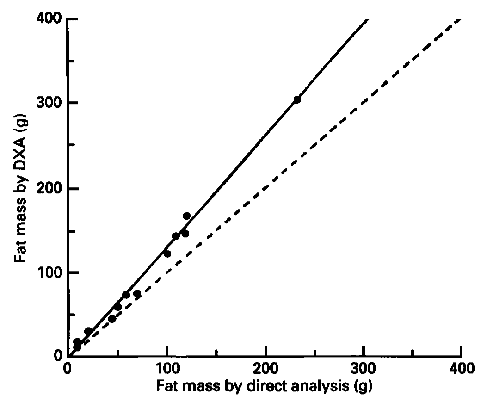
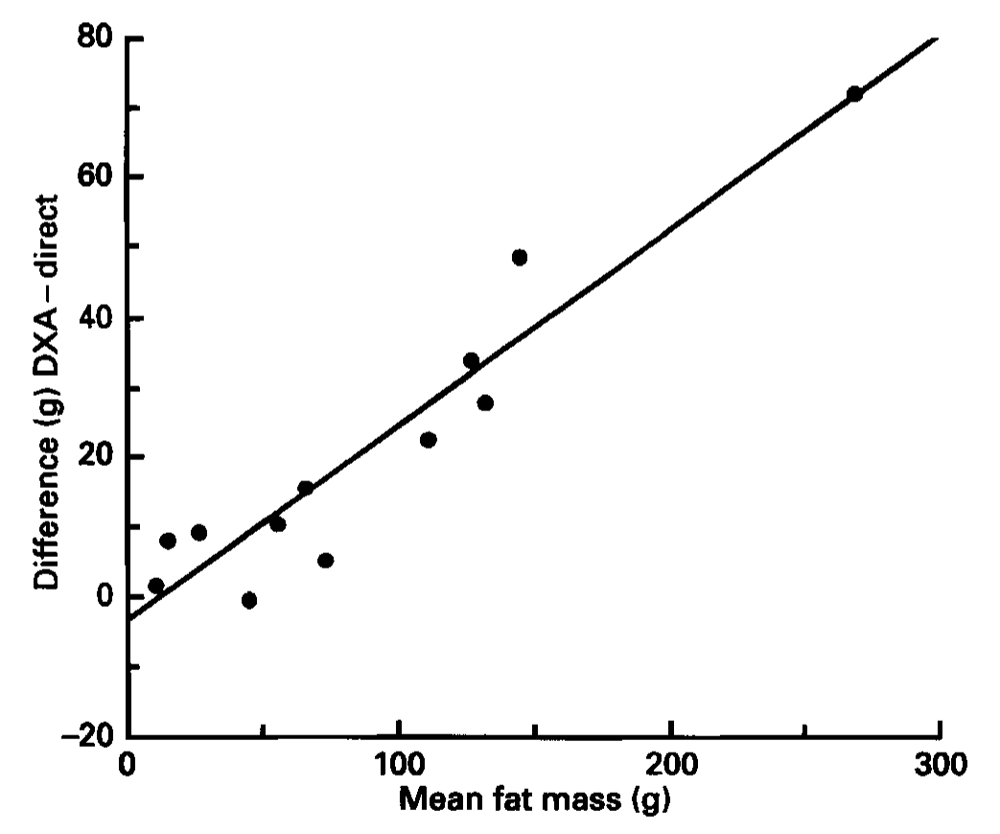
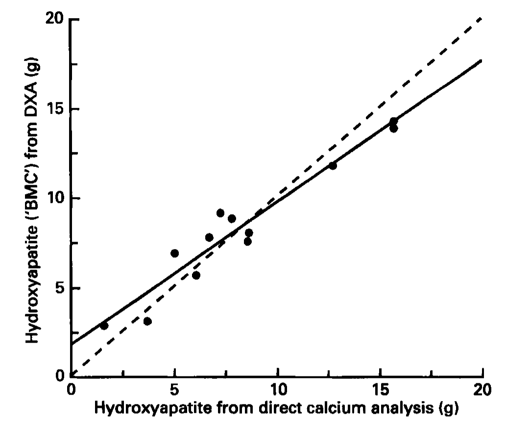
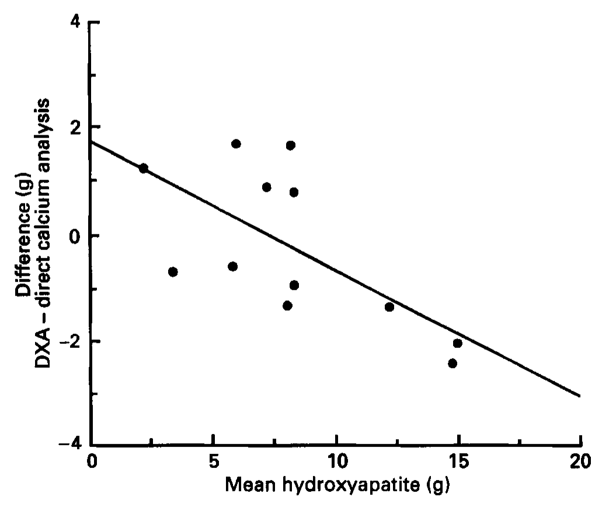
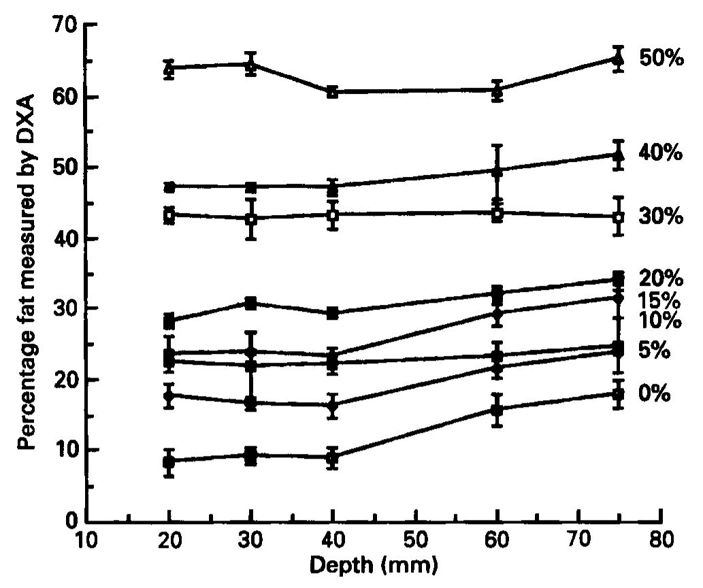

<!-- página 1 | impresa: 803 | encabezado: British Journal of Nutrition (1996), 75, 803–809 / 803 | pie: sello de descarga (margen derecho, en vertical): Downloaded from https://www.cambridge.org/core. IP address: 160.79.106.18, on 30 Sep 2026 at 05:16:02, subject to the Cambridge Core terms of use, available at https://www.cambridge.org/core/terms. https://doi.org/10.1079/BJN19960187 -->

# Dual-energy X-ray absorptiometry for the measurement of gross body composition in rats

BY SUSAN A. JEBB, STEPHEN W. GARLAND, GRAHAM JENNINGS AND MARINOS ELIA

*MRC Dunn Clinical Nutrition Centre, Hills Road, Cambridge CB2 2DH*

(*Received 17 July 1995 – Revised 4 October 1995 – Accepted 7 October 1995*)

**Dual-energy X-ray absorptiometry (DXA) is a novel, non-invasive technique for the measurement of gross body composition in small animals. In the present study the absolute accuracy of the Hologic QDR-1000W scanner was assessed by comparison with direct analysis in twelve rats with a range of body fat and bone mineral content (BMC) values. Fat masses measured by DXA and petroleum-ether extraction were significantly different (*P* &lt; 0·0023). The DXA technique consistently overestimated fat mass by approximately one third of the measured fat content. BMC derived from the measurement of Ca in ash gave a mean of 8·26 (range 1·57–15·71) g. BMC measured by DXA was not significantly different for the group as a whole. However, there was a trend for DXA to overestimate BMC in animals with low BMC and underestimate in those with higher BMC, compared with direct analysis, such that the 95 % limits of agreement for the two techniques were +2·73 to −2·58 g. These results suggest that the present small-animal software developed for use with currently available Hologic machines does not give an accurate measure of gross body composition compared with the results from classical direct analysis.**

**Dual-energy X-ray absorptiometry: Body composition: Body fat**

Numerous studies in small animals require accurate measurements of gross body composition and frequently large groups of animals have to be killed at intervals for carcass analysis. Typical examples include investigations into the effect of diet on growth and body composition and the effect of undernutrition or injury. Recently a dual-energy X-ray absorptiometry (DXA) system has become available for *in-vivo* measurements of body composition, but there is little information as to the accuracy of this novel technique.

DXA is a rectilinear scanning technique which uses X-rays at two different energies to resolve bone and soft-tissue masses based on the differential attenuation of the two beams. More recently the software has been developed to allow the subsequent discrimination of fat and fat-free soft tissue. This method is widely used for the measurement of bone-mineral and soft-tissue composition in subjects weighing more than 10 kg. Although the principle remains the same, machines produced by three different manufacturers all differ in terms of both the hardware and software. The Hologic series of machines (Hologic Inc., Waltham, MA 02154, USA) includes an infant version, which incorporates an additional platform on which the baby is placed to ensure adequate attenuation of the X-rays, and this is recommended for the weight range 2–10 kg. Recently the same principles have also been employed to produce a system suitable for use with small animals. The hardware is broadly similar but includes a 30 mm thick perspex platform on which the animal is placed, again to ensure adequate attenuation of the X-rays.

A number of studies have examined the accuracy of the DXA system in adults and infants with reference to chemical analysis in pigs or meat samples, with mixed results (Brunton *et al.* 1993; Svendson *et al.* 1993; Ellis *et al.* 1994; Jebb *et al.* 1995). This may be <!-- página 2 | impresa: 804 | encabezado: 804 / S. A. JEBB AND OTHERS | pie: sello de descarga (margen derecho, en vertical): Downloaded from https://www.cambridge.org/core. IP address: 160.79.106.18, on 30 Sep 2026 at 05:16:02, subject to the Cambridge Core terms of use, available at https://www.cambridge.org/core/terms. https://doi.org/10.1079/BJN19960187 --> due, at least in part, to inadequacies in the proxy ‘subjects’ which do not truly represent those subjects which the system is designed to measure. However, using the small-animal software there is the opportunity to test the accuracy of the DXA method against direct chemical analysis in the type of animal for which the system was intended.

Little information is available regarding the accuracy of these machines for measurements of body composition in small animals and, since inter-machine differences have been demonstrated in both the hardware and software, results obtained from one type of machine cannot be directly applied to another (Tothill *et al.* 1994). A limited number of studies have examined the accuracy of the Hologic QDR-1000W DXA measurements of rat bones compared with ash weights (Kimmel & Wronski, 1990; Ammann *et al.* 1992; Griffin *et al.* 1993; Hagiwara *et al.* 1993), but only one study has examined whole-body bone mineral (Mitlak *et al.* 1994). The latter study showed a good correlation between DXA and direct measurements (*r* > 0·89) in rats weighing 175–800 g but gave no indication of the standard error of the estimate. Furthermore each study has demonstrated that although the intercept of the regression line is close to zero, the slope is significantly different from unity. Mitlak *et al.* (1994) have suggested a correction factor which may be applied to estimate ash weight from DXA measurements, but this factor was shown to be different for spine and whole-body bone measurements. Furthermore, Hagiwara *et al.* (1993) have demonstrated that the DXA estimate of bone mineral content (BMC) is between 1 and 20 % higher than the ash weight depending on the water depth in which the bones are scanned. This artefact has been reduced by the introduction of the perspex block on which the animals are scanned. However, it raises the possibility that differences in soft-tissue thickness will produce artefactual errors in estimates of BMC in intact animals.

To date there has been no assessment of the accuracy of measurements of fat mass by DXA. Furthermore, it has been suggested that there may also be errors in the estimate of fat, which are related to differences in tissue thickness. Such artefacts have previously been demonstrated in the adult mode software (Jebb *et al.* 1995) in which there was a disproportionate increase in measured fat mass at extremes of depth.

In the present study the whole-body bone-mineral and soft-tissue composition of a series of rats was measured by DXA and compared with results obtained by direct analysis. In addition, the effects of depth on the measured fat mass were investigated in an experimental model system using vegetable oil and water to imitate the attenuation of fat and fat-free mass (FFM) respectively.

## METHODS

Twelve rats were studied, selected to provide a range of fat mass. Ten were from the MRC Dunn Nutrition Unit Hooded strain and included eight male animals of different ages to provide a range of body weights from 140 to 600 g and two female rats, one virgin and one post-partum, each weighing 333 g. In addition two genetically obese female fa/fa rats, weighing 360 and 480 g, were studied.

Each animal was killed by cervical dislocation. Animals were either scanned freshly or frozen and then allowed to thaw completely overnight at room temperature before scanning. We have previously demonstrated that this procedure has no effect on the measured composition (S. A. Jebb, unpublished results). A Hologic QDR-1000W DXA machine was used and data were analysed using the small-animal software package 5.61P. At the start of each scanning session a quality-control spine phantom was measured and shown to be correct and a rat calibration scan was also performed. The animals were each positioned according to the manufacturer’s operating instructions. Scans were performed in triplicate with no adjustment of animal positioning between measurements. The CV was less than 1 % for both fat mass and BMC.

The rats were then autoclaved, homogenized and freeze-dried to constant weight to <!-- página 3 | impresa: 805 | encabezado: BODY COMPOSITION OF RATS MEASURED BY DXA / 805 | pie: sello de descarga (margen derecho, en vertical): Downloaded from https://www.cambridge.org/core. IP address: 160.79.106.18, on 30 Sep 2026 at 05:16:02, subject to the Cambridge Core terms of use, available at https://www.cambridge.org/core/terms. https://doi.org/10.1079/BJN19960187 --> measure the water content. They were subsequently analysed for N, fat and ash content according to standard laboratory procedures. Fat was measured by petroleum-ether extraction (CV 1·94 %), and ash by combustion at 600°. Protein was estimated as Kjeldahl N × 6·25 (CV 0·73 %). The Ca present in the ash was measured by the methylthymol blue method (Roche Kit no. AM. 07 7061, (Roche, Welwyn Garden City, Herts) CV 2·21 %). Each sample was measured in duplicate.

The consequence of changes in the thickness of tissue scanned using the small-animal software was investigated as previously described for the adult software (Jebb *et al.* 1995). A cardboard box measuring 175 × 119 × 86 mm, with 3 mm thick rigid walls was lined with adhesive plastic sheeting and filled with known mixtures of vegetable oil and water. Five consecutive measurements were made at depths of 20, 30, 40, 60 and 75 mm and with eight separate mixtures of oil and water ranging from 0 to 50 % fat. The oil and water were not emulsified in any way and hence the oil floated on the water. The contribution of the tank itself to the measured fat was estimated by scanning multiple layers of the box, to produce a regression equation of weight of cardboard + plastic against measured fat.

The group results from DXA and direct analysis were compared using regression analysis and data for individual subjects were compared based on the difference between methods (Bland & Altman, 1986). The difference between fat measured by DXA and direct analysis was analysed using paired *t* tests. The difference between the regression of the two measurements and the line of unity was evaluated as the significance of the regression line of the mean *v.* difference plot. ANOVA was used to assess the changes in measured fat with depth. All statistical analyses were performed using DataDesk 4.0 (DataDesk, Ithaca, NY, USA).

## RESULTS

The sum of the components from the direct analysis of each animal was 99·2 (SD 0·7) %. In the male Hooded strain (*n* 8) the hydration fraction of FFM decreased from 75·7 to 71·2 % as the animals aged and gained weight whilst the proportion of ash in the FFM increased from 3·1 % in the smallest rat to 4·0 % in the 563 g rat. The ash content of the 600 g rat was lower than expected for its age and weight and did not follow this trend with ash representing only 3·7 % of FFM.

There was an excellent correlation (*r* 1·0, SEE 2·21 g, *P* &lt; 0·0001) between the mass of the animal and the weight measured by DXA. However there was a consistent trend for DXA to overestimate the weight as the mass of the animal increased (*r* 0·86, *P* &lt; 0·0001), although the absolute magnitude of this effect was small.

DXA measures fat, not adipose tissue, and in theory at least should measure fat in all parts of the body including membranes. In the light of this, direct chemical analysis is the most appropriate comparison. However, the absolute fat mass measured by DXA was significantly different from that measured by direct analysis (*P* &lt; 0·0023). There was a good correlation between the two methods (*r* 0·96, SEE 4·11 g, *P* &lt; 0·0001), but the regression line was significantly different (*P* &lt; 0·0001) from the line of unity (Fig. 1). The agreement between the two methods is shown in Fig. 2. DXA consistently overestimated fat mass compared with direct chemical analysis by approximately one third of the absolute fat mass.

The value of BMC calculated by the Hologic DXA machine represents the mass of hydroxyapatite (or hydroxyapatite equivalents) which is assumed to contain 38 % Ca (Hologic Inc., personal communication). In order to compare this with the values obtained by direct analysis of Ca the same assumption was made, with a further correction for the 1 % of Ca outside bone. Fig. 3 shows a good correlation between the two measurements (*r* 0·96, SEE 0·64 g, *P* &lt; 0·0001). Across the group as a whole the results were not significantly different from each other (*P* = 0·833) but were significantly different from the <!-- página 4 | impresa: 806 | encabezado: 806 / S. A. JEBB AND OTHERS | pie: sello de descarga (margen derecho, en vertical): Downloaded from https://www.cambridge.org/core. IP address: 160.79.106.18, on 30 Sep 2026 at 05:16:02, subject to the Cambridge Core terms of use, available at https://www.cambridge.org/core/terms. https://doi.org/10.1079/BJN19960187 --> line of unity (*P* = 0·018). On average, DXA underestimated hydroxyapatite compared with estimates from direct measurements of Ca by only −0·71 g, but the 95 % limits of agreement were +2·73 to −2·58 g. Furthermore there was a noticeable trend (*r* 0·686) such that at the lower end of the range DXA overestimated BMC whilst in the animals with higher BMC DXA underestimated the true value (Fig. 4). Simply expressing the DXA-measured BMC in relation to the body ash content shows a similar correlation and SEE (*r* 0·98, SEE 0·63 g, *P* &lt; 0·0001).

<!-- NOTA-CONV: Figs. 1 y 2 impresas en la mitad superior de la página 4, antes del final de este párrafo -->

Fig. 1. Correlation of fat mass in rats measured by dual-energy X-ray absorptiometry (DXA) with that measured by direct analysis (*y* = 1·32*x* − 3·65, *r* 0·96, SEE 4·11, *P* &lt; 0·0001). Dashed line indicates line of identity.

<!-- texto en la figura: eje vertical: Fat mass by DXA (g) (0 a 400) · eje horizontal: Fat mass by direct analysis (g) (0 a 400) -->

Fig. 2. Measurement of agreement between measurements of fat mass in rats made by dual-energy X-ray absorptiometry (DXA) and those made by direct analysis (*y* = 0·28*x* − 3·62, *r* 0·95, *P* = 0·0001).

<!-- texto en la figura: eje vertical: Difference (g) DXA − direct (−20 a 80) · eje horizontal: Mean fat mass (g) (0 a 300) -->

Fig. 5 shows the effect of depth on the measured fat mass in fat–water mixtures ranging <!-- página 5 | impresa: 807 | encabezado: BODY COMPOSITION OF RATS MEASURED BY DXA / 807 | pie: sello de descarga (margen derecho, en vertical): Downloaded from https://www.cambridge.org/core. IP address: 160.79.106.18, on 30 Sep 2026 at 05:16:02, subject to the Cambridge Core terms of use, available at https://www.cambridge.org/core/terms. https://doi.org/10.1079/BJN19960187 --> <!-- NOTA-CONV: la página 5 solo contiene las Figs. 3 y 4, que se colocan después de este párrafo; el párrafo sigue en la página 6 --> <!-- página 6 | impresa: 808 | encabezado: 808 / S. A. JEBB AND OTHERS | pie: sello de descarga (margen derecho, en vertical): Downloaded from https://www.cambridge.org/core. IP address: 160.79.106.18, on 30 Sep 2026 at 05:16:02, subject to the Cambridge Core terms of use, available at https://www.cambridge.org/core/terms. https://doi.org/10.1079/BJN19960187 --> from 0 to 50 % fat. These data are corrected for the effect of the box, which was shown to contribute 29·7 g fat and 63·6 g FFM to the measured composition. There was a tendency for the measured fat to increase as the depth increased. ANOVA showed a highly significant effect of depth across all proportions of fat ($F_{\mathbf{(4,40)}}$ 11·6, *P* &lt; 0·0001). However this effect was most marked for measurements at 0, 5, 10 and 15 % fat ($F_{\mathbf{(4,20)}}$ 17·6, *P* &lt; 0·0001) and not significant at 20, 30, 40 and 50 % fat ($F_{\mathbf{(4,20)}}$ 2·9, *P* &lt; 0·07). There were no significant differences between measurements of fat at depths of 20, 30 and 40 mm ($F_{\mathbf{(2,23)}}$ 1·1, *P* = 0·3589), but highly significant differences at 40, 60 and 75 mm ($F_{\mathbf{(2,23)}}$ 17·9, *P* = 0·0001).

<!-- NOTA-CONV: Figs. 3 y 4 impresas en la página 5 -->

Fig. 3. Correlation of measurements of rat bone mineral content (BMC; expressed as hydroxyapatite) by dual-energy X-ray absorptiometry (DXA) and direct calcium analysis (*y* = 0·79*x* + 1·77, *r* 0·96, SEE 0·64, *P* &lt; 0·0001). Dashed line indicates line of identity.

<!-- texto en la figura: eje vertical: Hydroxyapatite (‘BMC’) from DXA (g) (0 a 20) · eje horizontal: Hydroxyapatite from direct calcium analysis (g) (0 a 20) -->

Fig. 4. Measurement of agreement between measurements of rat bone mineral content (expressed as hydroxyapatite) made by dual-energy X-ray absorptiometry (DXA) and those made by direct calcium analysis (*y* = 1·74 − 0·24*x*, *r* 0·66, *P* = 0·018).

<!-- texto en la figura: eje vertical, en dos renglones: Difference (g) / DXA − direct calcium analysis (−4 a 4) · eje horizontal: Mean hydroxyapatite (g) (0 a 20) -->

<!-- NOTA-CONV: Fig. 5 impresa arriba de la página 6 -->

Fig. 5. Effect of depth on the measurement of fat mass by dual-energy X-ray absorptiometry (DXA).

<!-- texto en la figura: eje vertical: Percentage fat measured by DXA (0 a 70) · eje horizontal: Depth (mm) (10 a 80) · rótulos de las series a la derecha, de arriba abajo: 50% · 40% · 30% · 20% · 15% · 10% · 5% · 0% -->

All the animals measured in the first part of the present study had a measured depth of less than 50 mm. This in itself will be greater than the actual tissue thickness and hence it appears unlikely that a significant cause of the error in the absolute measurements of fat mass can be attributed to the effects of depth on the measured composition.

## DISCUSSION

This study has demonstrated that DXA measurements of body composition are an inaccurate substitute for direct chemical analysis to measure fat (and, by implication, lean tissue) and bone mineral. Although measurements made by different techniques commonly vary, it is reasonable to assume in this case that direct analysis is an acceptable ‘gold standard’. The methods for direct analysis are reproducible and the sum of the components shows good agreement with body weight. The slight underestimate will be due to small quantities of carbohydrate occurring as glycogen, which was not measured but is unlikely to account for more than 5 g/kg body weight.

Fat mass appears to be overestimated by DXA compared with direct analysis. This is not a constant bias but is proportional to the fat mass, such that total fat mass is overestimated by approximately one third in a range of animals weighing approximately 150–600 g. One possibility is that the attenuation values of stearic acid and water, which are used as the standards for the calibration of soft-tissue composition (Hologic Inc., personal communication), are inappropriate substitutes for the attenuation of soft tissue *in vivo*. <!-- página 7 | impresa: 809 | encabezado: BODY COMPOSITION OF RATS MEASURED BY DXA / 809 | pie: Printed in Great Britain / sello de descarga (margen derecho, en vertical): Downloaded from https://www.cambridge.org/core. IP address: 160.79.106.18, on 30 Sep 2026 at 05:16:02, subject to the Cambridge Core terms of use, available at https://www.cambridge.org/core/terms. https://doi.org/10.1079/BJN19960187 --> However this consistent error suggests that it may be possible to modify the current algorithms, or produce appropriate correction factors, to improve the absolute measurement of fat mass. Furthermore it may be possible to track changes in fat deposition with good precision or measure differences in fat mass between animals.

Although the correlation between DXA and direct estimates of whole-body bone mineral was good, as shown in a previous study (Mitlak *et al.* 1994) the variable error in individual measures of bone mineral limits the usefulness of this approach to measure bone mineral. Absolute bone-mineral mass is overestimated in small animals and underestimated in larger animals with more bone mineral, with 95 % limits of agreement of the two methods for the group as a whole between +2·73 and −2·58 g. In part the errors in the absolute measurement of Ca may be due to the assumption that Ca represents 38 % of hydroxyapatite, referred to as ‘BMC’ by the manufacturers. Hamnett (1925) showed that the percentage of Ca in the ash of rat bones is remarkably consistent in male and female animals and ranges from only 35·93 (SD 0·99) to 37·83 (SD 0·07) % in animals aged 23–150 d. However, regardless of the proportion of Ca assumed to be present in ash the large standard error of the estimate (0·64 g) will be unchanged. This variability in individual animals may be due to either methodological or biological variability, for example, edge-detection effects, or differences in the proportion of Ca in hydroxyapatite in animals of different ages, which was otherwise assumed to be constant.

The effects of depth on the measured fat content are small and would be most significant for animals with less than 20 % fat and with a tissue thickness greater than 40 mm which were not encountered in the present study.

Finally, these results are likely to be specific to this range of Hologic machines. Similar studies should be carried out using DXA systems produced by different manufacturers.

## REFERENCES

Ammann, P., Rizzoli, R., Slosman, D. & Bonjour, J-P. (1992). Sequential and precise *in vivo* measurement of bone mineral density in rats using dual energy X-ray absorptiometry. *Journal of Bone and Mineral Research* **7**, 311–316.

Bland, J. M. & Altman, D. G. (1986). Statistical methods for assessing agreement between two methods of clinical measurement. *Lancet* **i**, 307–310.

Brunton, J. A., Bayley, H. S. & Atkinson, S. A. (1993). Validation and application of dual energy X-ray absorptiometry to measure bone mass and body composition in small infants. *American Journal of Clinical Nutrition* **58**, 839–845.

Ellis, K. J., Shypailo, R. J., Pratt, J. A. & Pond, W. G. (1994). Accuracy of dual energy X-ray absorptiometry measurements in children. *American Journal of Clinical Nutrition* **60**, 660–665.

Griffin, M. G., Kimble, R., Hopfer, W. & Pacifici, R. (1993). Dual energy X-ray absorptiometry of the rat: accuracy, precision and measurement of bone loss. *Journal of Bone and Mineral Research* **8**, 795–800.

Hagiwara, S., Lane, N., Engelke, K., Sebastian, A., Kimmel, D. B. & Genant, H. K. (1993). Precision and accuracy for rat whole-body and femur bone mineral determination with dual X-ray absorptiometry. *Bone and Mineral Research* **22**, 57–68.

Hamnett, F. S. (1925). A biochemical study of bone growth. III. Changes in the composition of the ash during growth. *Journal of Biological Chemistry* **64**, 693–696.

Jebb, S. A., Goldberg, G. R., Jennings, G. & Elia, M. (1995). Dual energy X-ray absorptiometry measurements of body composition: effects of depth and tissue thickness, including comparisons with direct analysis. *Clinical Science* **88**, 319–324.

Kimmel, D. B. & Wronski, T. J. (1990). Non-destructive measurement of bone mineral in femurs from ovariectomized rats. *Calcified Tissue International* **46**, 101–110.

Mitlak, B. H., Schoenfeld, D. & Neer, R. M. (1994). Accuracy, precision and utility of spine and whole-skeleton mineral measurements by DXA in rats. *Journal of Bone and Mineral Research* **9**, 119–126.

Svendson, O. L., Haarbo, J., Hassager, C. & Christiansen, C. (1993). Accuracy of measurements of body composition by dual energy X-ray absorptiometry *in vivo*. *American Journal of Clinical Nutrition* **57**, 605–608.

Tothill, P., Avenell, A., Love, J. & Reid, D. M. (1994). Comparisons between Hologic, Lunar and Norland dual energy X-ray absorptiometers and other techniques used for whole-body soft tissue measurements. *European Journal of Clinical Nutrition* **48**, 781–794.
