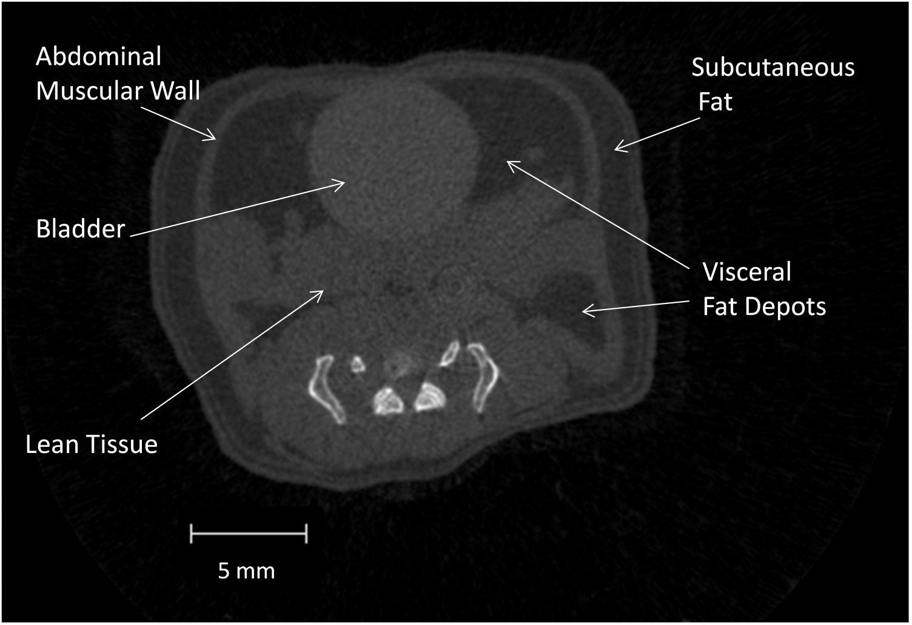
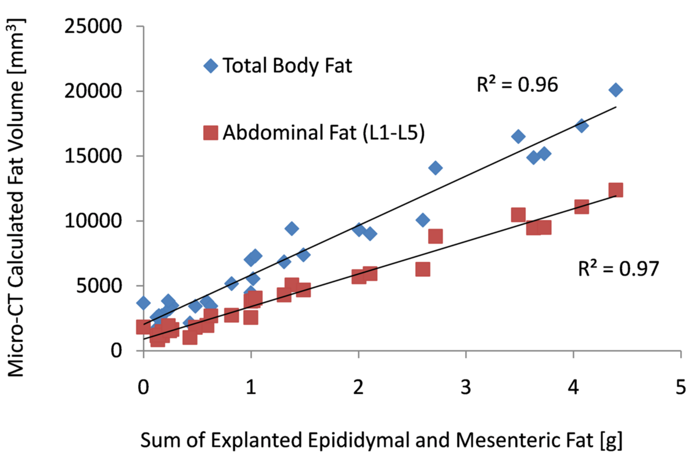
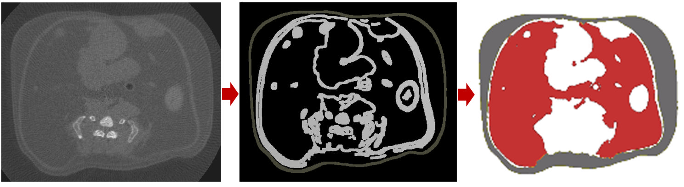
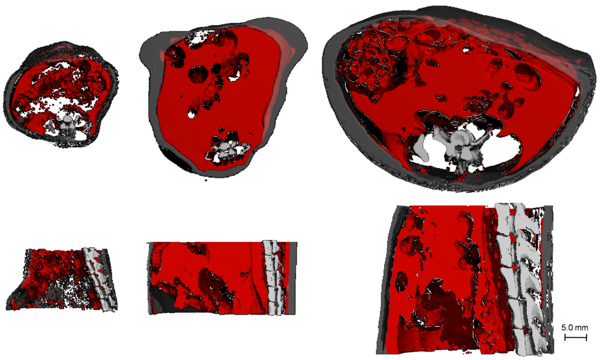

<!-- página 1 | encabezado: NIH Public Access / Author Manuscript / Methods. Author manuscript; available in PMC 2011 January 1. / NIH-PA Author Manuscript / NIH-PA Author Manuscript / NIH-PA Author Manuscript -->

Published in final edited form as:

*Methods*. 2010 January ; 50(1): 14. doi:10.1016/j.ymeth.2009.05.017.

# Quantification of Adiposity in Small Rodents using Micro-CT

**S. Judex**, **Y.K. Luu**\*, **E. Ozcivici**, **B. Adler**, **S. Lublinsky**, and **C.T. Rubin**

Department of Biomedical Engineering, Stony Brook University, Stony Brook, NY 11794

\* Department of Medicine, Diabetes Research Center, Albert Einstein College of Medicine, Bronx, NY 10461

## Abstract

Non-invasive three-dimensional imaging of live rodents is a powerful research tool that has become critical for advances in many biomedical fields. For investigations into adipose development, obesity, or diabetes, accurate and precise techniques that quantify adiposity *in vivo* are critical. Because total body fat mass does not accurately predict health risks associated with the metabolic syndrome, imaging modalities should be able to stratify total adiposity into subcutaneous and visceral adiposity. Micro-computed tomography (micro-CT) acquires high-resolution images based on the physical density of the material and can readily discriminate between subcutaneous and visceral fat. Here, a micro-CT based method to image the adiposity of live rodents is described. An automated and validated algorithm to quantify the volume of discrete fat deposits from the computed tomography is available. Data indicate that scanning the abdomen provides sufficient information to estimate total body fat. Very high correlations between micro-CT determined adipose volumes and the weight of explanted fat pads demonstrate that micro-CT can accurately monitor site-specific changes in adiposity. Taken together, *in vivo* micro-CT is a non-invasive, highly quantitative imaging modality with greater resolution and selectivity, but potentially lower through-put, than many other methods to precisely determine total and regional adipose volumes and fat infiltration in live rodents.

### Keywords

Micro Computed Tomography; In Vivo; Fat; Total Adipose Tissue; Visceral Adipose Tissue; Subcutaneous Adipose Tissue; Spatial Distribution; Mouse; Rat

## 1. Introduction

To address the etiology and pathophysiology of the current obesity epidemic and to evaluate potential treatments, the precise quantification of adipose tissue is critical. Total adipose tissue (TAT) is not uniformly distributed in the body but, instead, accumulates in specific compartments to become visceral adipose tissue (VAT) or subcutaneous adipose tissue (SAT). General indices of obesity that track TAT, such as the Body Mass Index, do not accurately predict the risk for diabetes and heart disease because the amount of fat in different body <!-- página 2 | impresa: 2 | encabezado: Judex et al. / Page 2 | pie: Methods. Author manuscript; available in PMC 2011 January 1. --> compartments carries differential metabolic risks [1,2]. VAT is more closely correlated with obesity-associated pathologies and complications than either TAT or SAT [3,4]. Not surprisingly, removing SAT from the abdominal area through liposuction does not provide the health benefits that would be expected from the reduction in fat mass [5]. Nevertheless, VAT is not the only factor contributing to the metabolic syndrome and measures of SAT have been associated with many metabolic risk factors including aberrant levels of fasting plasma insulin, triglycerides, low-density lipoprotein, and cholesterol [6,7].

<!-- NOTA-CONV: aviso de copyright, correspondencia, aviso del editor y conflicto de interés impresos al pie de la página 1, bajo la línea de notas, sin llamada en el texto; se colocan después del párrafo que cruza de la página 1 a la 2, en su orden impreso -->

© 2009 Elsevier Inc. All rights reserved.

**Correspondence to:** Stefan Judex, Ph.D. Department of Biomedical Engineering Psychology A Building, 3rd Floor Stony Brook University Stony Brook, NY, 11794-2580 USA Phone: 631-632-1549 FAX: 631-632-8577 e-mail: stefan.judex@sunysb.edu.

**Publisher's Disclaimer:** This is a PDF file of an unedited manuscript that has been accepted for publication. As a service to our customers we are providing this early version of the manuscript. The manuscript will undergo copyediting, typesetting, and review of the resulting proof before it is published in its final citable form. Please note that during the production process errors may be discovered which could affect the content, and all legal disclaimers that apply to the journal pertain.

Conflict of Interest

None of the authors have any conflict of interest

In humans, body composition and the spatial stratification into VAT and SAT is commonly determined by computed tomography (CT) and magnetic resonance imaging (MRI) [8-10]. In efforts to identify mechanisms and treatments for the health crisis associated with the metabolic syndrome, investigators have increasingly turned to mouse and rat models. In rodents, adiposity has been assessed by dual-energy X-ray Absorptiometry (DXA), weighing of abdominal and subcutaneous fat pads, *in vitro* culturing of adipocytes obtained from fat pads, chemical extraction techniques of lipids from the entire rodent, micro-MRI, or multi-echo MR. *In vivo* imaging techniques not only have the potential for a more accurate determination of adipose tissue but also allow for serial scans during an experimental protocol, facilitating the tracking of obesity development and treatment efficacy over time. Additionally, these non-invasive techniques may enhance experimental study design by reducing the number of required animals and increasing statistical power. However, the ability to spatially discriminate different types of adipose tissue in small rodents such as the mouse, the model of choice in obesity and diabetes research [11], is limited by most of the current measurement techniques. The resolution and signal-to-noise ratio required to selectively quantify adipose tissue depots in mice that weigh as little as ten grams presents a unique challenge.

Most current imaging methods such as DXA and nuclear MR of the whole animal typically fail to provide detailed spatial information on fat distribution [12,13] and spatial specificity can only be obtained by combining the two modalities [14]. Micro-MRI and small animal multi-echo MR have been successfully used to compartment-specific phenotype mouse models of obesity [15,16]. High-resolution micro-computed tomography (micro-CT) scanners have become widely available because of their gold-standard status for quantifying skeletal morphology of small rodents. Micro-CT images consist of physical density 3D maps of the scanned region. Thus, not only the volume and geometry of hard tissues can be quantified but any tissue with sufficiently large density gradients against the background including discrete fat deposits or infiltration of fat into other organs (Fig. 1). As the resolution of *in vivo* micro-CT scans can be selected to fall into an isometric voxel range of approximately ten to two hundred microns, the system can not only measure the total volume of adipose tissue within an animal, but can also identify and quantify small volumes of fat cells residing in discrete deposits. Compared to other 3D adipose imaging techniques including micro-MRI, micro-CT offers higher resolutions, cost-effectiveness, and degree of commercial availability and is being increasingly used in investigations that require data on body composition [17-20]. Here we describe a validated method to image and quantify TAT, SAT, and VAT by *in vivo* micro-CT.

## 2. Materials and Methods

Below, the steps involved in the *in vivo* quantification of discrete fat deposits by micro-CT are described for small animal models. Scan parameters and the effective use of post-processing data analysis routines that yield precise and accurate data are discussed.

### 2.1 Pre micro-CT scan

To determine accurate physical densities from the tissue linear attenuation values of the X-ray counts, calibration phantoms need to be scanned. Inherently, the range of the phantom densities should include the density of fat (many micro-CT scanners only come with phantoms that allow <!-- página 3 | impresa: 3 | encabezado: Judex et al. / Page 3 | pie: Methods. Author manuscript; available in PMC 2011 January 1. --> the calibration of much denser tissues). All data presented below were generated with *in vivo* scanners manufactured by Scanco AG (vivaCT 40, vivaCT 75, Switzerland). Other suppliers of *in vivo* micro computed tomography devices include General Electric (Fairfield, CT), Siemens (Knoxville, TN), Micro Photonics (Allentown, PA), or Echo Medical Systems (Houston, TX). In preparation of the scan, a control file that defines the *in vivo* micro-CT scan parameters has to be created. The variables within this control file include energy settings, the number of projections, scan dimensions, and exposure time, all of which define or influence image variables such as resolution, scan time, or the signal to noise ratio.

<strong>2.1.1 Energy Settings—</strong>Voltage and current are the basic energy settings that determine the X-ray characteristics. When imaging fat, greater efforts have to go into optimizing contrast than when imaging hard tissue. Inherently, the quality of the image increases with the signal to noise ratio. Quantum errors in counting photons are one prominent source of noise in microCT images. As this statistical error diminishes with the square of the photon flux, increasing the tube current can enhance the signal to noise ratio. For our scanners with a detector size of 1024×256, we typically select the highest available current for our source (133 μA) and a low voltage setting (45 KV). Whether even higher currents potentially available on scanners of other manufacturers positively impact adipose image quality has not been reported. Even though we use the above settings for scans of both mice and rats, very small or large animals may require an adjustment of the tube energy parameters and it may take several trials to find the optimal settings.

<strong>2.1.2 Resolution—</strong>The nominal resolution of the tomography is determined by the isotropic increment size and the number of projections in the control file. Inherently, high-resolution scans will capture more detail of the tissue architecture but will increase scan time and the exposure of the animal to anesthesia and radiation. Conversely, low-resolution scans are fast but may omit important tissue detail. To minimize time and resources necessary to process and store data, the lowest resolution that will provide adequate detail should be selected. Voxel densities of fat are relatively uniform throughout the adipose tissue and partial volume effects are less important than for structures that have an intricate architecture such as trabecular bone.

While spatial detail is not critical for the quantification of total adipose tissue (TAT), it becomes important when delineating the muscular wall that encloses the abdominal cavity. The abdominal muscular wall is commonly used to separate visceral adipose tissue (VAT, inside of the abdominal wall) from subcutaneous adipose tissue (SAT, outside of the abdominal wall) [21,22]. We have found that for many inbred mouse strains, a resolution of approximately 80 μm is sufficient to accurately identify the muscle fascia of the abdominal wall (Fig. 1). However, definition of the relatively thin muscular wall in young or very obese mice requires an increase in resolution. For instance, spatial separation of the fat compartments in the ob/ob mouse necessitates a resolution of about 50 μm.

<strong>2.1.3 Exposure and Number of Projections—</strong>In our experience, the exposure time plays a lesser role for soft tissue scans than for scans involving large contrast. To minimize scanning time, we therefore select a relatively low exposure time of 200 ms. For scanners with different exposure time selections, we recommend to use a low setting and test whether an increase in the exposure time improves image quality. More importantly than selecting exposure time, undersampling should be avoided by using at least 260 projections per 180°.

<strong>2.1.4 Region of Interest—</strong>Only a whole body scan can determine the amount of total body fat; however, there would be clear advantages in regards to scan time and data storage if similar information could be extracted from scanning a much smaller anatomical region. To this end, we performed whole body scans of forty-five 4mo old C57BL/6J mice across a large range of body mass/adiposity, and compared data from various analysis regions. The largest region <!-- página 4 | impresa: 4 | encabezado: Judex et al. / Page 4 | pie: Methods. Author manuscript; available in PMC 2011 January 1. --> spanned almost the entire body from the base of the skull, as the spinal canal begins to widen, to the distal end of the tibia [18]. The smallest region utilized the same images but the analysis was constricted to the abdominal region between L1 and L5. The large differences in body mass (range: 15.7 - 46.5 grams) were induced by differential diets and a non-pharmacological prophylaxis for adiposity over a 12wk period [20]. Total whole body fat volume was highly correlated with abdominal fat volume across the 45 mice ($\mathrm{R}^2$ = 0.99, p&lt;0.001). Post-mortem, epididymal and mesenteric fat pads, measures of visceral and subcutaneous fat mass respectively [18], were excised to determine whether relative differences in micro-CT fat volumes across animals are congruent with differences in abdominal fat mass. The combined weight of epididymal and mesenteric fat pads was highly correlated with the volumes of both total body and abdominal adiposity determined by micro-CT (Fig. 2). These data indicate that abdominal micro-CT fat volume is a precise measure of abdominal fat pad weight and that scanning an entire mouse may not be necessary to obtain relative data on total body fat as there was no loss in relative information by restricting the region of interest to the abdominal volume between L1 and L5. Reducing the size of the region of interest decreased the scan time from about 35-40 min to 12-13 min. It is important to note, however, that any condition that alters fat mass at only specific anatomical locations will alter the relation between abdominal fat and whole body fat, potentially necessitating whole body scans with site-specific evaluations of fat volume.

<strong>2.1.5 Radiation Exposure—</strong>All the parameters discussed above define the amount of radiation that an animal is exposed to during the scan, with longer durations and higher resolution and exposure times delivering greater doses [23]. The amount of radiation that an animal receives can be quantified precisely [24]. Investigations into the effects of micro-CT induced radiation on the tissue or the animal have yielded inconclusive data. Multiple scans at very high resolutions (&lt;15 μm) may have detrimental effects on *bone* morphology, particularly in young animals [25] while such an effect was not observed in adult rats [26]. Similar radiation studies have not been performed for the adipose system but because of the much lower resolution used for fat scans, only very small, if any, effects would be expected. It is interesting to note that the resolution at which we scan adipose tissue in small rodents is similar to the resolution used for high-resolution peripheral quantitative computed tomography (pQCT) imaging in humans [27]. Regardless, until precise radiation thresholds below which cellular and molecular activity is unchanged have been identified [28], the number of sequential longitudinal scans and settings of scan parameters need to be approached with care.

<strong>2.1.6 Animal Holder—</strong>Manufacturers may supply animal holders designed specifically for mice or rats. Many of these holders work well for scanning specific regions of an animal but often suffer from a lack of versatility. In our lab, we achieve the least amount of motion artifacts when using customized animal holders made of polystyrene foam, an inexpensive, low-density material that does not interfere with the measurement of soft tissues and that can readily be shaped to accommodate animals of very different sizes. Care should be taken to secure the animal without having any tissue or material outside the field of view.

### 2.2 Scanning of animal

<strong>2.2.1 Anesthesia—</strong>Animals will need to be maintained under anesthesia for the entire duration of the scan. In contrast to high-resolution imaging of smaller organs that move substantially during breathing, imaging adiposity at the described settings does not involve motion artifacts and therefore does not require gating. Verify that there is enough oxygen in the tank to maintain a constant flow rate of 0.1-0.5 l/min (depending on animal size and condition). Purge the induction chamber with 5% isoflurane (5-10 minutes depending on size of chamber). If multiple animals are scanned, re-purge the chamber periodically to maintain isoflurane concentration. The rodent should be monitored in the induction chamber. An animal <!-- página 5 | impresa: 5 | encabezado: Judex et al. / Page 5 | pie: Methods. Author manuscript; available in PMC 2011 January 1. --> is properly anesthetized when its muscle tone is relaxed and its heart and respiration rates have slowed visibly. Upon transfer of the mouse to the scanning chamber, the isoflurane nozzle is secured to the head of the animal. It is important to select an appropriate sized nozzle for the animal as improper anesthesia will result in either motion artifacts or animal death. The isoflurane level needs to be adjusted to the percentage necessary to keep the animal anesthetized. For an average-sized adult mouse, this range is 1.5-2%. Larger animals and animals that have had repeated exposure to isoflurane may require more anesthetic. Practice scans are useful to find an isoflurane level that neither causes motion artifacts in the images nor kills the animal.

<strong>2.2.2 Positioning—</strong>The animal is positioned comfortably in the animal holder, aligning its longitudinal axis transverse to the image plane. After securing the animal within the holder (e.g., rubber bands), foam shims can be placed around the animal if excessive space is present. Torsional misalignments can be adjusted for by stretching either hindlimb. A two-dimensional pre-scan image is taken to confirm the position of the animals and to define the boundaries of the region of interest. Misalignments can be corrected for by physically adjusting the position of the animal or by scanning the animal “as is” in its spatial position and to correct for any misalignments post scanning. Image registration techniques are available to match the region of interest between different animals via anatomical landmarks [29]. It should be noted, however, that image rotation may decrease the effective size of the analyzable region. If post-scanning rotations are expected, the size of the scan region should be selected conservatively. As described above, the typical anatomical region that we scan for the quantification of adiposity focuses on the abdomen defined by the skeletal landmarks of L1 and sacrum.

<strong>2.2.3 Post-Scan Recovery—</strong>When the scan is completed and the X-ray indicator light of the scanner is off, the animal can be dismounted from the holder and removed from the scanner. The animal will normally recover from the anesthesia within 5-10 minutes. A heat lamp will aid in the recovery and keep the animal warm. The exposure to anesthesia during the *in vivo* scan routinely causes a temporary dip (∼ 10%) in the body mass of the animals from which they recover within 2-3 days.

### 2.3 Quantification of fat compartments

<strong>2.3.1 Definition of the Raw Image—</strong>During scanning, a raw data file will be created that includes the sinograms from the scan. This raw file will be reconstructed into an ordered sequence of two-dimensional (2D) sections of the scan region. The final gray-scale file will reflect the apparent density of each voxel, with denser tissues appearing brighter and less dense tissues appearing darker.

<strong>2.3.2 Data Filter and Thresholding—</strong>A Gaussian filter is most commonly used to reduce noise in the gray-scale images. In our experience, levels for *sigma* and *support* of 1.0 / 2.0 have worked well for images scanned at 80 micron resolution, values that should be raised to 1.5 / 3 for 50 micron resolution scans. Upon filtering, thresholding of the image facilitates the segmentation of the tissue of interest from the background. *Ex-vivo* micro-CT imaging of a freshly harvested fat pad can be used to determine the preliminary range of voxel values that define adipose tissue. The smallest and largest value of this range, representing the lower and upper threshold for segmenting fat, can subsequently be optimized by plotting all voxel values of a given region of interest in a histogram. In this histogram, the distribution of tissue gray-scale values is typically bimodal in nature (two peaks), with one mode (peak) representing adipose tissue voxels and the other mode representing lean tissue voxels [18]. In our experience, the 2D image used for the determination of the upper and lower fat threshold should have a tissue composition of approximately 50% fat, 50% lean volume and come from an animal with average body mass. By using these thresholds, fat and lean volume can be visualized <!-- página 6 | impresa: 6 | encabezado: Judex et al. / Page 6 | pie: Methods. Author manuscript; available in PMC 2011 January 1. --> selectively. In addition, the selected threshold should be visually confirmed for animals at the extremes of any given sample (i.e., animals with the least and greatest amount of adiposity) by comparing gray-scale to segmented images. To reduce potential bias, we typically use fixed thresholds that are applied consistently across all regions of interest and animals within a given study.

<strong>2.3.3 Automatic Quantification of Discrete Fat Deposits—</strong>While the correct interpretation of fat data in metabolism, obesity, and diabetes related research may rely on the detailed volumetric assessment of distinct adipose compartments, it is also clear that such evaluations have to be performed in a precise, accurate, and efficient manner. In CT images, the abdominal muscular wall separating the visceral from the subcutaneous compartment can be used as the demarcation line for VAT and SAT because of the higher tissue density of muscle [21,22]. To separate the lower density fat compartments on both sides of the muscular wall, the fascia can be traced manually by drawing contour lines in any given two-dimensional micro-CT slice.

Unfortunately, the manual drawing of contour lines is cumbersome, labor-intensive, and may not yield the desired precision and accuracy [30-34]. Semi-automated algorithms to separate visceral from subcutaneous fat are much faster but may require the manual definition of a seed point [35-37]. An automated algorithm that is precise and robust was recently developed to quantify VAT and SAT in micro-CT images [19]. The algorithm is available for download at http://bme.sunysb.edu/labs/sjudex/miscellaneous.html and relies on Canny edge detection [38] and mathematical morphological operations to automate the manual contouring process that is otherwise required to spatially delineate the different adipose deposits (Fig. 3).

In vivo micro-CT scans of 74 C57BL/6J mice with a broad range of body weights and adiposity were used to test and validate the algorithm [19]. Despite the high heterogeneity within this sample of mice, the algorithm demonstrated a high degree of stability and robustness that did not necessitate changing of any of the initially set input variables. Comparisons of data between the automated and manual methods were in complete agreement ($\mathrm{R}^2$=0.99). Robustness was confirmed in a mouse model of severe obesity and in rats (Fig. 4). Compared to manual contouring, the increase in precision and accuracy, while decreasing processing time by at least an order of magnitude, suggests that this algorithm can be used effectively to separately assess the development of total, visceral, and subcutaneous adiposity.

<strong>2.3.4 Infiltration of Fat into other Organs—</strong>Of course, SAT and VAT are not the only fat deposits that can be analyzed. The liver and spleen are two organs which density values can be measured in a transverse region around the intervertebral disc between the 13th thoracic and first lumbar vertebrae. The inverse liver-to-spleen (L/S) density ratio is an indicator of the degree of fat infiltration in the liver [39-41]. Using the methods described above, the LS ratio was found to be significantly lower in C57BL/6J mice fed a high-fat diet than in regular diet mice, both at 8mo (52.9%, p&lt;0.0001) and 11mo (69.5%, p&lt;0.0001) of age [19].

### 2.4 Validation of method

While there is little doubt that micro-CT can precisely quantify fat volume based on voxel densities, the technique described above was validated by comparing volumetric micro-CT data to a well established method in the literature. To this end, the sample described under 2.1.4 was expanded and in addition to micro-CT based measurements of adiposity, the weights of explanted fat pads were recorded. Ninety C57BL/6J mice (weight range: 15.7 - 46.5 grams) were micro-CT scanned *in vivo* at 5 mo of age and subsequently sacrificed. Whole body fat volume (base of skull to distal tibia) derived from *in vivo* micro-CT was significantly (p&lt;0.001) correlated with *ex vivo* tissue weight of discrete perigonadal ($\mathrm{R}^2$ = 0.94), and subcutaneous <!-- página 7 | impresa: 7 | encabezado: Judex et al. / Page 7 | pie: Methods. Author manuscript; available in PMC 2011 January 1. --> ($\mathrm{R}^2$ = 0.91) fat pads. Both the correlations between visceral fat pad weight and micro-CT determined visceral fat volume ($\mathrm{R}^2$=0.95, p&lt;0.001) as well as subcutaneous fat pad weight and micro-CT determined subcutaneous fat volume ($\mathrm{R}^2$=0.91, p&lt;0.001) were very high. The strong correlations exceeded the associations between DXA measurements and fat pad weight [42] and validated *in vivo* micro-CT as a non-invasive, quantitative technique to determine the spatial distribution of specific fat compartments.

## 3 Conclusions

A validated method is described that can be used to quantify discrete fat deposits as well as fat infiltration into organs and tissues of live small rodents. Compared to current imaging techniques with similar capabilities, such as microMRI or the combination of DXA with NMR, micro-CT offers higher spatial resolutions and may be more readily available. Scan parameters that work well for mice with large differences in body and fat mass are presented but may have to be adjusted for animals with specific fat phenotypes. The high resolution of the method enables the detection of the muscular abdominal wall which is used to separate visceral adiposity from subcutaneous adiposity. An algorithm that standardizes and automates the analysis of the distribution of specific adipose compartments is available. This algorithm is precise, accurate, robust, and compared to the cumbersome process of manually drawing contour lines, provides large savings in time and labor costs. In addition, we have found that compared to whole body scans, limiting the volume of interest to the abdominal region does not necessarily cause a loss in information.

While not directly assessed here, it is likely that micro-CT measurements have a much greater accuracy than DXA that may greatly overestimate total fat mass [43]. Here, micro-CT fat volumes were validated against fat pad weight measurements in a relative sense but the accuracy of the method in an absolute sense is yet to be determined. Current limitations of *in vivo* micro-CT scanning, including relatively long time scan times and exposure to radiation that limit repetitive scans and high-throughput analyses, may be addressed by alternative CT scanning techniques such as vCT [44]. In summary, *in vivo* micro-CT is a non-invasive, quantitative tool that provides a robust, reliable, simple and cost-effective alternative with higher resolution and selectivity than many other methods to precisely determine total and regional adipose volumes and fat infiltration in small rodents.

## Acknowledgments

Financial support by NASA, NIAMS, NSF, and the Wallace Coulter Foundation is gratefully acknowledged.

## References

1. Kuo LE, Kitlinska JB, Tilan JU, Li L, Baker SB, Johnson MD, Lee EW, Burnett MS, Fricke ST, Kvetnansky R, Herzog H, Zukowska Z. Nat Med 2007;13:803–811. [PubMed: 17603492]

2. Pou KM, Massaro JM, Hoffmann U, Lieb K, Vasan RS, O'Donnell CJ, Fox CS. Diabetes Care. 2008

3. Weisberg SP, McCann D, Desai M, Rosenbaum M, Leibel RL, Ferrante AW Jr. J Clin Invest 2003;112:1796–1808. [PubMed: 14679176]

4. Fox CS, Massaro JM, Hoffmann U, Pou KM, Maurovich-Horvat P, Liu CY, Vasan RS, Murabito JM, Meigs JB, Cupples LA, D'Agostino RB Sr. O'Donnell CJ. Circulation 2007;116:39–48. [PubMed: 17576866]

5. Mohammed BS, Cohen S, Reeds D, Young VL, Klein S. Obesity (Silver Spring). 2008

6. Despres JP. Crit Pathw Cardiol 2007;6:51–59. [PubMed: 17667865]

7. Demerath EW, Reed D, Rogers N, Sun SS, Lee M, Choh AC, Couch W, Czerwinski SA, Chumlea WC, Siervogel RM, Towne B. Am J Clin Nutr 2008;88:1263–1271. [PubMed: 18996861]

8. Shen W, Chen J. Methods Mol Biol 2008;456:39–54. [PubMed: 18516551]

<!-- página 8 | impresa: 8 | encabezado: Judex et al. / Page 8 | pie: Methods. Author manuscript; available in PMC 2011 January 1. -->

9. Chiba Y, Saitoh S, Takagi S, Ohnishi H, Katoh N, Ohata J, Nakagawa M, Shimamoto K. Hypertens Res 2007;30:229–236. [PubMed: 17510504]

10. Maurovich-Horvat P, Massaro J, Fox CS, Moselewski F, O'Donnell CJ, Hoffmann U. Int J Obes (Lond) 2007;31:500–506. [PubMed: 16953256]

11. Brockmann GA, Bevova MR. Trends Genet 2002;18:367–376. [PubMed: 12127777]

12. Reed DR, Bachmanov AA, Tordoff MG. Physiol Behav 2007;91:593–600. [PubMed: 17493645]

13. Taicher GZ, Tinsley FC, Reiderman A, Heiman ML. Anal Bioanal Chem 2003;377:990–1002. [PubMed: 13680051]

14. Garcia MC, Wernstedt I, Berndtsson A, Enge M, Bell M, Hultgren O, Horn M, Ahren B, Enerback S, Ohlsson C, Wallenius V, Jansson JO. Diabetes 2006;55:1205–1213. [PubMed: 16644674]

15. Papademetris X, Shkarin P, Staib LH, Behar KL. Inf Process Med Imaging 2005;19:369–380. [PubMed: 17354710]

16. Calderan L, Marzola P, Nicolato E, Fabene PF, Milanese C, Bernardi P, Giordano A, Cinti S, Sbarbati A. Obesity (Silver Spring) 2006;14:405–414. [PubMed: 16648611]

17. Easterly ME, Foltz CJ, Paulus MJ. Lab Anim (NY) 2001;30:46–49. [PubMed: 11385757]

18. Luu YK, Lublinsky S, Ozcivici E, Capilla E, Pessin JE, Rubin CT, Judex S. Med Eng Phys 2009;31:34–41. [PubMed: 18486521]

19. Lublinsky S, Luu YK, Rubin CT, Judex S. J Digit Imaging. 2008

20. Rubin CT, Capilla E, Luu YK, Busa B, Crawford H, Nolan DJ, Mittal V, Rosen CJ, Pessin JE, Judex S. Proc Natl Acad Sci U S A 2007;104:17879–17884. [PubMed: 17959771]

21. Eguchi M, Tsuchihashi K, Saitoh S, Odawara Y, Hirano T, Nakata T, Miura T, Ura N, Hareyama M, Shimamoto K. Hypertens Res 2007;30:315–323. [PubMed: 17541210]

22. Urbanchek MG, Picken EB, Kalliainen LK, Kuzon WM Jr. J Gerontol A Biol Sci Med Sci 2001;56:B191–B197. [PubMed: 11320099]

23. Ford NL, Thornton MM, Holdsworth DW. Med Phys 2003;30:2869–2877. [PubMed: 14655933]

24. Figueroa SD, Winkelmann CT, Miller HW, Volkert WA, Hoffman TJ. Med Phys 2008;35:3866–3874. [PubMed: 18841837]

25. Klinck RJ, Campbell GM, Boyd SK. Med Eng Phys 2008;30:888–895. [PubMed: 18249025]

26. Brouwers JE, Van RB, Huiskes R. J Orthop Res 2007;25:1325–1332. [PubMed: 17568420]

27. Vico L, Zouch M, Amirouche A, Frere D, Laroche N, Koller B, Laib A, Thomas T, Alexandre C. J Bone Miner Res 2008;23:1741–1750. [PubMed: 18665795]

28. Boone JM, Velazquez O, Cherry SR. Mol Imaging 2004;3:149–158. [PubMed: 15530250]

29. Kristensen E, Parsons TE, Hallgrimsson B, Boyd SK. IEEE Trans Biomed Eng 2008;55:2826–2831. [PubMed: 19126464]

30. Seidell JC, Bakker CJ, van der KK. Am J Clin Nutr 1990;51:953–957. [PubMed: 2349931]

31. Donnelly LF, O'Brien KJ, Dardzinski BJ, Poe SA, Bean JA, Holland SK, Daniels SR. AJR Am J Roentgenol 2003;180:993–998. [PubMed: 12646443]

32. Poll LW, Wittsack HJ, Koch JA, Willers R, Scherer A, Kapitza C, Heinemann L, Modder U. Eur J Med Res 2002;7:347–352. [PubMed: 12204842]

33. Armao D, Guyon JP, Firat Z, Brown MA, Semelka RC. J Magn Reson Imaging 2006;23:736–741. [PubMed: 16555257]

34. Lublinsky S, Ozcivici E, Judex S. Calcif Tissue Int 2007;81:285–293. [PubMed: 17828460]

35. Elbers JM, Haumann G, Asscheman H, Seidell JC, Gooren LJ. Int J Obes Relat Metab Disord 1997;21:1121–1129. [PubMed: 9426379]

36. Bandekar AN, Naghavi M, Kakadiaris IA. Conf Proc IEEE Eng Med Biol Soc 2006;1:932–935. [PubMed: 17946011]

37. Bandekar A, Naghavi M, Kakadiaris I. Conf Proc IEEE Eng Med Biol Soc 2005;3:3280–3283. [PubMed: 17282946]

38. Canny J. IEEE Transactions on Pattern Analysis and Machine Intelligence 1986;8

39. Ricci C, Longo R, Gioulis E, Bosco M, Pollesello P, Masutti F, Croce LS, Paoletti S, de BB, Tiribelli C, Dalla PL. J Hepatol 1997;27:108–113. [PubMed: 9252082]

<!-- página 9 | impresa: 9 | encabezado: Judex et al. / Page 9 | pie: Methods. Author manuscript; available in PMC 2011 January 1. -->

40. Longo R, Ricci C, Masutti F, Vidimari R, Croce LS, Bercich L, Tiribelli C, Dalla PL. Invest Radiol 1993;28:297–302. [PubMed: 8478169]

41. Kodama Y, Ng CS, Wu TT, Ayers GD, Curley SA, Abdalla EK, Vauthey JN, Charnsangavej C. AJR Am J Roentgenol 2007;188:1307–1312. [PubMed: 17449775]

42. Sjogren K, Hellberg N, Bohlooly Y, Savendahl L, Johansson MS, Berglindh T, Bosaeus I, Ohlsson C. J Nutr 2001;131:2963–2966. [PubMed: 11694626]

43. Nagy TR, Clair AL. Obes Res 2000;8:392–398. [PubMed: 10968731]

44. Kiessling F, Greschus S, Lichy MP, Bock M, Fink C, Vosseler S, Moll J, Mueller MM, Fusenig NE, Traupe H, Semmler W. Nat Med 2004;10:1133–1138. [PubMed: 15361864]

<!-- página 10 | impresa: 10 | encabezado: Judex et al. / Page 10 | pie: Methods. Author manuscript; available in PMC 2011 January 1. -->

**Figure 1.**

Transverse micro-CT image of a mouse abdomen at the level of the L5-S1 inter-vertebral disk. Even without contrast agents or image processing, individual organs and tissues can be discerned by their differences in density and structure.

<!-- texto en la figura: rótulos con flechas: Abdominal Muscular Wall · Subcutaneous Fat · Bladder · Visceral Fat Depots (dos flechas) · Lean Tissue · barra de escala: 5 mm -->

<!-- página 11 | impresa: 11 | encabezado: Judex et al. / Page 11 | pie: Methods. Author manuscript; available in PMC 2011 January 1. -->

**Figure 2.**

Correlation between the weight of the harvested fat pads and fat volume determined by micro-CT for either the entire body (blue markers) or the abdominal region (red markers).

<!-- texto en la figura: eje y: Micro-CT Calculated Fat Volume [mm³] (0 a 25000) · eje x: Sum of Explanted Epididymal and Mesenteric Fat [g] (0 a 5) · leyenda: ◆ Total Body Fat (rombos azules) · ■ Abdominal Fat (L1-L5) (cuadrados rojos) · rótulos de las rectas de regresión: R² = 0.96 (recta superior, Total Body Fat) · R² = 0.97 (recta inferior, Abdominal Fat) -->

<!-- página 12 | impresa: 12 | encabezado: Judex et al. / Page 12 | pie: Methods. Author manuscript; available in PMC 2011 January 1. -->

**Figure 3.**

Each micro-CT slice (left image) is submitted to the automated algorithm which applies edge-detection and morphological operations (center) to obtain a fully segmented image (right image) in which visceral (red) is separated from subcutaneous (gray) adipose tissue (right).

<!-- página 13 | impresa: 13 | encabezado: Judex et al. / Page 13 | pie: Methods. Author manuscript; available in PMC 2011 January 1. -->

**Figure 4.**

Top Row: Reconstructed and segmented three dimensional tomographies of the abdominal region of an adult C57BL/6J mouse (left image), ob/ob mouse (center), and Sprague-Dawley rat (right image). Bottom Row: Sagittal view of the same region. Bone is depicted in light gray, visceral fat in red and subcutaneous fat in dark semi-transparent gray.

<!-- texto en la figura: barra de escala (abajo a la derecha, junto al corte sagital de la rata): 5.0 mm -->
