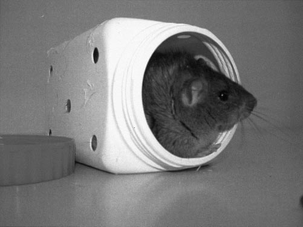
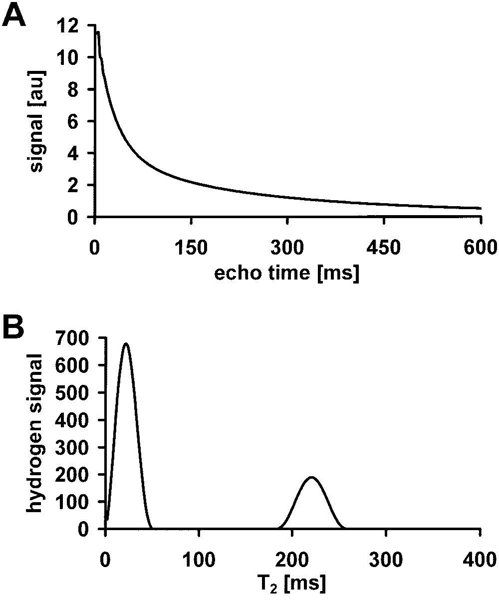
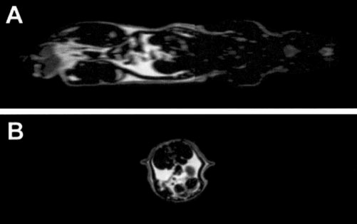
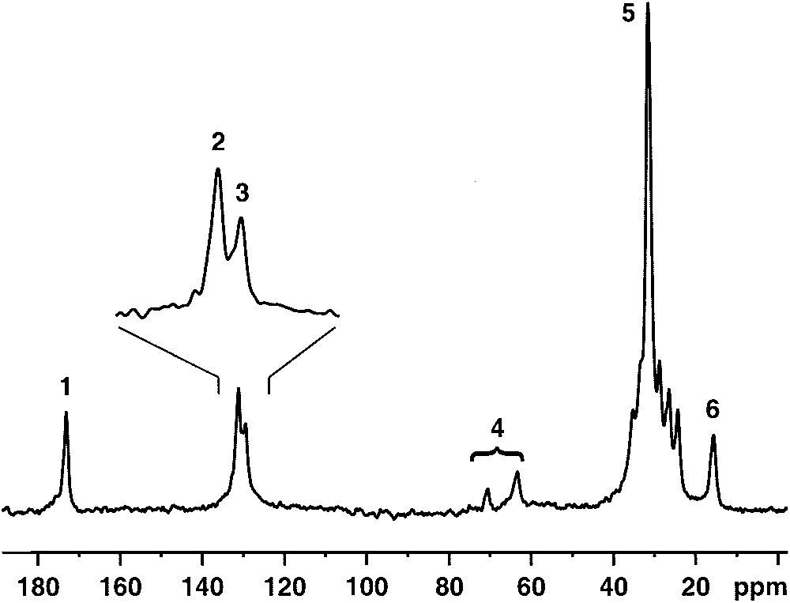
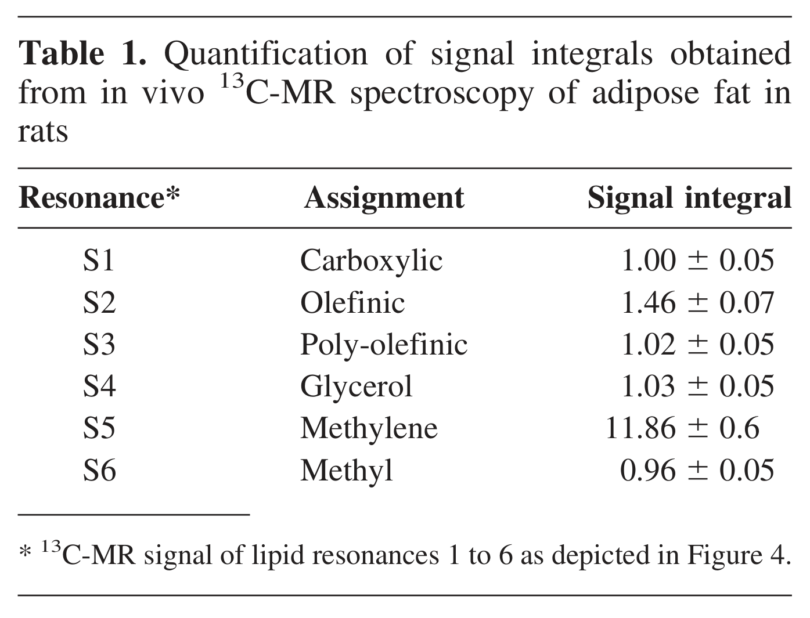
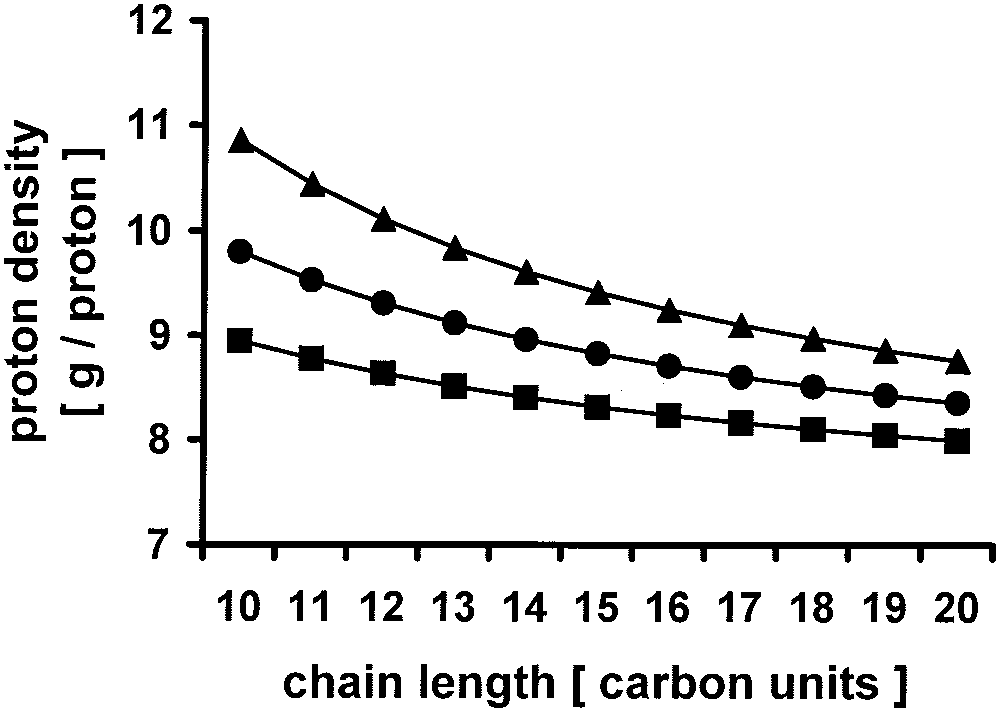
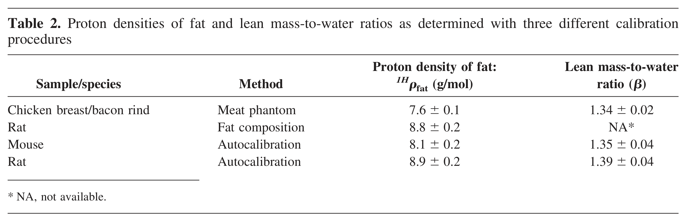
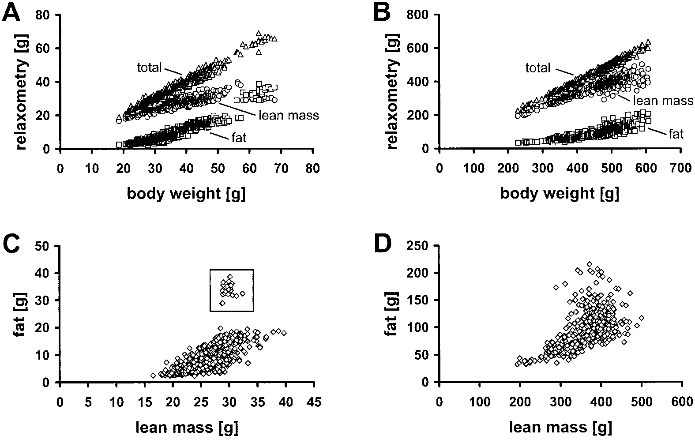
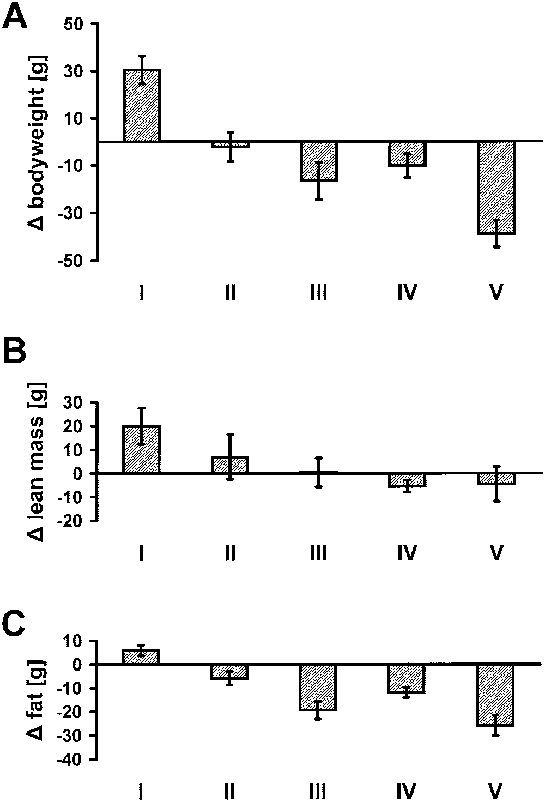

<!-- página 1 | impresa: 1604 | pie: 1604 OBESITY RESEARCH Vol. 12 No. 10 October 2004 -->

# Quantitative Body Composition Analysis in Awake Mice and Rats by Magnetic Resonance Relaxometry

*Basil Künnecke,\* Philippe Verry,† Agnès Bénardeau,† and Markus von Kienlin\**

## Abstract

KÜNNECKE, BASIL, PHILIPPE VERRY, AGNÈS BÉNARDEAU, AND MARKUS VON KIENLIN. Quantitative body composition analysis in awake mice and rats by magnetic resonance relaxometry. *Obes Res.* 2004; 12:1604–1615.

***Objective:*** Magnetic resonance (MR) relaxometry has recently been introduced for noninvasive body composition analysis in awake mice. The purpose of the present study was to extend the method to rats and to introduce calibration procedures that render MR relaxometry fully quantitative.

***Research Methods and Procedures:*** Proton $T_2$ MR relaxometry at 4.7 Tesla was used for body composition analyses in 700 awake mice and 400 rats of different strains and conditions. Relaxograms calculated from the signal decays observed with multi-spin-echo acquisition provided well-separated contributions of tissue water and fat. Analysis of fat composition was carried out in vivo using 13C-MR spectroscopy. Evolution of body composition in rats was assessed during drug treatment.

***Results:*** MR relaxometry for noninvasive body composition analysis in laboratory rodents was implemented on a standard MR scanner, and a throughput of >30 animals per hour was achieved. Excellent linearity and reproducibility with coefficients of variance as low as 2.5% and 1.7% were obtained in mice and rats, respectively. The lean mass-to-water ratio (mice, 1.35 ± 0.03; rats, 1.39 ± 0.04) and the proton density of fat (mice, 8.1 ± 0.2; rats, 8.9 ± 0.2 g/mol) were determined from cross-sectional data. Fat composition analysis by 13C-MR spectroscopy corroborated these findings and yielded information on the average acyl chain length (16.3 ± 1.6) and contributions of saturated (27 ± 3%), monounsaturated (22 ± 2%), and polyunsaturated (51 ± 3%) fatty acids. Longitudinal assessments in rats treated with sibutramine and dexfenfluramine showed dose-related changes in body composition.

<!-- NOTA-CONV: los siete párrafos siguientes (fechas de recepción y aceptación, aviso de costos de publicación, afiliaciones de las llamadas * y †, correspondencia, correo y copyright) están impresos en letra pequeña al pie de la columna izquierda de la página 1, bajo una línea; se colocan después del párrafo del resumen que cruza a la columna derecha -->

Received for review January 27, 2004.

Accepted in final form July 28, 2004.

The costs of publication of this article were defrayed, in part, by the payment of page charges. This article must, therefore, be hereby marked “advertisement” in accordance with 18 U.S.C. Section 1734 solely to indicate this fact.

\*Magnetic Resonance Imaging and Spectroscopy and †Discovery Biology, Vascular and Metabolic, F. Hoffmann-La Roche Ltd., CH-4070 Basel, Switzerland.

Address correspondence to Basil Künnecke, Magnetic Resonance Imaging and Spectroscopy, PRBD-M, Building 68/05A, F. Hoffmann-La Roche Ltd., Grenzacherstrasse 124, CH-4070 Basel, Switzerland.

E-mail: basil.kuennecke@roche.com

Copyright © 2004 NAASO

***Discussion:*** $T_2$ MR relaxometry backed by solid calibration provides a powerful means for rapid quantitative body composition analysis in awake mice and rats that is suitable for serial investigations in pharmaceutical research.

**Key words: fat, lean mass, spectroscopy, sibutramine, dexfenfluramine**

## Introduction

To date, body mass determination by simple weighing is the most widespread modality for assessing obesity-related fat accumulation in man and animal models. Although this procedure allows rapid assessments to be carried out noninvasively, it provides only an indirect and rather unreliable measure of body fat content (1,2). Changes in lean mass with its all-dominating tissue water component may easily masquerade or even feign potential changes in body fat content. However, new medicines for the prevention and treatment of overt obesity aim at reducing body fat without affecting lean mass (3). Thus, in the context of in vivo drug profiling, a clear need has emerged for reliable and rapid body composition analysis in experimental animals.

Numerous alternative noninvasive methods of weighing with higher selectivity for tissue fat have been used in man. Among these are densitometry, air-displacement plethysmography, impedancometry, and morphometric measurements such as BMI and skinfold thickness (4–6). However, all these latter modalities fall short in that they report only surrogates of fat content and are impracticable in experimental animals. On the other hand, imaging techniques such <!-- página 2 | impresa: 1605 | encabezado: Body Composition by MR Relaxometry, Künnecke et al. | pie: OBESITY RESEARCH Vol. 12 No. 10 October 2004 1605 / sello de descarga (margen derecho, en vertical): 15508528, 2004, 10, Downloaded from https://onlinelibrary.wiley.com/doi/10.1038/oby.2004.200 by Cochrane Mexico, Wiley Online Library on [01/10/2026]. See the Terms and Conditions (https://onlinelibrary.wiley.com/terms-and-conditions) on Wiley Online Library for rules of use; OA articles are governed by the applicable Creative Commons License --> as DXA, computer tomography, and magnetic resonance (MR)[^1] imaging have emerged for determining total fat content noninvasively in both humans and laboratory animals (5,6). These modalities have two major intrinsic limitations especially with respect to animal studies. Firstly, anesthesia is generally required for animals to keep them immobile during examination. Even though short-term anesthesia with modern anesthetics is perceived as minimally invasive, animals do respond with diminished food intake, altered growth patterns, and eventually with changes in body composition. Secondly, full-body scans for total fat determinations still require measurement times of approximately 10 to 30 minutes, hence providing a throughput incompatible with rapid screening procedures. Partial scans of the abdominal region have been used to address this latter issue, although at the expense of the need to extrapolate from abdominal fat to total body fat content.

Two new methods for body composition analysis have been proposed on the basis of MR spectroscopy. Whole-body 1H-MR spectroscopy, in principle, allows body composition to be directly and quantitatively assessed in vivo on the premise of the spectral separation between water and fat. Mitchell et al. established such an approach for carcass analysis (7). More recently, MR spectroscopy also has been implemented for body composition analysis in anesthetized mice (8) and rats (9,10), and its feasibility in awake mice has been demonstrated (11). However, the limited homogeneity of the static magnetic field and the ensuing spectral overlap particularly in whole-body assessments of larger and awake animals may considerably restrict its applicability. On the other hand, in vivo 1H-MR relaxometry has been proven a compelling alternative for assessing body composition in mice (12–15). MR relaxometry unambiguously separates water and fat in biological tissue due to their very different $T_2$ and/or $T_1$ relaxation times and, thus, allows quantification of the individual components (14,15). Agricultural and food industries have been using MR relaxometry over the last decades to ascertain the composition of their raw materials and products (16). Analytical low-field bench-top MR instruments have generally been employed for such routine MR relaxometry. Lately, it has been demonstrated that the same technology and instrumentation are also applicable to living mice even in absence of anesthesia. Quantitative comparisons with DXA and chemical extraction as gold standard have shown that MR relaxometry is even more precise than DXA and much more rapid than any other method available for quantitative body composition analysis (12,14). However, despite the method’s obvious promise, only very scant data of relaxometric body composition analysis in conscious animals are available in the literature, and experience is limited to assessments in mice.

<!-- NOTA-CONV: nota al pie impresa en la página 2 -->

[^1]: Nonstandard abbreviations: MR, magnetic resonance; BW, body weight; DM, dry matter; MRS, MR spectroscopy; CPMG, Carr-Purcell-Meiboom-Gill.

The aim of the present work was 3-fold: to extend the scope of in vivo MR relaxometry for body composition analysis to larger laboratory animals, to transfer the method to conventional MR scanners used for routine animal examination, and to build a solid basis for calibration and absolute quantification of body composition. In this article, we describe the successful implementation of MR relaxometry on a high-field animal scanner for body composition analysis in mice and rats. Excellent reproducibility and linearity of in vivo MR relaxometry are demonstrated, and two novel concepts of calibration for absolute quantification are introduced. Finally, cross-sectional and longitudinal body composition analyses are reported from several hundred mice and rats of various genetic backgrounds and subjected to different dietary regimes and drug treatments.

## Research Methods and Procedures

### Animals

Experimentation with animals was performed within the Swiss federal regulations for animal welfare and under the rules of the Association for Assessment and Accreditation of Laboratory Animal Care International. Reproducibility studies and cross-sectional analyses of body composition were performed with rats (250 to 650 grams) and mice (25 to 65 grams) of different strains [rats, Sprague-Dawley, Wistar, Zucker Fatty (*fa*/*fa*); mice, C57BL/6J, AKR/J, 129P3, NMRI, *ob/ob*], ages (rats, 6 to 25 weeks; mice, 3 to 18 weeks), and dietary conditions. For experiments addressing pharmacological efficacy, Sprague-Dawley rats at 3 weeks of age were fed ad libitum with a high-caloric diet (Kliba 2154) providing 20% of the calories from fat. After an initial growth phase of 10 weeks, the 50% of the animals with the largest body weight (BW) were randomized into five homogeneous groups (*n* = 9) with regard to averaged BW and food intake. Thereafter, Group I continued to be fed with high-fat diet ad libitum and treated with placebo (tap water). Groups III and IV had also unlimited access to high-fat diet but in addition received daily doses (3 mg/kg per os) of the centrally acting appetite suppressants sibutramine (Meridia, Knoll, Germany) (17,18) and dexfenfluramine (19,20), respectively. Group V was also treated with dexfenfluramine akin to Group IV but with a daily dose of 10 mg/kg. Finally, the animals of Group II were pair-fed with those of Group III and received a reduced amount of food corresponding to the food intake of individual peers in Group III.

All in vivo experiments for determining body composition relaxometrically were carried out with nonanesthetized animals. Shortly before the MR investigation, individual animals were transferred into commercially available polyethylene/polypropylene containers with custom-drilled <!-- página 3 | impresa: 1606 | encabezado: Body Composition by MR Relaxometry, Künnecke et al. | pie: 1606 OBESITY RESEARCH Vol. 12 No. 10 October 2004 / sello de descarga (margen derecho, en vertical): 15508528, 2004, 10, Downloaded from https://onlinelibrary.wiley.com/doi/10.1038/oby.2004.200 by Cochrane Mexico, Wiley Online Library on [01/10/2026]. See the Terms and Conditions (https://onlinelibrary.wiley.com/terms-and-conditions) on Wiley Online Library for rules of use; OA articles are governed by the applicable Creative Commons License --> holes for air circulation (rats, 1200 mL; mice, 105-mL effective volume) as shown in Figure 1. The containers were closed with screw-top lids and then placed on the slide-in patient table in a specially designed plastic mold to ensure reliable positioning within the homogeneous region of the magnet and transmit/receive coil. Animal preparation and subsequent MR relaxometry took less than 2 minutes per animal and resulted in a sustained throughput of >30 animals per hour. In addition to MR relaxometry, 1H-MR imaging and 13C-MR spectroscopy (MRS) were performed with a subset of animals anesthetized with 2% to 2.5% isoflurane in N2O/O2. A limited number of rats were sacrificed, and epididymal fat pads were surgically resected for subsequent gravimetric analysis.

<!-- NOTA-CONV: Figure 1 impresa arriba de la columna izquierda de la página 3 -->

*Figure 1:* Plastic container with ventilation holes used for noninvasive body composition analysis in awake rats by MR relaxometry.

### Phantoms

Phantoms mimicking the $T_2$ relaxation behavior of animal tissue in vivo were prepared on the basis of agar agar gels. Lean tissue was simulated with a 1% agar agar gel supplemented with 20 mM CuSO4, resulting in an average $T_2$ of water of 45 ms at 4.7 Tesla. Correspondingly, a plain 0.75% agar agar gel with an average $T_2$ of 230 ms was used to model fat. Additional studies were conducted in phantoms that were composed of lean chicken breast and fatty bacon rind and heated to 37 °C.

### $\mathrm{T}_2$ MR Relaxometry

Proton $T_2$ MR relaxometry at 4.7 Tesla (200 MHz) was carried out on a Bruker Biospec 47/40 equipped with a custom-built linearly polarized birdcage resonator (195-mm diameter, 16 rungs, 280-mm length) with radio-frequency power capability > 1 kW and a homogeneous $\mathrm{B}_1$ field with &lt;3% variation over a 1.2-liter sample volume. An actively switched PIN diode shunt attenuator (12 dB) was inserted in the transmit/receive path to avoid saturation of the preamplifier due to the very strong whole-body MR signals obtained from obese animals. Data acquisition was accomplished using a Carr-Purcell-Meiboom-Gill (CPMG) multiple spin-echo sequence with the following parameters: 90° excitation and 256 refocusing pulses (180°) of rectangular shape and 200- and 400-µs duration, respectively, 5-µs dwell time, 256 sample points, two averages, and repetition time (TR) = 10,000 ms. A short interecho interval of echo time (TE) = 2.5 ms renders data collection highly insensitive to motion. With these parameters, the $T_2$ decay is sampled over a time window of 640 ms. The carrier frequency was set midway between the resonance of water and those of the methylene moieties in fatty acids such as to minimize off-resonance effects for the two chemical species of interest (21,22). With these acquisition parameters, average power deposition was limited to below 2.5 W/kg.

Once every day the magnetic field was automatically shimmed with FASTMAP on a 1.2-liter container filled with tap water (23). The resulting magnetic field homogeneity in awake rats was better than 100 Hz as determined from the width at one-half height of the whole-body water resonance. Before and after every series of experiments, the daily performance of the instrument was ascertained with a set of agar agar phantoms containing known amounts of water. For each sample or animal, the probe was tuned and matched, and the pulse power was individually adjusted using the MR scanner’s in-built pulse power calibration routine.

### Data Analysis

Quantification of body composition was achieved by analysis of $T_2$ distributions. The maximal echo amplitudes of the CPMG signal train were extracted in the time domain and subjected to an inverse Laplace transformation as provided by the CONTIN software (24). The first two echoes were omitted from the analysis because of signal fluctuations generally detected in these early data. The resulting relaxograms were calculated with 200 equidistant samples over the range of 10 to 400 ms. The relaxograms from in vivo and phantom studies always showed two fully separated peaks at ∼40 and 230 ms, which have been assigned to tissue water and fat, respectively. Integration of the two peaks with demarcation at 100 ms yielded quantitative measures of the signal contributions of the two constituents. Finally, the coil’s actual sensitivity resulting from differential coil loadings was accounted for by multiplication with the transmitter voltage required for the 90° pulse (25).

### 1H-MR Fat Imaging

Fat-selective whole-body proton MR imaging (26) was performed at 200 MHz using a 3D rapid acquisition relaxation enhanced sequence (27) with the following parameters: <!-- página 4 | impresa: 1607 | encabezado: Body Composition by MR Relaxometry, Künnecke et al. | pie: OBESITY RESEARCH Vol. 12 No. 10 October 2004 1607 / sello de descarga (margen derecho, en vertical): 15508528, 2004, 10, Downloaded from https://onlinelibrary.wiley.com/doi/10.1038/oby.2004.200 by Cochrane Mexico, Wiley Online Library on [01/10/2026]. See the Terms and Conditions (https://onlinelibrary.wiley.com/terms-and-conditions) on Wiley Online Library for rules of use; OA articles are governed by the applicable Creative Commons License --> rectangular pulses for excitation (1.92 ms) and refocusing (1.2 ms), 33.3-kHz spectral width, 1283 complex data points, a rapid acquisition relaxation enhanced factor of 32, effective echo time/repetition time ($\mathrm{TE}_{\mathrm{eff}}$/TR) = 81/486 ms, and four averages. The residual water signal was further suppressed with a Gaussian-shaped saturation pulse of 7.5-ms duration placed on the water resonance. The large size of the rats investigated together with the limited length of homogenous $\mathrm{B}_1$ and $\mathrm{B}_0$ field required that total body acquisition was performed in two consecutive experiments each with a field of view of 24 × 8 × 8 cm3. Between the two acquisitions, the patient bed was advanced by 15 cm. Thus, total examination time per animal amounted to 33 minutes. Before Fourier transformation, each data set was zero-filled to isotropic resolution, and a Hanning apodization was applied. The two sets of images were concatenated after discarding one-half of the overlapping portion in each image. Fat volume was determined by pixel counting after automatic thresholding at an image intensity corresponding to 30% of that of a reference capillary filled with sunflower oil. This threshold was empirically found to provide good separation of the lipid signals from background noise and residual water signals.

### 13C-MRS

Auxiliary experiments for determining representative body fat composition in rats were carried out using in vivo 13C-MRS (at 50 MHz). Individual animals were positioned on a home-built two-turn transmit/receive surface coil (40-mm diameter) such that the abdominal fat pads lay on the coil. Proton-decoupled 13C-MR spectra were obtained in the pulse-acquire mode with the following settings: rectangular pulses (90° at coil center), 12-kHz spectral width, 4k data points, 5-second relaxation delay, and 128 averages. Proton decoupling during the acquisition was achieved with a WALTZ-16 sequence using the whole-body resonator described above. Exponential line broadening (20 Hz) was applied before Fourier transformation. Individual contributions of the signals from carboxylic, olephinic, methylene, and methyl moieties were quantified by integration after automatic baseline correction with a fifth order spline. 13C-chemical shifts were referenced to the strong methylene resonance of fatty acids at 30 ppm relative to tetramethyl silane (28).

### Gravimetry

Pieces of tissue were weighed and then homogenized for 2 minutes (Polytron) with 3 volumes (w/v) homogenizing solution 1:2 (v/w) methanol/aqueous arabic gum, 5% (w/v). Total fat was extracted from 5 mL of homogenate according to a previously described standard procedure (29). Samples of the homogenate were freeze-dried, whereas the extracts were dried under vacuum to constant weight. Water and fat contents were then determined gravimetrically.

<!-- NOTA-CONV: Figure 2 impresa arriba de la columna derecha de la página 4 -->

*Figure 2:* (A) Envelope of a typical signal train obtained from a rat submitted to whole-body 1H-MR relaxometry using a multiecho CPMG experiment. (B) $T_2$ relaxogram obtained from the signal train depicted in A after inverse Laplace transformation. The two peaks at $T_2$ relaxation times of ∼40 and 240 ms represent tissue water and body fat, respectively. The area under the curve is proportional to the total number of protons in each constituent.

<!-- texto en la figura: rótulos de los paneles: A, B · A: eje y: signal [au]; eje x: echo time [ms] · B: eje y: hydrogen signal; eje x: T₂ [ms] -->

### Statistics

Statistical analysis of data was performed with StatView (SAS Institute Inc., Cary, NC). Values are indicated as mean ± SE. ANOVA combined with Dunnett’s post hoc test was used for comparison of multiple groups. Data with *p* &lt; 0.05 was considered significant.

## Results

### In Vivo Relaxometry

Figure 2A shows a typical signal train obtained from whole-body $T_2$ MR relaxometry carried out on an awake rat. The signal shows a multiexponential decay with a small apparent offset from baseline. Inverse Laplace transformation was effectuated to yield relaxograms that represent the density distribution of $T_2$ decays. Figure 2B depicts such a relaxogram calculated from the signal shown in Figure 2A. Typically, two well-separated peaks appear at ∼40 and 240 ms. Based on literature values (30) and tests with meat samples of known compositions, the two components were assigned to tissue water and fat, respectively. The area <!-- página 5 | impresa: 1608 | encabezado: Body Composition by MR Relaxometry, Künnecke et al. | pie: 1608 OBESITY RESEARCH Vol. 12 No. 10 October 2004 / sello de descarga (margen derecho, en vertical): 15508528, 2004, 10, Downloaded from https://onlinelibrary.wiley.com/doi/10.1038/oby.2004.200 by Cochrane Mexico, Wiley Online Library on [01/10/2026]. See the Terms and Conditions (https://onlinelibrary.wiley.com/terms-and-conditions) on Wiley Online Library for rules of use; OA articles are governed by the applicable Creative Commons License --> under the respective curves was used for quantitative body composition analysis. Scattered $T_2$ signals, very well separated from the contributions of fat and water, were also detected above 400 ms, although at a very low level accounting for &lt;2% of the total signal amplitude. The latter was ascribed to free water such as urine or cerebrospinal fluid but was excluded from the analyses described below.

### Reproducibility, Linearity, and Validation

Reproducibility of the relaxometric assessments was ascertained in vitro with agar agar phantoms of known water contents and $T_2$ relaxations mimicking tissue water and fat, respectively. Under these conditions, a coefficient of variance better than 0.25% was achieved for 10 repeated measurements. Accordingly, long-term reproducibility was tested and the coefficient of variance was found to be smaller than 5% for repeated measurements distributed over one-half a year. Finally, reproducibility under in vivo conditions was determined by analyzing 13 and 20 repeated measures taken over a day from a single awake mouse and rat, respectively. The coefficients of variance for water and fat were found to be as low as 2.5% and 2.0%, respectively, in mice and 1.7% and 1.2%, respectively, in rats.

Linearity of the relaxometric determination of body composition was tested with 20 measurements carried out on phantoms with variable contents and compositions of agar agar gels mimicking tissue water and fat. Linearity was assessed over a range of up to 525 grams of MR signal-producing mass, which corresponds to animals with a gross weight close to 650 grams. Under these conditions, correlation of water and fat mass with the corresponding signal integrals in the relaxograms showed for both components excellent linearity over the entire range (*r* > 0.998) and slopes identical within statistical errors.

Validation of relaxometry for noninvasive body composition analysis was carried out on sets of rats that were further analyzed with two alternative methods. First, volumetric assessments of fat depots were performed using 1H MR-based fat imaging on anesthetized animals as demonstrated previously by others (26,31). Figure 3 depicts typical cross-sectional views of an obese rat in coronal and axial directions acquired by fat-selective whole-body imaging. Although the signal from tissue water is completely suppressed, fatty tissue shows as bright areas. Pixel counting with a threshold set at an image intensity of 30% of that of a reference capillary filled with sunflower oil then provided quantitative estimates of the animals’ fat volumes. These fat volumes in a group of six rats were found to be highly correlated (*r* > 0.99) with the respective fat contents determined by MR relaxometry. Secondly, epididymal fat was quantified gravimetrically as a surrogate for total body fat content. After relaxometric assessment of body composition by MRS, 23 rats were sacrificed, and the epididymal fat pads were carefully resected and weighed. Total body fat contents determined noninvasively and fat mass in epididymal depots were highly correlated (*r* > 0.97) (data not shown).

<!-- NOTA-CONV: Figure 3 impresa arriba de la columna derecha de la página 5 -->

*Figure 3:* Representative coronal (A) and axial (B) views of an obese rat acquired by fat-selective whole-body 1H-MR imaging. Although the signal from tissue water is completely suppressed, fatty tissues show as bright areas. Pixel counting with a threshold set at an image intensity of 30% of that of a reference capillary filled with sunflower oil provided quantitative estimates of the animal’s fat volume.

<!-- texto en la figura: rótulos de los paneles: A, B -->

### Fat Composition

13C-MRS provides a convenient means of determining quantitatively and noninvasively the average composition of tissue fat (28). Figure 4 shows a typical proton-decoupled 13C-MR spectrum obtained in vivo from the abdominal fat depots of a rat. The spectrum consists essentially of the resonances of glycerides. The resonances cluster into six distinct groups that can be attributed to carbonylic (resonance 1), olefinic (resonances 2 and 3), methylene (resonance 5), and methyl (resonance 6) carbons of fatty acid chains and the three carbon moieties in glycerol (resonance 4), respectively (28). The olefinic carbons can be further subdivided according to their chemical nature. The olefinic carbons in polyunsaturated fatty acids adjacent to the intermittent methylene group(s) (“inner” olefinic carbons) resonate exclusively at ∼128 ppm (resonance 3), whereas the two “outer” olefinic carbons in polyunsaturated fatty acids and of monounsaturated acids resonate at ∼130 ppm (resonance 2) (28). With the premise that the vast majority of polyunsaturated fatty acids in adipose fat are doubly unsaturated (28), the signal amplitudes in the fully relaxed 13C-MR spectrum can be used to calculate the average chain length and the degree of unsaturation of the fat’s constituents as given below:

$$
S_1 = S_4 = S_6 = k \times (FA_\mathrm{s} + FA_\mathrm{m} + FA_\mathrm{d}) = k \times 1 \tag{1}
$$

$$
S_2 = k \times (2 \times FA_\mathrm{m} + 2 \times FA_\mathrm{d}) \tag{2}
$$

<!-- página 6 | impresa: 1609 | encabezado: Body Composition by MR Relaxometry, Künnecke et al. | pie: OBESITY RESEARCH Vol. 12 No. 10 October 2004 1609 / sello de descarga (margen derecho, en vertical): 15508528, 2004, 10, Downloaded from https://onlinelibrary.wiley.com/doi/10.1038/oby.2004.200 by Cochrane Mexico, Wiley Online Library on [01/10/2026]. See the Terms and Conditions (https://onlinelibrary.wiley.com/terms-and-conditions) on Wiley Online Library for rules of use; OA articles are governed by the applicable Creative Commons License -->

*Figure 4:* Proton-decoupled 13C-MR spectrum obtained in vivo from the abdominal fat depots of a rat. The spectrum is dominated by glycerides, which give rise to six distinct groups of resonances: 1, carboxylic; 2, olefinic; 3, polyolefinic; 5, methylene; 6, methyl carbons of esterified fatty acids; and 4, the three carbon moieties in glycerol.

<!-- texto en la figura: números de las resonancias sobre los picos: 1, 2, 3, 4 (con llave), 5, 6 · ampliación de los picos 2 y 3 sobre el espectro · eje x: 180, 160, 140, 120, 100, 80, 60, 40, 20 ppm -->

$$
S_3 = k \times (2 \times FA_\mathrm{d}) \tag{3}
$$

$$
\begin{aligned}
S_5 = k \times ((CL - 2) \times FA_\mathrm{s} + (CL - 4) & \\
& \times FA_\mathrm{m} + (CL - 6) \times FA_\mathrm{d})
\end{aligned} \tag{4}
$$

where $S_1$ to $S_6$ are the integrals of the corresponding 13C-MR signals, *k* is a calibration constant, *CL* is the average chain length, and $FA_\mathrm{s}$, $FA_\mathrm{m}$, and $FA_\mathrm{d}$ are the fractional contribution of saturated, monounsaturated, and doubly (poly) unsaturated fatty acids to the total pool of fatty acid chains in glycerides. Rearrangement of the above equations yields the following expressions:

$$
CL = (S_5 + 2 \times S_1 + S_2 + S_3)/S_1 \tag{5}
$$

$$
FA_\mathrm{s} = (S_1 - S_2/2)/S_1 \tag{6}
$$

$$
FA_\mathrm{m} = (S_2 - S_3)/(2 \times S_1) \tag{7}
$$

$$
FA_\mathrm{d} = S_3/(2 \times S_1) \tag{8}
$$

Using the integrals $S_1$ to $S_6$ obtained from the 13C-MR spectrum of adipose tissue in rats as listed in Table 1, the average chain length evaluates to *CL* = 16.3 ± 1.6 and the fractional contributions of saturated, monounsaturated, and doubly unsaturated fatty acids to $FA_\mathrm{s}$ = 27 ± 3%, $FA_\mathrm{m}$ = 22 ± 2%, and $FA_\mathrm{d}$ = 51 ± 3%, respectively.

### Calibration and Absolute Quantification

Three conceptually different methods for absolute quantification of body composition were tested. The first, conventional, approach was based on reference measurements on meat samples, i.e., lean chicken breast and fatty bacon rind, which were subsequently extracted for gravimetric determination of total lipids and water. Absolute amounts (in grams) of water and fat were then related to the respective signal integrals $S_\mathrm{water}$ and $S_\mathrm{fat}$ in the relaxograms according to the following equations:

<!-- NOTA-CONV: Table 1 impresa arriba de la columna derecha de la página 6; el párrafo anterior cruza de la columna izquierda a la derecha por debajo de la tabla -->

**Table 1.** Quantification of signal integrals obtained from in vivo 13C-MR spectroscopy of adipose fat in rats

| Resonance\* | Assignment | Signal integral |
|---|---|---|
| S1 | Carboxylic | 1.00 ± 0.05 |
| S2 | Olefinic | 1.46 ± 0.07 |
| S3 | Poly-olefinic | 1.02 ± 0.05 |
| S4 | Glycerol | 1.03 ± 0.05 |
| S5 | Methylene | 11.86 ± 0.6 |
| S6 | Methyl | 0.96 ± 0.05 |

\* 13C-MR signal of lipid resonances 1 to 6 as depicted in Figure 4.

Imagen original

$$
\text{Water (grams)} = \alpha_\mathrm{inst} \times {}^{\mathit{1H}}\rho_\mathrm{water} + S_\mathrm{water} \tag{9}
$$

$$
\text{Fat (grams)} = \alpha_\mathrm{inst} \times {}^{\mathit{1H}}\rho_\mathrm{fat} + S_\mathrm{fat} \tag{10}
$$

where $\alpha_\mathrm{inst}$ denotes the general sensitivity of the instrument and ${}^{\mathit{1H}}\rho_\mathrm{water}$ and ${}^{\mathit{1H}}\rho_\mathrm{fat}$ the proton densities of water and fat. (Here, we define proton density as molar mass divided by the number of protons per mole.) The compound calibration factors, $\alpha_\mathrm{inst} \times {}^{\mathit{1H}}\rho_\mathrm{water}$ and $\alpha_\mathrm{inst} \times {}^{\mathit{1H}}\rho_\mathrm{fat}$ determined from phantom studies, were then applied to in vivo body composition analysis in animals.

The second strategy used analytical knowledge of the proton densities of water and fat to solve equations 9 and 10. Although water is chemically well defined and its proton density amounts to 9.0 g/mol, tissue fat is a complex mixture of glycerides with different degrees of unsaturation and chain lengths. Hence, its proton density is a priori not known. Figure 5 shows the theoretical proton densities of pure triglycerides as a function of chain length and degree of unsaturation. The proton density increases with shorter chain length and higher unsaturation. The proton density of the fat depots in vivo, in turn, can be estimated from the weighted average of those of its pure constituents. As demonstrated above, 13C-MR spectroscopy provided these data. For an average chain length of 16 carbons and the fractional contribution of saturated, mono-, and doubly unsaturated acyl chains of 27%, 22%, and 51%, respectively, a proton density ${}^{\mathit{1H}}\rho_\mathrm{fat}$ = 8.8 g/mol was calculated for fat. The <!-- página 7 | impresa: 1610 | encabezado: Body Composition by MR Relaxometry, Künnecke et al. | pie: 1610 OBESITY RESEARCH Vol. 12 No. 10 October 2004 / sello de descarga (margen derecho, en vertical): 15508528, 2004, 10, Downloaded from https://onlinelibrary.wiley.com/doi/10.1038/oby.2004.200 by Cochrane Mexico, Wiley Online Library on [01/10/2026]. See the Terms and Conditions (https://onlinelibrary.wiley.com/terms-and-conditions) on Wiley Online Library for rules of use; OA articles are governed by the applicable Creative Commons License --> sensitivity factor, $\alpha_\mathrm{inst}$, was determined from reference measurements on agar agar phantoms with known water content.

<!-- NOTA-CONV: Figure 5 impresa arriba de la columna izquierda de la página 7 -->

*Figure 5:* Calculated proton density (molar molecular mass/moles of protons) of pure triglycerides with saturated (triangles), monounsaturated (circles), and doubly unsaturated (squares) acyl chains of different lengths.

<!-- texto en la figura: eje y: proton density [ g / proton ] (7 a 12) · eje x: chain length [ carbon units ] (10 a 20) · tres series de puntos unidos por curvas: triángulos (arriba), círculos (en medio) y cuadrados (abajo) -->

The third method was based on the premise that the total BW must be explained by the sum of fat, water, and some dry matter (DM) consisting of proteins, nucleic acids, carbohydrates, minerals, etc. as given by equation 11:

$$
\mathrm{BW} = \mathrm{fat} + \mathrm{water} + \mathrm{DM} \tag{11}
$$

In this context, the term lean mass (or fat-free mass) designates the sum of water and DM (32). On the grounds of experimental data from carcass studies reported in the literature (8,33), we hypothesized that lean mass and water content are strongly correlated; hence, BW may be expressed in terms of fat and water contents alone:

$$
\mathrm{BW} = \mathrm{fat} + \beta \times \mathrm{water} \tag{12}
$$

with $\beta$ representing the lean mass-to-water ratio. Rewriting equation 12 in terms of MR signal intensities ($S_\mathrm{fat}$ and $S_\mathrm{water}$) and proton densities (${}^{\mathit{1H}}\rho_\mathrm{fat}$ and ${}^{\mathit{1H}}\rho_\mathrm{water}$) of fat and water then leads to equation 13:

$$
\begin{aligned}
\mathrm{BW} = (\alpha_\mathrm{inst} \times {}^{\mathit{1H}}\rho_\mathrm{fat}) \times S_\mathrm{fat} + (\alpha_\mathrm{inst} \times \beta \times {}^{\mathit{1H}}\rho_\mathrm{water}) & \\
& \times S_\mathrm{water} = c_\mathrm{fat} \times S_\mathrm{fat} + c_\mathrm{water} \times S_\mathrm{water}
\end{aligned} \tag{13}
$$

with $\alpha_{inst}$ representing the general sensitivity of the MR instrument, $c_\mathrm{fat} = \alpha_\mathrm{inst} \times {}^{\mathit{1H}}\rho_\mathrm{fat}$, and $c_\mathrm{water} = \alpha_\mathrm{inst} \times \beta \times {}^{\mathit{1H}}\rho_\mathrm{water}$. This concept potentially allows a self-calibration of the fat and water signals to be performed by means of multiple regression analysis of BWs and water and fat signal intensities obtained from cross-sectional analysis of larger cohorts. We tested the above hypothesis with sets of 700 mice and 450 rats under various nutritional and physiological conditions. Multiple regression for $c_\mathrm{water}$ and $c_\mathrm{fat}$ demonstrated that BW is, indeed, highly correlated (*r* > 0.986) with the weighted sum of water and fat contributions according to equation 13. Because ${}^{\mathit{1H}}\rho_\mathrm{water}$ is known and $\alpha_\mathrm{inst}$ was determined in phantom studies, the parameters $\beta$ and ${}^{\mathit{1H}}\rho_\mathrm{fat}$ could be calculated from the regression analysis.

Table 2 summarizes the values obtained for $\beta$ and ${}^{\mathit{1H}}\rho_\mathrm{fat}$ by the three methods of calibration outlined above. All three approaches for calibration provide a fairly consistent picture. However, in the present study, absolute quantification of body composition in mice and rats was based on the autocalibration method, primarily because of its reliability and practicability as shall be discussed below. The values of ${}^{\mathit{1H}}\rho_\mathrm{fat}$ and $\beta$ listed in Table 2 were applied to the in vivo studies presented below. The instrument’s sensitivity, $\alpha_\mathrm{inst}$, was calculated by reversal of equation 13 as the group average determined from all animals assessed during a day.

### Cross-Sectional Body Composition Analysis in Vivo

Cross-sectional body composition analyses were performed in vivo on adult mice and rats of different backgrounds, ages, and nutritional conditions. Figure 6 displays <!-- página 8 | impresa: 1611 | encabezado: Body Composition by MR Relaxometry, Künnecke et al. | pie: OBESITY RESEARCH Vol. 12 No. 10 October 2004 1611 / sello de descarga (margen derecho, en vertical): 15508528, 2004, 10, Downloaded from https://onlinelibrary.wiley.com/doi/10.1038/oby.2004.200 by Cochrane Mexico, Wiley Online Library on [01/10/2026]. See the Terms and Conditions (https://onlinelibrary.wiley.com/terms-and-conditions) on Wiley Online Library for rules of use; OA articles are governed by the applicable Creative Commons License --> correlations of BWs with the fat and lean masses and their sum as determined by MR relaxometry in 700 mice (Figure 6A) and 450 rats (Figure 6B). The sum of fat and lean mass, i.e., the calculated BW, is highly correlated (*r* > 0.986) with BW as postulated for the autocalibration procedure described above. Group data of fat or lean mass on their own also show reasonable correlation with BW, but their individual contributions are much more dispersed than their sum. Notably, there is a complete lack of correlation between fat and lean mass in individual animals. This finding is illustrated with the scatter plots depicted in the lower panels of Figure 6 that relate lean mass to fat contents in individual mice (Figure 6C) and rats (Figure 6D). It is noteworthy that a group of very obese *ob/ob* mice carrying a leptin deficiency presented with average lean mass but had fat masses far larger than those detected in other mice of different backgrounds and nutritional conditions (see box in Figure 6C). Despite this dramatic shift in body composition, the lean mass-to-water ratio and the average proton density of fat remained constant. Inspection of subsets of animals of the same background and raised under identical conditions further revealed that BW, fat, and lean mass are spread over a significant range despite their standardized genetic background.

<!-- NOTA-CONV: Table 2 impresa al pie de la página 7, a todo lo ancho -->

**Table 2.** Proton densities of fat and lean mass-to-water ratios as determined with three different calibration procedures

| Sample/species | Method | Proton density of fat: ${}^{\mathit{1H}}\rho_\mathrm{fat}$ (g/mol) | Lean mass-to-water ratio ($\beta$) |
|---|---|---|---|
| Chicken breast/bacon rind | Meat phantom | 7.6 ± 0.1 | 1.34 ± 0.02 |
| Rat | Fat composition | 8.8 ± 0.2 | NA\* |
| Mouse | Autocalibration | 8.1 ± 0.2 | 1.35 ± 0.04 |
| Rat | Autocalibration | 8.9 ± 0.2 | 1.39 ± 0.04 |

\* NA, not available.

Imagen original

<!-- NOTA-CONV: Figure 6 impresa arriba de la página 8, a todo lo ancho -->

*Figure 6:* Cross-sectional body composition analysis in 700 mice (left) and 450 rats (right). Panels A and B depict the individual contribution of lean mass, fat, and their sum. Panels C and D present correlations between lean mass and fat. The box in panel C identifies a group of very obese *ob/ob* mice carrying a leptin deficiency.

<!-- texto en la figura: rótulos de los paneles: A, B, C, D · A: eje y: relaxometry [g] (0 a 80); eje x: body weight [g] (0 a 80); rótulos de las series: total, lean mass, fat · B: eje y: relaxometry [g] (0 a 800); eje x: body weight [g] (0 a 700); rótulos de las series: total, lean mass, fat · C: eje y: fat [g] (0 a 50); eje x: lean mass [g] (0 a 45); recuadro alrededor de un grupo de puntos entre 30 y 40 g de grasa · D: eje y: fat [g] (0 a 250); eje x: lean mass [g] (0 a 600) -->

### Longitudinal Body Composition Analysis in Vivo

In a longitudinal study, evolution of body composition on drug treatment with the centrally acting appetite suppressants sibutramine and dexfenfluramine was assessed by MR relaxometry. After an initial growth phase of 10 weeks under a high-fat diet, the animals were separated into five groups with homogenous BW (514 ± 1.4 grams), lean mass (429 ± 2.6 grams), and body fat (85 ± 1.7 grams). Three of these groups of obese rats (*n* = 9 per group) were treated with 3 mg/kg per day sibutramine (Group III), 3 mg/kg per day dexfenfluramine (Group IV), or 10 mg/kg per day dexfenfluramine (Group V), respectively. In addition, two control groups received vehicle only. One of the control groups had free access to food (Group I), whereas the other was pair fed with the sibutramine group and had restricted access to food so as to match individually the reduced caloric intake of treated animals (Group II). Figure 7 displays the changes in BW (Figure 7A), lean mass (Figure 7B), and total body fat (Figure 7C) observed after 3 weeks of treatment. The control animals significantly gained weight, whereas the pharmacologically treated animals showed a strong trend toward reduced BW. Pair-fed animals had stable BWs throughout the study. Body composition analysis draws a similar picture overall but also shows remarkable differences in the details. Controls gained lean mass and fat proportional to their body composition at the beginning of the experiment. Treated animals, on the other hand, significantly lost fat mass while lean mass was preserved. Dexfenfluramine treatment at higher doses showed an increased efficiency in reducing total body fat. These findings fully support the postulated outcome of the pharmacological <!-- página 9 | impresa: 1612 | encabezado: Body Composition by MR Relaxometry, Künnecke et al. | pie: 1612 OBESITY RESEARCH Vol. 12 No. 10 October 2004 / sello de descarga (margen derecho, en vertical): 15508528, 2004, 10, Downloaded from https://onlinelibrary.wiley.com/doi/10.1038/oby.2004.200 by Cochrane Mexico, Wiley Online Library on [01/10/2026]. See the Terms and Conditions (https://onlinelibrary.wiley.com/terms-and-conditions) on Wiley Online Library for rules of use; OA articles are governed by the applicable Creative Commons License --> interventions with appetite suppressants that should result in a reduced food intake. Remarkably, sibutramine showed a reduction in fat content significantly larger (*p* &lt; 0.005) than that observed by food restriction in pair-fed animals. These data suggest that reduction of BW by sibutramine is not only due to hypophagia but also has important contributions from additional mechanisms.

<!-- NOTA-CONV: Figure 7 impresa arriba de la columna izquierda de la página 9 -->

*Figure 7:* Longitudinal assessment of body composition in obese rats treated with the centrally acting appetite suppressants sibutramine (Group III, 3 mg/kg) and dexfenfluramine (Group IV, 3 mg/kg; Group V, 10 mg/kg), pair-fed litter mates with restricted access to food (Group II), and placebo-treated animals (Group I). The three panels display the changes in BW (A), lean mass (B), and total body fat (C) observed after 3 weeks of treatment.

<!-- texto en la figura: rótulos de los paneles: A, B, C · A: eje y: Δ bodyweight [g] (-50 a 50) · B: eje y: Δ lean mass [g] (-20 a 30) · C: eje y: Δ fat [g] (-40 a 10) · eje x de los tres paneles: I, II, III, IV, V (grupos); barras con trama y barras de error -->

## Discussion

### MR Relaxometry

Recently, combined $T_1$/$T_2$ proton MR relaxometry has been proposed as a promising modality for noninvasive body composition analysis in mice (14,15). Here, we have adopted a similar approach that is based on pure $T_2$ MR relaxometry. We have successfully implemented this method on a standard 4.7-Tesla MR scanner and made it suitable for assessing body composition in larger laboratory rodents. The echo interval of 2.5 ms used in our CPMG measurement is very short on the time scale of animal movements, thus rendering $T_2$ relaxography insensitive to motion, as manifested by the excellent reproducibility in vivo. This, together with the complete absence of gradient noise, makes this modality suitable for working with nonanesthetized, fully awake animals. To further minimize the biological impact of the measurements, we capitalized on the animals’ inborn behavior to seek out and hide in dark burrows such as the containers used for the measurements. Moreover, MR relaxometry is a very rapid procedure whose speed and convenience are similar to those of conventional BW assessments but with the advantage of providing direct measures of total fat and tissue water. In contrast to imaging methods that offer information on the spatial distribution, MR relaxometry provides global measures of body composition, although at much superior speed. In our hands, a sustained throughput of >30 animals per hour has been achieved. Moreover, body composition analysis by MR relaxometry can be automated, and, after appropriate calibration as discussed below in detail, it yields fully quantitative measures of total fat and lean mass in absolute terms.

### Validation

Excellent reproducibility of relaxometric body composition analysis was achieved in vitro and in vivo. With coefficients of variance of 2.5% and 2.0% for lean mass and fat, respectively, in awake mice, reproducibility was similar to that reported previously by others for live mice assessed with a dedicated MR spectrometer (14). In our hands, reproducibility in rats tended to be even better, with coefficients of variance as low as 1.7% and 1.2%, respectively. We found that a large homogenous $\mathrm{B}_1$ field is a crucial prerequisite for this high reproducibility. Nonetheless, such a reproducibility is remarkable in the light of the unusual settings and clearly demonstrates the robustness of $T_2$ MR relaxometry in nonanesthetized animals. A brief calculation of accuracy for medium-sized mice of 30 grams BW and an average fat content of ∼6 grams reveals that MR relaxometry with a coefficient of variance of 2.0% for fat can reliably detect changes in fat content as small as 240 mg.

In vitro experiments with samples of escalating size and weight have also shown excellent linearity over the range of 0 to beyond 650 grams BW. However, whole-body assessments in larger animals produce unusually strong MR signals that may saturate the receiver circuit of the MR scanner and lead to nonlinearities if not adequately dealt with. In stark contrast to conventional MR experiments, the MR signal had, thus, to be attenuated by 12 dB before it was fed into the receiver. Differential coil loading and ensuing changes in the coil’s sensitivity due to lossy samples of <!-- página 10 | impresa: 1613 | encabezado: Body Composition by MR Relaxometry, Künnecke et al. | pie: OBESITY RESEARCH Vol. 12 No. 10 October 2004 1613 / sello de descarga (margen derecho, en vertical): 15508528, 2004, 10, Downloaded from https://onlinelibrary.wiley.com/doi/10.1038/oby.2004.200 by Cochrane Mexico, Wiley Online Library on [01/10/2026]. See the Terms and Conditions (https://onlinelibrary.wiley.com/terms-and-conditions) on Wiley Online Library for rules of use; OA articles are governed by the applicable Creative Commons License --> varying sizes also had to be accounted for. Here, we used a sensitivity correction proportional to the transmitter voltage required to obtain a standardized 90° pulse on individual animals (25).

Validation of relaxometric determination of body composition by total chemical extraction and DXA scans has been presented previously (12,14). Here, we have added the comparison with two more methods widely used for whole-body fat determination. Quantitative MR imaging of fat in situ (26,31) and invasive resection and weighing of epididymal fat pad (34) in subgroups of animals both correlated excellently with the much more rapid and more convenient body composition analysis by MR relaxometry.

### Absolute Quantification

Absolute quantification of body composition by different modalities has produced quantitatively reproducible, although rather diverging, results in absolute terms (14). The reason for these discrepancies may be found in the fact that each methodology measures different components of the body composition and also relies on specific assumptions to infer lean and fat masses. Moreover, there is an evident lack of a good “gold standard” for calibration and computation of accuracy. Here, we have evaluated three conceptually different approaches for calibrating body composition analysis by MR relaxometry.

*Extraction and Gravimetry.* Chemical extraction of tissue and subsequent gravimetry allow water, fat, and residual DM to be readily quantified. Yet, depending on the nature of the extraction procedure in use, the balance between fat and DM is shifted because more or less fat in the form of triglycerides and structural lipids will be recovered in the “fat” phase. Extraction also is rather tedious a procedure, especially when applied to entire animals. Hence, ex vivo samples collated from lean and fatty meat are used instead, as reported herein and elsewhere (14). However, meat samples have a poor long-term stability, and reconstitution does not guarantee standardized fat and water composition. Moreover, such meat samples also show insufficient short-term stability because tissue water tends to leak out, resulting in edema-like loosely bound extracellular water with much increased $T_2$ values of ∼100 ms (35). On these grounds, we consider this approach unsuitable for reliable long-term calibration and daily performance checks.

*Fat Composition Analysis.* The calibration of the relaxometric measurement for water and fat content is assumed to be dependent solely on the respective proton densities and a general sensitivity factor (see equations 9 and 10). With the aim of analytically calculating the actual proton density of fat from the well-known properties of its pure constituents, we analyzed the fat composition of adipose tissue using auxiliary in vivo 13C-MR spectroscopy. The general sensitivity factor was obtained from measurements on agar agar reference samples containing known amounts of water. In contrast to meat, these latter samples are easily and reproducibly prepared and exhibit the desired long-term stability. Moreover, 13C-MR also provides supplementary information as to the average chain length and the relative contributions of saturated, mono-, and polyunsaturated acyl chains in adipose fat. In this respect, it is noteworthy that the average acyl chain length with 16.3 ± 1.6 carbons and the saturation are appreciably smaller than commonly assumed for biochemical calibrations on the basis of a triolein standard.

*Autocalibration.* The autocalibration procedure is based on the notion that tissue water content and lean mass are intimately correlated and that lean mass plus fat must fully account for total BW. Cross-sectional analyses in large cohorts of mice and rats with different backgrounds, BWs, ages, and physiological states have, indeed, demonstrated the validity of this assumption for a wide variety of conditions. Multiple regression analysis on these data in combination with the measurement of the instrument’s general sensitivity with an agar agar reference sample then provided the proton density of fat (${}^{\mathit{1H}}\rho_\mathrm{fat}$) and the lean mass-to-water ratio ($\beta$) with great accuracy. The proton density of fat determined in rats by autocalibration and by fat composition analysis are in excellent agreement, although the two methods use completely independent approaches. The autocalibration method strongly relies on stable values for $\beta$ and $\rho_\mathrm{fat}$; hence, it might be argued that (patho)physiological changes would alter the lean mass-to-water ratio or the fat composition and, thus, would falsify body composition analysis. However, we have shown that both parameters are, indeed, very constant for a range of very different conditions. Under these conditions, autocalibration can be reversed to infer the daily performance of the instrument, i.e., the sensitivity factor $\alpha_\mathrm{inst}$, merely from relaxometric data and BW determination obtained from a set of animals. We used this latter procedure extensively because it is straightforward and supersedes other methods of calibration in terms of practicability.

### Application of in Vivo Body Composition Analysis in Pharma Research and Development

Cross-sectional body composition analysis in vivo in large groups of several hundred mice and rats was carried out to get insight into the variability of individual body composition. The lean mass-to-water ratio was found to be very stable not only among different animals but also between mice and rats. In this context, it is relevant to consider the potential impact of edema, i.e., the accumulation of loosely bound extracellular water, implicated in numerous diseases and specific pharmacological treatments. In vivo $T_2$ measurements in edematic muscle indicate that the condition of edema may be modeled with ex vivo meat samples as described herein (35). Although never observed in our in <!-- página 11 | impresa: 1614 | encabezado: Body Composition by MR Relaxometry, Künnecke et al. | pie: 1614 OBESITY RESEARCH Vol. 12 No. 10 October 2004 / sello de descarga (margen derecho, en vertical): 15508528, 2004, 10, Downloaded from https://onlinelibrary.wiley.com/doi/10.1038/oby.2004.200 by Cochrane Mexico, Wiley Online Library on [01/10/2026]. See the Terms and Conditions (https://onlinelibrary.wiley.com/terms-and-conditions) on Wiley Online Library for rules of use; OA articles are governed by the applicable Creative Commons License --> vivo experiments, edema may be expected to give rise to an additional well-separated and quantifiable component in the $T_2$ relaxogram at ∼100 ms.

In contrast to the stable lean mass-to-water ratio, species-related differences were observed for the average proton densities of fat (Table 2). These differences are most likely due to a shift in the relative contributions of saturated and unsaturated fatty acids in body fat (36). It has been shown that changes in the dietary intake of lipids may significantly influence the fatty acid composition of triacylglycerols in adipose tissue (37). Because the present method of body composition analysis is predicated on a constant fat composition, it is essential to understand what influence potential variations will have on quantification. Rats fed with either natural fish oil or fully hydrogenated fish oil have been shown to develop an ∼30% shift from polyunsaturated to monounsaturated fatty acids in the fat depots of adipose tissue (37). However, such a shift in fat composition would incur only a 2% change in quantification of whole-body fat. Similarly, an unrecognized change in average acyl chain length by one carbon would cause a 2.5% error because the proton density of triacylglycerols is only moderately dependent on acyl chain length.

Closer inspection of group data from cross-sectional analysis revealed that lean mass is only weakly correlated with fat content. This finding strongly suggests that the BW of individual animals is, in general, predictive of neither lean mass nor fat content. It also emphasizes the importance of repeated, noninvasive measures of body composition to control for interindividual variability in pharmacological studies. Using the two centrally acting appetite suppressants sibutramine and dexfenfluramine, we have demonstrated that noninvasive MR relaxometry provides detailed insight into the evolution of body composition in obese rats in response to dietary and pharmacological modulation. Sibutramine and dexfenfluramine exert their appetite-suppressant action by interacting with the serotonergic system by increasing serotonin release or inhibiting its reuptake, respectively. Our data confirmed that from a pharmacological stance, both drugs are efficacious in reducing BW as compared with untreated animals. Body composition analysis revealed that this loss of weight was due exclusively to a decrease in total body fat. Dexfenfluramine treatment showed a clear dose dependence for the loss of BW and fat contents. Sibutramine exerted a pharmacological action beyond the mere reduction of food intake, as is evidenced by the significantly larger loss of body fat as compared with pair-fed animals with identically limited food intake. This additional effect is attributed to noradrenaline reuptake inhibition that induces an increase in heart rate and blood pressure and consequently increases thermogenesis (38,39).

In conclusion, we have demonstrated that MR relaxometry using a conventional high-field MR scanner provides a convenient means for rapid noninvasive body composition analyses in awake mice and rats. This method was shown to have excellent reproducibility, linearity, and sensitivity. Two new concepts for calibration have been implemented to yield absolute quantification of lean mass and total body fat content. Finally, body composition analysis by MR relaxometry in cross-sectional and longitudinal assessments has proven to be a high-throughput modality suitable for large-scale screening in pharma research and development.

## Acknowledgments

We thank Marcel Meier and Iris Kunz for their valuable scientific discussions, Thomas Bielser for building the bird cage resonator and writing analysis software, and Stephanie Schöppenthau for her diligence in measuring >1000 animals.

## References

1. **Deurenberg D, Deurenberg-Yap M.** Differences in body-composition assumptions across ethnic groups: practical consequences. *Curr Opin Nutr Metab Care*. 2001;4:377–83.

2. **Prentice AM, Jebb SA.** Beyond body mass index. *Obes Rev*. 2001;2:141–7.

3. **Marks BL, Rippe JM.** The importance of fat free mass maintenance in weight loss programmes. *Sports Med*. 1996; 22:273–81.

4. **Fields DA, Goran MI, McCrory MA.** Body-composition assessment via air-displacement plethysmography in adults and children: a review. *Am J Clin Nutr*. 2002;75:453–67.

5. **Goodpaster BH.** Measuring body fat distribution and content in humans. *Curr Opin Clin Nutr Metab Care*. 2002;5:481–7.

6. **Jebb SA, Elia M.** Techniques for the measurement of body composition: a practical guide. *Int J Obes*. 1993;17:811–21.

7. **Mitchell AD, Wang PC, Elsasser TH.** Determination of fat and water content in vitro and in vivo by proton nuclear magnetic resonance. *J Sci Food Agric*. 1991;56:265–76.

8. **Mystkowski P, Shankland E, Schreyer SA, et al.** Validation of whole-body magnetic resonance spectroscopy as a tool to assess murine body composition. *Int J Obes*. 2000;24:719–24.

9. **Stein DT, Babcock EE, Malloy CR, McGarry JD.** Use of proton spectroscopy for detection of homozygous fatty ZDF-drt rats before weaning. *Int J Obes Relat Metab Disord*. 1995;19:804–10.

10. **Barac-Nieto M, Gupta RK.** Use of proton MR spectroscopy and MR imaging to assess obesity. *J Magn Reson Imag*. 1998;6:235–8.

11. **Cockman MD, Trokhan DP, Eckstein DM, et al.** Validation and application of a magnetic resonance spectroscopy method for estimating body composition in conscious mice. *Proc Intl Soc Mag Reson Med*. 2003;11:1308.

12. **Tinsley FC, Taicher GZ, Heiman ML.** Novel NMR technology provides quick and precise body composition measurement of live mice. *Obes Res.* 2001;9:112S.

13. **Taicher GZ, Tisley FC, Craney S, Heiman ML.** Novel NMR technology demonstrates altered body composition after short term dietary change. *Am J Clin Nutr.* 2002;75:358S.

14. **Taicher GZ, Tinsley FC, Reiderman A, Heiman M.** Quantitative magnetic resonance (QMR) method for bone and <!-- página 12 | impresa: 1615 | encabezado: Body Composition by MR Relaxometry, Künnecke et al. | pie: OBESITY RESEARCH Vol. 12 No. 10 October 2004 1615 / sello de descarga (margen derecho, en vertical): 15508528, 2004, 10, Downloaded from https://onlinelibrary.wiley.com/doi/10.1038/oby.2004.200 by Cochrane Mexico, Wiley Online Library on [01/10/2026]. See the Terms and Conditions (https://onlinelibrary.wiley.com/terms-and-conditions) on Wiley Online Library for rules of use; OA articles are governed by the applicable Creative Commons License --> whole-body-composition analysis. *Anal Bioanal Chem*. 2003; 377:990–1002.

15. **Tinsley FC, Taicher GZ, Heiman ML.** Evaluation of a quantitative magnetic resonance method for mouse whole body composition analysis. *Obes Res*. 2004;12:150–60.

16. **Mariette F.** NMR relaxometry and MRI for food quality control: application to dairy products and processes. In: Belton PS, Webb GA, Rutledge D, Gil AM, eds. Magnetic Resonance in Food Science: Latest Developments. RSC Books, Cambridge, UK; 2003, pp. 209–22.

17. **Spanswick D, Lee K.** Emerging antiobesity drugs. *Expert Opin Emerg Drugs*. 2003;8:217–37.

18. **Brown M, Bing C, King P, Pickavance L, Heal D, Wilding J.** Sibutramine reduces feeding, body fat and improves insulin resistance in dietary-obese male Wistar rats independently of hypothalamic neuropeptide Y. *Br J Pharmacol*. 2001;132: 1898–904.

19. **McTavish D, Heel RC.** Dexfenfluramine: A review of its pharmacological properties and therapeutic potential in obesity. *Drugs*. 1992;43:713–33.

20. **Brindley DN, Russell JC.** Metabolic abnormalities linked to obesity: effects of dexfenfluramine in the corpulent rat. *Metab Clin Exp*. 1995;44:S23–7.

21. **Le Roux P.** Non-CPMG fast spin echo with full signal. *J Magn Reson*. 2002;155:278–92.

22. **Hürlimann MD, Griffin DD.** Spin dynamics of Carr-Purcell-Meiboom-Gill-like sequences in grossly inhomogeneous B0 and B1 fields and application to NMR well logging. *J Magn Reson*. 2000;143:120–35.

23. **Gruetter R.** Automatic, localized in vivo adjustments of all first- and second-order shim coils. *Magn Reson Med*. 1993; 29:804–11.

24. **Provencher SW.** CONTIN: a general purpose constrained regularization program for inverting noisy linear algebraic and integral equations. *Comput Phys Commun*. 1982;27:229–42.

25. **Michaelis T, Merboldt KD, Bruhn H, Hänicke W, Frahm J.** Absolute concentration of metabolites in the adult human brain in vivo: quantification of localized proton spectra. *Radiology*. 1993;187:219–27.

26. **Allegrini PR, Rudin M, Schmid H.** Assessment of body fat in obese rats by MRI: validation and time course study. *Proc Intl Soc Magn Reson Med*. 2000;8:1970.

27. **Hennig J, Nauerth A, Friedburg H.** RARE imaging: a fast imaging method for clinical MR. *Magn Reson Med*. 1986;3: 823–33.

28. **Sillerud LO, Han CH, Bitensky MW, Francendese AA.** Metabolism and structure of triacylglycerols in rat epididymal fat pad adipocytes determined by 13C nuclear magnetic resonance. *J Biol Chem*. 1986;261:4380–8.

29. **Bligh EG, Dyer WJ.** A rapid method of total lipid extraction and purification. *Can J Biochem Physiol*. 1959;37:911–7.

30. **Luyten PR, Anderson CM, den Hollander JA.** 1H NMR relaxation measurements of human tissues in situ by spatially resolved spectroscopy. *Magn Reson Med*. 1987;4:431–40.

31. **Thomas EL, Saeed N, Hajnal JV, et al.** Magnetic resonance imaging of total body fat. *J Appl Physiol*. 1998;85:1778–85.

32. **Pietrobelli A, Formica C, Wang Z, Heymsfield SB.** Dual-energy X-ray absorptiometry body composition model: review of physical concepts. *Am J Physiol*. 1996;271:E941.

33. **Pierson RN, Wang J, Thornton JC.** Measurement of body composition: applications in hormone research. *Horm Res*. 1997;48(Suppl 1):56–62..

34. **Eisen EJ, Leatherwood JM.** Predicting percent fat in mice. *Growth*. 1982;45:100–7.

35. **Ploutz-Snyder LL, Nyren S, Cooper TG, Potchen EJ, Meyer RA.** Different effects of exercise and edema on $\mathrm{T}_2$ relaxation in skeletal muscle. *Magn Reson Med*. 1997;37: 676–82.

36. **Fan TW, Clifford AJ, Higashi RM.** In vivo 13C NMR analysis of acyl chain composition and organization of perirenal triacylglycerides in rats fed vegetable and fish oils. *J Lipid Res*. 1994;35:678–89.

37. **Morgado N, Sanhueza J, Galleguillos A, Garrido A, Nieto S, Valenzuela A.** Effect of dietary hydrogenated fish oil on the plasma lipoprotein profile and on the fatty acid composition of different tissues of the rat. *Ann Nutr Metab*. 1999;43: 310–8.

38. **Hansen DL, Toubro S, Stock MJ, MacDonald IA, Astrup A.** Thermogenic effects of sibutramine in humans. *Am J Clin Nutr*. 1998;68:1180–6.

39. **Lean ME.** How does sibutramine work? *Int J Obes Rela Metab Disord*. 2001;25:S8–11.
