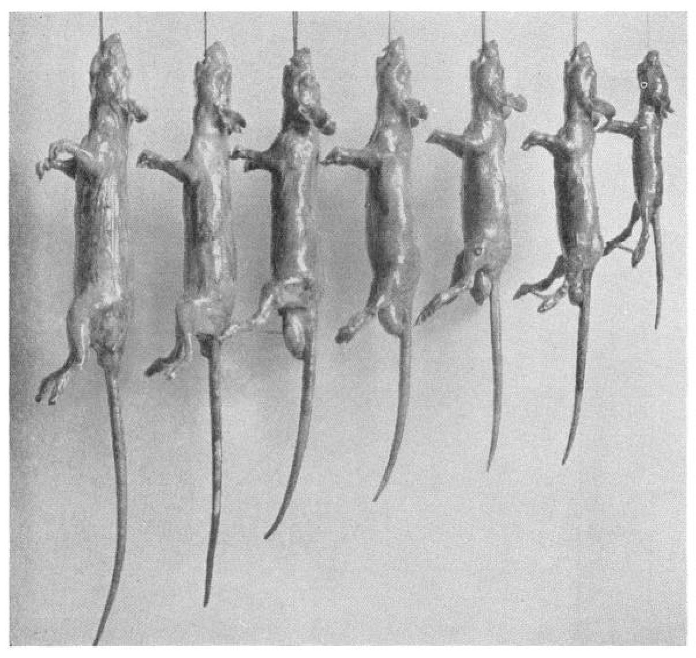
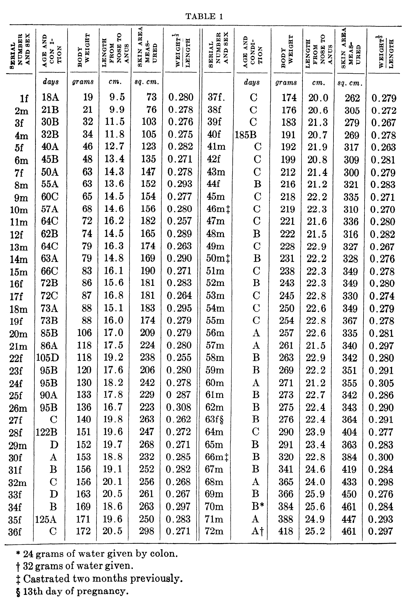

<!-- página 1 | impresa: 24 | pie: 24 / sello de descarga (cortado por los bordes izquierdo y derecho de la página): oaded from www.physiology.org/journal/ajplegacy by ${individualUser.givenNames} ${individualUser.surname} (130.130.211.199) on August 2 / Copyright © 1929 American Physiological Society. All rights reserved. -->

# DETERMINATION OF THE SURFACE AREA OF THE WHITE RAT WITH ITS APPLICATION TO THE EXPRESSION OF METABOLIC RESULTS

MILTON O. LEE

WITH THE TECHNICAL ASSISTANCE OF ELIZABETH CLARK

*From the Memorial Foundation for Neuro-Endocrine Research, Harvard Medical School, Boston*

Received for publication February 20, 1929

Whatever may be the theoretical significance of body surface as a biometric unit for the reference of metabolic rate measurements, it seems at the present time that the use of such a unit gives the least variable results for individuals differing greatly in size, and for different species. In this paper no discussion of surface area as related to heat production and dissipation by an organism will be entered into.

With the increasing use of the rat as a laboratory animal for metabolism experiments, there is a need for the determination of formulae for the estimation of surface area with an accuracy comparable to that attained in the measurement of heat production by present day methods and technic. Hitherto, surface area in the rat has been estimated by the use of the Meeh formula,

$$
S = k\,W^{\frac{2}{3}}
$$

The value of *k* was given by Rubner (1883, 1902) as 9.13 and by Pfaundler (1916) as 9.74. No statement has been found as to the number of animals or the methods used by these workers. Hill and Hill (1913) found the average value of *k* for five young rats of 50 to 129 grams weight to be 9.93. Carman and Mitchell (1926) measured the skin areas of 62 rats ranging from 25 to 461 grams in weight. They obtained an average constant of 11.36.

There are a number of objections to this formula. In it the assumption is made that body surface is a function of weight alone. A considerable increase in accuracy has attended the results of workers who have introduced a length or height measurement into the Meeh formula for other animals and man. Theoretically, such a measurement should be of aid in predicting the surface area of individuals who vary much from the pattern shape of the species, i.e., in obesity or emaciation. It would seem probable <!-- página 2 | impresa: 25 | encabezado: DETERMINATION OF SURFACE AREA IN THE RAT / 25 | pie: sello de descarga (cortado por los bordes izquierdo y derecho de la página): oaded from www.physiology.org/journal/ajplegacy by ${individualUser.givenNames} ${individualUser.surname} (130.130.211.199) on August 2 / Copyright © 1929 American Physiological Society. All rights reserved. --> that the use of such a measurement in the rat might increase the accuracy of prediction, even though casual observation indicates that changes from the pattern shape in rats are not as great as in many other species. Carman and Mitchell were not successful in attempts to increase the accuracy by introducing a function of body length. The measurement of length which they used, however, was from the withers to the root of the tail, expressed to the nearest half centimeter. A comparable length measurement has not, so far as we are aware, been used for other animals. We have made such measurements in all of the rats in the present series and find that they stand in no very constant relationship to total nose-anus length.

When metabolic rates are expressed with reference to body surface as predicted by the above formula with the constant 11.36 they amount to approximately 24 calories per hour per square meter for adult female rats. This value is more than 30 per cent lower than that for adult women or female dogs. It would seem that in rats under laboratory conditions, where body temperature is about the same as in man, the rate of heat production should be more nearly comparable.

This large discrepancy between the heat production of the rat and of man would seem to indicate that the value 11.36 for *k* is considerably too great. It is probable that this high value of *k* was due to the method of measurement used, which involved stretching the skin. Previously, in a few determinations of the skin area by the same method, one of us (L) obtained results in close agreement with those of Carman and Mitchell. The average constant in the Meeh formula, for six adult rats was 11.49.[^1] It was observed at that time that the area of the skin could vary within wide limits, depending upon the amount of stretching. The skins of rats of all ages are remarkably loose and apparently somewhat elastic. Certainly the true body surface is not the total area of the stretched skin.

These considerations, together with the fact that in some work on metabolism under way in this laboratory a more accurate basis of comparison of the metabolic rate of the rat with that of man and of other animals was desired, have led us to undertake the task of measuring the skin areas of a large series of rats by a method which eliminates errors due to stretching.

A number of methods were considered for obtaining true body surface areas without stretching the skin. The small size of the rat makes difficult the application of the paper mold or plaster cast methods which have given satisfactory results for other species in the hands of a number of workers. The method finally adopted was to dip the animal in a quickly drying, nonshrinking lacquer which was allowed to harden before the animal was skinned. Such a varnish after hardening is still flexible, but does not <!-- página 3 | impresa: 26 | encabezado: 26 / MILTON O. LEE AND ELIZABETH CLARK | pie: sello de descarga (cortado por los bordes izquierdo y derecho de la página): oaded from www.physiology.org/journal/ajplegacy by ${individualUser.givenNames} ${individualUser.surname} (130.130.211.199) on August 2 / Copyright © 1929 American Physiological Society. All rights reserved. --> stretch.[^2] It is believed that the accuracy of this method is greater than that of paper molds or plaster casts. The actual area given is that of the outside surface of the skin, since the outline is traced along the cut edge of the hardened varnish. The skin after removal is a perfect mold of the body. Any small wrinkles are preserved just as they were on the animal. An idea of the exactness of the molding of the body is given by the fact that it was necessary to cut the skin into from ten to fifteen pieces in order to make it lie flat upon the paper. The unvarnished skin may be stretched flat in a single piece. Figure 1 is a photograph of several varnished rats showing the mold of the body secured, the method of spreading the legs and the position of the animal while the coating was drying. The method has been used on monkeys (Macacus rhesus) weighing as much as six kilograms, with excellent results. Even for so large an animal a single heavy coat of varnish is sufficient.

<!-- NOTA-CONV: nota al pie impresa en la página 2 -->

[^1]: The area of the ears was included in the measurements.

<!-- NOTA-CONV: Fig. 1 impresa en la página 3, en medio del párrafo anterior (entre "may be stretched" y "flat in a single piece") -->

Fig. 1

<!-- NOTA-CONV: nota al pie impresa en la página 3 -->

[^2]: Two commercial nitro-cellulose enamels, “Duco” and “Nitro-Valspar” were used. The latter preparation gave the better results.

<!-- página 4 | impresa: 27 | encabezado: DETERMINATION OF SURFACE AREA IN THE RAT / 27 | pie: sello de descarga (cortado por los bordes izquierdo y derecho de la página): oaded from www.physiology.org/journal/ajplegacy by ${individualUser.givenNames} ${individualUser.surname} (130.130.211.199) on August 2 / Copyright © 1929 American Physiological Society. All rights reserved. -->

Since rats are ordinarily starved for 18 to 24 hours before a metabolism determination, it was thought desirable to starve them similarily before making body surface measurements. The rat was then killed and body weight and the several length measurements were recorded immediately. Five linear measurements were made, nose-anus length, withers-anus length, length from nose to end of tail, reach of the forelegs and stretch of the hind legs. The hair was removed at first by clipping and later by dipping for a few minutes into a solution of barium sulphide. The latter method was more satisfactory since the hair on the head and around the legs was taken off. The rat was then washed, and dried or sponged with alcohol. It is necessary that the skin be dry for the varnish to adhere tightly. The animal was then dipped into the nitro-cellulose lacquer, suspended by the teeth, and the excess lacquer allowed to drain off. The legs were held away from the body by sticks between the paws. The body was hung in a current of warm air and ordinarily the varnish became hard within an hour. The rat was then skinned, the pelt cut into as many pieces as necessary, and the pieces pinned out flat on paper. The areas were outlined with pencil, traced on smooth paper and measured with a compensating polar planimeter. The toes were allowed to stick together while the varnish hardened, and the whole foot was split parallel with the palm. This gives both surfaces of the entire foot but does not give quite all of the area on the side of each toe. The error involved, however, is very small. The skin of the tail was removed and measured. The ears were cut off around their bases, pinned flat and the outline traced. The area of each ear was multiplied by two to give both surfaces. Carman and Mitchell did not include the areas of the ears in their measurements. These surfaces in small rats may amount to a maximum of about 5 per cent of the total.

The accuracy of the method was checked in a number of ways. It was thought that the varnish might contract in drying and thus tend to decrease the skin areas. This was tested by using a gold-beater’s skin balloon attached to a water manometer. A pressure of a few centimeters of water was placed on the membrane to keep it distended. It was then dipped into the varnish and allowed to dry. After correcting for changes in temperature it was found that no measurable contraction had occurred.

Two outlines of one skin were made by two people. The difference between the measurements was 0.8 per cent. The difference between the measurements made by one person of two outlines of each of four skins was 0.03, 0.1, 0.06 and 0.4 per cent. Measurements by two people of the same outlines differed by 0.01 and 0.03 per cent. All areas were measured at least twice.

Seventy-two rats, 27 females and 45 males, ranging from 19 to 418 grams in weight were used in the series. Animals in all conditions of health <!-- página 5 | impresa: 28 | encabezado: 28 / MILTON O. LEE AND ELIZABETH CLARK | pie: sello de descarga (cortado por los bordes izquierdo y derecho de la página): oaded from www.physiology.org/journal/ajplegacy by ${individualUser.givenNames} ${individualUser.surname} (130.130.211.199) on August 2 / Copyright © 1929 American Physiological Society. All rights reserved. --> <!-- NOTA-CONV: la página 5 solo contiene la Tabla 1, que se coloca después de este párrafo; el párrafo sigue en la página 6 --> <!-- página 6 | impresa: 29 | encabezado: DETERMINATION OF SURFACE AREA IN THE RAT / 29 | pie: sello de descarga (cortado por los bordes izquierdo y derecho de la página): oaded from www.physiology.org/journal/ajplegacy by ${individualUser.givenNames} ${individualUser.surname} (130.130.211.199) on August 2 / Copyright © 1929 American Physiological Society. All rights reserved. --> were purposely selected. Some had much body fat, others were much emaciated, one female was pregnant, and three males had been castrated. It was desired to emphasize as much as possible differences in the pattern shape in order to determine a formula for body surface which would serve for under- and over-nourished animals as well as for normal ones.

<!-- NOTA-CONV: Tabla 1 impresa en la página 5 (ocupa toda la página). En el original la tabla está compuesta en dos mitades lado a lado (ratas 1f a 36f a la izquierda y 37f. a 72m a la derecha), separadas por una doble línea vertical, y los encabezados de columna están impresos en vertical (girados 90°); aquí se conserva como una sola tabla de 12 columnas con los encabezados en horizontal -->

TABLE 1

<table>
<thead>
<tr><th><strong>SERIAL NUMBER AND SEX</strong></th><th><strong>AGE AND CON ITION</strong></th><th><strong>BODY WEIGHT</strong></th><th><strong>LENGTH FROM NOSE TO ANUS</strong></th><th><strong>SKIN AREA MEASURED</strong></th><th>$\dfrac{\textbf{WEIGHT}^{\frac{1}{3}}}{\textbf{LENGTH}}$</th><th><strong>SERIAL NUMBER AND SEX</strong></th><th><strong>AGE AND CONDITION</strong></th><th><strong>BODY WEIGHT</strong></th><th><strong>LENGTH FROM NOSE TO ANUS</strong></th><th><strong>SKIN AREA MEASURED</strong></th><th>$\dfrac{\textbf{WEIGHT}^{\frac{1}{3}}}{\textbf{LENGTH}}$</th></tr>
<tr><td></td><td><em>days</em></td><td><em>grams</em></td><td><em>cm.</em></td><td><em>sq. cm.</em></td><td></td><td></td><td><em>days</em></td><td><em>grams</em></td><td><em>cm.</em></td><td><em>sq. cm.</em></td><td></td></tr>
</thead>
<tbody>
<tr><td>1f</td><td>18A</td><td>19</td><td>9.5</td><td>73</td><td>0.280</td><td>37f.</td><td>C</td><td>174</td><td>20.0</td><td>262</td><td>0.279</td></tr>
<tr><td>2m</td><td>21B</td><td>21</td><td>9.9</td><td>76</td><td>0.278</td><td>38f</td><td>C</td><td>176</td><td>20.6</td><td>305</td><td>0.272</td></tr>
<tr><td>3f</td><td>30B</td><td>32</td><td>11.5</td><td>103</td><td>0.276</td><td>39f</td><td>C</td><td>183</td><td>21.3</td><td>279</td><td>0.267</td></tr>
<tr><td>4m</td><td>32B</td><td>34</td><td>11.8</td><td>105</td><td>0.275</td><td>40f</td><td>185B</td><td>191</td><td>20.7</td><td>269</td><td>0.278</td></tr>
<tr><td>5f</td><td>40A</td><td>46</td><td>12.7</td><td>123</td><td>0.282</td><td>41m</td><td>C</td><td>192</td><td>21.9</td><td>317</td><td>0.263</td></tr>
<tr><td>6m</td><td>45B</td><td>48</td><td>13.4</td><td>135</td><td>0.271</td><td>42f</td><td>C</td><td>199</td><td>20.8</td><td>309</td><td>0.281</td></tr>
<tr><td>7f</td><td>50A</td><td>63</td><td>14.3</td><td>147</td><td>0.278</td><td>43m</td><td>C</td><td>212</td><td>21.4</td><td>300</td><td>0.279</td></tr>
<tr><td>8m</td><td>55A</td><td>63</td><td>13.6</td><td>152</td><td>0.293</td><td>44f</td><td>B</td><td>216</td><td>21.2</td><td>321</td><td>0.283</td></tr>
<tr><td>9m</td><td>60C</td><td>65</td><td>14.5</td><td>154</td><td>0.277</td><td>45m</td><td>C</td><td>218</td><td>22.2</td><td>335</td><td>0.271</td></tr>
<tr><td>10m</td><td>57A</td><td>68</td><td>14.6</td><td>156</td><td>0.280</td><td>46m‡</td><td>C</td><td>219</td><td>22.3</td><td>310</td><td>0.270</td></tr>
<tr><td>11m</td><td>64C</td><td>72</td><td>16.2</td><td>182</td><td>0.257</td><td>47m</td><td>C</td><td>221</td><td>21.6</td><td>336</td><td>0.280</td></tr>
<tr><td>12f</td><td>62B</td><td>74</td><td>14.5</td><td>165</td><td>0.289</td><td>48m</td><td>B</td><td>222</td><td>21.5</td><td>316</td><td>0.282</td></tr>
<tr><td>13m</td><td>64C</td><td>79</td><td>16.3</td><td>174</td><td>0.263</td><td>49m</td><td>C</td><td>228</td><td>22.9</td><td>327</td><td>0.267</td></tr>
<tr><td>14m</td><td>63A</td><td>79</td><td>14.8</td><td>169</td><td>0.290</td><td>50m‡</td><td>B</td><td>231</td><td>22.2</td><td>328</td><td>0.276</td></tr>
<tr><td>15m</td><td>66C</td><td>83</td><td>16.1</td><td>190</td><td>0.271</td><td>51m</td><td>C</td><td>238</td><td>22.3</td><td>349</td><td>0.278</td></tr>
<tr><td>16f</td><td>72B</td><td>86</td><td>15.6</td><td>181</td><td>0.283</td><td>52m</td><td>B</td><td>243</td><td>22.3</td><td>349</td><td>0.280</td></tr>
<tr><td>17f</td><td>72C</td><td>87</td><td>16.8</td><td>181</td><td>0.264</td><td>53m</td><td>C</td><td>245</td><td>22.8</td><td>330</td><td>0.274</td></tr>
<tr><td>18m</td><td>73A</td><td>88</td><td>15.1</td><td>183</td><td>0.295</td><td>54m</td><td>C</td><td>250</td><td>22.6</td><td>349</td><td>0.279</td></tr>
<tr><td>19f</td><td>73B</td><td>88</td><td>16.0</td><td>174</td><td>0.279</td><td>55m</td><td>C</td><td>254</td><td>22.8</td><td>367</td><td>0.278</td></tr>
<tr><td>20m</td><td>85B</td><td>106</td><td>17.0</td><td>209</td><td>0.279</td><td>56m</td><td>A</td><td>257</td><td>22.6</td><td>335</td><td>0.281</td></tr>
<tr><td>21m</td><td>86A</td><td>118</td><td>17.5</td><td>224</td><td>0.280</td><td>57m</td><td>A</td><td>261</td><td>21.5</td><td>340</td><td>0.297</td></tr>
<tr><td>22f</td><td>105D</td><td>118</td><td>19.2</td><td>238</td><td>0.255</td><td>58m</td><td>B</td><td>263</td><td>22.9</td><td>342</td><td>0.280</td></tr>
<tr><td>23f</td><td>95B</td><td>120</td><td>17.6</td><td>206</td><td>0.280</td><td>59m</td><td>B</td><td>269</td><td>22.2</td><td>351</td><td>0.291</td></tr>
<tr><td>24f</td><td>95B</td><td>130</td><td>18.2</td><td>242</td><td>0.278</td><td>60m</td><td>A</td><td>271</td><td>21.2</td><td>355</td><td>0.305</td></tr>
<tr><td>25f</td><td>90A</td><td>133</td><td>17.8</td><td>229</td><td>0 287</td><td>61m</td><td>B</td><td>273</td><td>22.7</td><td>342</td><td>0.286</td></tr>
<tr><td>26m</td><td>95B</td><td>136</td><td>16.7</td><td>223</td><td>0.308</td><td>62m</td><td>B</td><td>275</td><td>22.4</td><td>343</td><td>0.290</td></tr>
<tr><td>27f</td><td>C</td><td>140</td><td>19.8</td><td>263</td><td>0.262</td><td>63f§</td><td>B</td><td>276</td><td>22.4</td><td>364</td><td>0.291</td></tr>
<tr><td>28f</td><td>122B</td><td>151</td><td>19.6</td><td>247</td><td>0.272</td><td>64m</td><td>C</td><td>290</td><td>23.9</td><td>404</td><td>0.277</td></tr>
<tr><td>29m</td><td>D</td><td>152</td><td>19.7</td><td>268</td><td>0.271</td><td>65m</td><td>B</td><td>291</td><td>23.4</td><td>363</td><td>0.283</td></tr>
<tr><td>30f</td><td>A</td><td>153</td><td>18.8</td><td>232</td><td>0.285</td><td>66m‡</td><td>B</td><td>320</td><td>22.8</td><td>384</td><td>0.300</td></tr>
<tr><td>31f</td><td>B</td><td>156</td><td>19.1</td><td>252</td><td>0.282</td><td>67m</td><td>B</td><td>341</td><td>24.6</td><td>419</td><td>0.284</td></tr>
<tr><td>32m</td><td>C</td><td>156</td><td>20.1</td><td>256</td><td>0.268</td><td>68m</td><td>A</td><td>365</td><td>24.0</td><td>433</td><td>0.298</td></tr>
<tr><td>33f</td><td>D</td><td>163</td><td>20.5</td><td>261</td><td>0.267</td><td>69m</td><td>B</td><td>366</td><td>25.9</td><td>450</td><td>0.276</td></tr>
<tr><td>34f</td><td>B</td><td>169</td><td>18.6</td><td>263</td><td>0.297</td><td>70m</td><td>B*</td><td>384</td><td>25.6</td><td>461</td><td>0.284</td></tr>
<tr><td>35f</td><td>125A</td><td>171</td><td>19.6</td><td>250</td><td>0.283</td><td>71m</td><td>A</td><td>388</td><td>24.9</td><td>447</td><td>0.293</td></tr>
<tr><td>36f</td><td>C</td><td>172</td><td>20.5</td><td>298</td><td>0.271</td><td>72m</td><td>A†</td><td>418</td><td>25.2</td><td>461</td><td>0.297</td></tr>
</tbody>
</table>

<!-- NOTA-CONV: en la mitad izquierda el encabezado de la segunda columna imprime "CON I-/TION", sin la D de CONDITION (queda un hueco), y la S inicial de "SERIAL" está desalineada; "37f." lleva punto y "0 287" (rata 25f) no lleva punto decimal, como en el original -->

\* 24 grams of water given by colon.

† 32 grams of water given.

‡ Castrated two months previously.

&sect; 13th day of pregnancy.

Imagen original

In table 1 the observed condition of the rat is indicated by the letters A, B, C, or D. By this scale A represents what was considered an excellent condition, with considerable body fat and a heavy sleek coat of hair. The letter D designates rats considerably emaciated. The letters B and C designate more or less arbitrarily, grades between these extremes. The condition indicated by the letters does not in all cases agree with that indicated by the nutritive ratio, which is probably a better index of bodily condition. Marked obesity is seldom found in rats and no very obese animals were available to us. In two rats attempts were made to simulate obesity by the administration of water. The animals were anesthetized with amytal. The water was given slowly by way of the colon and sufficient time allowed for much of it to be absorbed. Since the body weight was recorded only to the nearest gram, differences in the specific gravity of body fat and water would introduce no error.

RESULTS. The data of the skin area measurements are given in table 1. When these data were applied in a formula of the Meeh-Rubner type

$$
S = k\,W^{\frac{2}{3}} \tag{1}
$$

the average value of *k* was found to be 9.00 ± 0.05, with a standard deviation of ±0.604 and a coefficient of variation of 6.71 per cent. This constant is 21 per cent less than the value 11.36 as determined by Carman and Mitchell for the same formula and is in fairly close agreement with the original value of 9.13 determined by Rubner. For the same range of weight (50 to 130 grams) the values of *k* also agree well with those given by Hill and Hill (1913) It was found, however, that there was a progressive decrease in the individual values of the constant with increasing size and weight. The deviation from the average ranged from about +14 per cent in the small rats to about −9 per cent in the large ones. Of the first 36 animals listed in the table, 26 had constants greater than the average *k* and of the remaining 36 animals 28 had constants with minus deviations. Carman and Mitchell found no such change in the values of *k* for the rats in their series. The probable explanation is that the skins of the smaller and younger rats stretch more than do those of larger and older ones.

This progressive decrease in the constant suggested that the value of the exponent of *W* was too great. Accordingly, the exponent of *W* was varied from 0.40 to 0.80 and the coefficients of variation of the corresponding average values of *k* were determined. These coefficients of variation with the several exponents were as follows: 0.40—13.4 per cent; 0.50—<!-- página 7 | impresa: 30 | encabezado: 30 / MILTON O. LEE AND ELIZABETH CLARK | pie: sello de descarga (cortado por los bordes izquierdo y derecho de la página): oaded from www.physiology.org/journal/ajplegacy by ${individualUser.givenNames} ${individualUser.surname} (130.130.211.199) on August 2 / Copyright © 1929 American Physiological Society. All rights reserved. -->7.9 per cent; 0.59—4.67 per cent; *0.60—4.55 per cent;* 0.61—4.78 per cent; 0.667—6.71 per cent; 0.70—8.5 per cent;0.80—15.5 per cent. It is apparent from these data that the best value for the exponent of *W* in the simple Meeh formula for the rat is very nearly 0.60. Cowgill and Drakbin (1927) showed, in the same way, that with Carman and Mitchell’s data the best value of the exponent was 0.667. It is believed that the difference in the results on the rat is due to the inaccuracies involved when the skin is stretched.

The data were then applied in formula (2), of the Meeh-Rubner type,

$$
S = k\,W^{0.60} \tag{2}
$$

with the value 0.60 for the exponent of *W*. In this formula the average value of *k* was 12.54 ±0.05. The agreement was considerably closer than with formula (1). The average deviation was ±3.61 per cent of the mean; the standard deviation was ±0.570 and the coefficient of variation was 4.55 per cent of the mean. Seventy-two per cent of the individual values of the constant had a deviation of not more than 5 per cent from 12.54 and 27 per cent had a deviation of less than 10 per cent. The greatest deviation was 11.5 per cent.

The agreement of calculated and measured surfaces was also much better by this formula. By formula (1) the average deviation of the calculated from the measured areas was ±6.4 per cent; by formula (2) the deviation was ±3.6 per cent. With formula (2) there was further no consistent variation of the individual constants with increasing size. For the animals in a poor nutritional condition, however, the accuracy was not as great as for those in good condition.

Attempts were made with several formulae to increase the accuracy by introducing a function of length. One such expression used, namely,

$$
S = k\,W^{0.425}\quad L^{0.725} \tag{3}
$$

is the same as the Du Bois height weight formula for human beings, except for the vaue of *k*, and is also similar in principle to the *metabolic index* which Gulick (1925) has used for rats. This formula is perfectly bi-dimensional in character. For our series of rats the average value of *K* was 3.57 ±0.02, with a coefficient of variation of 6.25 per cent. The accuracy of prediction is thus not as great as with formula (2) and only slightly better than with formula (1). In other trials, the values of the exponents of *W* and *L* were changed, both with and without regard for keeping the formula perfectly bi-dimensional. None of these attempts gave results as accurate as were obtained with formula (2). Linear measurements other than total body length were not found to be of value in constructing more accurate formulae.

Cowgill and Drabkin found that the use of a “*nutritive correction factor*,” <!-- página 8 | impresa: 31 | encabezado: DETERMINATION OF SURFACE AREA IN THE RAT / 31 | pie: sello de descarga (cortado por los bordes izquierdo y derecho de la página): oaded from www.physiology.org/journal/ajplegacy by ${individualUser.givenNames} ${individualUser.surname} (130.130.211.199) on August 2 / Copyright © 1929 American Physiological Society. All rights reserved. --> similar in principle to von Pirquet’s *gelidusi*, gave the best formula for estimating the body surface of dogs. Von Pirquet (1917) showed that the ratio of the cube root of ten times the weight to the sitting height, gave a reliable index of the nutritional state of children. Cowgill and Drabkin used for their nutritional correction factor the ratio $\frac{W^{\frac{1}{3}}}{L}$. They determined the ratio for the most obese dog obtainable and used this value as a standard with which to compare other values of the ratio. We have used the same principle in the determination of a similar formula for the rat, and find that a somewhat greater accuracy is attained than with any other formula we have used. The values of $\frac{W^{\frac{1}{3}}}{L}$ for each rat are given in table 1. We have retained the terms used by Cowgill and Drabkin, of $N_m$ for the standard or maximal and $N_{obs}$ for the individual nutritive indices. The highest ratio obtained was 0.308. The value 0.310 was selected as the arbitrary standard.

Formula (4) which contains the nutritional correction factor, and which gave the closest agreement with the data, is as follows:

$$
S = k\,W^{0.61} \times \frac{0.310}{N_{obs}} \tag{4}
$$

In this formua the average value of *k* was 10.76 ±0.04, with a standard deviation of ±0.444 and a coefficient of variation of 4.12 per cent. Seventy-four per cent of the individual values of *k* had a deviation of less than five per cent from 10.76 and 26 per cent had a deviation of less than nine per cent. The greatest single deviation was −8.9 per cent. The exponent 0.61 for *W* gave slightly more consistent values of *k* in this formula than 0.60. The agreement of calculated and measured surfaces was also slightly better. With the exponent 0.60 the average constant was 11.31, with a standard deviation of ±0.471 and a coefficient of variation of 4.17 per cent.

The increase in accuracy by the use of such a formula involving a function of length is not as great as that found by Cowgill and Drabkin for the dog. However, as pointed out above, differences in the pattern shape are not nearly so marked in the rat as in the dog. The use of formula (4) is recommended for rats that are emaciated, markedly obese or that have shown abnormal growth.

For the estimation of surface area in adult rats in good condition, formula (2) may be preferable because of its simplicity and the fact that no length measurements are necessary. This is sometimes a decided advantage. In our experience, the only satsifactory method of obtaining body length measurements on living rats is to use light anesthesia. The animals may then be placed back downwards on a strip of paper, the head held by a <!-- página 9 | impresa: 32 | encabezado: 32 / MILTON O. LEE AND ELIZABETH CLARK | pie: sello de descarga (cortado por los bordes izquierdo y derecho de la página): oaded from www.physiology.org/journal/ajplegacy by ${individualUser.givenNames} ${individualUser.surname} (130.130.211.199) on August 2 / Copyright © 1929 American Physiological Society. All rights reserved. --> wire loop over the teeth, the body straightened by a slight traction on the tail, and marks made opposite the anus and the tip of the nose. Repeated measurements made in this way check within 2 mm.

It is apparent that for both formulae (2) and (4) there is no significant variation in the values of *k* with age or size. For both the simple formula and that involving the nutritional correction factor, the average of the constants for the 36 rats weighing less than 172 grams is almost identical with the average of the constants for the 36 weighing more than 173 grams. In both formulae the value of *k* is slightly greater for males than for females. In formula (2) the average for males is 12.62 and for females 12.44. In formula (4) the average for males is 10.87 and for females 10.62. This difference is probably due to the additional area of the scrotum in males, which may amount to upwards of 8 or 9 square centimeters. As is apparent from figure 1, this area is considerably greater than the increase in body surface that would be caused if flesh equal in weight to the scrotum and its contents were evenly distributed over the animal. In the three castrated. males the average constant is slightly less than the average for the females. The most of the rats in poor condition are concentrated in the middle of the weight range. The average deviation of the constant is slightly greater for the animals designated C or D than for those designated A or B, but there is no consistent variation in one direction.

The final test of the usefulness in metabolic work of a formula for the estimation of body surface area is the agreement of results of basal metabolic rate determinations in animals of widely different weights and various species pattern shapes. As Harris and Benedict (1919) have pointed out, the general applicability of the so-called “surface area law” of Rubner cannot be said to have been rigorously tested because of the inaccuracies of the formulae hitherto used for the estimation of body surface in different species. Since the accuracy of formulae (2) and (4) of this paper is comparable to that of formulae for the dog and man, a valid comparison of the basal heat production in the rat with these species may be made. Mitchell and Carman (1926) published data of basal metabolic rate measurements on rats ranging from 84 to 251 grams in weight. Using their formula for surface area, they found the average basal heat production in starved female rats to be 571 ±7 calories per day per square meter of body surface, with a coefficient of variation of 8.0 per cent. In male rats the corresponding heat production was 600 ±11 calories, with a coefficient of variation of 13.5 per cent. We have calculated from their data the daily heat production per square meter of body surface as predicted by our simple formula (2). For the female rats the rate is 730 ±8 calories, with a coefficient of variation of 7.6 per cent. For the male rats the rate is 777 ±14 calories, with a coefficient of variation of 13.2 per cent. The agreement of the metabolic results, as shown by the coefficients of variation, is slightly better with our formula than with the Meeh-Rubner <!-- página 10 | impresa: 33 | encabezado: DETERMINATION OF SURFACE AREA IN THE RAT / 33 | pie: sello de descarga (cortado por los bordes izquierdo y derecho de la página): oaded from www.physiology.org/journal/ajplegacy by ${individualUser.givenNames} ${individualUser.surname} (130.130.211.199) on August 2 / Copyright © 1929 American Physiological Society. All rights reserved. --> expression. For a more conclusive test, rats of more extreme weight ranges should be used.

Just as significant as the better agreement of metabolic results in the rat, is the fact that, while the heat production of the rat is brought into much closer agreement with that of the dog and of man, there is still a considerable and apparently valid difference. Cowgill and Drabkin showed that with body surface predicted by their formula, the heat production of adult female dogs averaged 836 calories per day per square meter, or about two per cent less than the heat production in women. With Carman and Mitchell’s formula for surface area, the heat production in the female rat is 33 per cent less than that in women, and in the male rat 35 per cent less than in men. With our formula 2 the differences are 14 and 16 per cent less respectively. These differences are rather large, and it would appear that there is a discrepancy between the heat production of the rat and of man, expressed with reference to body surface area, which is somewhat greater than can be attributed to errors in the estimation of either body surface or metabolic rate.

## SUMMARY

The skin areas of 72 rats, ranging from 19 to 418 grams in weight and in various conditions of nutrition, were measured by a method which eliminates errors due to stretching. The animals were given a coating of a quickly drying varnish before skinning. Formulae for the prediction of body surface were constructed on the basis of the data obtained. Two formulae were selected which gave the best agreement with the data. The simpler but slightly less accurate one is a modified Meeh-Rubner formula, in which the exponent of *W* is 0.60 and the constant 12.54. The best formula found involves the use of a correction factor for the nutritional state. The heat production of the rat expressed with reference to body surface, as predicted by these formulae, is brought into closer agreement than hitherto with the heat production of human beings.

We are indebted to Mr. Philip Solomon for assistance in the large number of calculations involved in this work.

## BIBLIOGRAPHY

CARMAN, G. G. AND H. H. MITCHELL. 1926. This Journal, lxxvi, 380.

COWGILL, G. H. AND D. I. DRABKIN. 1927. This Journal, lxxxi, 36.

GULICK, A. 1925. This Journal, lxxii, 204.

HARRIS, A. AND F. G. BENEDICT. 1919. A biometric study of basal metabolism in man. Carnegie Inst. Wash. Pub. 279.

HILL, A. V. AND A. M. HILL. 1913. Journ. Physiol., xlvi, 81.

MITCHELL, H. H. AND G. G. CARMAN. 1926. This Journal, lxxvi, 385.

PFAUNDLER, M. 1916. Zeitschr. f. Kinderh., xiv, 1.

RUBNER, M. 1883. Zeitschr. f. Biol., xix, 536.

VON PIRQUET, C. P. 1917. System der Ernährung, vol. 1, Berlin.
