<!-- página 1 -->

<!-- NOTA-CONV: la página 1 es la portada que JSTOR añade al PDF; sus logotipos (International Biometric Society, arriba a la izquierda, y JSTOR, abajo a la izquierda) no se guardan -->

A Concordance Correlation Coefficient to Evaluate Reproducibility

Author(s): Lawrence I-Kuei Lin

Reviewed work(s):

Source: *Biometrics*, Vol. 45, No. 1 (Mar., 1989), pp. 255-268

Published by: International Biometric Society

Stable URL: http://www.jstor.org/stable/2532051

Accessed: 23/08/2012 08:58

Your use of the JSTOR archive indicates your acceptance of the Terms & Conditions of Use, available at http://www.jstor.org/page/info/about/policies/terms.jsp

JSTOR is a not-for-profit service that helps scholars, researchers, and students discover, use, and build upon a wide range of content in a trusted digital archive. We use information technology and tools to increase productivity and facilitate new forms of scholarship. For more information about JSTOR, please contact support@jstor.org.

*International Biometric Society* is collaborating with JSTOR to digitize, preserve and extend access to *Biometrics.*

http://www.jstor.org

<!-- página 2 | impresa: 255 | encabezado: BIOMETRICS 45, 255–268 / March 1989 | pie: 255 -->

# A Concordance Correlation Coefficient to Evaluate Reproducibility

**Lawrence I-Kuei Lin**

Baxter Healthcare Corporation, Route 120 and Wilson Road, Round Lake, Illinois 60073, U.S.A.

## SUMMARY

A new reproducibility index is developed and studied. This index is the correlation between the two readings that fall on the 45° line through the origin. It is simple to use and possesses desirable properties. The statistical properties of this estimate can be satisfactorily evaluated using an inverse hyperbolic tangent transformation. A Monte Carlo experiment with 5,000 runs was performed to confirm the estimate’s validity. An application using actual data is given.

## 1. Introduction

In an assay validation or an instrument validation process, the reproducibility of the measurements from trial to trial is of interest. Also, when a new assay or instrument is developed, it is of interest to evaluate whether the new assay can reproduce the results based on a traditional gold-standard assay (Westgard and Hunt, 1973; Bauer and Kennedy, 1981). Such validation processes are often evaluated by using the Pearson correlation coefficient, the paired $t$-test, the least squares analysis of slope (= 1) and intercept (= 0), the coefficient of variation, or the intraclass correlation coefficient. There are drawbacks to all of these, however, in that none alone can fully assess the desired reproducibility characteristics. For example, to evaluate the blood cell counter for hematology analysis in a laboratory, it is desirable to have duplicates of the same blood sample measurement by the counter at different times (usually at most 1 day apart) yield results as close together as possible. If we plot the first measurement against the second measurement of the red blood cell counts for all blood samples available, we would like to see, within a tolerable error, that the measurements fall on a 45° line through the origin ($45^\circ_\mathrm{o}$). The Pearson correlation coefficient measures a linear relationship but fails to detect any departure from the $45^\circ_\mathrm{o}$ line (see Figure 1). The paired $t$-test fails (see Figure 2) to detect poor agreement in pairs of data such as (1, 3), (2, 3), (3, 3), (4, 3), and (5, 3). Combining the above two methods cannot detect poor agreement in pairs of data such as (1, 2.8), (2, 2.9), (3, 3.0), (4, 3.1), and (5, 3.2). The least squares approach fails to detect departure from intercept equal to 0 and slope equal to 1 if data are very scattered (see Figure 3, lower plot). In other words, the more the data are scattered (nonreproducible), the less chance one could reject the hypothesis. The least squares approach can reject a highly reproducible assay due to very small residual error (see Figure 3, upper plot). This is also true if the paired $t$-test is used (see Figure 2, lower plot). The coefficient of variation and the intraclass correlation coefficient allow duplicate readings to be interchangeable. In other words, these methods consider duplicate readings as replicates (random) rather than two distinct readings. Two <!-- página 3 | impresa: 256 | encabezado: 256 / Biometrics, March 1989 --> <!-- página 4 | impresa: 257 | encabezado: A Concordance Correlation Coefficient / 257 --> distinct readings would occur in the case of a first reading (earlier) versus a second reading (later) or as a reading of assay A versus a reading of assay B.

<!-- NOTA-CONV: palabras clave impresas al pie de la página 2 (folio 255), bajo una línea de separación; se colocan después del párrafo que cruza de la página 2 a la 4 -->

*Key words:* Accuracy; Asymptotic normality; Concordance correlation coefficient; 45° line through the origin; Precision; $Z$-transformation.

<!-- NOTA-CONV: Figs. 1 y 2 impresas en la página 3 (folio 256), que no contiene texto corrido; el párrafo anterior la salta de la página 2 a la 4 -->

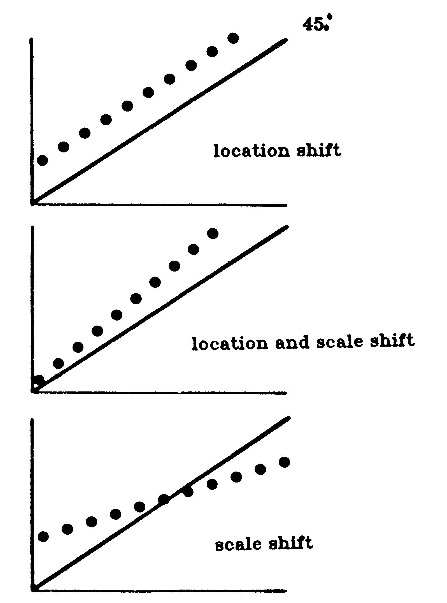

**Figure 1.** Cases when Pearson correlation coefficient fails to detect nonreproducibility.

<!-- texto en la figura: rótulo de la recta, arriba a la derecha: 45°ₒ (en la figura el grado y el subíndice o se imprimen como puntos rellenos) · rótulos de los tres paneles (de arriba abajo): location shift · location and scale shift · scale shift -->

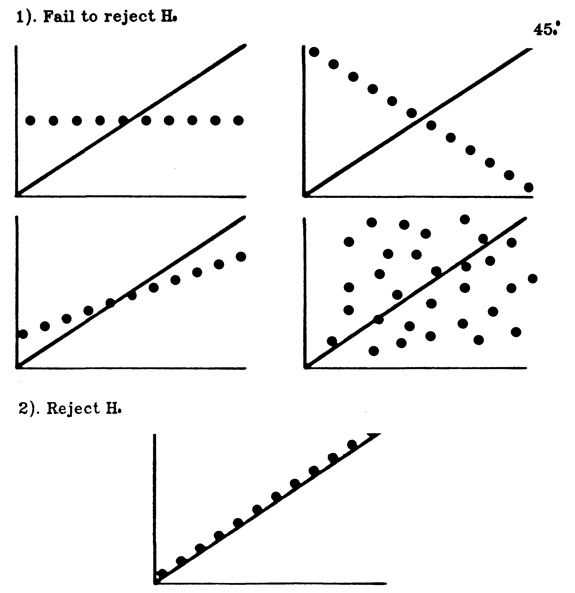

**Figure 2.** Cases when paired $t$-test can be misleading. $H_0$: Means are equal

<!-- texto en la figura: rótulo de la recta, arriba a la derecha: 45°ₒ (grado y subíndice o impresos como puntos rellenos) · grupo superior de cuatro paneles: 1). Fail to reject H₀ · panel inferior: 2). Reject H₀ (en los rótulos de la figura el subíndice de H se imprime como un punto relleno; se lee como 0 por la leyenda) -->

<!-- NOTA-CONV: Fig. 3 impresa en la página 4 (folio 257), arriba del final del párrafo anterior -->

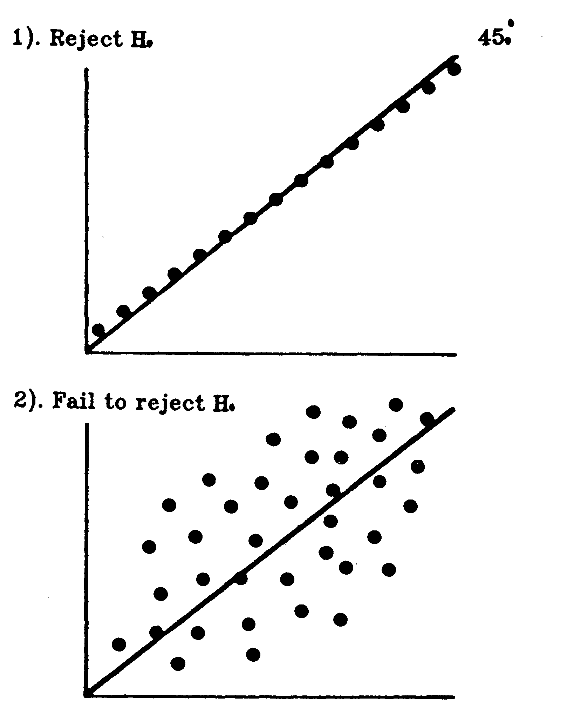

**Figure 3.** Cases when least squares analysis can be misleading. $H_0$: Intercept = 0 and slope = 1

<!-- texto en la figura: rótulo de la recta, arriba a la derecha: 45°ₒ (grado y subíndice o impresos como puntos rellenos) · panel superior: 1). Reject H₀ · panel inferior: 2). Fail to reject H₀ (subíndice de H impreso como un punto relleno; se lee como 0 por la leyenda) -->

This study proposes a desirable reproducibility index, to be called a concordance correlation coefficient, which evaluates the agreement between two readings (from the same sample) by measuring the variation from the 45° line through the origin (the concordance line).

## 2. The Concordance Correlation Coefficient

Let us assume that pairs of samples $(Y_{i1},\ Y_{i2})$, $i = 1, 2, \ldots, n$, are independently selected from a bivariate population with means $\mu_1$ and $\mu_2$ and covariance matrix

$$
\begin{pmatrix} \sigma_1^2 & \sigma_{12} \\ \sigma_{12} & \sigma_2^2 \end{pmatrix}.
$$

The degree of concordance between $Y_1$ and $Y_2$ can be characterized by the expected value of the squared difference, i.e.,

$$
\begin{aligned}
\mathrm{E}[(Y_1 - Y_2)^2] &= (\mu_1 - \mu_2)^2 + (\sigma_1^2 + \sigma_2^2 - 2\sigma_{12}) \\
&= (\mu_1 - \mu_2)^2 + (\sigma_1 - \sigma_2)^2 + 2(1 - \rho)\sigma_1\sigma_2,
\end{aligned}
$$

where $\rho$ is the Pearson correlation coefficient. This also represents the expected squared perpendicular deviation from the $45^\circ_\mathrm{o}$ line, multiplied by 2.

If each pair, $Y_1$ and $Y_2$, in the population are in perfect agreement, $\mathrm{E}[(Y_1 - Y_2)^2]$ would be 0. The following transformation is proposed in order for the value of the index to be <!-- página 5 | impresa: 258 | encabezado: 258 / Biometrics, March 1989 --> scaled between −1 and 1:

$$
\begin{aligned}
\rho_\mathrm{c} &= 1 - \frac{\mathrm{E}[(Y_1 - Y_2)^2]}{\sigma_1^2 + \sigma_2^2 + (\mu_1 - \mu_2)^2} \\
&= 1 - \frac{\text{Expected squared perpendicular deviation from } 45^\circ_\mathrm{o} \text{ line}}{\begin{array}{r} \text{Expected squared perpendicular deviation from } 45^\circ_\mathrm{o} \text{ line} \\ \text{when } Y_1 \text{ and } Y_2 \text{ are uncorrelated} \end{array}}
\end{aligned}
$$

or,

$$
\rho_\mathrm{c} = \frac{2\sigma_{12}}{\sigma_1^2 + \sigma_2^2 + (\mu_1 - \mu_2)^2} = \rho C_\mathrm{b},
$$

where

$$
\begin{aligned}
C_\mathrm{b} &= [(v + 1/v + u^2)/2]^{-1}, \\
v &= \sigma_1/\sigma_2 = \text{scale shift}, \\
u &= (\mu_1 - \mu_2)/\sqrt{\sigma_1\sigma_2} = \text{location shift relative to the scale.}
\end{aligned}
$$

Here, $0 \lt C_\mathrm{b} \leqslant 1$ is a bias correction factor that measures how far the best-fit line deviates from the $45^\circ_\mathrm{o}$ line (measure of accuracy). No deviation from the $45^\circ_\mathrm{o}$ line occurs when $C_\mathrm{b} = 1$. The further $C_\mathrm{b}$ is from 1, the greater the deviation is from the $45^\circ_\mathrm{o}$ line. The Pearson correlation coefficient $\rho$ measures how far each observation deviated from the best-fit line (measure of precision).

If we let $\beta_1 = (\sigma_1/\sigma_2)\rho$ and $\beta_0 = \mu_1 - \beta_1\mu_2$ represent the regression slope and intercept, respectively, from the conditional distribution of $Y_1$ given $Y_2$, then

$$
\rho_\mathrm{c} = \frac{2\beta_1\sigma_2^2}{(\sigma_1^2 + \sigma_2^2) + [(\beta_0 - 0) + (\beta_1 - 1)\mu_2]^2}\,.
$$

This concordance correlation coefficient, $\rho_\mathrm{c}$, possesses the following characteristics:

(i) $-1 \leqslant -\lvert \rho \rvert \leqslant \rho_\mathrm{c} \leqslant \lvert \rho \rvert \leqslant 1$.

(ii) $\rho_\mathrm{c} = 0$ if and only if $\rho = 0$.

(iii) $\rho_\mathrm{c} = \rho$ if and only if $\sigma_1 = \sigma_2$ and $\mu_1 = \mu_2$.

(iv) $\rho_\mathrm{c} = \pm 1$ if and only if

(a) $(\mu_1 - \mu_2)^2 + (\sigma_1 - \sigma_2)^2 + 2\sigma_1\sigma_2(1 \mp \rho) = 0$, or equivalently,

(b) $\rho = \pm 1$, $\sigma_1 = \sigma_2$, and $\mu_1 = \mu_2$, or equivalently,

(c) each pair of readings is in perfect (1) agreement (for example, 1, 1; 2, 2; 3, 3; 4, 4; 5, 5) or in perfect reversed (−1) agreement (for example, 5, 1; 4, 2; 3, 3; 2, 4; 1, 5).

This concordance correlation coefficient evaluates the degree to which pairs fall on the $45^\circ_\mathrm{o}$ line. It contains the measurements of accuracy ($C_\mathrm{b}$) and precision ($\rho$). Any departure from this line would produce $\rho_\mathrm{c} \lt 1$ even if $\rho = 1$.

For $n$ independent pairs of samples, it is natural to use the sample counterparts; i.e., let

$$
\hat{\rho}_\mathrm{c} = \frac{2S_{12}}{S_1^2 + S_2^2 + (\bar{Y}_1 - \bar{Y}_2)^2}\,,
$$

where

$$
\bar{Y}_j = \frac{1}{n} \sum_{i=1}^{n} Y_{ij}, \quad S_j^2 = \frac{1}{n} \sum_{i=1}^{n} (Y_{ij} - \bar{Y}_j)^2, \quad j = 1,\ 2;
$$

<!-- página 6 | impresa: 259 | encabezado: A Concordance Correlation Coefficient / 259 -->

and

$$
S_{12} = \frac{1}{n} \sum_{i=1}^{n} (Y_{i1} - \bar{Y}_1)(Y_{i2} - \bar{Y}_2).
$$

## 3. Inference

Let us assume that $\hat{\rho}_\mathrm{c}$ is the sample concordance correlation coefficient of paired samples from a bivariate normal distribution. Using the transformation theory of functions of asymptotically normal vectors (Serfling, 1980, p. 122), we can show that $\hat{\rho}_\mathrm{c}$ is a consistent estimator of $\rho_\mathrm{c}$ and has an asymptotic normal distribution with mean $\rho_\mathrm{c}$ and variance (see the Appendix)

$$
\sigma_{\hat{\rho}_\mathrm{c}}^2 = \frac{1}{n - 2}\,[(1 - \rho^2)\rho_\mathrm{c}^2(1 - \rho_\mathrm{c}^2)/\rho^2 + 4\rho_\mathrm{c}^3(1 - \rho_\mathrm{c})u^2/\rho - 2\rho_\mathrm{c}^4u^4/\rho^2]. \tag{1}
$$

One can improve the normal approximation by using the inverse hyperbolic tangent transformation (or $Z$-transformation),

$$
\hat{Z} = \tanh^{-1}(\hat{\rho}_\mathrm{c}) = \frac{1}{2} \ln \frac{1 + \hat{\rho}_\mathrm{c}}{1 - \hat{\rho}_\mathrm{c}}\,.
$$

This yields a better asymptotic normality with mean $Z = \tfrac{1}{2} \ln[(1 + \rho_\mathrm{c})/(1 - \rho_\mathrm{c})]$ and variance (see the Appendix)

$$
\sigma_{\hat{Z}}^2 = \frac{1}{n - 2} \left[ \frac{(1 - \rho^2)\rho_\mathrm{c}^2}{(1 - \rho_\mathrm{c}^2)\rho^2} + \frac{4\rho_\mathrm{c}^3(1 - \rho_\mathrm{c})u^2}{\rho(1 - \rho_\mathrm{c}^2)^2} - \frac{2\rho_\mathrm{c}^4u^4}{\rho^2(1 - \rho_\mathrm{c}^2)^2} \right]. \tag{2}
$$

One can replace the parameters of (1) and (2) with their sample counterparts to derive confidence intervals or to do hypothesis testing. Note that use of the $Z$-transformation approach when assessing the confidence interval for $\rho_\mathrm{c}$ not only bounds the value within the open interval (−1, 1), but also provides a more realistic asymmetric interval.

## 4. Monte Carlo Simulation

To assess the asymptotic normality, a Monte Carlo simulation was performed for five underlying values of $\rho_\mathrm{c}$ with samples sizes of $n$ = 10, $n$ = 20, and $n$ = 50. For each of the 15 situations, 5,000 runs were performed. Paired samples were generated from each of the following bivariate normal distributions (five cases), using Statistical Analysis System (SAS) software:

**Case 1.** Mean (0, 0) and covariance matrix

$$
\begin{pmatrix} 1 & .95 \\ .95 & 1 \end{pmatrix},
$$

$\rho_\mathrm{c}$ = .95 with no difference in location and scale parameters.

**Case 2.** Mean $(-\sqrt{.1}/2,\ \sqrt{.1}/2)$ and covariance matrix

$$
\begin{pmatrix} 1 & .95 \\ .95 & 1 \end{pmatrix},
$$

$\rho_\mathrm{c}$ = .905 with a slight shift in location parameters.

<!-- página 7 | impresa: 260 | encabezado: 260 / Biometrics, March 1989 -->

**Case 3.** Mean $(-\sqrt{.1}/2,\ \sqrt{.1}/2)$ and covariance matrix

$$
\begin{pmatrix} 1.1^2 & .95 \times 1.1 \times .9 \\ .95 \times 1.1 \times .9 & .9^2 \end{pmatrix},
$$

$\rho_\mathrm{c}$ = .887 with slight differences in both location and scale parameters.

**Case 4.** Mean $(-\sqrt{.1}/2,\ \sqrt{.1}/2)$ and covariance matrix

$$
\begin{pmatrix} .9^2 & .8 \times .9 \times 1.1 \\ .8 \times .9 \times 1.1 & 1.1^2 \end{pmatrix},
$$

$\rho_\mathrm{c}$ = .747 with slight differences in both location and scale parameters, and with a smaller correlation coefficient.

**Case 5.** Mean $(-\sqrt{.25}/2,\ \sqrt{.25}/2)$ and covariance matrix

$$
\begin{pmatrix} (\tfrac{4}{3})^2 & .5 \times \tfrac{4}{3} \times \tfrac{2}{3} \\ .5 \times \tfrac{4}{3} \times \tfrac{2}{3} & (\tfrac{2}{3})^2 \end{pmatrix},
$$

$\rho_\mathrm{c}$ = .360 with large differences in both location and scale parameters, and with correlation coefficient .5.

In each run, $\hat{\rho}_\mathrm{c}$, $\hat{Z}$, and their standard errors based on the sample counterparts of (1) and (2) were calculated. The mean, standard deviation (Std), test statistic value ($D$), and $P$-value for normality based on 5,000 runs are reported in Table 1. The test statistic, based on a Kolmogorov goodness-of-fit test, is the greatest distance between the observed cumulative density function and the normal cumulative density function. The asymptotic variances of $\hat{\rho}_\mathrm{c}$ were right on the target when sample sizes were 20 or larger. They tended to underestimate in cases 1, 2, and 3 when sample sizes were 10. For this reason, 200 bootstrap (Efron, 1979) samples were used for each run to estimate $\hat{\rho}_\mathrm{c}$ and $\hat{Z}$ when $n$ = 10. The bootstrap estimates of the standard errors were calculated for each run by taking the standard deviation of those 200 $\hat{\rho}_\mathrm{c}$’s and $\hat{Z}$’s. The means of the estimators based on 5,000 runs are reported in Table 2. The “bootstrapped” $S_{\hat{\rho}_\mathrm{c}}$ tended to overestimate in cases 1, 2, and 3, and to underestimate in case 5. Based on the value of $D$ in Table 1, the distribution of $\hat{\rho}_\mathrm{c}$ was closer to normality when $\rho_\mathrm{c}$ was closer to 0, and/or when $n$ became larger.

The asymptotic standard error of $\hat{Z}$ using sample counterparts of (2) was very close to the true standard error in each of the 15 situations in this study. The bootstrap estimates tended to underestimate when $n$ = 10 and were very close to the value of the square root of expression (2) (using sample counterparts) multiplied by $\sqrt{(n - 2)/n}$. In Table 1, the distribution of $\hat{Z}$ was much closer to normality than that of $\hat{\rho}_\mathrm{c}$ since the $D$ value of $\hat{Z}$ was much smaller in each of the 15 situations. The normality hypothesis was not rejected, even with 5,000 runs, except for case 4, $n$ = 20 and case 5, $n$ = 10. Even for these two situations, the distributions were sufficiently close to normality for practical purposes. The largest $D$ value of $\hat{Z}$, among the 15 situations considered, was .017:

The asymptotic normality of $\hat{\rho}_\mathrm{c}$ and $\hat{Z}$ for data from nonnormal distributions was also examined. Additional Monte Carlo simulations were performed, using SAS software, for data from the uniform and Poisson distributions. Paired samples were generated for cases 1, 3, and 5 from the uniform distribution after standardization. Standardization refers to uniform variates on the interval (0, 1) minus .5, multiplied by $\sqrt{12}$. Paired samples were also generated for the same cases from the Poisson distribution after standardization. Standardization here refers to Poisson variates with mean 9 minus 9, divided by 3. The sample sizes used were $n$ = 10 and $n$ = 50. The results are provided in Table 3 for the uniform distribution and in Table 4 for the Poisson distribution.

<!-- página 8 | impresa: 261 | encabezado: A Concordance Correlation Coefficient / 261 -->

**Table 1**

*Mean, standard deviation (Std), and test of normality based on simulation of* 5,000 *runs generated from normal distribution*

<table>
<thead>
<tr><th rowspan="3"></th><th colspan="4"><em>n</em> = 10</th><th colspan="4"><em>n</em> = 20</th><th colspan="4"><em>n</em> = 50</th></tr>
<tr><th colspan="2"></th><th colspan="2">Normality</th><th colspan="2"></th><th colspan="2">Normality</th><th colspan="2"></th><th colspan="2">Normality</th></tr>
<tr><th>Mean</th><th>Std</th><th><em>D</em></th><th><em>P</em>-value</th><th>Mean</th><th>Std</th><th><em>D</em></th><th><em>P</em>-value</th><th>Mean</th><th>Std</th><th><em>D</em></th><th><em>P</em>-value</th></tr>
</thead>
<tbody>
<tr><td colspan="13"><strong>Case 1. $\boldsymbol{\rho_c}$ = .950; <em>Z</em> = 1.832</strong></td></tr>
<tr><td>$\hat{\rho}_c$</td><td>.937</td><td>.051</td><td>.136</td><td>&lt;.01</td><td>.942</td><td>.027</td><td>.092</td><td>&lt;.01</td><td>.947</td><td>.015</td><td>.052</td><td>&lt;.01</td></tr>
<tr><td>$S_{\hat{\rho}_c}$</td><td>.044</td><td></td><td></td><td></td><td>.026</td><td></td><td></td><td></td><td>.015</td><td></td><td></td><td></td></tr>
<tr><td>$\hat{Z}$</td><td>1.782</td><td>.344</td><td>.011</td><td>.119</td><td>1.807</td><td>.231</td><td>.008</td><td>&gt;.15</td><td>1.822</td><td>.143</td><td>.007</td><td>&gt;.15</td></tr>
<tr><td>$S_{\hat{Z}}$</td><td>.341</td><td></td><td></td><td></td><td>.233</td><td></td><td></td><td></td><td>.144</td><td></td><td></td><td></td></tr>
<tr><td colspan="13"><strong>Case 2. $\boldsymbol{\rho_c}$ = .905; <em>Z</em> = 1.499</strong></td></tr>
<tr><td>$\hat{\rho}_c$</td><td>.874</td><td>.078</td><td>.111</td><td>&lt;.01</td><td>.891</td><td>.045</td><td>.078</td><td>&lt;.01</td><td>.900</td><td>.025</td><td>.050</td><td>&lt;.01</td></tr>
<tr><td>$S_{\hat{\rho}_c}$</td><td>.069</td><td></td><td></td><td></td><td>.044</td><td></td><td></td><td></td><td>.026</td><td></td><td></td><td></td></tr>
<tr><td>$\hat{Z}$</td><td>1.434</td><td>.312</td><td>.012</td><td>.070</td><td>1.468</td><td>.212</td><td>.010</td><td>&gt;.15</td><td>1.484</td><td>.130</td><td>.008</td><td>&gt;.15</td></tr>
<tr><td>$S_{\hat{Z}}$</td><td>.310</td><td></td><td></td><td></td><td>.218</td><td></td><td></td><td></td><td>.137</td><td></td><td></td><td></td></tr>
<tr><td colspan="13"><strong>Case 3. $\boldsymbol{\rho_c}$ = .887; <em>Z</em> = 1.408</strong></td></tr>
<tr><td>$\hat{\rho}_c$</td><td>.855</td><td>.080</td><td>.101</td><td>&lt;.01</td><td>.873</td><td>.047</td><td>.076</td><td>.01</td><td>.882</td><td>.027</td><td>.039</td><td>&lt;.01</td></tr>
<tr><td>$S_{\hat{\rho}_c}$</td><td>.075</td><td></td><td></td><td></td><td>.048</td><td></td><td></td><td></td><td>.029</td><td></td><td></td><td></td></tr>
<tr><td>$\hat{Z}$</td><td>1.344</td><td>.286</td><td>.007</td><td>&gt;.15</td><td>1.378</td><td>.193</td><td>.011</td><td>&gt;.15</td><td>1.397</td><td>.119</td><td>.008</td><td>&gt;.15</td></tr>
<tr><td>$S_{\hat{Z}}$</td><td>.293</td><td></td><td></td><td></td><td>.205</td><td></td><td></td><td></td><td>.129</td><td></td><td></td><td></td></tr>
<tr><td colspan="13"><strong>Case 4. $\boldsymbol{\rho_c}$ = .747; <em>Z</em> = .966</strong></td></tr>
<tr><td>$\hat{\rho}_c$</td><td>.699</td><td>.153</td><td>.082</td><td>&lt;.01</td><td>.723</td><td>.099</td><td>.056</td><td>&lt;.01</td><td>.738</td><td>.060</td><td>.038</td><td>&lt;.01</td></tr>
<tr><td>$S_{\hat{\rho}_c}$</td><td>.149</td><td></td><td></td><td></td><td>.101</td><td></td><td></td><td></td><td>.062</td><td></td><td></td><td></td></tr>
<tr><td>$\hat{Z}$</td><td>.929</td><td>.307</td><td>.011</td><td>.139</td><td>.945</td><td>.210</td><td>.013</td><td>.044</td><td>.958</td><td>.131</td><td>.008</td><td>&gt;.15</td></tr>
<tr><td>$S_{\hat{Z}}$</td><td>.310</td><td></td><td></td><td></td><td>.218</td><td></td><td></td><td></td><td>.137</td><td></td><td></td><td></td></tr>
<tr><td colspan="13"><strong>Case 5. $\boldsymbol{\rho_c}$ = .360; <em>Z</em> = .377</strong></td></tr>
<tr><td>$\hat{\rho}_c$</td><td>.323</td><td>.200</td><td>.021</td><td>&lt;.01</td><td>.338</td><td>.136</td><td>.020</td><td>&lt;.01</td><td>.353</td><td>.088</td><td>.014</td><td>&lt;.01</td></tr>
<tr><td>$S_{\hat{\rho}_c}$</td><td>.195</td><td></td><td></td><td></td><td>.140</td><td></td><td></td><td></td><td>.089</td><td></td><td></td><td></td></tr>
<tr><td>$\hat{Z}$</td><td>.352</td><td>.236</td><td>.017</td><td>&lt;.01</td><td>.360</td><td>.158</td><td>.008</td><td>&gt;.15</td><td>.372</td><td>.101</td><td>.011</td><td>.147</td></tr>
<tr><td>$S_{\hat{Z}}$</td><td>.231</td><td></td><td></td><td></td><td>.162</td><td></td><td></td><td></td><td>.102</td><td></td><td></td><td></td></tr>
</tbody>
</table>

Imagen original

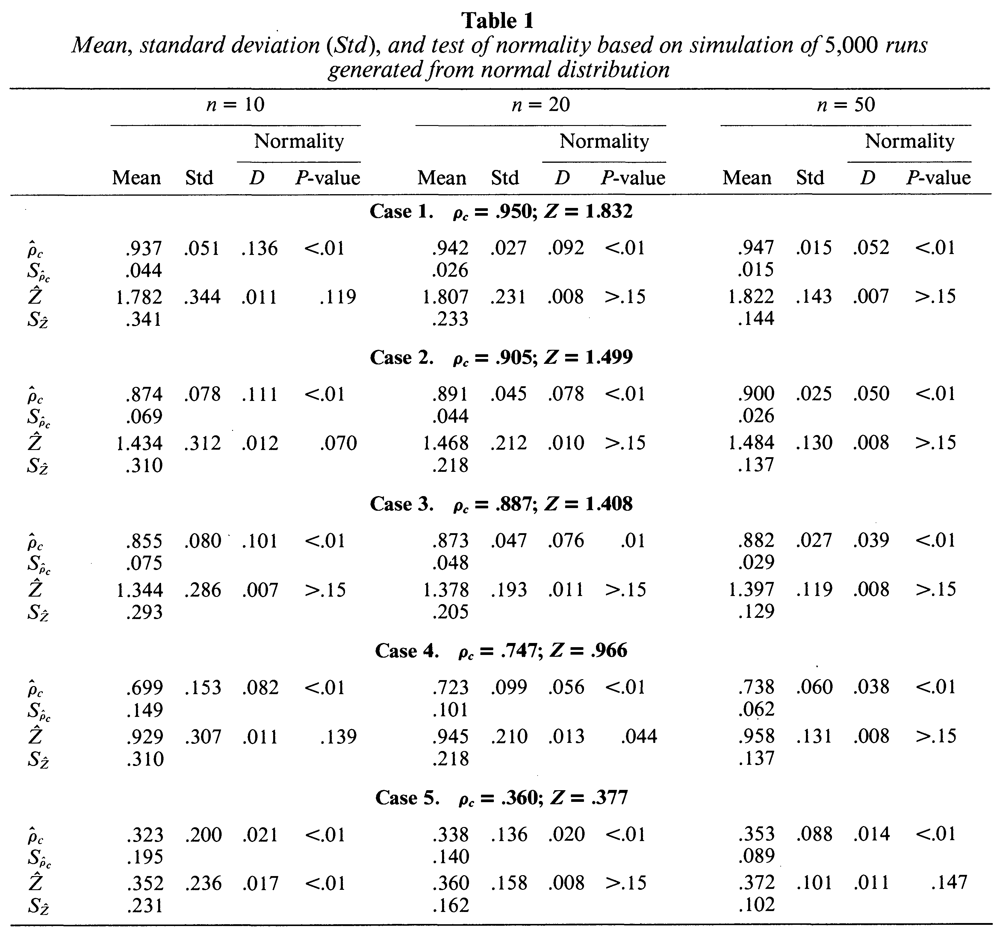

**Table 2**

*Actual and bootstrapped estimation of* $\sigma_{\hat{\rho}_c}$ *and* $\sigma_{\hat{Z}}$ ($n$ = 10) *based on* 5,000 *runs*

<table>
<thead>
<tr><th colspan="2">Case</th><th>Bootstrapped</th><th>Actual</th></tr>
</thead>
<tbody>
<tr><td rowspan="2">1</td><td>$S_{\hat{\rho}_c}$</td><td>.063</td><td>.051</td></tr>
<tr><td>$S_{\hat{Z}}$</td><td>.314</td><td>.344</td></tr>
<tr><td rowspan="2">2</td><td>$S_{\hat{\rho}_c}$</td><td>.087</td><td>.078</td></tr>
<tr><td>$S_{\hat{Z}}$</td><td>.284</td><td>.312</td></tr>
<tr><td rowspan="2">3</td><td>$S_{\hat{\rho}_c}$</td><td>.090</td><td>.080</td></tr>
<tr><td>$S_{\hat{Z}}$</td><td>.268</td><td>.286</td></tr>
<tr><td rowspan="2">4</td><td>$S_{\hat{\rho}_c}$</td><td>.151</td><td>.153</td></tr>
<tr><td>$S_{\hat{Z}}$</td><td>.280</td><td>.307</td></tr>
<tr><td rowspan="2">5</td><td>$S_{\hat{\rho}_c}$</td><td>.172</td><td>.200</td></tr>
<tr><td>$S_{\hat{Z}}$</td><td>.207</td><td>.236</td></tr>
</tbody>
</table>

Imagen original

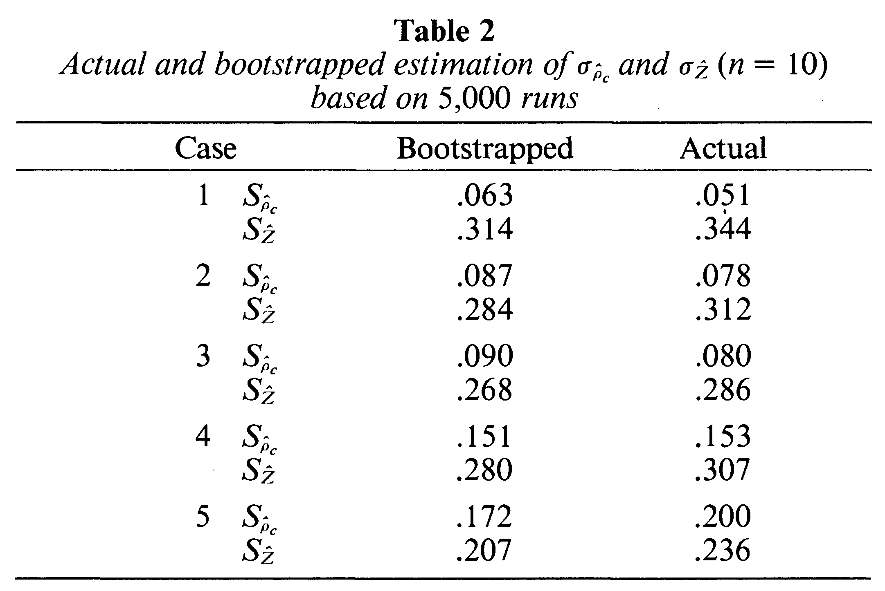

<!-- página 9 | impresa: 262 | encabezado: 262 / Biometrics, March 1989 -->

**Table 3**

*Mean, standard deviation* (Std), *and test of normality based on simulation of* 5,000 *runs from the uniform distribution*

<table>
<thead>
<tr><th rowspan="3"></th><th colspan="4"><em>n</em> = 10</th><th colspan="4"><em>n</em> = 50</th></tr>
<tr><th colspan="2"></th><th colspan="2">Normality</th><th colspan="2"></th><th colspan="2">Normality</th></tr>
<tr><th>Mean</th><th>Std</th><th><em>D</em></th><th><em>P</em>-Value</th><th>Mean</th><th>Std</th><th><em>D</em></th><th><em>P</em>-Value</th></tr>
</thead>
<tbody>
<tr><td colspan="9"><strong>Case 1. $\boldsymbol{\rho_c}$ = .950; <em>Z</em> = 1.832</strong></td></tr>
<tr><td>$\hat{\rho}_c$</td><td>.930</td><td>.052</td><td>.132</td><td>&lt;.01</td><td>.947</td><td>.015</td><td>.052</td><td>&lt;.01</td></tr>
<tr><td>$S_{\hat{\rho}_c}$</td><td>.046</td><td></td><td></td><td></td><td>.015</td><td></td><td></td><td></td></tr>
<tr><td>$\hat{Z}$</td><td>1.768</td><td>.352</td><td>.010</td><td>&gt;.15</td><td>1.821</td><td>.142</td><td>.007</td><td>&gt;.15</td></tr>
<tr><td>$S_{\hat{Z}}$</td><td>.350</td><td></td><td></td><td></td><td>.145</td><td></td><td></td><td></td></tr>
<tr><td colspan="9"><strong>Case 3. $\boldsymbol{\rho_c}$ = .887; <em>Z</em> = 1.408</strong></td></tr>
<tr><td>$\hat{\rho}_c$</td><td>.857</td><td>.081</td><td>.102</td><td>&lt;.01</td><td>.883</td><td>.026</td><td>.042</td><td>&lt;.01</td></tr>
<tr><td>$S_{\hat{\rho}_c}$</td><td>.076</td><td></td><td></td><td></td><td>.029</td><td></td><td></td><td></td></tr>
<tr><td>$\hat{Z}$</td><td>1.349</td><td>.283</td><td>.013</td><td>.054</td><td>1.400</td><td>.115</td><td>.011</td><td>&gt;.15</td></tr>
<tr><td>$S_{\hat{Z}}$</td><td>.299</td><td></td><td></td><td></td><td>.130</td><td></td><td></td><td></td></tr>
<tr><td colspan="9"><strong>Case 5. $\boldsymbol{\rho_c}$ = .360; <em>Z</em> = .377</strong></td></tr>
<tr><td>$\hat{\rho}_c$</td><td>.315</td><td>.200</td><td>.030</td><td>&lt;.01</td><td>.352</td><td>.085</td><td>.018</td><td>&lt;.01</td></tr>
<tr><td>$S_{\hat{\rho}_c}$</td><td>.199</td><td></td><td></td><td></td><td>.089</td><td></td><td></td><td></td></tr>
<tr><td>$\hat{Z}$</td><td>.342</td><td>.231</td><td>.017</td><td>&lt;.01</td><td>.371</td><td>.098</td><td>.008</td><td>&gt;.15</td></tr>
<tr><td>$S_{\hat{Z}}$</td><td>.233</td><td></td><td></td><td></td><td>.102</td><td></td><td></td><td></td></tr>
</tbody>
</table>

Imagen original

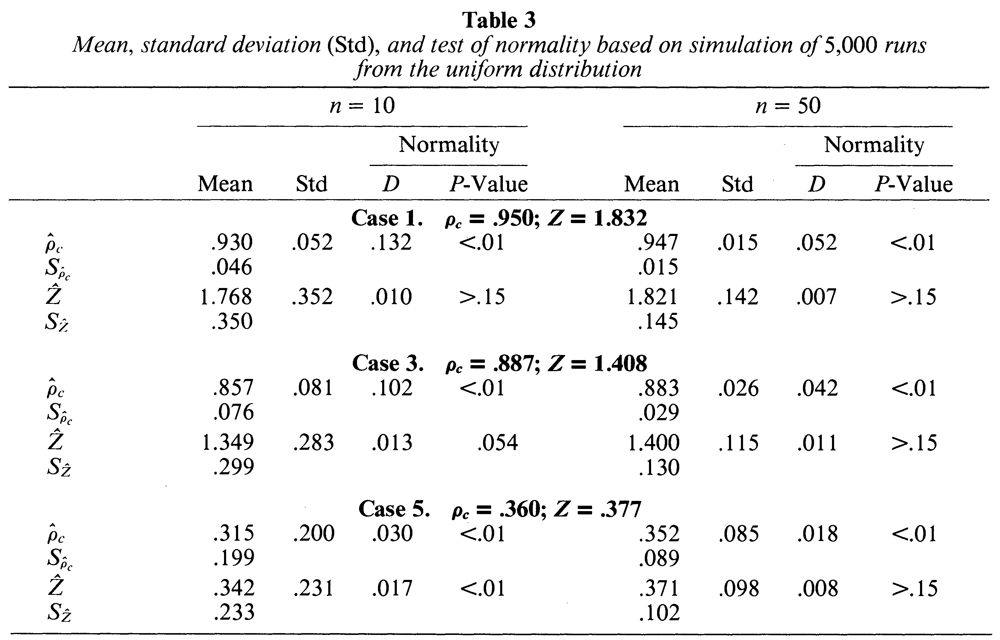

**Table 4**

*Mean, standard deviation* (Std), *and test of normality based on simulation of* 5,000 *runs from the Poisson distribution*

<table>
<thead>
<tr><th rowspan="3"></th><th colspan="4"><em>n</em> = 10</th><th colspan="4"><em>n</em> = 50</th></tr>
<tr><th colspan="2"></th><th colspan="2">Normality</th><th colspan="2"></th><th colspan="2">Normality</th></tr>
<tr><th>Mean</th><th>Std</th><th><em>D</em></th><th><em>P</em>-Value</th><th>Mean</th><th>Std</th><th><em>D</em></th><th><em>P</em>-Value</th></tr>
</thead>
<tbody>
<tr><td colspan="9"><strong>Case 1. $\boldsymbol{\rho_c}$ = .950; <em>Z</em> = 1.832</strong></td></tr>
<tr><td>$\hat{\rho}_c$</td><td>.932</td><td>.050</td><td>.129</td><td>&lt;.01</td><td>.947</td><td>.015</td><td>.059</td><td>&lt;.01</td></tr>
<tr><td>$S_{\hat{\rho}_c}$</td><td>.044</td><td></td><td></td><td></td><td>.015</td><td></td><td></td><td></td></tr>
<tr><td>$\hat{Z}$</td><td>1.779</td><td>.344</td><td>.006</td><td>&gt;.15</td><td>1.821</td><td>.145</td><td>.009</td><td>&gt;.15</td></tr>
<tr><td>$S_{\hat{Z}}$</td><td>.341</td><td></td><td></td><td></td><td>.144</td><td></td><td></td><td></td></tr>
<tr><td colspan="9"><strong>Case 3. $\boldsymbol{\rho_c}$ = .887; <em>Z</em> = 1.408</strong></td></tr>
<tr><td>$\hat{\rho}_c$</td><td>.856</td><td>.080</td><td>.107</td><td>&lt;.01</td><td>.882</td><td>.026</td><td>.048</td><td>&lt;.01</td></tr>
<tr><td>$S_{\hat{\rho}_c}$</td><td>.074</td><td></td><td></td><td></td><td>.028</td><td></td><td></td><td></td></tr>
<tr><td>$\hat{Z}$</td><td>1.346</td><td>.279</td><td>.013</td><td>.037</td><td>1.397</td><td>.116</td><td>.010</td><td>&gt;.15</td></tr>
<tr><td>$S_{\hat{Z}}$</td><td>.288</td><td></td><td></td><td></td><td>.129</td><td></td><td></td><td></td></tr>
<tr><td colspan="9"><strong>Case 5. $\boldsymbol{\rho_c}$ = .360; <em>Z</em> = .377</strong></td></tr>
<tr><td>$\hat{\rho}_c$</td><td>.315</td><td>.196</td><td>.024</td><td>&lt;.01</td><td>.353</td><td>.085</td><td>.017</td><td>&lt;.01</td></tr>
<tr><td>$S_{\hat{\rho}_c}$</td><td>.193</td><td></td><td></td><td></td><td>.088</td><td></td><td></td><td></td></tr>
<tr><td>$\hat{Z}$</td><td>.342</td><td>.229</td><td>.018</td><td>&lt;.01</td><td>.372</td><td>.098</td><td>.006</td><td>&gt;.15</td></tr>
<tr><td>$S_{\hat{Z}}$</td><td>.227</td><td></td><td></td><td></td><td>.102</td><td></td><td></td><td></td></tr>
</tbody>
</table>

Imagen original

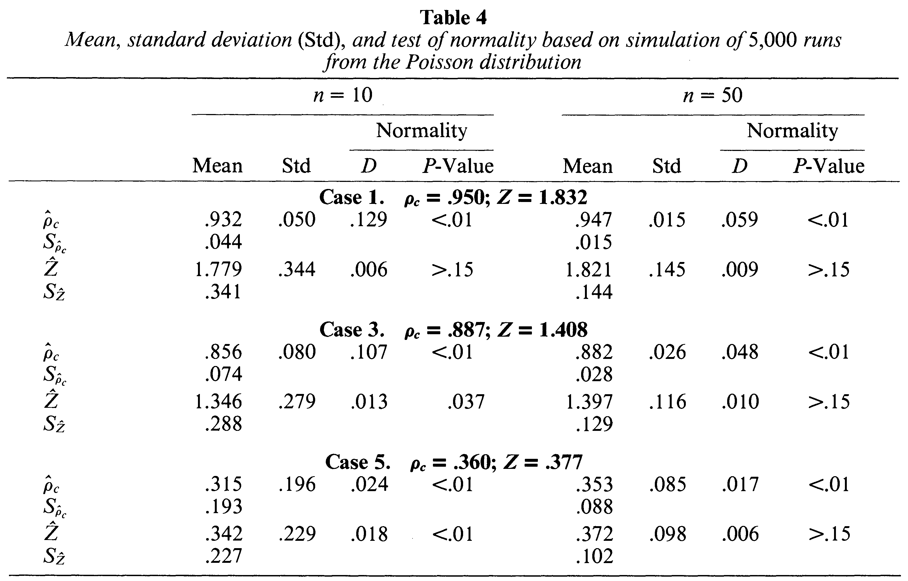

The asymptotic normality of $\hat{\rho}_\mathrm{c}$ and $\hat{Z}$ for samples from the uniform (short-tailed, symmetric) and Poisson (long-tailed, asymmetric to the right) distributions is very similar to that for samples from the normal distribution. These results demonstrate that $\hat{Z}$ is robust for samples from uniform and Poisson distributions. A very encouraging result is that it is robust even with a sample size of 10.

<!-- página 10 | impresa: 263 | encabezado: A Concordance Correlation Coefficient / 263 -->

## 5. Examples

Two examples are considered that investigate the following two questions:

(1) Can a “Portable \$ave” machine (actual name withheld) reproduce a gold-standard machine in measuring total bilirubin in blood?

(2) Can an *in-vitro* assay for screening the toxicity of biomaterials reproduce from trial to trial? [This example uses part of the data from Johnson et al. (1985). The two assays in this example are the best and the worst in terms of reproducibility, respectively, in that data set.]

To study the first question, blood samples were taken from 10 animals, one sample per animal. Each sample was measured for bilirubin level by three operators using a Portable \$ave machine and a gold-standard Hitachi machine. The salesman of the Portable \$ave machine claimed that it can reproduce the results measured by the Hitachi machine, and that “anyone on your staff can run tests.” Therefore, this study was conducted at Baxter by three operators. One was a well-trained medical technician in the laboratory (denoted by M.T.); one was a staff nurse who represented the targeted personnel to operate this machine with minimal training (denoted by Nurse); and one was a temporary summer trainee with no training who was the son of a vice president of the laboratory (denoted by S-VP).

The results are plotted in Figure 4. This plot indicates that the Portable \$ave machine is reproducible if it is performed by well-trained personnel (symbol M), but not by personnel with minimum or no training (symbols N and S). Table 5 presents the statistical outcome using a variety of different analyses. The first two rows present $\hat{\rho}_\mathrm{c}$ and a 95% confidence interval for $\rho_\mathrm{c}$ for each operator. These figures clearly reflect high reproducibility performed by the M.T. (.995), mediocre reproducibility by the S-VP (.838), and poor reproducibility by the nurse (.624). For more detailed information, the next three rows show excellent <!-- página 11 | impresa: 264 | encabezado: 264 / Biometrics, March 1989 --> precision ($r$ = .999), with minimum location shift ($\hat{u}$ = −.041) and scale shift ($\hat{v}$ = .916) by the M.T. Also shown in these three rows are moderate precision ($r$ = .936), with poor location shift ($\hat{u}$ = .768) and scale shift ($\hat{v}$ = 1.878) by the nurse. The laboratory refused to purchase this machine because it worked well only when it was used by well-trained personnel, contradicting the claim made by the salesman.

<!-- NOTA-CONV: Fig. 4 impresa al pie de la página 10 (folio 263), debajo del párrafo anterior, que continúa en la página 11 -->

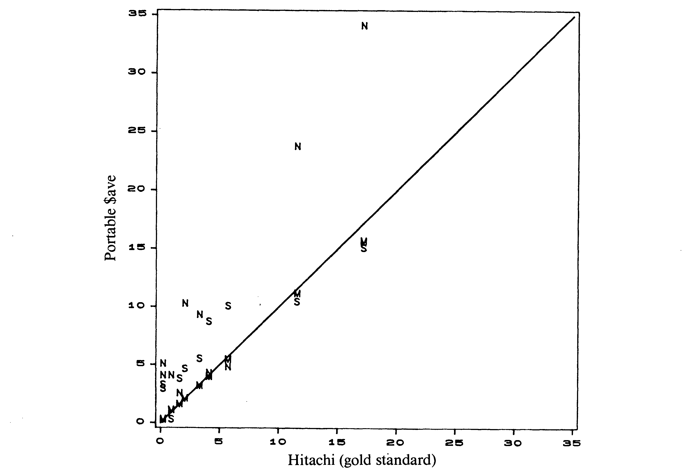

**Figure 4.** Portable \$ave versus Hitachi by three operators for measuring bilirubin in blood. M: M.T.; N: Nurse; S: S-VP

<!-- texto en la figura: eje y: Portable $ave (marcas 0, 5, 10, 15, 20, 25, 30, 35) · eje x: Hitachi (gold standard) (marcas 0, 5, 10, 15, 20, 25, 30, 35) · símbolos de los puntos: M, N, S · la recta trazada es la línea de 45° por el origen -->

<!-- NOTA-CONV: Tabla 5 impresa arriba de la página 11 (folio 264), antes de la continuación del párrafo anterior -->

**Table 5**

*Statistical analyses to evaluate the reproducibility of “Portable* \$*ave” machine by* 3 *operators*

<table>
<thead>
<tr><th>Methoda</th><th>M.T.</th><th>Nurse</th><th>S-VP</th></tr>
</thead>
<tbody>
<tr><td>$\hat{\rho}_c$</td><td>.995</td><td>.624</td><td>.838</td></tr>
<tr><td>95% CI</td><td>(.988, .998)</td><td>(.292, .822)</td><td>(.520, .952)</td></tr>
<tr><td>$\hat{u}$</td><td>−.041</td><td>.768</td><td>.377</td></tr>
<tr><td>$\hat{v}$</td><td>.916</td><td>1.878</td><td>.805</td></tr>
<tr><td>$r$</td><td>.999</td><td>.936</td><td>.917</td></tr>
<tr><td>$P_\mathrm{pt}$</td><td>.227</td><td>.012</td><td>.037</td></tr>
<tr><td>$P_\mathrm{ls}$</td><td>&lt;.0001</td><td>.002</td><td>.017</td></tr>
<tr><td>CV</td><td>7.98%</td><td>72.8%</td><td>35.8%</td></tr>
<tr><td>$r_\mathrm{i}$</td><td>.995</td><td>.617</td><td>.848</td></tr>
</tbody>
</table>

a $\hat{\rho}_c = r[(\hat{v} + 1/\hat{v} + \hat{u}^2)/2]^{-1}$.

95% CI: confidence interval for $\rho_c$ using $Z$-transformation.

$\hat{u} = (\bar{Y}_1 - \bar{Y}_2)/\sqrt{S_1S_2}$.

$\hat{v} = S_1/S_2$.

$r$ = Pearson correlation coefficient.

$P_\mathrm{pt}$ = $P$-value using paired $t$-test.

$P_\mathrm{ls}$ = $P$-value using least squares analysis.

CV = Coefficient of variation.

$r_\mathrm{i}$ = Intraclass correlation coefficient.

Imagen original

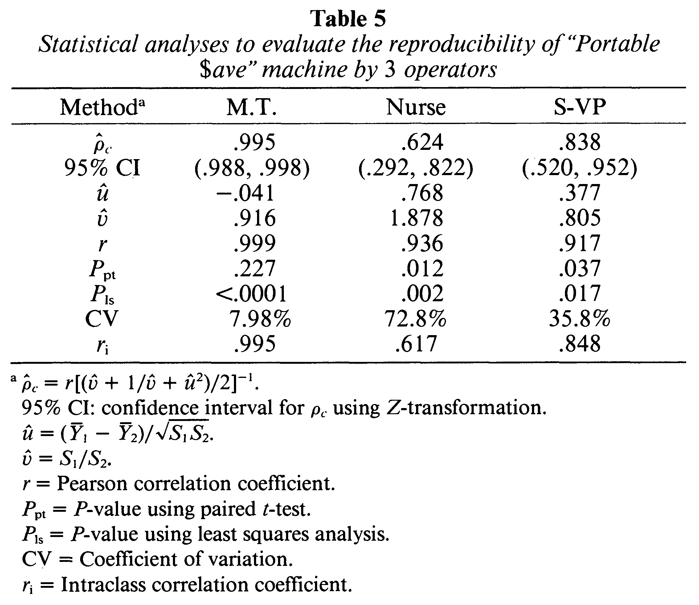

If one chose to use the paired $t$-test ($P_\mathrm{pt}$ in Table 5), luckily one would draw the correct conclusions in this example. If one chose to use the least squares analysis ($P_\mathrm{ls}$ in Table 5), the hypothesis of zero intercept and unit slope by the M.T. would be strongly rejected ($P$ &lt; .0001), much more so than that by the nurse ($P$ = .002) and by the S-VP ($P$ = .017), due to a near-zero residual error. The least squares analysis results contradict intuition. The smaller the residual error (more precision), the more likely one would reject zero intercept and unit slope. On the other hand, the larger the residual error (less precision), the less likely one would reject.

The coefficient of variation (CV in Table 5) works well in this example, although one might decide that a CV of 7.98% (by the M.T.) is not acceptable (greater than 5%). The intraclass correlation coefficient ($r_\mathrm{i}$ in Table 5) works very well and is nearly identical to $\hat{\rho}_\mathrm{c}$ in this example. This coefficient will give results similar to those for $\hat{\rho}_\mathrm{c}$ most of the time. However, it will give a negative value when the paired readings are uncorrelated. It cannot distinguish bias from imprecision, which can be characterized by $\hat{u}$, $\hat{v}$, and $r$ when $\hat{\rho}_\mathrm{c}$ is used.

In the second example, 10 materials, varying from nontoxic to highly toxic, were evaluated by two biochemical *in-vitro* assays. The two assays were cellular adenosine triphosphate activity using cell line 76 (ATP-76), and cellular adhesion using cell line 74 (CLA-74). These two assays are commonly used in screening the toxicity of materials for use in medical devices. The results are expressed as percent cell function. The lower the value, the higher the toxicity. Two independent trials, approximately 1 week apart, were performed. The purpose was to assess the reproducibility between trials of each assay for material screening. The data are plotted in Figure 5.

Figure 5 shows that ATP-76 had much better agreement than CLA-74 between the two trials. Table 6 presents the statistical outcome. $\hat{\rho}_\mathrm{c}$ clearly demonstrates good trial-to-trial <!-- página 12 | impresa: 265 | encabezado: A Concordance Correlation Coefficient / 265 --> reproducibility for ATP-76 ($\hat{\rho}_\mathrm{c}$ = .969) and poor reproducibility for CLA-74 ($\hat{\rho}_\mathrm{c}$ = .283 with a 95% CI containing 0). The paired $t$-test marginally rejected the reproducibility of ATP-76 ($P$ = .049) while it failed to reject the reproducibility of CLA-74 ($P$ = .087). The least squares analysis rejects neither. Due to a higher mean value of CLA-74 compared with that for ATP-76, the coefficient of variation fails to reflect the poorer reproducibility of CLA-74 (17.6%). The intraclass correlation coefficient works well in this example.

<!-- NOTA-CONV: Fig. 5 y Tabla 6 impresas en la parte superior de la página 12 (folio 265), antes de la continuación del párrafo anterior -->

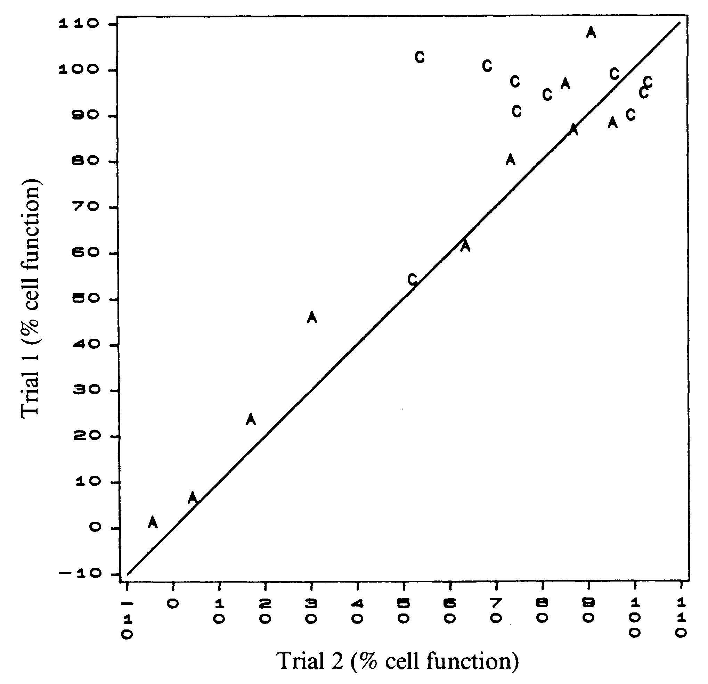

**Figure 5.** Trial-to-trial reproducibility of two *in-vitro* assays. A: ATP-76; C: CLA-74

<!-- texto en la figura: eje y: Trial 1 (% cell function) (marcas −10, 0, 10, 20, 30, 40, 50, 60, 70, 80, 90, 100, 110) · eje x: Trial 2 (% cell function) (marcas −10, 0, 10, 20, 30, 40, 50, 60, 70, 80, 90, 100, 110, con los dígitos de cada marca impresos en vertical, uno debajo de otro) · símbolos de los puntos: A, C · la recta trazada es la línea de 45° por el origen -->

**Table 6**

*Statistical analyses to evaluate the trial-to-trial reproducbility by ATP*-76 *and CLA*-74 *in-vitro assays*

<table>
<thead>
<tr><th>Methoda</th><th>ATP-76</th><th>CLA-74</th></tr>
</thead>
<tbody>
<tr><td>$\hat{\rho}_c$</td><td>.969</td><td>.283</td></tr>
<tr><td>95% CI</td><td>(.874, .992)</td><td>(−.245, .681)</td></tr>
<tr><td>$\hat{u}$</td><td>.153</td><td>.743</td></tr>
<tr><td>$\hat{v}$</td><td>.998</td><td>.723</td></tr>
<tr><td>r</td><td>.980</td><td>.376</td></tr>
<tr><td>Ppt</td><td>.049</td><td>.087</td></tr>
<tr><td>Pls</td><td>.156</td><td>.151</td></tr>
<tr><td>CV</td><td>11.46%</td><td>17.57%</td></tr>
<tr><td>$r_\mathrm{i}$</td><td>.971</td><td>.250</td></tr>
</tbody>
</table>

a $\hat{\rho}_c = r[(\hat{v} + 1/\hat{v} + \hat{u}^2)/2]^{-1}$.

95% CI: 95% confidence interval for $\rho_c$ using $Z$-transformation.

$\hat{u} = (\bar{Y}_1 - \bar{Y}_2)/\sqrt{S_1S_2}$.

$\hat{v} = S_1/S_2$.

$r$ = Pearson correlation coefficient.

$P_\mathrm{pt}$ = $P$-value using paired $t$-test.

$P_\mathrm{ls}$ = $P$-value using least squares analysis.

CV = Coefficient of variation.

$r_\mathrm{i}$ = Intraclass correlation coefficient.

Imagen original

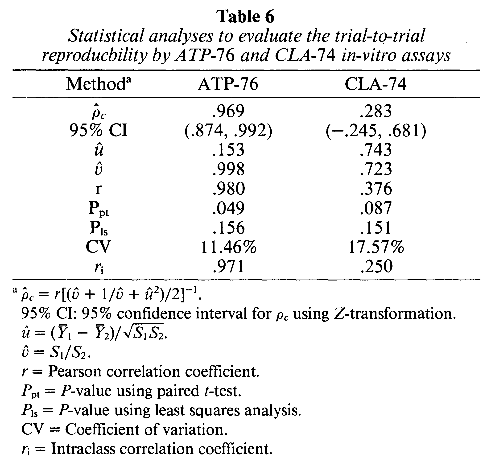

<!-- página 13 | impresa: 266 | encabezado: 266 / Biometrics, March 1989 -->

## 6. Conclusion

The concordance correlation coefficient, which is used to evaluate the agreement between paired readings, has desirable characteristics. It is simple to use. Its estimate using the sample counterparts is consistent and has asymptotic normality for bivariate normal data. However, its statistical properties (consistency and asymptotic normality) can be much improved by using the inverse hyperbolic tangent transformation ($Z$-transformation). It is also robust against samples from the uniform and Poisson distributions even with small sample sizes.

## 7. Future Studies

This index can be generalized to evaluate agreements among more than two readings. The multiple-reading counterpart is

$$
\rho_\mathrm{c} = \frac{2 \sum_{i=1}^{p} \sum_{j=1}^{p} \sigma_{ij}}{\sum_{i=1}^{p} \sum_{j=1}^{p} (\mu_i - \mu_j)^2 + 2 \sum_{i=1}^{p} \sigma_i^2}\,, \quad p > 2.
$$

This index may also be a good statistic for use in goodness-of-fit tests. For example, to test for normality, one can measure the agreement between the cumulative density function versus the cumulative normal density function through this index, rather than taking the maximum deviation, as in the Kolmogorov test.

This index can also be applied when $Y_1$ is random and $Y_2$ is fixed, in which case the standard error has a simpler structure. The index can be used to characterize agreement between the observed measurements and the theoretical (expected) values. These possibilities are under investigation.

## ACKNOWLEDGEMENTS

I would like to express my sincere gratitude to the editor and referees for their valuable comments, to Laurene Strauch for her assistance in preparing this manuscript, and to my fellow statisticians at Baxter Healthcare Corp. for their support and comments.

## RÉSUMÉ

On présente et on étudie un nouvel indice de reproductibilité. Cet indice est la corrélation entre les deux lectures qui tombent sur la première bissectrice (45 degrés). It est simple à utiliser et a les propriétés souhaitées. Les propriétés statistiques de cette estimation peuvent être évaluées de façon satisfaisante en utilisant la transformation de l’arctangente hyperbolique. On a fait une simulation de Monte Carlo avec 5,000 tirages pour confirmer la validité de l’estimation. On donne une application utilisant des données réelles.

## REFERENCES

Bauer, S. and Kennedy, J. W. (1981). Applied statistics for the clinical laboratory: II. Within-run imprecision. *The Journal of Clinical Laboratory Automation* **1,** 197–201.

Efron, B. (1979). Bootstrap methods: Another look at the jackknife. *Annals of Statistics* **7,** 1–26.

Johnson, H. J., Northup, S. J., Seagraves, P. A., Atallah, M., Garvin, P. J., Lin, L., and Darby, T. D. (1985). Biocompatibility test procedure for materials evaluation *in vitro*. II. Objective methods of toxicity assessment. *Journal of Biomedical Materials Research* **19,** 489–508.

Serfling, R. J. (1980). *Approximation Theorems of Mathematical Statistics*. New York: Wiley.

<!-- página 14 | impresa: 267 | encabezado: A Concordance Correlation Coefficient / 267 -->

Westgard, J. O. and Hunt, M. R. (1973). Use and interpretation of common statistical tests on method-comparison studies. *Clinical Chemistry* **19,** 49–57.

*Received February* 1986; *revised June and September* 1987.

## APPENDIX

Let $(Y_{11},\ Y_{12}), \ldots, (Y_{n1},\ Y_{n2})$ be independent observations on a bivariate normal distribution. The concordance correlation coefficient is

$$
\rho_\mathrm{c} = \frac{2\sigma_{12}}{\sigma_1^2 + \sigma_2^2 + (\mu_1 - \mu_2)^2}\,.
$$

The $Z$-transformation of $\rho_\mathrm{c}$ is $Z = \tfrac{1}{2} \ln[(1 + \rho_\mathrm{c})/(1 - \rho_\mathrm{c})] = \tanh^{-1}\rho_\mathrm{c}$.

The sample analogues are

$$
\hat{\rho}_\mathrm{c} = \frac{2S_{12}}{S_1^2 + S_2^2 + (\bar{Y}_1 - \bar{Y}_2)^2}
$$

and

$$
\hat{Z} = \tanh^{-1}\hat{\rho}_\mathrm{c}.
$$

We first consider the asymptotic normality of $\hat{Z}$. It will then be straightforward to obtain the asymptotic normality of $\hat{\rho}_\mathrm{c}$ by simply applying the hyperbolic tangent transformation of $\hat{Z}$. The asymptotic normality of $\hat{Z}$ is algebraically less cumbersome. The transformation may be expressed as $\hat{Z} = g(\mathbf{v})$, where

$$
\mathbf{v} = (v_1,\ v_2,\ v_3,\ v_4,\ v_5) = \left( \bar{Y}_1,\ \bar{Y}_2,\ \frac{1}{n} {\textstyle\sum} Y_{i1}^2,\ \frac{1}{n} {\textstyle\sum} Y_{i2}^2,\ \frac{1}{n} {\textstyle\sum} Y_{i1}Y_{i2} \right)
$$

and

$$
g(v_1,\ v_2,\ v_3,\ v_4,\ v_5) = \frac{1}{4} \ln \left[ 1 + \frac{4(v_5 - v_1v_2)}{v_3 + v_4 - 2v_5} \right].
$$

The vector $\mathbf{v}$ is expressed as functions of sample moments and has asymptotic 5-variate normality with mean $\mathrm{E}(\mathbf{v}) = (\mu_1, \mu_2, \sigma_1^2 + \mu_1^2, \sigma_2^2 + \mu_2^2, \sigma_{12} + \mu_1\mu_2)$ and variance $n^{-1}\,\boldsymbol{\Sigma}$, where

$$
\begin{gathered}
\boldsymbol{\Sigma} = \{W_{ij}\}_{5\times5}, \\
W_{11} = \sigma_1^2, \quad W_{12} = W_{21} = \sigma_{12}, \quad W_{22} = \sigma_2^2, \\
W_{13} = W_{31} = 2\mu_1\sigma_1^2, \quad W_{23} = W_{32} = 2\mu_1\sigma_{12}, \quad W_{33} = 2\sigma_1^4 + 4\sigma_1^2\mu_1^2, \\
W_{14} = W_{41} = 2\mu_2\sigma_{12}, \quad W_{24} = W_{42} = 2\mu_2\sigma_2^2, \\
W_{34} = W_{43} = 2\sigma_{12}^2 + 4\mu_1\mu_2\sigma_{12}, \quad W_{44} = 2\sigma_2^4 + 4\sigma_2^2\mu_2^2, \\
W_{15} = W_{51} = \mu_2\sigma_1^2 + \mu_1\sigma_{12}, \quad W_{25} = W_{52} = \mu_1\sigma_2^2 + \mu_2\sigma_{12}, \\
W_{35} = W_{53} = 2\sigma_{12}\mu_1^2 + 2\sigma_{12}\sigma_1^2 + 2\mu_1\mu_2\sigma_1^2, \\
W_{45} = W_{54} = 2\sigma_{12}\mu_2^2 + 2\sigma_{12}\sigma_2^2 + 2\mu_1\mu_2\sigma_2^2, \\
W_{55} = \sigma_1^2\sigma_2^2 + \mu_1^2\sigma_2^2 + \mu_2^2\sigma_1^2 + \sigma_{12}^2 + 2\mu_1\mu_2\sigma_{12},
\end{gathered}
$$

which is the covariance matrix of $(Y_1,\ Y_2,\ Y_1^2,\ Y_2^2,\ Y_1Y_2)$. It follows from the theory on functions of asymptotically normal vectors (Serfling, 1980, Corollary 3.3) that $\hat{Z}$ is asymptotically normal with mean $Z$ and variance $n^{-1}\mathbf{d}\boldsymbol{\Sigma}\mathbf{d}'$, where

$$
\mathbf{d} = \left( \left.\frac{\partial g}{\partial v_1}\right|_{\mathbf{v}=\mathrm{E}(\mathbf{v})},\ \ldots,\ \left.\frac{\partial g}{\partial v_5}\right|_{\mathbf{v}=\mathrm{E}(\mathbf{v})} \right).
$$

<!-- página 15 | impresa: 268 | encabezado: 268 / Biometrics, March 1989 -->

The elements of $\mathbf{d}$ are

$$
\begin{aligned}
d_1 &= \left.\frac{\partial g}{\partial v_1}\right|_{\mathbf{v}=\mathrm{E}(\mathbf{v})} = -\frac{\mu_2}{\sigma_1^2 + \sigma_2^2 + 2\sigma_{12} + (\mu_1 - \mu_2)^2}\,; \\
d_2 &= \left.\frac{\partial g}{\partial v_2}\right|_{\mathbf{v}=\mathrm{E}(\mathbf{v})} = -\frac{\mu_1}{\sigma_1^2 + \sigma_2^2 + 2\sigma_{12} + (\mu_1 - \mu_2)^2}\,; \\
d_3 &= d_4 = \left.\frac{\partial g}{\partial v_3}\right|_{\mathbf{v}=\mathrm{E}(\mathbf{v})} = \left.\frac{\partial g}{\partial v_4}\right|_{\mathbf{v}=\mathrm{E}(\mathbf{v})} \\
&= \frac{-\sigma_{12}}{[\sigma_1^2 + \sigma_2^2 + 2\sigma_{12} + (\mu_1 - \mu_2)^2][\sigma_1^2 + \sigma_2^2 - 2\sigma_{12} + (\mu_1 - \mu_2)^2]}\,; \\
d_5 &= \left.\frac{\partial g}{\partial v_5}\right|_{\mathbf{v}=\mathrm{E}(\mathbf{v})} \\
&= \frac{(\sigma_1^2 + \sigma_2^2) + (\mu_1 - \mu_2)^2}{[\sigma_1^2 + \sigma_2^2 + 2\sigma_{12} + (\mu_1 - \mu_2)^2][\sigma_1^2 + \sigma_2^2 - 2\sigma_{12} + (\mu_1 - \mu_2)^2]}\,.
\end{aligned}
$$

After straightforward but tedious algebraic calculation, it can be shown that the variance of $\hat{Z}$ is

$$
\begin{aligned}
\sigma_{\hat{Z}}^2 &= \frac{1}{n}\,\mathbf{d}\boldsymbol{\Sigma}\mathbf{d}' \\
&= \frac{1}{n} \left[ \frac{(1 - \rho^2)\rho_\mathrm{c}^2}{(1 - \rho_\mathrm{c}^2)\rho^2} + \frac{4\rho_\mathrm{c}^3(1 - \rho_\mathrm{c})u^2}{\rho(1 - \rho_\mathrm{c}^2)^2} - \frac{2\rho_\mathrm{c}^4u^4}{\rho^2(1 - \rho_\mathrm{c}^2)^2} \right].
\end{aligned}
$$

One may substitute in the above expressions sample counterparts that are consistent estimates. One may replace the $n$ with $n - 2$ for less bias, as evident in the Monte Carlo study in this paper. The asymptotic normality of $\hat{\rho}_\mathrm{c}$ can be obtained by letting

$$
\hat{\rho}_\mathrm{c} = \tanh(\hat{Z}).
$$

From the theory on functions of asymptotically normal statistics (Serfling, 1980, Theorem 3.1), $\hat{\rho}_\mathrm{c}$ is asymptotically normal with mean $\rho_\mathrm{c}$ and variance

$$
(1 - \rho_\mathrm{c}^2)^2\sigma_{\hat{Z}}^2.
$$

This asymptotic variance depends on the parameter $\rho_\mathrm{c}$ much more than $\sigma_{\hat{Z}}^2$ does. Like Fisher’s $Z$-transformation on the sample correlation coefficient, the $\hat{Z}$ approaches normality much more rapidly than the $\hat{\rho}_\mathrm{c}$, as confirmed by the Monte Carlo study in this paper.
