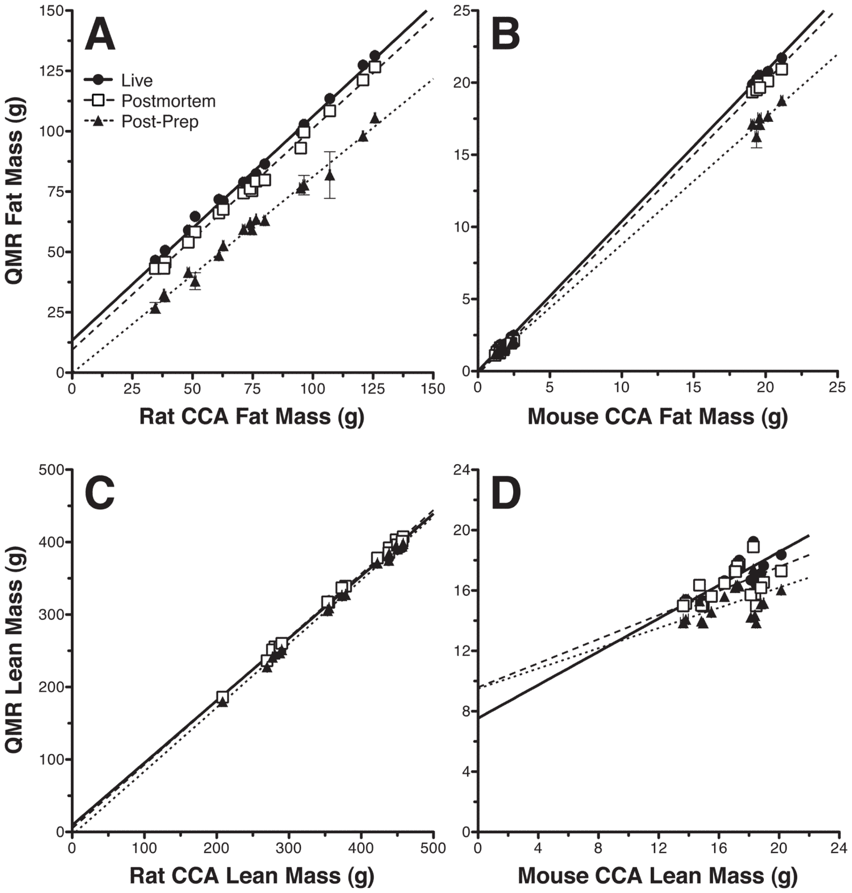
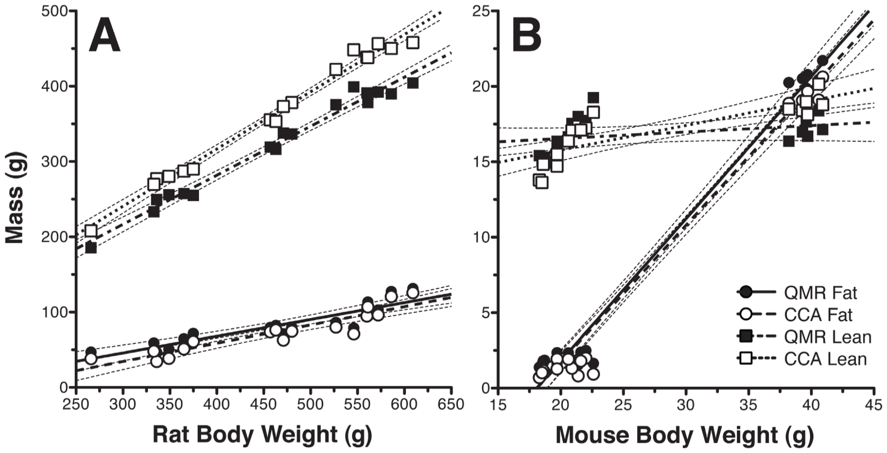
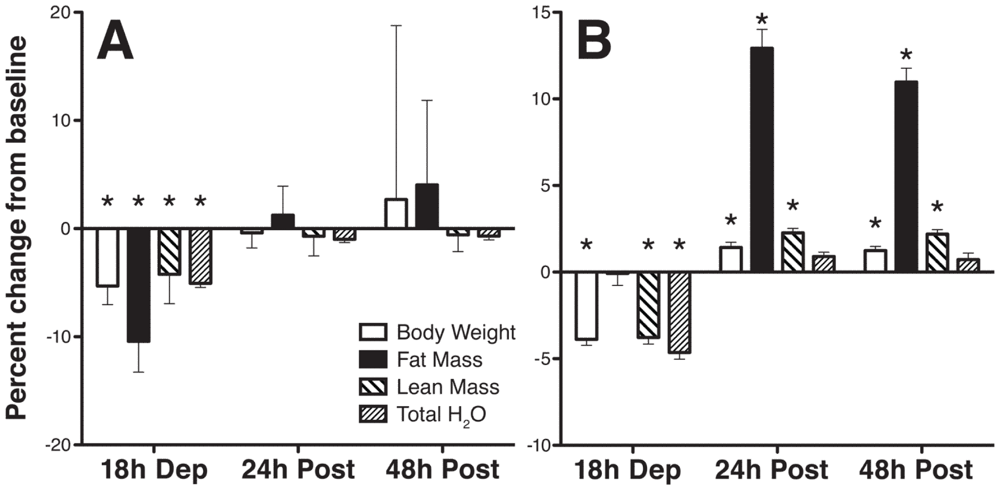
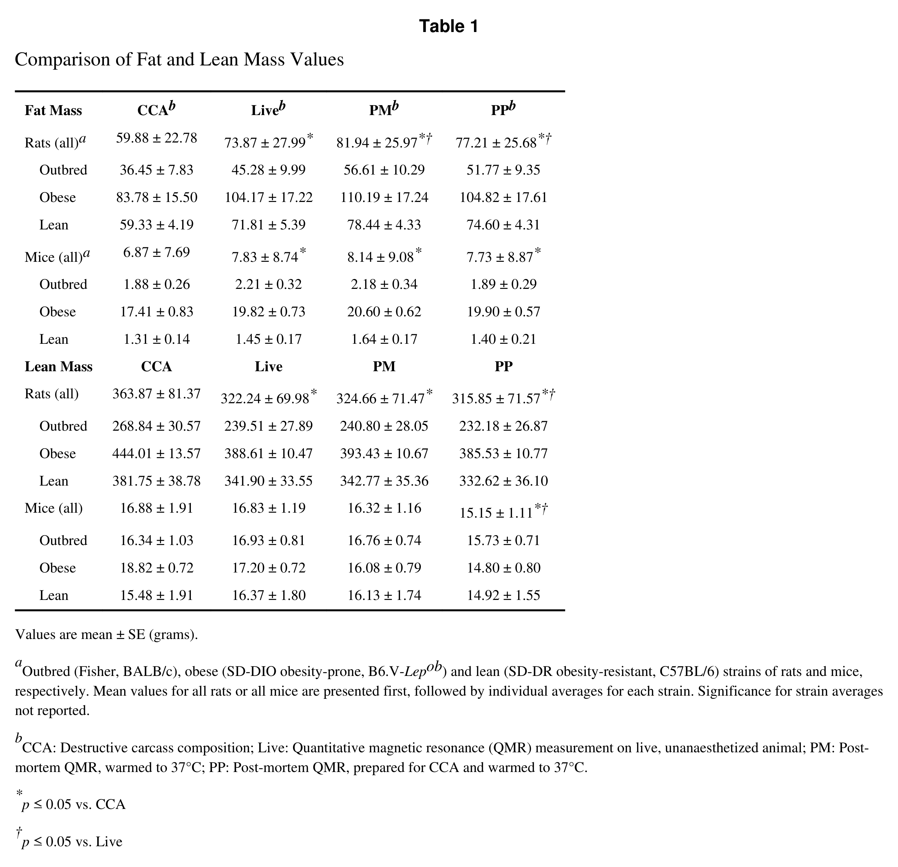
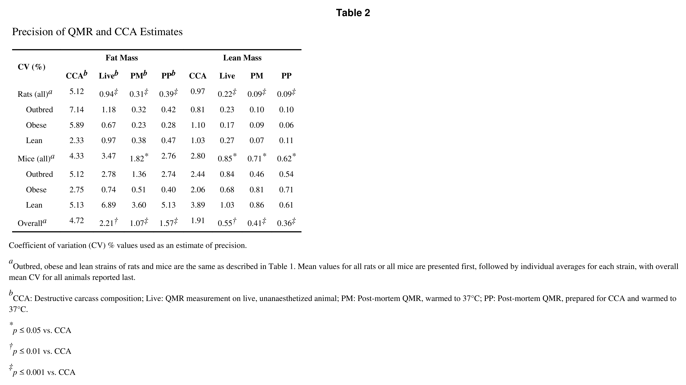

<!-- página 1 | encabezado: NIH Public Access / Author Manuscript / Obesity (Silver Spring). Author manuscript; available in PMC 2011 February 1. / NIH-PA Author Manuscript / NIH-PA Author Manuscript / NIH-PA Author Manuscript -->

Published in final edited form as:

*Obesity (Silver Spring)*. 2010 August ; 18(8): 1652–1659. doi:10.1038/oby.2009.471.

# Evaluation of a quantitative magnetic resonance imaging system for whole body composition analysis in rodents

<strong>JP. Nixon</strong>1, <strong>M Zhang</strong>2, <strong>C Wang</strong>3,4,5, <strong>M Kuskowski</strong>3, <strong>CM Novak</strong>6, <strong>JA Levine</strong>2,4, <strong>CJ Billington</strong>3,4, and <strong>CM Kotz</strong>3,4,5

1 Minnesota Craniofacial Research Training Program, School of Dentistry, University of Minnesota, Minneapolis MN 55455, USA

2 Mayo Clinic, Endocrine Research Unit, Rochester, MN 55905, USA

3 Veterans Affairs Medical Center, One Veterans Drive, Minneapolis, MN 55417, USA

4 Minnesota Obesity Center, University of Minnesota, St. Paul, MN 55108

5 Food Science and Nutrition, University of Minnesota, St. Paul, MN 55108, USA

6 Department of Biological Sciences, Kent State University, Kent, OH 44242

## Abstract

We evaluated the EchoMRI-900 combination rat and mouse quantitative magnetic resonance (QMR) body composition method in comparison to traditional whole-body chemical carcass analysis (CCA) for measurements of fat and fat-free mass in rodents. Live and postmortem QMR fat and lean mass measurements were obtained for lean, obese and outbred strains of rats and mice, and compared with measurements obtained using CCA. A second group of rats was measured before and after 18 h food or water deprivation. Significant positive correlations between QMR and CCA fat and lean mass measurements were shown for rats and mice. While all live QMR fat and lean measurements were more precise than CCA for rats, values obtained for mice significantly differed from CCA for lean mass only. QMR performed post-mortem slightly overestimated fat and lean values relative to live QMR but did not show lower precision than live QMR. Food deprivation reduced values for both fat and lean mass; water deprivation reduced estimates of lean mass only. In summary, all measurements using this QMR system were comparable to those obtained by CCA, but with higher overall precision, similar to previous reports for the murine QMR system. However, postmortem QMR measurements slightly overestimated live QMR values, and lean and fat mass measurements in this QMR system are influenced by hydration status and animal size, respectively. Despite these caveats, we conclude that the EchoMRI QMR system offers a fast *in vivo* method of body composition analysis, well correlated to but with greater overall precision than CCA.

## Introduction

In studying the neural, physiological and endocrine mechanisms underlying propensity for weight gain, it is often desirable to quickly obtain accurate, repeated measurements of body composition. Because many of the comorbidities associated with obesity are specifically <!-- página 2 | impresa: 2 | encabezado: Nixon et al. / Page 2 / NIH-PA Author Manuscript / NIH-PA Author Manuscript / NIH-PA Author Manuscript | pie: Obesity (Silver Spring). Author manuscript; available in PMC 2011 February 1. --> caused by excess body fat, rather than excess weight, assessment methods such as weight or body mass index (BMI) that estimate but do not specifically measure body fat are not adequate for use in primary research or clinical studies (1). A number of methods have been developed to determine body composition in experimental animal models used in obesity research. Traditional methods of determining body fat and lean mass, such as whole-body carcass composition analysis (CCA), are time consuming and terminal procedures (2), precluding longitudinal repeated studies. Newer methods such as bioelectrical impedance analysis (BIA) and dual-energy X-ray absorptiometry (DXA) allow repeated measures in live subjects, however both methods require the use of anesthesia to immobilize study animals. In addition, BIA estimates of body composition show a greater magnitude of error in obese subjects (3,4), while DXA can take between 5 to 35 minutes per subject, depending on the size of the animal and the desired scan resolution (5). Body composition scanning using quantitative magnetic resonance (QMR) appears to be superior to CCA, BIA and DXA methods in that QMR offers rapid measurement of body composition in live, unanaesthetized animals. While BIA directly measures only total water and DXA directly measures only two variables (fat and non-fat), QMR measurements utilize inherent differences in the nuclear magnetic resonance (NMR) properties of hydrogen atoms and hydrogen density in fluids and tissues to derive estimates of fat mass, lean mass, total body water and free water (body fluids not bound in tissues). Devices using these QMR methods are available for use with both human and animal subjects (6–11).

<!-- NOTA-CONV: datos de correspondencia y declaración de conflicto de interés impresos al pie de la página 1, bajo la línea de notas, sin llamada en el texto; se colocan después del párrafo que cruza de la página 1 a la 2, en su orden impreso -->

Corresponding author: Joshua P. Nixon, Veterans Affairs Medical Center, GRECC (11G), One Veterans Drive, Minneapolis, MN, USA 55417, Tel: +1 612 467-4956, Fax: +1 612 725-2084, nixon049@umn.edu.

**Disclosure**

All authors listed declare no conflict of interest in the publication of this manuscript.

While whole-body QMR systems designed specifically for mice and humans have previously been evaluated (9,11), no similar comparison has been performed for a QMR system designed for use with both rats and mice. To address this issue, we evaluated the precision and accuracy of QMR in comparison to traditional whole-body CCA, using the EchoMRI-900 (Echo Medical Systems, Houston, TX USA), a device designed to analyze both rats and mice, to address four goals: First, to compare data obtained from QMR and CCA analyses for outbred, lean, and obese strains of rats and mice; second, to determine whether postmortem and live QMR estimates of fat and lean mass are comparable; third, to compare the precision of QMR and CCA methods; and fourth, to determine the effects of short periods of food or water deprivation on QMR body fat and lean mass estimates.

## Methods

To compare data obtained from QMR with CCA analyses, we examined adult male rats and mice of varying body adiposity and genetic background. For each species, we examined one outbred, one lean, and one obese strain. For rats, Fisher rats (F344/NCr, National Cancer Institute, Frederick, MD USA; n=6) were used as an outbred strain, and obesity-prone (OP, n=6) and obesity-resistant (OR, n=5) Sprague-Dawley (SD) rats (OP-CD and OP-CR, Charles River, Wilmington, MA USA) were used as obese and lean animals, respectively. For mice, we examined BALB/cJ outbred, (n=12), B6.V-*Lep*<em>ob</em>/J obese (n=12), and Black 6 C57BL/6J lean mice (n=12) (Jackson, Bar Harbor, ME USA). For food and water deprivation studies, an additional 7 SD rats (Charles River) were used. Animals were housed individually (rats) or in groups (mice) in cages with a 12:12 light-dark cycle, with lights on at 0700. Rodent chow (Harlan Teklad 8604) and water were allowed *ad libitum*, except as described below for deprivation studies. All studies described here were approved by the local Institutional Animal Care and Use Committee at the Veterans Affairs Medical Center and the University of Minnesota.

All QMR measurements were made during the light phase (0700-1900). Scans were performed by placing animals into a thin-walled plastic cylinder (mice: 1.5 mm thick, 4.7 cm inner diameter; rats: 3 mm thick, 6.8 or 8.2 cm inner diameter, based on body weight), with a cylindrical plastic insert added to limit movement. While in the tube, animals were <!-- página 3 | impresa: 3 | encabezado: Nixon et al. / Page 3 / NIH-PA Author Manuscript / NIH-PA Author Manuscript / NIH-PA Author Manuscript | pie: Obesity (Silver Spring). Author manuscript; available in PMC 2011 February 1. --> briefly subjected to a low-intensity (0.05 Tesla) electromagnetic field to measure fat, lean mass, free water, and total body water. The general theoretical background and specific technical details describing the basic functionality of this system is well-described by Tinsley et al (9). Briefly, this system generates a signal that modifies the spin patterns of hydrogen atoms within the subject, and uses an algorithm to evaluate the resulting T1 and T2 relaxation curves specific to each of the four components measured – fat mass, lean muscle mass equivalent, total body water, and free water. It is important to note that the system used by Tinsley was an earlier model than the Echo device used in the previous study; in current generation systems, all four components are obtained from individual relaxation curves, while in previous models total body water was a derived estimates. Because each component is estimated based on an individually derived T1/T2 relaxation curve fractionated from the total returned signal, we consider each estimate to be a direct measurement. For rats, QMR scans were performed with accumulation times of 2 minutes. All mice in this study were scanned using a 4-minute accumulation. This longer scan time for mice is recommended by the manufacturer for this combination machine; while short scan times are possible for mice, our initial investigations showed significantly higher variability for QMR fat mass values vs. CCA in mice at 2-minute accumulation times (data not shown). For deprivation studies, rats were scanned once both before and after 18h deprivation of either food or water, and scanned again 24 and 48 h after food or water was returned. For QMR measurements used for comparison with CCA, three sets of scans were performed in triplicate on each animal: Live scans, post-mortem (PM) scans on intact carcasses, and post-preparation (PP) scans on shaved, eviscerated carcasses. Live subjects were returned to their cages between scans. For PM and PP scans, animals were warmed to 37°C (verified by an internal temperature probe) prior to each scan, and repositioned between scans.

Postmortem and PP QMR scans were performed to mimic the procedure used by investigators that ship animals to another location for QMR measurements. Following live QMR measurements, animals were sacrificed by CO2 asphyxia, enclosed individually in airtight plastic bags, and cooled to 4°C for 24 to 48 hours. For PM scans, intact carcasses were warmed to 37°C in a hybridization oven prior to PM QMR measurements but were not removed from plastic bags to limit water loss. For PP scans, subjects were prepared for CCA analysis by removal of body hair and gut contents. After re-warming to 37°C, PP QMR scans were performed on the eviscerated carcasses, and carcasses were stored frozen at −70°C.

For CCA analysis, thawed carcasses were homogenized in double-distilled water. Aliquots of homogenate were used to determine total lipid content by chloroform extraction (12), and a separate set of aliquots were placed in an ashing oven to determine protein content (13). Three samples from each animal were analyzed for lipid content. For protein content, three samples per rat were analyzed, while for mice, three samples were obtained where possible, however only two samples were available for three mice (2 Black 6, 1 BALB/c) due to small carcass size. For CCA, a two-compartment model was used, with fat mass defined as total lipid weight, and lean mass measurements defined as water weight plus ash and protein weights. A bootstrap procedure that calculated all potential combinations of variables was used to generate CCA lean mass values.

For comparisons between QMR and CCA, fat and lean mass measurements were compared using Deming regressions, an analysis that assumes error in both methodologies without assuming either method is superior (14). Linear regressions against body weight were also performed for all QMR and CCA values. Regression slopes were compared using a two-tailed *t*-test (15). The precision of each method was determined by calculating the coefficient of variation (CV) for QMR and CCA measurements. Arcsine-transformed CV <!-- página 4 | impresa: 4 | encabezado: Nixon et al. / Page 4 / NIH-PA Author Manuscript / NIH-PA Author Manuscript / NIH-PA Author Manuscript | pie: Obesity (Silver Spring). Author manuscript; available in PMC 2011 February 1. --> values were compared using one-way repeated measures ANOVA. Two-way repeated measures ANOVA was used to analyze differences in CV values by animal strain. For deprivation studies, data were analyzed using one-way repeated measures ANOVA over time. GraphPad Prism 5.0 (GraphPad Software, San Diego, CA USA) was used for regressions, statistical comparisons and to generate all graphs.

## Results

### QMR live scan vs. CCA

Mean fat and lean mass values for all groups are presented in Table 1. For both rats and mice, Deming regressions showed positive significant correlations between fat mass as determined by QMR and CCA (Rats: Fat mass slope = 0.927 ± 0.0168, Fig. 1A; Mice: Fat mass slope = 1.038 ± 0.0044, Fig. 1B). Differences in the y-intercept suggest an overestimation of fat mass for QMR in rats relative to CCA. Linear regression against body weight shows no difference in slope between QMR and CCA fat mass measures for both rats (Fig. 2A) and mice (Fig. 2B). For lean mass, Deming regressions showed positive correlations between lean mass as determined by QMR and CCA measurements for both rats and mice (Rats: Lean mass slope = 0.860 ± 0.017, Fig. 1C; Mice: Lean mass slope = 0.551 ± 0.110, Fig. 1D). Similar to fat mass in rats, the regression y-intercept shows that lean mass in mice appears to be overestimated by QMR relative to CCA. When regressed against body weight, QMR and CCA lean mass measurements show significantly different slopes for both rats ($\mathrm{F}_{1,\ 30}$ = 11.045, *p* = 0.0024<strong>,</strong> Fig. 2A) and mice ($\mathrm{F}_{1,\ 32}$ = 8.516, *p* = 0.0064<strong>,</strong> Fig. 2B); slopes for fat mass did not differ significantly in either species (Fig 2A, 2B).

### Postmortem and post-preparation QMR scans

One-way repeated measures ANOVA showed significant differences between fat mass values obtained during live, PM and PP scans (F = 27.99, *p* &lt; 0.0001, Table 1). Bonferroni-adjusted post-hoc comparisons showed that all QMR values were significantly different than CCA (p &lt; 0.001), and that PM (but not PP) values differed from live measurements (p &lt; 0.01). Deming regressions against CCA values indicate significantly different slopes for live, PM and PP fat mass values for both rats (Live: 0.9277 ± 0.0168; PM: 0.9174 ± 0.0163; PP: 0.8130 ± 0.02032; $\mathrm{F}_{2,\ 45}$ = 12.91, *p* &lt; 0.0001, Fig 1A) and mice (Live: 1.038 ± 0.0044; PM: 1.014 ± 0.0050; PP: 0.8792 ± 0.0069; $\mathrm{F}_{2,\ 48}$ = 241.54, *p* &lt; 0.0001, Fig 1B). For lean mass, one-way repeated ANOVA also indicated significant differences between live, PM and PP scan values (F = 38.45, *p* &lt; 0.0001, Table 1). Bonferroni-adjusted post-hoc comparisons showed that while QMR scan values did not differ significantly, all were significantly different than CCA (p &lt; 0.001). For both rats and mice, Deming regressions against CCA lean mass values showed no significant differences in slope for live, PM or PP measures; however, there were significant differences in the intercepts in both groups (Rats: $\mathrm{F}_{2,\ 47}$ = 20.73, *p* &lt; 0.0001, Fig. 1C; Mice: $\mathrm{F}_{2,\ 50}$ = 14.77, *p* &lt; 0.0001, Fig. 1D).

### Precision of QMR scans vs. CCA

Mean CV values for all groups are presented in Table 2. Values were arcsine transformed prior to analysis. Overall, one-way repeated measures ANOVA showed significant differences between QMR live, PM, PP and CCA values for both rats (fat mass: F = 10.54, *p* &lt; 0.0001; lean mass: F = 20.84, *p* &lt; 0.0001) and mice (fat mass: F = 3.46, *p* = 0.0229; lean mass: F = 4.30, *p* = 0.0089). For rats, Bonferroni-adjusted post-hoc comparisons showed no significant differences between live, PP or PM CV values for either fat or lean mass, but indicated that all were significantly (p &lt; 0.001) lower than the CV for CCA (Table 2). For mouse lean mass, post-hoc comparisons were similar to rats, with live, PP, and PM CV values all significantly lower than CCA CV values (p ≤ 0.05). However, post-hoc comparisons for fat mass in mice showed significant differences only between PM and CCA <!-- página 5 | impresa: 5 | encabezado: Nixon et al. / Page 5 / NIH-PA Author Manuscript / NIH-PA Author Manuscript / NIH-PA Author Manuscript | pie: Obesity (Silver Spring). Author manuscript; available in PMC 2011 February 1. --> CV values (p ≤ 0.05). While no significant differences in the CV were observed between rat strains for either method of analysis, two-way repeated measures ANOVA showed significant effects of mouse strain for fat measurements only (F = 5.11, df = 2, *p* = 0.0203).

### Deprivation studies

One-way repeated measures ANOVA showed that 18 h food deprivation significantly reduced body weight (F = 103.8, *p* &lt; 0.0001), fat mass (F = 52.62, *p* &lt; 0.0001), lean mass (F = 37.74, *p* &lt; 0.0001), and total water weight (F = 91.05, *p* &lt; 0.0001) relative to starting values (Fig. 3A); no significant change in free water was found. Bonferroni-adjusted post-hoc comparisons indicated that all reductions due to deprivation were significantly different than baseline values (mean changes: weight = −24.33 g; fat = −4.605 g; lean = −14.70 g; total water = −14.67 g; all *p* &lt; 0.001), and that all measures returned to a level not significantly different from initial values after 24 h re-feeding.

While one-way repeated ANOVA showed a significant main effect of 18 h water deprivation for body weight (F = 109.4, *p* &lt; 0.0001), fat mass (F = 137.7, *p* &lt; 0.0001) lean mass (F = 134.4, *p* &lt; 0.0001), and total water (F = 91.05, *p* &lt; 0.0001), Bonferroni-adjusted post-hoc comparisons indicate that the pattern of change was different than that seen for food deprivation (Fig. 3B). Fat mass measures after water deprivation were not significantly different than initial values, but did increase significantly (mean increase: 6.301 g, *p* &lt; 0.001) 24 h after water was returned, and this difference persisted for at least 48 h following deprivation. Post-deprivation body weight and lean mass measures were significantly decreased relative to baseline (mean change: weight = −18.41 g; lean = −13.34 g; both *p* &lt; 0.001), and both were significantly increased relative to baseline following both 24 and 48 h of water availability (mean 24 h increase: weight = 25.21 g; lean = 8.061 g; both *p* &lt; 0.001). Total water decreased significantly after deprivation (mean change = −13.77 g, *p* &lt; 0.001) but returned to initial values within 24 h of water availability. As was observed for food deprivation, water deprivation did not significantly affect free water measurements.

## Discussion

The use of an NMR-based device such as the EchoMRI QMR system for measures of whole-body composition allows for reduced time and effort spent to obtain data, fewer number of subjects needed per study, and the ability to track changes in individual subjects over time. While the advantages for both researcher and subject are clear, there are potential drawbacks that must be considered. First, to be useful to investigators, QMR must be shown to be comparable to traditional CCA to allow comparisons between studies performed using the different methods. If there is no meaningful, consistent relationship between measurements, conclusions drawn from CCA studies might not agree with those from studies implementing QMR. Second, precision of measurements must be considered. A technically superior yet less precise method may not be appropriate for some experiments. Third, as many researchers do not have direct access to a QMR machine, in some cases scans are performed postmortem at remote facilities offering QMR services, making it especially important to determine the accuracy of scanning non-living animals. Finally, gut contents and hydration status of subjects can vary due to differences in food or water intake, experimental manipulations, or in the case of post-mortem scans from evaporative water loss. It is thus necessary to determine whether these changes affect QMR measurements, especially because previous studies suggest that tissue hydration can affect the accuracy of other non-invasive scan methods (16,17). We have attempted to address all of these concerns in our present study.

The data presented here indicate a positive correlation between CCA and QMR body composition measurements for both fat and lean mass in rats and mice. For fat mass, we <!-- página 6 | impresa: 6 | encabezado: Nixon et al. / Page 6 / NIH-PA Author Manuscript / NIH-PA Author Manuscript / NIH-PA Author Manuscript | pie: Obesity (Silver Spring). Author manuscript; available in PMC 2011 February 1. --> have shown a linear correlation in values obtained by each method (Fig. 1A, 1B), although a noticeable bias is apparent in rat fat estimates as evidenced by the regression intercepts. Consistent with previous studies (9), lean mass estimates for QMR were consistently lower than those obtained using CCA (Table 1). While lean mass measurement correlations were thus not as strong as those for fat mass, a weaker correlation between these measurements is expected because the components used to define lean mass differ between methods. The two-compartment CCA method used in the present study defines lean mass as fat-free lean mass plus ash and water, while QMR is calibrated to a signal most closely correlated to lean skeletal muscle only. However, the Deming regression analysis used in this study shows that, despite differences in methodology, a linear, predictive relationship exists between CCA and QMR composition measurements for both fat and lean mass (Fig. 1). This statistical analysis is a structural relationship model which accounts for variability in the error of each method, and does not assume that either is superior (14). We used the Deming methodology rather than the Bland-Altman analysis because the Deming analysis was more appropriate for our goals: First, to compare methods of measurement, in which each method is assumed to have an unknown amount of measurement error, and second, to determine whether it would be possible to predict or convert data between measurement methods for future meta-analyses. A structural relationship model such as the Deming regression is appropriate for these goals, as Bland and Altman originally stated (18), but mathematical complexity of the Deming regression made it difficult to implement until more recent advances in computerized statistical programs.

In the present study we use CV values (the ratio of the standard deviation to the mean) from repeated measurements as an estimate of precision. Previous investigations using a QMR machine designed specifically for mice have shown that QMR is significantly more precise than both CCA and DXA measurements for fat mass, reporting QMR CV values of 0.86% to 3.70% for live mice (6,9). While the CV values for fat mass in the present study are within the range reported previously, averaging 0.94% for rats and 3.47% for mice (Table 2), it is important to note that the duration of each scan was longer in this study than the 1-minute scans performed using the mouse-specific QMR device in the previous study (9). Pilot data for the combination rat and mouse system used in this study showed that the CV for fat mass in mice was higher when a shorter (2 minute) accumulation time was used, averaging around 4.8% (data not shown). However, the shorter 2-minute accumulation scan was adequate to obtain low CV values for rats. The variability in fat mass measurements in this study was greatest in animals with smaller body sizes, especially in the lean mouse strains, despite longer accumulation times. Although DXA fat estimates are expected to be more variable in very lean animals, QMR estimates are not (9). While we do not replicate these findings here, it is important to note that the mouse-specific system used by Tinsley et. al. may have greater accuracy for small animals than the QMR system used here. Overall these findings suggest that for fat mass, the combination rat and mouse QMR system is fairly optimal for rats even at the shortest scan durations, while for mice, longer scan durations or repeated scans may be necessary for the highest precision, especially in very small or very lean individuals. While the previous study showed strong correlations between QMR lean mass measures and body weight (9), no estimate of precision was provided for lean mass. We have shown here that the QMR lean mass measurements are more precise than CCA for both rats and mice (Table 2). The precision in lean mass measurements was very high, with CV values lower than those obtained for fat mass in all animals examined. Additionally, pilot data suggest that unlike fat mass values, lean mass measurements in mice are less strongly affected by shorter scan durations. Because the QMR machine used is specifically calibrated against lean muscle (6,9), the high precision could allow rapid monitoring of even small changes in muscle mass in study subjects.

<!-- página 7 | impresa: 7 | encabezado: Nixon et al. / Page 7 / NIH-PA Author Manuscript / NIH-PA Author Manuscript / NIH-PA Author Manuscript | pie: Obesity (Silver Spring). Author manuscript; available in PMC 2011 February 1. -->

To determine what, if any, changes in QMR readings might occur post-mortem, we performed triplicate PM and PP QMR scans on all animals used for comparison with CCA. A previous study using a mouse-specific QMR machine showed an increase in precision in PM scans, suggesting that movement during scanning might affect accuracy (9). Our results do not replicate this finding for the combination rat and mouse QMR system. For both PM and PP scans, the precision of QMR fat and lean mass estimates are not significantly different than values obtained in live animals (Table 2). However, our data indicate there are systematic differences in the absolute values for both measurements. Specifically, scans performed on nonliving animals appear to overestimate fat and lean mass relative to scans performed in live subjects (Fig. 1, Table 1). For lean mass, it is possible that differences observed in nonliving animals might be due to post-mortem evaporative water loss. Only PP lean mass values significantly differed from live QMR estimates. These animals are presumably subject to greater evaporative water loss during removal of gut contents. Furthermore, while the absolute values for lean mass differed between scans, the regression slope values versus CCA did not (Fig. 1C, 1D). This constant amplitude bias is consistent with an underestimation of lean mass as tissue hydration decreases. In contrast, the differences observed for fat mass measurements are not as easily explained. It is possible that the increased error in fat mass measurement in very small or lean individuals, or small inaccuracies due to animal movement during live QMR, could explain some postmortem differences in estimated fat mass. However, these explanations would predict a convergence in fat estimates in larger animals due to decreased magnitude of effect as fat mass increases. Our results show that the difference between live and post-mortem fat mass estimates increases along with body size, especially for mice. While it is clear that some post-mortem change affects QMR fat mass estimates, the exact cause of this change is still uncertain.

We were interested in whether short-term deprivation of food or water would affect QMR fat and lean mass measurements, both to ascertain whether such short manipulations could result in detectable differences in body composition and to determine whether changes in hydration state would affect estimates, as has previously been shown for BIA and DXA (3,16,17). Previous studies suggest that while both fat and protein are lost during short-term fasting, protein loss is minimal and the majority of weight lost from muscle is primarily glycogen and water (19–21). In the short period of food deprivation described here, QMR showed small but significant changes in fat, lean mass and total body water (Fig. 3A). As would be expected based on previous studies, all measured changes were returned to baseline values following re-feeding. In contrast, during water deprivation, no change in fat mass was observed, while lean mass and total water estimates decreased significantly (Fig. 3B). When water was returned, lean mass returned to initial values, but fat and total water estimates increased significantly relative to baseline. The change in fat mass during and after water deprivation is likely due to the concurrent reduction in food intake observed in water-deprived rats (22). While total water decreased during deprivation, free water did not change, indicating that water lost was primarily that bound in tissues rather than from body fluids. While we feel confident that the QMR system is sensitive enough to detect body composition changes due to short-term food manipulations, data from animals that do not have adequate access to water may be problematic as this QMR system appears to overestimate lean mass as water is lost. We suggest caution in interpreting data regarding water-deprived animals until the effects of tissue hydration on QMR measurements are better characterized.

We have shown here that body composition analysis using the rat and mouse combination EchoMRI QMR system produces fat and lean mass values comparable to those obtained by CCA. It is important to note that the components measured by this machine are not identical to those obtained using CCA, especially for lean mass. However, the consistent linear correlations between the two measurement methods suggest that studies using either method <!-- página 8 | impresa: 8 | encabezado: Nixon et al. / Page 8 / NIH-PA Author Manuscript / NIH-PA Author Manuscript / NIH-PA Author Manuscript | pie: Obesity (Silver Spring). Author manuscript; available in PMC 2011 February 1. --> could be directly compared using a mathematical transformation. We have also shown that measurements using this QMR system have higher overall precision for both fat and lean mass than measurements obtained using CCA (mean QMR CV difference vs CCA = 2.5% and 1.4% for fat and lean mass, respectively), and that for both rats and mice the precision of this machine is comparable to that of a similar machine designed specifically for mice. While the precision of this machine is not significantly higher than that of CCA for fat mass in mice, the advantages of using a non-terminal method are obvious, especially for long-term studies. With respect to postmortem scans, we have provided evidence suggesting that this combination QMR machine yields fat and lean mass measurements that slightly overestimate those obtained from live animals, yet remain more precise than those obtained using CCA. We also show that this system is sensitive to very small changes due to short periods (&lt; 1 day) of food or water deprivation in rodents, and provide evidence that for lean mass in particular the hydration state of tissue affects body composition estimates. We conclude that the Model 900 EchoMRI QMR system offers a fast, non-terminal, and precise method of body composition analysis in both rats and mice, yielding measurements comparable to those obtained by CCA without the need for the time-consuming chemical analyses of the latter method.

## Acknowledgments

Funding for these experiments provided by the US Department of Veterans Affairs Rehabilitation Research & Development (to CMK and CJB), the Minnesota Department of Employment and Economic Development from the State’s legislative appropriation for the Minnesota Partnership for Biotechnology and Medical Genomics (to CMK, CJB, JAL and CMN), National Institutes of Health Grant NS055859 (to CMN), American Heart Association Grant 0635113N (to CMN), National Institute of Neurological Disorders and Stroke Grant NS055859 (to JAL), Minnesota Obesity Center grant DK050456 (to CJB), and Minnesota Craniofacial Research Training Program Grant T32DE007288 from the National Institute of Dental & Craniofacial Research. The content is solely the responsibility of the authors and does not necessarily represent the official views of the National Institute of Dental & Craniofacial Research or the National Institutes of Health. The authors also wish to thank Dr. Ruth Harris for her assistance with CCA ash analysis.

## Abbreviations

<!-- NOTA-CONV: la lista de abreviaturas está impresa en dos columnas alineadas (sigla y significado), sin encabezado ni líneas; se representa como tabla HTML de dos columnas sin encabezado -->

<table>
<tbody>
<tr><td>BIA</td><td>Bioelectrical impedance analysis</td></tr>
<tr><td>BMI</td><td>Body mass index</td></tr>
<tr><td>CCA</td><td>Carcass composition analysis</td></tr>
<tr><td>CV</td><td>Coefficient of variation</td></tr>
<tr><td>DXA</td><td>Dual-energy X-ray absorptiometry</td></tr>
<tr><td>NMR</td><td>Nuclear magnetic resonance</td></tr>
<tr><td>OP</td><td>Obesity-prone</td></tr>
<tr><td>OR</td><td>Obesity-resistant</td></tr>
<tr><td>PM</td><td>Postmortem</td></tr>
<tr><td>PP</td><td>Post-preparation</td></tr>
<tr><td>QMR</td><td>Quantitative magnetic resonance</td></tr>
<tr><td>SD</td><td>Sprague-Dawley</td></tr>
</tbody>
</table>

## References

1. Prentice AM, Jebb SA. Beyond body mass index. Obes Rev 2001;2:141–7. [PubMed: 12120099]

<!-- página 9 | impresa: 9 | encabezado: Nixon et al. / Page 9 / NIH-PA Author Manuscript / NIH-PA Author Manuscript / NIH-PA Author Manuscript | pie: Obesity (Silver Spring). Author manuscript; available in PMC 2011 February 1. -->

2. Reynolds, DS.; Kunz, TH. Standard methods for destructive body compositon analysis. In: Speakman, JR., editor. Body composition analysis of animals: a handbook of nondestructive methods. Cambridge University Press; Cambridge, UK; New York: 2001. p. 39-55.

3. Deurenberg P. Limitations of the bioelectrical impedance method for the assessment of body fat in severe obesity. Am J Clin Nutr 1996;64:449S–52S. [PubMed: 8780361]

4. Rutter K, Hennoste L, Ward LC, Cornish BH, Thomas BJ. Bioelectrical impedance analysis for the estimation of body composition in rats. Lab Anim 1998;32:65–71. [PubMed: 9481696]

5. Nagy, TR. The use of dual-energy X-ray absorptiometry for the measurement of body composition. In: Speakman, JR., editor. Body composition analysis of animals: a handbook of nondestructive methods. Cambridge University Press; Cambridge, UK; New York: 2001. p. 211-28.

6. Taicher GZ, Tinsley FC, Reiderman A, Heiman ML. Quantitative magnetic resonance (QMR) method for bone and whole-body-composition analysis. Anal Bioanal Chem 2003;377:990–1002. [PubMed: 13680051]

7. Kunnecke B, Verry P, Benardeau A, von Kienlin M. Quantitative body composition analysis in awake mice and rats by magnetic resonance relaxometry. Obes Res 2004;12:1604–15. [PubMed: 15536224]

8. Suzuki J, Furutoh K, Nishikibe M. [A new system using NMR technology for measurement of body composition in experimental animals]. Nippon Yakurigaku Zasshi 2004;123:281–7. [PubMed: 15056944]

9. Tinsley FC, Taicher GZ, Heiman ML. Evaluation of a quantitative magnetic resonance method for mouse whole body composition analysis. Obes Res 2004;12:150–60. [PubMed: 14742854]

10. Siegel MJ, Hildebolt CF, Bae KT, Hong C, White NH. Total and intraabdominal fat distribution in preadolescents and adolescents: measurement with MR imaging. Radiology 2007;242:846–56. [PubMed: 17244720]

11. Napolitano A, Miller SR, Murgatroyd PR, et al. Validation of a quantitative magnetic resonance method for measuring human body composition. Obesity (Silver Spring) 2008;16:191–8. [PubMed: 18223634]

12. Leshner AI, Litwin VA, Squibb RL. A simple method for carcass analysis. Physiol Behav 1972;9:281–2. [PubMed: 4654744]

13. Harris RB. Growth measurements in Sprague-Dawley rats fed diets of very low fat concentration. J Nutr 1991;121:1075–80. [PubMed: 2051227]

14. Cornbleet PJ, Gochman N. Incorrect least-squares regression coefficients in method-comparison analysis. Clin Chem 1979;25:432–8. [PubMed: 262186]

15. Zar, J. Biostatistical Analysys. 4. Prentice-Hall; Upper Saddle River, NJ: 1998. t-test for comparing regression slopes; p. 360

16. Speakman JR, Booles D, Butterwick R. Validation of dual energy X-ray absorptiometry (DXA) by comparison with chemical analysis of dogs and cats. Int J Obes Relat Metab Disord 2001;25:439–47. [PubMed: 11319644]

17. Pietrobelli A, Wang Z, Formica C, Heymsfield SB. Dual-energy X-ray absorptiometry: fat estimation errors due to variation in soft tissue hydration. Am J Physiol 1998;274:E808–16. [PubMed: 9612238]

18. Altman DG, Bland JM. Measurement in Medicine - the Analysis of Method Comparison Studies. Statistician 1983;32:307–17.

19. Bjorntorp P, Yang MU. Refeeding after fasting in the rat: effects on body composition and food efficiency. Am J Clin Nutr 1982;36:444–9. [PubMed: 7113950]

20. Bjorntorp P, Edstrom S, Kral JG, et al. Refeeding after fasting in the rat: energy substrate fluxes and replenishment of energy stores. Am J Clin Nutr 1982;36:450–6. [PubMed: 7051801]

21. Yang MU, Presta E, Bjorntorp P. Refeeding after fasting in rats: effects of duration of starvation and refeeding on food efficiency in diet-induced obesity. Am J Clin Nutr 1990;51:970–8. [PubMed: 2349933]

22. Adolph EF. Urges to eat and drink in rats. Am J Physiol 1947;151:110–25. [PubMed: 20271650]

<!-- página 10 | impresa: 10 | encabezado: Nixon et al. / Page 10 / NIH-PA Author Manuscript / NIH-PA Author Manuscript / NIH-PA Author Manuscript | pie: Obesity (Silver Spring). Author manuscript; available in PMC 2011 February 1. -->

**Figure 1. Regression Analysis of QMR and CCA Body Composition Measures**

Deming regression analysis of fat and lean mass values obtained by quantitative magnetic resonance (QMR) regressed against chemical carcass analysis (CCA) measurements. Fat mass regressions: Rats, Panel A; Mice, Panel B. Lean mass regressions: Rats, Panel C; Mice, Panel D. Live: QMR scans (unanaesthetized animal) indicated by solid circles, Postmortem QMR (warmed to 37°C) by open circles, and Post-Preparation QMR (gut contents removed, warmed to 37°C) by solid triangles. Standard error for both QMR and CCA values indicated by error bars.

<!-- texto en la figura: rótulos de paneles: A · B · C · D · panel A: eje y: QMR Fat Mass (g) (0 a 150) · eje x: Rat CCA Fat Mass (g) (0 a 150) · leyenda: ● Live (línea continua) · □ Postmortem (línea de trazos) · ▲ Post-Prep (línea punteada) · panel B: eje y sin rótulo (0 a 25) · eje x: Mouse CCA Fat Mass (g) (0 a 25) · panel C: eje y: QMR Lean Mass (g) (0 a 500) · eje x: Rat CCA Lean Mass (g) (0 a 500) · panel D: eje y sin rótulo (0 a 24) · eje x: Mouse CCA Lean Mass (g) (0 a 24) -->

<!-- página 11 | impresa: 11 | encabezado: Nixon et al. / Page 11 / NIH-PA Author Manuscript / NIH-PA Author Manuscript / NIH-PA Author Manuscript | pie: Obesity (Silver Spring). Author manuscript; available in PMC 2011 February 1. -->

**Figure 2. QMR and CCA Fat and Lean Mass Regressed Against Body Weight**

Fat and lean mass values obtained by quantitative magnetic resonance (QMR) and chemical carcass analysis (CCA) regressed against body weight in rats (Panel A) and mice (Panel B). Solid symbols represent QMR measurements, open symbols represent CCA. 95% confidence intervals for all measurements indicated by thin broken lines.

<!-- texto en la figura: rótulos de paneles: A · B · panel A: eje y: Mass (g) (0 a 500) · eje x: Rat Body Weight (g) (250 a 650) · panel B: eje y sin rótulo (0 a 25) · eje x: Mouse Body Weight (g) (15 a 45) · leyenda (panel B): ● QMR Fat (línea continua) · ○ CCA Fat (línea de trazos largos) · ■ QMR Lean (línea de trazos) · □ CCA Lean (línea punteada) -->

<!-- página 12 | impresa: 12 | encabezado: Nixon et al. / Page 12 / NIH-PA Author Manuscript / NIH-PA Author Manuscript / NIH-PA Author Manuscript | pie: Obesity (Silver Spring). Author manuscript; available in PMC 2011 February 1. -->

**Figure 3. Effects of Food or Water Deprivation on QMR Measures**

Effects of 18 h food (Panel A) or water deprivation (Panel B) on quantitative magnetic resonance estimates of body composition measurements in live, unanaesthetized rats. Measurements are percent change (± SEM) from pre-deprivation values, performed after 18 h deprivation and repeated 24 and 48 h after return of food or water. Significant changes relative to baseline indicated by asterisk (\*).

<!-- texto en la figura: rótulos de paneles: A · B · panel A: eje y: Percent change from baseline (-20 a 20) · categorías del eje x (ambos paneles): 18h Dep · 24h Post · 48h Post · leyenda (panel A): barra blanca Body Weight · barra negra Fat Mass · barra con rayado diagonal ancho Lean Mass · barra con rayado diagonal fino Total H₂O · asteriscos (*) sobre las barras con cambio significativo · panel B: eje y sin rótulo (-10 a 15) -->

<!-- página 13 | impresa: 13 | encabezado: Nixon et al. / Page 13 / NIH-PA Author Manuscript / NIH-PA Author Manuscript / NIH-PA Author Manuscript | pie: Obesity (Silver Spring). Author manuscript; available in PMC 2011 February 1. -->

**Table 1**

Comparison of Fat and Lean Mass Values

<table>
<thead>
<tr><th>Fat Mass</th><th>CCA<em>b</em></th><th>Live<em>b</em></th><th>PM<em>b</em></th><th>PP<em>b</em></th></tr>
</thead>
<tbody>
<tr><td>Rats (all)<em>a</em></td><td>59.88 ± 22.78</td><td>73.87 ± 27.99<em>*</em></td><td>81.94 ± 25.97<em>*†</em></td><td>77.21 ± 25.68<em>*†</em></td></tr>
<tr><td>Outbred</td><td>36.45 ± 7.83</td><td>45.28 ± 9.99</td><td>56.61 ± 10.29</td><td>51.77 ± 9.35</td></tr>
<tr><td>Obese</td><td>83.78 ± 15.50</td><td>104.17 ± 17.22</td><td>110.19 ± 17.24</td><td>104.82 ± 17.61</td></tr>
<tr><td>Lean</td><td>59.33 ± 4.19</td><td>71.81 ± 5.39</td><td>78.44 ± 4.33</td><td>74.60 ± 4.31</td></tr>
<tr><td>Mice (all)<em>a</em></td><td>6.87 ± 7.69</td><td>7.83 ± 8.74<em>*</em></td><td>8.14 ± 9.08<em>*</em></td><td>7.73 ± 8.87<em>*</em></td></tr>
<tr><td>Outbred</td><td>1.88 ± 0.26</td><td>2.21 ± 0.32</td><td>2.18 ± 0.34</td><td>1.89 ± 0.29</td></tr>
<tr><td>Obese</td><td>17.41 ± 0.83</td><td>19.82 ± 0.73</td><td>20.60 ± 0.62</td><td>19.90 ± 0.57</td></tr>
<tr><td>Lean</td><td>1.31 ± 0.14</td><td>1.45 ± 0.17</td><td>1.64 ± 0.17</td><td>1.40 ± 0.21</td></tr>
<tr><th>Lean Mass</th><th>CCA</th><th>Live</th><th>PM</th><th>PP</th></tr>
<tr><td>Rats (all)</td><td>363.87 ± 81.37</td><td>322.24 ± 69.98<em>*</em></td><td>324.66 ± 71.47<em>*</em></td><td>315.85 ± 71.57<em>*†</em></td></tr>
<tr><td>Outbred</td><td>268.84 ± 30.57</td><td>239.51 ± 27.89</td><td>240.80 ± 28.05</td><td>232.18 ± 26.87</td></tr>
<tr><td>Obese</td><td>444.01 ± 13.57</td><td>388.61 ± 10.47</td><td>393.43 ± 10.67</td><td>385.53 ± 10.77</td></tr>
<tr><td>Lean</td><td>381.75 ± 38.78</td><td>341.90 ± 33.55</td><td>342.77 ± 35.36</td><td>332.62 ± 36.10</td></tr>
<tr><td>Mice (all)</td><td>16.88 ± 1.91</td><td>16.83 ± 1.19</td><td>16.32 ± 1.16</td><td>15.15 ± 1.11<em>*†</em></td></tr>
<tr><td>Outbred</td><td>16.34 ± 1.03</td><td>16.93 ± 0.81</td><td>16.76 ± 0.74</td><td>15.73 ± 0.71</td></tr>
<tr><td>Obese</td><td>18.82 ± 0.72</td><td>17.20 ± 0.72</td><td>16.08 ± 0.79</td><td>14.80 ± 0.80</td></tr>
<tr><td>Lean</td><td>15.48 ± 1.91</td><td>16.37 ± 1.80</td><td>16.13 ± 1.74</td><td>14.92 ± 1.55</td></tr>
</tbody>
</table>

Values are mean ± SE (grams).

<em>a</em>Outbred (Fisher, BALB/c), obese (SD-DIO obesity-prone, B6.V-*Lep*<em>ob</em>) and lean (SD-DR obesity-resistant, C57BL/6) strains of rats and mice, respectively. Mean values for all rats or all mice are presented first, followed by individual averages for each strain. Significance for strain averages not reported.

<em>b</em>CCA: Destructive carcass composition; Live: Quantitative magnetic resonance (QMR) measurement on live, unanaesthetized animal; PM: Post-mortem QMR, warmed to 37°C; PP: Post-mortem QMR, prepared for CCA and warmed to 37°C.

<em>\*</em>*p* ≤ 0.05 vs. CCA

<em>†</em>*p* ≤ 0.05 vs. Live

Imagen original

<!-- página 14 | impresa: 14 | encabezado: Nixon et al. / Page 14 / NIH-PA Author Manuscript / NIH-PA Author Manuscript / NIH-PA Author Manuscript | pie: Obesity (Silver Spring). Author manuscript; available in PMC 2011 February 1. -->

<!-- NOTA-CONV: la Tabla 2 está impresa apaisada, girada 90° en sentido antihorario sobre la página 14 (se lee de abajo hacia arriba); se transcribe en el orden natural de lectura y su recorte se giró 90° en sentido horario -->

**Table 2**

Precision of QMR and CCA Estimates

<table>
<thead>
<tr><th rowspan="2">CV (%)</th><th colspan="4">Fat Mass</th><th colspan="4">Lean Mass</th></tr>
<tr><th>CCA<em>b</em></th><th>Live<em>b</em></th><th>PM<em>b</em></th><th>PP<em>b</em></th><th>CCA</th><th>Live</th><th>PM</th><th>PP</th></tr>
</thead>
<tbody>
<tr><td>Rats (all)<em>a</em></td><td>5.12</td><td>0.94<em>‡</em></td><td>0.31<em>‡</em></td><td>0.39<em>‡</em></td><td>0.97</td><td>0.22<em>‡</em></td><td>0.09<em>‡</em></td><td>0.09<em>‡</em></td></tr>
<tr><td>Outbred</td><td>7.14</td><td>1.18</td><td>0.32</td><td>0.42</td><td>0.81</td><td>0.23</td><td>0.10</td><td>0.10</td></tr>
<tr><td>Obese</td><td>5.89</td><td>0.67</td><td>0.23</td><td>0.28</td><td>1.10</td><td>0.17</td><td>0.09</td><td>0.06</td></tr>
<tr><td>Lean</td><td>2.33</td><td>0.97</td><td>0.38</td><td>0.47</td><td>1.03</td><td>0.27</td><td>0.07</td><td>0.11</td></tr>
<tr><td>Mice (all)<em>a</em></td><td>4.33</td><td>3.47</td><td>1.82<em>*</em></td><td>2.76</td><td>2.80</td><td>0.85<em>*</em></td><td>0.71<em>*</em></td><td>0.62<em>*</em></td></tr>
<tr><td>Outbred</td><td>5.12</td><td>2.78</td><td>1.36</td><td>2.74</td><td>2.44</td><td>0.84</td><td>0.46</td><td>0.54</td></tr>
<tr><td>Obese</td><td>2.75</td><td>0.74</td><td>0.51</td><td>0.40</td><td>2.06</td><td>0.68</td><td>0.81</td><td>0.71</td></tr>
<tr><td>Lean</td><td>5.13</td><td>6.89</td><td>3.60</td><td>5.13</td><td>3.89</td><td>1.03</td><td>0.86</td><td>0.61</td></tr>
<tr><td>Overall<em>a</em></td><td>4.72</td><td>2.21<em>†</em></td><td>1.07<em>‡</em></td><td>1.57<em>‡</em></td><td>1.91</td><td>0.55<em>†</em></td><td>0.41<em>‡</em></td><td>0.36<em>‡</em></td></tr>
</tbody>
</table>

Coefficient of variation (CV) % values used as an estimate of precision.

<em>a</em>Outbred, obese and lean strains of rats and mice are the same as described in Table 1. Mean values for all rats or all mice are presented first, followed by individual averages for each strain, with overall mean CV for all animals reported last.

<em>b</em>CCA: Destructive carcass composition; Live: QMR measurement on live, unanaesthetized animal; PM: Post-mortem QMR, warmed to 37°C; PP: Post-mortem QMR, prepared for CCA and warmed to 37°C.

<em>\*</em>*p* ≤ 0.05 vs. CCA

<em>†</em>*p* ≤ 0.01 vs. CCA

<em>‡</em>*p* ≤ 0.001 vs. CCA

Imagen original

