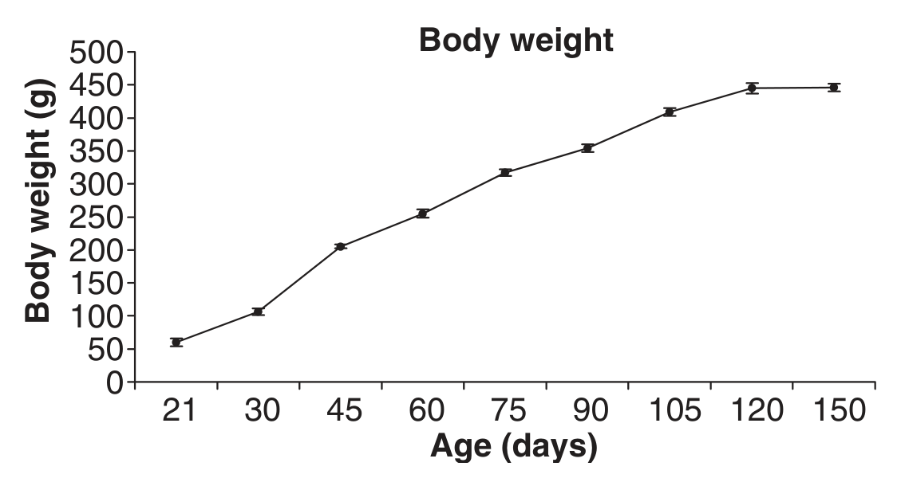
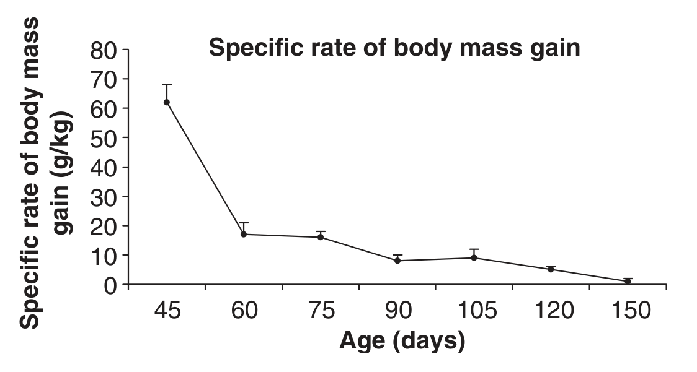
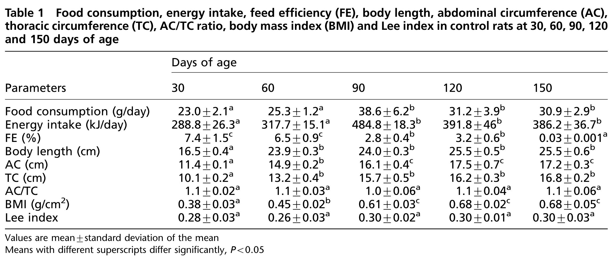
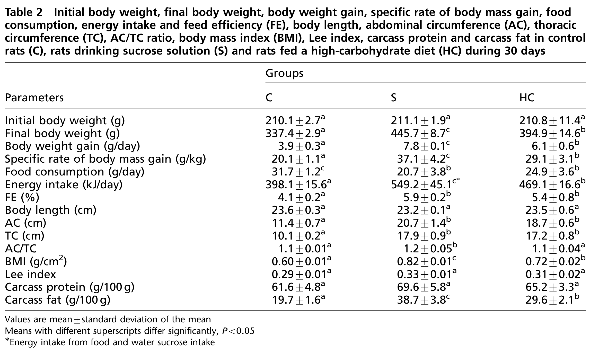
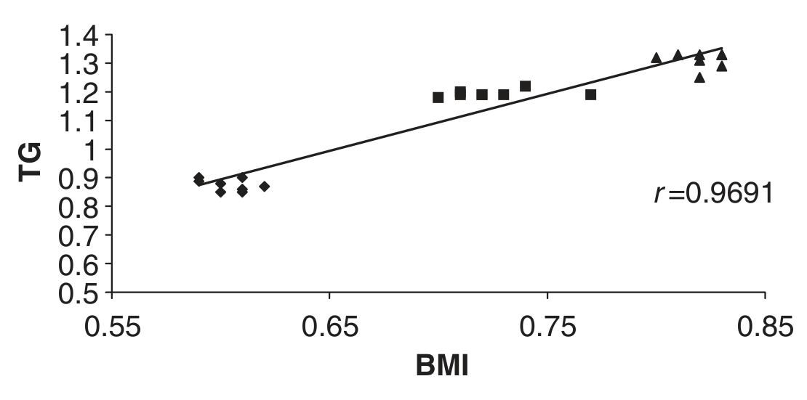
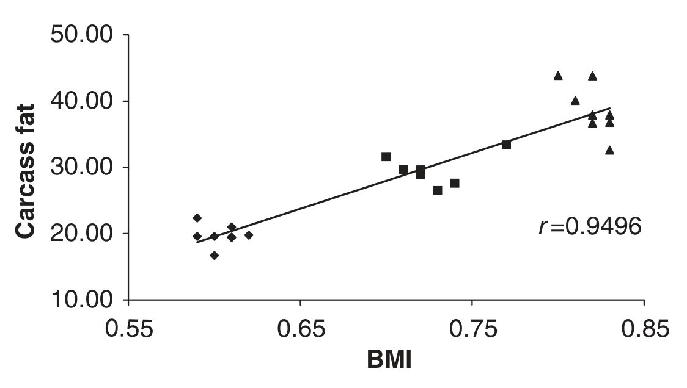
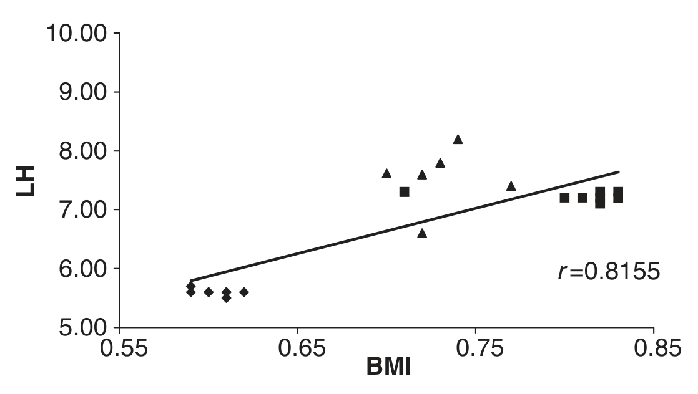
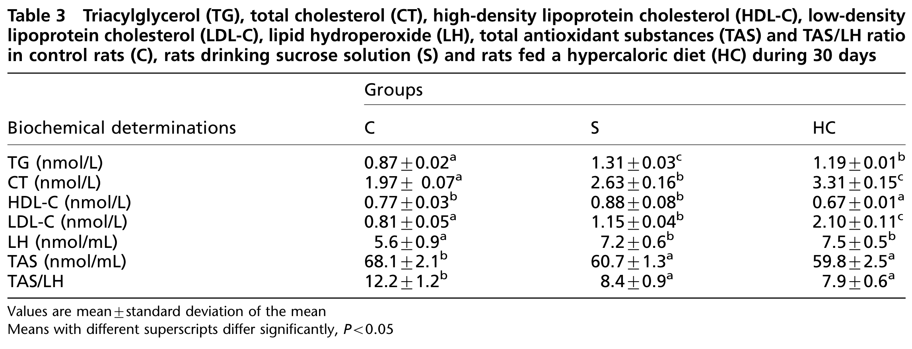

<!-- página 1 | impresa: 111 | pie: © Laboratory Animals Ltd. Laboratory Animals (2007) 41, 111–119 -->

# Anthropometrical parameters and markers of obesity in rats

E L B Novelli1, Y S Diniz1, C M Galhardi2, G M X Ebaid1, H G Rodrigues2, F Mani1, A A H Fernandes1, A C Cicogna2 and J L V B Novelli Filho3

1Department of Chemistry and Biochemistry, Institute of Biological Sciences, University of São Paulo State, UNESP, 18618-000 Botucatu; 2Post Graduation Course, Department of Clinical Cardiology, Faculty of Medicine, UNESP, Botucatu; 3Department of Orthopaedic Surgery, Faculty of Medicine, UNESP, Botucatu, São Paulo, Brazil

## Summary

The present study was undertaken to determine anthropometrical parameters in male adult Wistar rats. We tested the hypothesis that the anthropometrical index may identify obesity and may predict its adverse effects on lipid profile and oxidative stress in rats. Two experimental protocols were performed. In the first experiment, 50 male Wistar rats, 21 days old and fed a control chow were studied up to 150 days of age. In the second experiment, male Wistar rats, 60 days old, were divided into three groups (*n* = 8): control (C) given free access to a control chow; (S) receiving the control chow and drinking 30% sucrose *ad libitum* and (HC) fed a high-carbohydrate diet *ad libitum*. The first experiment showed that food consumption, energy intake and body weight increased with increasing age, while specific rate of body mass gain was significantly decreased. There were no significant differences in body length and thoracic circumference of rats from 60 days of age. The abdominal circumference (AC) and body mass index (BMI) significantly increased with enhancing age in rats up to 90 days of age and remained constant thereafter. In the second experiment, after 30 days of dietary treatment, the final body weight, body mass gain, carcass fat and BMI were higher in S and HC rats than in C. There were no significant alterations in body length and carcass protein among the groups. Triacylglycerol (TG), total cholesterol (CT), low-density lipoprotein cholesterol (LDL-C) and lipid hydroperoxide (LH) were higher in S and HC rats than in C. High-density lipoprotein cholesterol (HDL-C) decreased in HC rats and total antioxidant substances (TAS) decreased in S and HC rats. There were positive correlations between BMI with carcass fat, BMI with LH and BMI and serum TG concentration. In conclusion, the BMI for male adult Wistar rats ranged between 0.45 and 0.68 g/cm2. Obesity may be easily estimated from the BMI in rats. Alterations in BMI were associated with dyslipidemic profile and oxidative stress in serum of rats and BMI may predict these adverse consequences of the obesity in rats.

**Keywords** Obesity; body mass index; lipid profile; oxidative stress

Obesity has been considered an emerging health problem (Acheson 2004) and in spite of the number of studies to prevent or treat obesity, its prevalence continues to rise.

Diet is certainly of importance to obesity incidence and to its negative consequences, such as cancer (Bianchini *et al*. 2002), aging (Hart *et al*. 1999), cardiovascular disease (Novelli *et al*. 2002, Diniz *et al*. 2004) and a number of other pathological conditions <!-- página 2 | impresa: 112 | encabezado: 112 / E L B Novelli et al. | pie: Laboratory Animals (2007) 41 --> (Rolandsson *et al*. 2001, Peltonen *et al*. 2003), but the mechanisms responsible for these pathological changes are not yet clearly elucidated.

<!-- NOTA-CONV: la línea de correspondencia (al pie de la columna izquierda) y la fecha de aceptación (al pie de la página, a la izquierda) están impresas en la página 1 -->

*Correspondence: Dr E L B Novelli. Email: drno@uol.com.br*

Accepted 14 March 2006

Rats are frequently used as animal models for studying adverse effects of obesity (Iossa *et al*. 1999). Both humans and rodents tend to gain weight with high-caloric intake (Chicco *et al*. 1999). However, under *ad libitum* feeding conditions, obesity occurs in some but not in all experimental rats (Commerford *et al*. 2000).

There is a lack of information on anthropometrical parameters in laboratory rodents, and there is no definition of obesity in laboratory rats. Obesity is usually taken as any significant increase in body weight or energy content relative to control animals (Rothwell & Stock 1981). This definition of obesity relies on the assumption that all control animals maintained in the laboratory are both lean and normal. Therefore, many experimental bioassays have shown a steady variability in the incidence, onset time and severity of degenerative diseases. These adverse changes have all been associated with different patterns of voluntary food intake, or *ad libitum* overfeeding of food and calories (Faine *et al*. 2002), and might influence the accuracy of the experimental results.

Thus, the purpose of the present study was to determine anthropometrical parameters to identify obesity in male adult Wistar rats. We tested the hypothesis that the anthropometrical index may define the threshold for obesity and may predict its adverse effects on lipid profile and oxidative stress in rats.

## Materials and methods

### Animals and housing conditions

The Ethical Committee for Conduction of Animal Studies at the Institute of Biological Sciences, São Paulo State University (UNESP) approved the experimental protocol and all animals were cared for in accordance with the principles and guidelines of the Canadian Council on Animal Care as outlined in the *Guide to the Care and Use of Experimental Animals*. Two experimental protocols were performed. The animals in both experimental protocols were individually housed in polypropylene cages in an environmentally controlled clean air room, with a temperature of 22±3°C, a 12 h light/12 h dark cycle and a relative humidity of 60±5%.

## Experiment 1

### Animals and diet

Fifty male Wistar rats, weighing 60±5 g at 21 days of age, were given water *ad libitum* and were fed a standard chow (3074 SIF, Purina Ltd, Campinas, SP, Brazil) with 26.5% protein, 3.8% fat, 40% carbohydrate, 4.5% crude fibre in 100 g of chow, and 12.56 kJ/g metabolizable energy, during 150 days of the experimental period. Food and water consumption were measured daily at the same time (09:00 to 10:00 h) and body weights were determined once a week.

### Anthropometrical and nutritional determinations

The abdominal circumference (AC) (immediately anterior to the forefoot), thoracic circumference (immediately behind the foreleg), body length (nose-to-anus or nose–anus length) were determined in all rats at 30, 60, 90, 120 and 150 days of age. The measurements were made in anaesthetized rats (0.1 mL intraperitoneally of 1% sodium barbiturate).

The body weight and body length were used to determine the following anthropometrical parameters:

- Body mass index (BMI) = body weight (g)/length2 (cm2)
- Lee index = cube root of body weight (g) / nose-to-anus length (cm) (Bernardis 1970)
- Specific rate of body mass gain (g/kg) = $\mathrm{d}M/M\,\mathrm{d}t$, where $\mathrm{d}M$ represents the gain of body weight during $\mathrm{d}t = t_2 - t_1$ and *M* is the rat body weight at $t_1$

Based on food and caloric intake (Diniz *et al*. 2005), the following nutritional parameters were calculated:

- Energy intake (kJ/day) = mean food consumption x dietary metabolizable energy

<!-- página 3 | impresa: 113 | encabezado: Index of obesity in rats / 113 | pie: Laboratory Animals (2007) 41 -->

- Feed efficiency (FE; %) = (mean body weight gain × 100)/energy intake

## Experiment 2

### Animals and diet

In order to more appropriately study the effects of obesity on anthropometrical measures, nutritional parameters and the association of anthropometrical parameters with changes in lipid profile and oxidative stress, in a separate experiment 24 male Wistar rats, weighing 210.7±5.3 g at 60 days of age were randomly assigned to one of three groups (*n* = 8/group). Rats in the control group (C) were given free access to a standard Purina rodent chow, as in experiment 1. The (S) group was fed *ad libitum* standard Purina chow and received *ad libitum* 30% sucrose in its drinking water. The (HC) group was fed *ad libitum,* a high-carbohydrate diet with 19.93% protein, 15.39% fat, 57.50% carbohydrate, 2.81% dietary fibre in 100 g of chow, and 18.84 kJ/g metabolizable energy. For inclusion in the chow of the HC group, we tested 10 palatable foods such as, potato crisps, milk chocolate, chocolate cookies, corn flakes, cheese biscuits, puffed wheat, salami, toasted peanuts, almonds and maize crackers (Barber *et al*. 1985). The animals were placed in a rectangular box and the various types of foods were appropriately mixed into the chow. Each animal was submitted to one day of each food component and the number of ingested pellets was measured. The three more palatable food components were offered to the animals until the end of the experiment. The high-carbohydrate diet (HC) was formulated by mixing 100 g of toasted peanut, 100 g of milk chocolate and 50 g of maize cracker to 150 g of the Purina chow (Novelli *et al*. 2002, Diniz *et al*. 2004). Therefore, all diets provided sufficient amounts of vitamins, minerals and essential lipids. The diets contained 20–25% total protein to provide essential amino acids, according to the recommendation of the American Institute of Nutrition (Bieri *et al*. 1977). The dietary ingredients were homogenized in distilled water at 60°C and the homogenate was used to prepare the pellets. Diets were given fresh each day as dry pellets; therefore there was no spillage. Food consumption was measured daily at the same time (09:00 to 10:00 h). The body weights were determined once a week. The nutritional and anthropometrical parameters were determined as in experiment 1. After four weeks of treatment, rats were fasted overnight (12–14 h) and killed by decapitation.

### Biochemical determinations

Blood was placed in a centrifuge tube and allowed to clot to obtain the serum. Serum was separated by centrifugation at 1400 ***g*** for 10 min. The triacylglycerol (TG), total cholesterol (CT) and high-density lipoprotein cholesterol (HDL-C) were assayed in serum by enzymatic method (test kit CELM diagnosis, Modern Laboratory Equipment Company, São Paulo, SP, Brazil).

Low-density lipoprotein cholesterol (LDL-C) was selectively precipitated from 60 µL of serum by adding 1 mL of phosphotungstic acid and MgCl2 precipitating reagents (CELM diagnosis), vortex-mixed and separation by centrifugation carried out at 1400 ***g*** for 10 min. The LDL-C pellet was dissolved in 600 µL of 0.015 mM NaOH, which did not contain interfering substances; therefore dialysis was not needed. The cholesterol concentrations in the dissolved LDL-C pellet were measured by enzymatic method (CELM diagnosis) (Scoccia *et al*. 2001).

Total protein (Lowry *et al*. 1951), lipid hydroperoxide (LH) and total antioxidant substances (TAS; test kit Randox Ltd, Crumlin, County Antrim, UK) were also determined in serum. Spectrophotometric determinations were performed in a Pharmacia Biotech spectrophotometer with temperature-controlled cuvette chamber (model 974213, UV/visible Ultrospec 5000 with Swift II Applications software to computer system control, Cambridge, UK).

LH was measured through hydroperoxide-mediated oxidation of Fe2+, with 100 µL of sample and 900 µL of a reaction mixture containing 250 µM of FeSO4, 25 mM of <!-- página 4 | impresa: 114 | encabezado: 114 / E L B Novelli et al. | pie: Laboratory Animals (2007) 41 --> H2SO4, 100 µM of xylenol orange and 4 mM of butylated hydroxytoluene in 90% (v/v) methanol (Jiang *et al*. 1991). LH was analysed using a micro plate reader (µQuant-MQX 200 with Kcjunior software to computer system control, Bio-Tech Instruments, Inc, Winooski, VT, USA). All reagents were from Sigma (St Louis, MO, USA).

The body composition was analysed from the carcass. Carcasses were weighed, chopped into small pieces and finally homogenized with distilled water (volumes equal to twice the carcass weight) (Iossa *et al*. 1999) in an ultraturrax homogenizer (IKA Works, Inc, Wilmington, NC, USA). Aliquots of the homogenate were analysed for lipid (Bligh & Dyer 1959) and protein content (Lowry *et al*. 1951).

### Statistics

The results are presented as means±standard deviations. Significance of difference was tested using analysis of variance in conjunction with Tukey’s test. A probability of 0.05 was chosen as the significant level. Correlations analyses were determined by the Pearson’s linear correlation test (Curi 1997).

## Results

### Experiment 1

Body weights of developing rats, from 21 to 150 days of age, are shown in Figure 1. The body weight gain by the rats over the study enhanced with increasing age with no significant differences in body weight of rats between 120 and 150 days. Before 60 days of age, an initial rapid growth period occurred, and then the gain slowed. The specific rate of body mass gain was significantly decreased with increasing age (Figure 2).

The food consumption, energy intake and AC significantly increased in rats up to 90 days of age and remained constant thereafter. The FE significantly decreased with enhancing age. The FE exhibited the highest values in rats at 30 and 60 days of age. The body length and TC were lowest in rats at 30 days. BMI was lower in 30-day-old rats and increased with enhancing age in rats up to 90 days of age and remained constant thereafter. No significant differences were observed in the AC/TC ratio or in the Lee index (Table 1).

<!-- NOTA-CONV: Figuras 1 y 2 impresas en la página 4, en la parte superior de la columna derecha; se colocan al terminar el párrafo que cruza de la columna izquierda a la derecha -->

**Figure 1 Body weight (g) of male Wistar rats during 150 days of age**

<!-- texto en la figura: título del panel: Body weight · eje y: Body weight (g), de 0 a 500 (marcas 0, 50, 100, 150, 200, 250, 300, 350, 400, 450, 500) · eje x: Age (days), marcas 21, 30, 45, 60, 75, 90, 105, 120, 150 -->

**Figure 2 Specific rate of body mass gain of male Wistar rats during 150 days of age**

<!-- texto en la figura: título del panel: Specific rate of body mass gain · eje y: Specific rate of body mass gain (g/kg), de 0 a 80 (marcas 0, 10, 20, 30, 40, 50, 60, 70, 80) · eje x: Age (days), marcas 45, 60, 75, 90, 105, 120, 150 -->

### Experiment 2

S rats had significantly higher final body weight, body weight gain and specific rate of body mass gain than did HC rats from the controls. The food consumption was significantly decreased in S and in HC rats from the controls. S animals had the highest energy intake, since the energy was from food and sucrose aqueous solution intake in these animals. The FE was higher in S and in HC rats than in C (Table 2).

The body length, Lee index and carcass protein were comparable in all three groups. The AC and TC were higher in S and HC rats than in C, whereas S rats had significantly higher AC/TC ratio than the others. BMI was higher in S than in HC and C groups. HC rats had higher BMI than C. The carcass fat was increased in S and HC groups. S rats had the highest values of carcass fat (Table 2). The analyses of lipid from the <!-- página 5 | impresa: 115 | encabezado: Index of obesity in rats / 115 | pie: Laboratory Animals (2007) 41 --> carcass were positively correlated with BMI (*r* = 0.9496; *P* = 0.0005) (Figure 3).

<!-- NOTA-CONV: Tablas 1 y 2 impresas en la página 5, arriba y a todo lo ancho; se colocan al terminar el párrafo que cruza de la página 4 a la 5 -->

**Table 1 Food consumption, energy intake, feed efficiency (FE), body length, abdominal circumference (AC), thoracic circumference (TC), AC/TC ratio, body mass index (BMI) and Lee index in control rats at 30, 60, 90, 120 and 150 days of age**

<table>
<thead>
<tr><th rowspan="2">Parameters</th><th colspan="5">Days of age</th></tr>
<tr><th>30</th><th>60</th><th>90</th><th>120</th><th>150</th></tr>
</thead>
<tbody>
<tr><td>Food consumption (g/day)</td><td>23.0±2.1a</td><td>25.3±1.2a</td><td>38.6±6.2b</td><td>31.2±3.9b</td><td>30.9±2.9b</td></tr>
<tr><td>Energy intake (kJ/day)</td><td>288.8±26.3a</td><td>317.7±15.1a</td><td>484.8±18.3b</td><td>391.8±46b</td><td>386.2±36.7b</td></tr>
<tr><td>FE (%)</td><td>7.4±1.5c</td><td>6.5±0.9c</td><td>2.8±0.4b</td><td>3.2±0.6b</td><td>0.03±0.001a</td></tr>
<tr><td>Body length (cm)</td><td>16.5±0.4a</td><td>23.9±0.3b</td><td>24.0±0.3b</td><td>25.5±0.5b</td><td>25.5±0.6b</td></tr>
<tr><td>AC (cm)</td><td>11.4±0.1a</td><td>14.9±0.2b</td><td>16.1±0.4c</td><td>17.5±0.7c</td><td>17.2±0.3c</td></tr>
<tr><td>TC (cm)</td><td>10.1±0.2a</td><td>13.2±0.4b</td><td>15.7±0.5b</td><td>16.2±0.3b</td><td>16.8±0.2b</td></tr>
<tr><td>AC/TC</td><td>1.1±0.02a</td><td>1.1±0.03a</td><td>1.0±0.06a</td><td>1.1±0.04a</td><td>1.1±0.06a</td></tr>
<tr><td>BMI (g/cm2)</td><td>0.38±0.03a</td><td>0.45±0.02b</td><td>0.61±0.03c</td><td>0.68±0.02c</td><td>0.68±0.05c</td></tr>
<tr><td>Lee index</td><td>0.28±0.03a</td><td>0.26±0.03a</td><td>0.30±0.02a</td><td>0.30±0.01a</td><td>0.30±0.03a</td></tr>
</tbody>
</table>

Values are mean±standard deviation of the mean

Means with different superscripts differ significantly, *P*&lt;0.05

Imagen original

**Table 2 Initial body weight, final body weight, body weight gain, specific rate of body mass gain, food consumption, energy intake and feed efficiency (FE), body length, abdominal circumference (AC), thoracic circumference (TC), AC/TC ratio, body mass index (BMI), Lee index, carcass protein and carcass fat in control rats (C), rats drinking sucrose solution (S) and rats fed a high-carbohydrate diet (HC) during 30 days**

<table>
<thead>
<tr><th rowspan="2">Parameters</th><th colspan="3">Groups</th></tr>
<tr><th>C</th><th>S</th><th>HC</th></tr>
</thead>
<tbody>
<tr><td>Initial body weight (g)</td><td>210.1±2.7a</td><td>211.1±1.9a</td><td>210.8±11.4a</td></tr>
<tr><td>Final body weight (g)</td><td>337.4±2.9a</td><td>445.7±8.7c</td><td>394.9±14.6b</td></tr>
<tr><td>Body weight gain (g/day)</td><td>3.9±0.3a</td><td>7.8±0.1c</td><td>6.1±0.6b</td></tr>
<tr><td>Specific rate of body mass gain (g/kg)</td><td>20.1±1.1a</td><td>37.1±4.2c</td><td>29.1±3.1b</td></tr>
<tr><td>Food consumption (g/day)</td><td>31.7±1.2c</td><td>20.7±3.8b</td><td>24.9±3.6b</td></tr>
<tr><td>Energy intake (kJ/day)</td><td>398.1±15.6a</td><td>549.2±45.1c*</td><td>469.1±16.6b</td></tr>
<tr><td>FE (%)</td><td>4.1±0.2a</td><td>5.9±0.2b</td><td>5.4±0.8b</td></tr>
<tr><td>Body length (cm)</td><td>23.6±0.3a</td><td>23.2±0.1a</td><td>23.5±0.6a</td></tr>
<tr><td>AC (cm)</td><td>11.4±0.7a</td><td>20.7±1.4b</td><td>18.7±0.6b</td></tr>
<tr><td>TC (cm)</td><td>10.1±0.2a</td><td>17.9±0.9b</td><td>17.2±0.8b</td></tr>
<tr><td>AC/TC</td><td>1.1±0.01a</td><td>1.2±0.05b</td><td>1.1±0.04a</td></tr>
<tr><td>BMI (g/cm2)</td><td>0.60±0.01a</td><td>0.82±0.01c</td><td>0.72±0.02b</td></tr>
<tr><td>Lee index</td><td>0.29±0.01a</td><td>0.33±0.01a</td><td>0.31±0.02a</td></tr>
<tr><td>Carcass protein (g/100 g)</td><td>61.6±4.8a</td><td>69.6±5.8a</td><td>65.2±3.3a</td></tr>
<tr><td>Carcass fat (g/100 g)</td><td>19.7±1.6a</td><td>38.7±3.8c</td><td>29.6±2.1b</td></tr>
</tbody>
</table>

Values are mean±standard deviation of the mean

Means with different superscripts differ significantly, *P*&lt;0.05

\*Energy intake from food and water sucrose intake

Imagen original

Table 3 shows that S rats had significantly higher TG, than HC rats and controls. CT and LDL-C serum concentrations were higher in HC than in S and in C animals. S rats had increased CT and LDL-C in relation to C animals. HDL-C was lower in HC rats than in S and C. TAS concentrations were reduced in S and HC rats, while LH was increased in these groups from the C. The TAS/LH ratio was significantly lower in S and HC groups than in C. There were positive correlations between BMI and TG levels (*r* = 0.9691; *P* = 0.0001) (Figure 4), and between serum LH concentrations and BMI (*r* = 0.8155; *P* = 0.0001) (Figure 5).

## Discussion

The adverse effects of obesity have been extensively studied in experimental animals. Interestingly, little information is available on the relationships between obesity and <!-- página 6 | impresa: 116 | encabezado: 116 / E L B Novelli et al. | pie: Laboratory Animals (2007) 41 --> anthropometrical parameters in laboratory rodents, as well as on anthropometrical measures, lipid profile and oxidative stress in rats.

Figure 1 shows that a rapid increase in body weight was coupled with a significant increased rate of body mass gain at 60 days of age, and was followed by a lower rate of body mass gain (Figure 2). Eating behaviour is an integral part of nutritional research (Diniz *et al*. 2005), and coordinating energy intake and energy expenditure is involved in the regulation of body weight (Commerford *et al*. 2000).

Food consumption and energy intake were increased in rats up to 90 days of age, indicating that from this age intake–expenditure adjustments were delayed. Rat maturation was characterized by variations in food consumption and energy intake (Thomas *et al*. 2002). Therefore, the increase in food consumption and energy intake in rats from 90 days of age were associated with reduced FE. Note that in Table 1 there were no significant changes <!-- página 7 | impresa: 117 | encabezado: Index of obesity in rats / 117 | pie: Laboratory Animals (2007) 41 --> in body length and TC of rats from 60 days of age, and there were no significant changes in the Lee index and AC/TC ratio during the entire experimental period. However, AC was significantly enhanced in rats at 90 days of age and it remained constant thereafter. These observations indicated that from 90 days of age there was fat accumulation in the abdominal region and that AC for adult male rats ranged between 14.9±0.2 and 17.2±0.3 cm.

<!-- NOTA-CONV: Figuras 4, 3 y 5 y Tabla 3 impresas en la página 6 (Figura 4 en la columna derecha, debajo del texto; Figuras 3 y 5 lado a lado debajo de las dos columnas; Tabla 3 al pie, a todo lo ancho); se colocan al terminar el párrafo que cruza de la página 6 a la 7, en su orden físico -->

**Figure 4 Correlations between body mass index (BMI, g/cm2) and serum triacylglycerol concentration (TG, mmol/L) of control rats (♦), rats fed a high-carbohydrate diet (■) and rats drinking sucrose solution (▲), during 30 days**

<!-- texto en la figura: eje y: TG (marcas 0.5, 0.6, 0.7, 0.8, 0.9, 1, 1.1, 1.2, 1.3, 1.4) · eje x: BMI (marcas 0.55, 0.65, 0.75, 0.85) · anotación: r=0.9691 (r en cursiva) · marcadores: ♦ (control), ■ (high-carbohydrate), ▲ (sucrose) y recta de regresión -->

**Figure 3 Correlations between body mass index (BMI, g/cm2) and serum carcass fat (g/100 g) of control rats (◆), rats fed a high-carbohydrate diet (■) and rats drinking sucrose solution (▲), during 30 days**

<!-- texto en la figura: eje y: Carcass fat (marcas 10.00, 20.00, 30.00, 40.00, 50.00) · eje x: BMI (marcas 0.55, 0.65, 0.75, 0.85) · anotación: r=0.9496 (r en cursiva) · marcadores: ◆ (control), ■ (high-carbohydrate), ▲ (sucrose) y recta de regresión -->

**Figure 5 Correlations between body mass index (BMI, g/cm2) and serum lipid hydroperoxide concentration (LH, nmol/mL) of control rats (♦), rats fed a high-carbohydrate diet (■) and rats drinking sucrose solution (▲), during 30 days**

<!-- texto en la figura: eje y: LH (marcas 5.00, 6.00, 7.00, 8.00, 9.00, 10.00) · eje x: BMI (marcas 0.55, 0.65, 0.75, 0.85) · anotación: r=0.8155 (r en cursiva) · marcadores: ♦ (control), ■ (high-carbohydrate), ▲ (sucrose) y recta de regresión -->

**Table 3 Triacylglycerol (TG), total cholesterol (CT), high-density lipoprotein cholesterol (HDL-C), low-density lipoprotein cholesterol (LDL-C), lipid hydroperoxide (LH), total antioxidant substances (TAS) and TAS/LH ratio in control rats (C), rats drinking sucrose solution (S) and rats fed a hypercaloric diet (HC) during 30 days**

<table>
<thead>
<tr><th rowspan="2">Biochemical determinations</th><th colspan="3">Groups</th></tr>
<tr><th>C</th><th>S</th><th>HC</th></tr>
</thead>
<tbody>
<tr><td>TG (nmol/L)</td><td>0.87±0.02a</td><td>1.31±0.03c</td><td>1.19±0.01b</td></tr>
<tr><td>CT (nmol/L)</td><td>1.97± 0.07a</td><td>2.63±0.16b</td><td>3.31±0.15c</td></tr>
<tr><td>HDL-C (nmol/L)</td><td>0.77±0.03b</td><td>0.88±0.08b</td><td>0.67±0.01a</td></tr>
<tr><td>LDL-C (nmol/L)</td><td>0.81±0.05a</td><td>1.15±0.04b</td><td>2.10±0.11c</td></tr>
<tr><td>LH (nmol/mL)</td><td>5.6±0.9a</td><td>7.2±0.6b</td><td>7.5±0.5b</td></tr>
<tr><td>TAS (nmol/mL)</td><td>68.1±2.1b</td><td>60.7±1.3a</td><td>59.8±2.5a</td></tr>
<tr><td>TAS/LH</td><td>12.2±1.2b</td><td>8.4±0.9a</td><td>7.9±0.6a</td></tr>
</tbody>
</table>

Values are mean±standard deviation of the mean

Means with different superscripts differ significantly, *P*&lt;0.05

Imagen original

It has previously been shown that adult rats (age 60 days) are characterized by the cessation of growth and development (Bernardis 1970, Thomas *et al*. 2002). Since the BMI increased in rats up to 90 days of age and remained constant thereafter, we can affirm that the BMI for normal adult rats ranged between the values observed at 60 and 90 days of age (0.45±0.02 to 0.68±0.05 g/cm2).

Table 2 shows that S and HC rats had reduced food consumption, while final body weight, body weight gain and specific rate of body mass gain were increased in these animals. This is in agreement with previous reports (Novelli *et al*. 2002). Several factors may contribute to differential patterns of food intake. The hypophagia (defined as an individual food intake score lower than 2 standard deviations above the mean for the control rats) was partly due to the energy of HC (average 18.84 kJ/g) compared with C (12.56 kJ/g), and related to sucrose intake from drinking water in S rats. The energy intake is an important factor in the regulation of body weight (Chicco *et al*. 1999). Note that in Table 2 the total energy intake was higher in S and HC than in C animals, confirming that obesity was the result of energy intake exceeding energy expenditure (Acheson 2004).

Despite the higher energy intake in S than in HC rats, no significant differences were observed in body length and carcass protein among the groups indicating that the increased body weight due to excessive energy intake was adipose tissue. Table 2 shows that carcass fat was higher in S than in HC rats from the controls. Considering that there were no significant differences in FE of S and HC rats, the excess of energy intake that was higher in S than in HC was responsible for increased carcass fat in S rats from HC. It has been reported that sucrose can increase the body weight when given separately from chow in a solution, or as a supplement (Goodson *et al*. 2001). In both these cases, the animal can modulate the intake of sucrose relative to the intake of other energy sources.

There were positive correlations between BMI and carcass fat (Figure 3) demonstrating that BMI is a simple reliable estimate of body fat in rats. BMI, body weight and carcass fat were higher in S than in HC rats. On the other hand, although S and HC rats had a higher Lee index than C, no significant differences were observed in the Lee index of S and HC rats indicating that BMI had advantage over the Lee index as an estimate of body fat and obesity in rats. Since the BMI for normal rats ranged between 0.45 and 0.68 g/cm2 (experiment 1), both S and HC rats had obesity, but obesity was significantly higher in S than in HC rats, and this was reflected in a BMI value that was higher in S than in HC (Table 2).

The AC and TC were also increased in S and HC rats. Since no significant differences were observed in TC and AC between S and HC groups, and S rats had higher final body weight than HC, we can affirm that these anthropometrical parameters were not accurate as markers of increased body weight and obesity in rats. In the same way, AC/TC ratio was only enhanced in S rats and was not changed with the increased body weight observed in HC rats (Table 2).

Interestingly, S rats had the highest TG serum concentrations (Table 3). It has been reported that the increased amount of fructose in the diets increases the fructose-phosphate aldolase activity resulting in increased glycerol-phosphate and acetyl coenzyme-A, so providing more TG precursors (Hallfrish 1990). During periods of high-carbohydrate intake, the hepatic tissue can convert glucose into fatty acids, from which TGs are made, transported to the blood stream as very low-density lipoprotein cholesterol (VLDL-C) and stored as fat in the adipose tissue (Colette *et al*. 2003). Delayed lipolysis of VLDL-C <!-- página 8 | impresa: 118 | encabezado: 118 / E L B Novelli et al. | pie: Laboratory Animals (2007) 41 --> because of the competition for the site of lipoprotein lipase between VLDL-C from hepatic origin and chylomicrons from intestinal origin could lead to the formation of TG-rich lipoprotein remnants (Raveh *et al*. 2001).

S and HC rats had increased CT and LDL-C compared with controls, with HC rats having the highest LDL-C concentrations. This fact was explained by the decreased HDL-C observed in HC rats, thus decreasing the reverse cholesterol transport from the blood stream to the liver (Raveh *et al*. 2001).

Oxidative stress was associated with obesity in S and HC rats. There is a growing awareness that obesity is a prime risk factor for the development of dyslipidemic profile and that oxidative stress may play a role in various adverse effects of obesity (Diniz *et al*. 2005). The use of oxygen to oxidative metabolism of fuel results in free radical, or reactive oxygen species (ROS) production (Feuers 1998). Increased caloric intake is an important factor in decreasing the mitochondrial membrane fluidity and increasing the generation of ROS (Esposito *et al*. 1999). Therefore, although ROS are essential for certain physiological processes, when that concentration is raised, the body’s antioxidant defences may be unable to cope. The result is a condition called oxidative stress, an imbalance between the oxidants and antioxidants systems (Nishiyama *et al*. 1998).

The LH levels were significantly increased in S and in HC rats, and TAS concentrations were decreased in these animals (Table 3). Although the role of oxidative stress is well established, lipid peroxidation products, such as LH, should not represent the only component that is important in oxidative stress. The emerging view of free radicals as modulators in several signal transduction pathways (Astley 2003) brought new insights into oxidative stress theories and questions concerning their influence on lipid profile. Free radicals react with protein thiol moieties to produce a variety of sulphur oxidation states, thus diminishing the cellular uptake of lipids from the blood (Chen *et al*. 2003). Note that S and HC rats had oxidative stress and although these groups had different changes in serum lipids, both S and HC animals had dyslipidemic profiles (Table 3). There were positive correlations between BMI and TG levels (Figure 4) indicating that BMI may predict this adverse consequence of obesity.

On the other hand, increased serum TG concentrations have been associated with decreased LDL-C, which becomes more susceptible to oxidative modification (Brizzi *et al*. 2003). It is widely accepted that atherogenesis is initiated by oxidation of the lipids in LDL-C (Chen *et al*. 2003). Figure 5 shows positive correlations between BMI and LH concentrations. Therefore, a threshold BMI is indicative of obesity, and its severity is indicated by how high the BMI is past this threshold.

In conclusion, the BMI for male adult Wistar rats ranged between 0.45 and 0.68 g/cm2. The results show the effectiveness of BMI as a threshold of increased body weight in rats and should be taken into consideration in future studies dealing with obesity in rats. Alterations in BMI were associated with dyslipidemic profile and oxidative stress in serum of rats; therefore, BMI may predict these adverse consequences of the obesity in rats.

*Acknowledgements* This research was supported by FAPESP and CNPq.

## References

Acheson KJ (2004) Carbohydrate and weight control: where do we stand? *Current Opinion in Clinical Nutritional Metabolism Care* **7**, 485–92

Astley SB (2003) Dietary antioxidants – past, present and future? *Trends in Food Science and Technology* **14**, 93–8

Barber T, Vina J, Cabo J (1985) Decreased urea synthesis in cafeteria-diet-induced obesity in the rat. *Biochemical Journal* **230**, 675–81

Bernardis LL (1970) Prediction of carcass fat, water and lean body mass from Lee’s nutritive ratio in rats with hypothalamic obesity. *Experientia* **26**, 789–90

Bianchini F, Kaaks R, Vainiuo H (2002) Overweight, obesity and cancer risk. *Lancet Oncology* **3**, 565–74

Bieri JG, Stoenband GS, Briggs GM, Phillips RW, Woodand JC, Knpha JJ (1977) American Institute of <!-- página 9 | impresa: 119 | encabezado: Index of obesity in rats / 119 | pie: Laboratory Animals (2007) 41 --> Nutrition. Report of the American Institute of Nutrition Ad Hoc Committee on Standards for Nutritional Studies. *Journal of Nutrition* **107**, 1340–51

Bligh E, Dyer W (1959) A rapid method of total lipid extraction and purification. *Canadian Journal of Biochemical Physiology* **37**, 911–19

Brizzi P, Tonolo G, Carusillo F, Malaguarnera M, Maioli M, Musumeci S (2003) Plasma lipid composition and LDL oxidation. *Clinical Chemistry and Laboratory Medicine* **41**, 56–60

Chen K, Thomas SR, Keaney JF (2003) Beyond LDL oxidation: ROS in vascular signal transduction. *Free Radical Biology and Medicine* **35**, 117–23

Chicco A, Bernal C, Soria A, Giangrossi BS, Lombardo Y (1999) Dietary effects of partial or total substitution of sucrose for starch on glucose and lipid metabolism in dyslipidemic rats. *Nutrition Research* **19**, 281–93

Colette C, Percheron C, Herbute N, Michel F, Pham T (2003) Exchanging carbohydrates for monounsaturated fats in energy restricted diets. *International Journal of Obesity* **27**, 648–56

Commerford SR, Pagliassotti MJ, Melby CL, Wei Y, Gayles EC, Hill JO (2000) Fat oxidation, lipolysis and free fatty acid cycling in obesity-prone and obesity-resistant rats. *American Journal of Physiology – Endocrinology and Metabolism* **279**, 875–85

Curi PR (1997) *Metodologia e Análise da Pesquisa em Ciências Biológicas*. 1st edn. Botucatu, SP: Editora Tipomic, 263pp

Diniz YS, Cicogna A, Padovani C, Santana L, Faine L, Novelli ELB (2004) Diets rich in saturated and polyunsaturated fatty acids: metabolic shifting and cardiac health. *Nutrition* **20**, 230–4

Diniz YS, Faine LA, Galhardi CM, *et al.* (2005) Monosodium glutamate in standard and high-fiber diets: metabolic syndrome and oxidative stress in rats. *Nutrition* **21**, 749–55

Esposito LA, Melov S, Panov A (1999) Mitochondrial disease in mouse results in increased oxidative stress. *Proceedings of the National Academy of Sciences* **96**, 4820–5

Faine L, Diniz YS, Almeida J, Novelli ELB, Ribas BO (2002) Toxicity of *ad lib* overfeeding. *Food and Chemical Toxicology* **40**, 663–8

Feuers RJ (1998) The effects of dietary restriction on mitochondrial dysfunction in aging. *Annals of the New York Academy of Sciences* **125**, 192–201

Goodson G, Halford JCG, Javkson HC, Blundell JE (2001) Paradoxial effects of a high sucrose diet: high energy intake and reduced body weight gain. *Appetite* **37**, 253–4

Hallfrish J (1990) Metabolic effects of dietary fructose. *FASEB Journal* **4**, 2652–60

Hart RW, Dixit R, Seng J, *et al.* (1999) Adaptive role of caloric intake on degenerative disease process. *Toxicological Sciences* **52**, 3–12

Iossa S, Lionetti L, Mollica M, Barletta A, Liverini G (1999) Energy intake and utilization vary during development in rats. *Journal of Nutrition* **129**, 1596–8

Jiang Z, Woollard A, Wolff S (1991) Lipid hydroperoxide measurement by oxidation of Fe2+ in the presence of xylenol orange. Comparison with the TBA assay and on iodometric method. *Lipids* **26**, 853–7

Lowry DH, Rosembrough N, Farr A (1951) Protein measurement with folinphenol reagent. *Journal of Biological Chemistry* **193**, 265–75

Nishiyama Y, Ikeda H, Haramaki N, Yoshida N, Imaizumi T (1998) Oxidative stress is related to exercise intolerance in patients with heart failure. *American Heart Journal* **135**, 115–20

Novelli ELB, Fernandes A, Campos K, Diniz Y, Almeida J, Ribas BO (2002) The adverse effects of a high-energy dense diet on cardiac tissue. *Journal of Nutritional and Environmental Medicine* **12**, 287–90

Peltonen M, Lindroos AK, Torgerson JS (2003) Musculoskeletal pain in the obese: a comparison with a general population and long-term changes after conventional and surgical obesity treatment. *Pain* **104**, 549–57

Raveh O, Pinchuk I, Fainaru M, Lichtenberg D (2001) Kinetics of lipid peroxidation in mixture of HDL and LDL, mutual effects. *Free Radical Biology and Medicine* **31**, 1486–97

Rolandsson O, Hagg E, Nilsson M, Hallmans G, Mincheva-Nilsson L, Lernmark A (2001) Prediction of diabetes with body mass index, oral glucose tolerance test and islet cell autoantibodies in a regional population. *Journal of Internal Medicine* **249**, 279–88

Rothwell NJ, Stock MJ (1981) Regulation of energy balance. *Annual Review of Nutrition* **1**, 235–56

Scoccia AE, Molinuevo MS, McCarthy AD, Cortizo AM (2001) A simple method to assess the oxidative susceptibility of low density lipoproteins. *Clinical Pathology* **1**, 1–12

Thomas MA, Rice HB, Weinstock D, Corwin RL (2002) Effects of aging on food intake and body composition in rats. *Physiology and Behavior* **76**, 487–500
