<!-- página 1 | encabezado: Anal Bioanal Chem (2003) 377 : 990–1002 / DOI 10.1007/s00216-003-2224-3 -->

SPECIAL ISSUE PAPER

**Gersh Z. Taicher · Frank C. Tinsley · Arcady Reiderman** **Mark L. Heiman**

# Quantitative magnetic resonance (QMR) method for bone and whole-body-composition analysis

Received: 30 July 2003 / Revised: 12 August 2003 / Accepted: 13 August 2003 / Published online: 16 September 2003

© Springer-Verlag 2003

**Abstract** Objective: to evaluate the applicability, precision, and accuracy of the new EchoMRI quantitative magnetic resonance (QMR) method for in-vitro bovine bone analysis and in-vivo whole-body-composition analysis of conscious live mice. Research methods and procedures: bovine tibia bone samples were measured by QMR and dual-energy X-ray adsorptiometry (DEXA). Repeated measures of whole-body composition were made using live and dead mice with different levels of fat by QMR and DEXA and by classic chemical analysis of the mouse carcass. Results: bone-mineral density (BMD) and bone-mineral content (BMC) measured in bovine tibia by QMR and DEXA were highly correlated. Precision of fat and lean measurement in mice was found to be better for QMR than for DEXA. The coefficient of variation (*CV*) for fat was 0.34–0.71% for QMR compared with 3.06–12.60% for DEXA. Discussion: QMR offers more specific parameters of bone structure than does DEXA. QMR and DEXA did not differ in the total amount of fat detected in live mice but QMR had improved precision. QMR was superior to DEXA in measuring fat in very small mice. Conclusions: in bone tissue there is a strong correlation between hydrogen NMR signal and bone-mineral density as measured by X-ray. QMR provides a very precise, accurate, fast, and easy to use method for determining fat and lean mass of mice without the need for anesthesia. Its ability to detect differences and monitor changes in body composition in mice with great precision should be of great value in characterizing phenotypes and studying drugs affecting obesity.

**Keywords** QMR · Bone · Osteoporosis · Body composition · Obesity · New technology

<!-- NOTA-CONV: los dos bloques siguientes (autores con su institución, dirección y correo de correspondencia) están impresos en letra pequeña al pie de la columna izquierda de la página 1, bajo una línea; se transcriben aquí, en su orden de lectura, antes de la columna derecha -->

G. Z. Taicher (✉) · A. Reiderman Echo Medical Systems, 11191 Westheimer, #223, Houston, TX 77042, USA e-mail: Taicher@EchoMRI.com

F. C. Tinsley · M. L. Heiman Eli Lilly Research, Indianapolis, IN 46285, USA

## Bone analysis

### Introduction

Nuclear magnetic resonance (NMR), magnetic resonance spectroscopy (MRS), and magnetic resonance imaging (MRI) methods may be used for rapid, in-vivo determination of bone properties, such as bone-mineral density (BMD) and bone-mineral content (BMC). Particularly, these methods may be applied for diagnosing diseases that affect bone, such as osteoporosis. In addition, these techniques may be used for monitoring bone condition during progress of a bone disease, including the effect of different types of treatment of the disease.

The new EchoMRI quantitative magnetic resonance (QMR) method for bone analysis (Echo Medical Systems, Houston, TX, USA) is presented in the context of osteoporosis. However, this method may be applied to measure bone parameters not related to osteoporosis.

#### Bone in a human skeleton

The human skeleton consists of approximately 80% cortical (compact) bone and approximately 20% trabecular (cancellous, or “spongy”) bone. The structure and composition of individual bones varies, and is generally related to the specific function performed by the particular bone. Generally, an anatomical bone consists of specific bone tissue (about 25% by volume) and of bone marrow (about 75% by volume). Of the specific bone tissue weight, only about 20% is organic matter (mainly collagen), about 70% is mineralized (crystals of hydroxyapatite and amorphous calcium phosphate) and about 10% is water [1, 2]. In order to clarify and reconcile various terminologies for bones and their components, the following definitions will be used. An “anatomical bone” is a structural, functional part of the skeleton such as the tibia, the radius, and the calcaneus. The term “bone” in general refers to a part of any of the previously mentioned anatomical bones. “Bone tissue” is the tissue composition of cortical bone and trabecular <!-- página 2 | impresa: 991 | encabezado: 991 --> bone making up any anatomical bone. “Specific bone tissue” represents the part of bone tissue excluding any microscopic cavities, blood vessels and the like. The microscopic cavities include osteocytes, lacunae, canaliculi, Haversian canals, and Volkmann’s canals. “Bone matrix” is the specific bone tissue excluding any chemically bound water. “Bound water” is also known in literature as the hydration shell [3]. Bone matrix consists of organic matter, 95% of which is in the form of collagen fibers, and inorganic matter referred to as bone mineral.

Bone continuously undergoes remodeling or turnover during life. Older bone tissue is replaced at anatomically discrete sites with newly formed bone tissue to avoid cumulative skeletal fatigue damage. During bone growth, and during the remodeling process in a normal healthy person, organic matter remains a relatively constant fraction of the total specific bone-tissue volume while mineralization of bone occurs by replacement of water by the mineral (crystals of bone mineral) [4]. Mineralization and crystal growth continue until there is no space left for further mineral expansion. Crystals form and grow within a fixed volume by displacement of water. The space between the crystals becomes smaller and smaller as crystals grow, until eventually a state of maximum mineralization is achieved. For bone crystals to grow, mineral ions must diffuse from fluid circulation. As the intercrystalline spaces become so small as to approach atomic dimensions, ions can no longer diffuse at appreciable rates [5]. Specifically, polyvalent ions of calcium, which form a large part of bone mineral, are large and are electrically charged such that they prevented, by electric repulsion and size, from entering narrow intercrystalline spaces. Additional chemical evidence suggests that water in calcified tissues is largely in chemically bound form [4].

Ashing [6] is useful for making accurate measurements of bone mineralization in laboratory animals if the skeleton is first rid of surrounding soft tissue in order to measure only bone mineral, but it cannot be used on live animals (see below in measurement of BMC in mice). In-vivo measurement of bone mass and mineral content has mainly been done by DEXA for mice [7] and rats [8]. Long-term ovariectomized rats have been used as a model for osteoporosis [9]. Since bones in rodents (mice in particular) are very small, it is difficult to accurately discriminate the entire planar area of the skeleton from the surrounding tissue using DEXA. This is particularly true for obese mice and rats.

#### Osteoporosis

Osteoporosis is a systematic skeletal disease characterized generally by low bone mass and microarchitectural deterioration of bone tissue, with a consequent increase in susceptibility to fracture. More specifically, the total volume of the anatomical bones remains unchanged during progress of the disease but the bones show cortical thinning and development of porosis. Osteoporotic bones exhibit a specific bone tissue fraction and a bone-mineral fraction of their total volumes which are less than that of healthy bone. However, within specific bone tissue proportions of mineral and organic matter remain relatively unchanged. The structural and chemical composition of the specific bone tissue in osteoporotic bone tissue is thus relatively indistinguishable from that of normal bone. This has made analysis of osteoporotic bone difficult using chemical methods for analyzing bone.

#### Radiologic bone densitometry

The National Osteoporosis Foundation has issued specific and aggressive recommendations for managing and preventing osteoporosis [10]. These guidelines include the use of BMD as the single most reliable tool for assessing bone strength and osteoporosis risk. The rationale for using BMD as a monitoring and predictive tool is that there is a well-established relationship between BMD and the ability of bone to withstand compressive, torsional, and bending forces. A strong correlation between BMD measured by X-ray absorptiometry and the load necessary to induce skeletal failure is shown in Ref. [11].

In-vivo radiologic bone densitometry methods for diagnosis and therapeutic follow-up include:

1. Conventional skeletal radiography. This method is relatively insensitive and bone loss is apparent only when bone mass has decreased by about 30–50% [12].
2. Radiographic absorptiometry or photodensitometry. This technique uses exposure to X-rays of a reference wedge alongside the area of interest in measuring the optical density of X-ray films of the bones [13].
3. Radiogrammetry. This method relies on the expected linearity of measurements of X-ray films made of cortical bone taken under standardized conditions [14]. The method provides values for cortical width of bone, from which the cortical area of the bone can be derived. This method is accurate in predicting bone ash weight but is less sensitive and less specific than absorptiometric measurements, because it does not account for trabecular bone density or cortical bone porosity.
4. Single photon absorptiometry (SPA). This method includes measurements related to attenuation by bone and soft tissue of a well-collimated gamma-ray beam [15]. To account for soft tissue absorption, the body part being examined is immersed in a water bath that simulates a uniform soft tissue thickness. Single energy X-ray absorptiometry (SXA) is a related and newly developed technique suitable for scanning appendicular sites [16]. It avoids the need for using specific radioisotopes.
5. Dual-energy photon absorptiometry (DPA). This technique has to be used to analyze sites that cannot be surrounded with a bath of constant soft tissue thickness, for example, proximal femora and vertebral bodies, which are very irregular bones [17]. The irregularity makes delineation of the bones difficult. Furthermore, these bones are surrounded by a widely varying amount of fat, muscle mass, and, in the case of the spine, gastrointestinal <!-- página 3 | impresa: 992 | encabezado: 992 --> organs which may be partially filled with gas. These factors limit the use of SPA and SXA. The differing thickness of soft tissue can be accommodated by simultaneous measurement of the transmission of gamma rays of two different energies. This is based on the fact that the attenuation characteristics differ for bones and soft tissue as a function of X-ray photon energy.
6. Dual-energy X-ray absorptiometry (DEXA). DEXA has now largely replaced DPA because of its greater precision, ease of use and freedom from several technical artifacts [18]. There is no evidence to suggest that DEXA has any disadvantages compared with DPA. The theory underlying DPA and DEXA requires that there are only two energy absorptive components present, bone and soft tissue, each having uniform composition. In practice, fat is more correctly considered an independent component with attenuation characteristics that differ from those of water, muscle, and most organs. Fat is distributed non-uniformly in the region of the lumbar spine and may cause errors of up to 10% in estimation of spinal bone mineral mass. Errors can also be introduced by the presence of fat within the vertebral bone marrow. It was found that systematic inaccuracies in DEXA BMD measurements commonly exceed 20% at typical in vivo lumbar vertebral sites, especially for osteopenic/osteoporotic, postmenopausal, and elderly patients [19].
7. Quantitative computed tomography (QCT). Under appropriate conditions QCT may provide a measure of volumetric bone-mineral density, and cancellous bone can be measured independently of the surrounding cortical bone [20]. The biggest source of error in single-energy X-ray QCT systems is the fat within the bone marrow. The accuracy of QCT may be improved by performing scans at two different X-ray energy levels. Errors in in-vivo measurements are much higher than for those made in vitro. The precision of dual-energy QCT in terms of coefficient of variation can be about 10%, which is not as good as the 2% obtainable with single-energy QCT. A wide range of radiation doses is used to perform QCT, with values as high as 40 mGy for dual-energy measurements. This comparatively high radiation dose limits the number of repeated measurements that can be made on to a single patient, for example, to monitor the progression of bone disease.
8. Photon-scattering methods and neutron-activation analysis. These techniques have been conceptually and experimentally developed for bone-mineral density measurement [21]. However, these techniques require soft-tissue corrections and assume a small variation in trabecular fat content [22].
9. Ultrasound. Evaluation of bone by ultrasound is based on measurement of velocity, attenuation, or reflection of ultrasonic energy imparted to bone [23]. Interest in ultrasound-type techniques is based on the fact that ultrasonic energy does not introduce ionizing radiation to the body and may provide some information concerning structural organization of bone in addition to information concerning bone mass or density. Ultrasound attenuation measurement has not yet been proven for use as a screening tool. While ultrasound reflection measurement may provide some indication of the material properties of bone, it has not been widely studied. The speed of sound has been shown to be a function of both mass and the modulus of elasticity of bone, but there have been no studies examining whether or not the speed of sound provides a measure of bone “quality” and a better assessment of bone fragility than bone densitometry alone [24].

#### Magnetic resonance of human bone

A brief description of NMR techniques used in this study is given in the Appendix. More detail can be found elsewhere [25, 26]. Existing MRI instruments and techniques can be used for determining structural properties of bone [27]. A method of using MRI measurements to determine the microstructure of a mass of trabecular bone is described in Ref. [28]. In general, NMR/MRI instruments for analyzing bone typically make measurements corresponding to the amount of time for hydrogen nuclei present in anatomical bone to substantially realign their spin axes, and consequently their bulk magnetization, with an applied static magnetic field, as well as measurements related to the hydrogen density from within each image pixel.

In the field of in-vivo analysis of bone there have been numerous attempts to use NMR methods and techniques. Briefly, these techniques and their limitations are as follows:

1. MRS. The MRS method used to quantify the mineral content of bone is based on recording a 31P spectrum in vivo and comparing it to the MRS spectrum of a reference standard having known concentrations of reference minerals [29]. A drawback to this technique is the fact that many human tissue types contain a variety of phosphates which yield 31P peaks within a very narrow chemical shift range. Thus, resolving an individual peak within a 31P MRS spectrum of measurements made on bone is very difficult. In addition, MRS requires very high homogeneity and strength of the static magnetic field due to the required high spectral resolution of chemical shifts, making MRS equipment extremely expensive.
2. Microscopic MRI. The essence of this MRI method for osteoporosis diagnosis is to make an image of the microstructure of trabecular bone, and based on this image and certain empirical criteria, to calculate several trabecular bone parameters such as trabecular thickness, intercept length, and fabric tensor. Then, by comparing the obtained set of parameters with data corresponding to trabecular bone having a known condition, the condition of the bone being examined is determined [30, 31, 32]. Disadvantages of this method are based on the fact that a typical MRI system provides pixel sizes of about 0.5 to 1 millimeters (mm) and section <!-- página 4 | impresa: 993 | encabezado: 993 --> thicknesses of about 2 to 3 mm. This resolution is insufficient to analyze trabecular bone microstructures, which would require image resolution less than the average trabecular thickness, which is about 100 micrometers (µm). Images with a pixel size of 137×137×350 µm, as described in Ref. [30] and 100×100×1000 µm, as described in Refs. [31] and [32], are about the smallest in-vivo pixel sizes which can be attained using the best currently available equipment. This resolution is still not sufficient to resolve trabecular bone microstructures. In addition there are fundamental limitations in the microscopic MRI physics and technology [33] that may restrict future improvements in spatial resolution of MRI measurement. Technological limitations include requirements for higher signal-to-noise ratio, more homogeneous and stable static magnetic field, and stronger as well as more linear magnetic fields gradients. Physical limitations include the spectral signal line width and the effect of chemical shifts on the measurement.
3. Relaxometry. This type of NMR method [34, 35] avoids the necessity for complicated and expensive equipment but fails to overcome several limitations, such as the desire that trabecular bone is the only bone analyzed. As in the MRI method, fluids that occupy the intratrabecular spaces are not of a simple type fluid but include a mixture of blood, lipids, proteins, and other fluids each having an individual NMR relaxation rate. Therefore, the NMR relaxation time spectrum may be extremely complicated. The relaxation time spectrum is also subject- and skeletal site-dependent. The correlation between the relaxation time spectrum and the physical condition of the bone, such as reduced BMD (more specifically osteoporotic condition), is questionable. The internal magnetic field gradient distribution, the underlying phenomenon of this relaxometry NMR method, is not only a function of trabecular bone microstructure but also depends on the spatial distribution of the magnetic susceptibility of the materials being analyzed. The assumption that the magnetic susceptibility of bone tissue and bone marrow is constant, as is required for these techniques, is not highly accurate [36].

Despite extensive research and development into methods of characterizing bone and the cause and treatment of osteoporosis, there is still a need for reliable, accurate, precise, and specific non-invasive methods for acquiring information relating to bone and for detecting, diagnosing, and monitoring diseases such as osteoporosis.

#### Measurement of BMC in mice

A common method for measuring BMC of vertebrate animals such as mice is ashing. Ash content is measured as the residue left after combustion of a sample in a muffle furnace or bomb calorimeter. There are no standardized methods for ashing. Thus drying temperatures may range from 450 °C to 650 °C during a time period from 2 to 8 h. Ashing as it pertains to BMC determination is done on the skeleton alone. This is a laborious process and can only be done at the conclusion of a study.

Recently, peripheral DEXA has gained popularity as a research tool for in vivo determination of BMC in rodents. This technique has a good level of precision and accuracy and can be used for longitudinal studies.

### Research methods and procedures

In order to compare BMC measured by DEXA and chemical analysis, 18 wild-type male C57BL/6NHsd mice (Harlan, Indianapolis, IN, USA) were used. The mice were 10 to 12 weeks of age and maintained on the diet from the time of weaning. They were maintained on TD95217 diet (Harlan Teklad, Madison, WI, USA; 40% of calories from fat) to provide a moderate level of obesity. All mice were measured by DEXA (p-DEXA, Norland, Fort Atkinson, WI, USA), both live and post mortem. The DEXA instrument was calibrated daily according to the manufacturer’s instructions. Each mouse was measured once by DEXA while under methoxyflurane anesthesia (3%) to eliminate locomotor activity and was assayed five times post mortem. The mice were repositioned between DEXA measurements. After DEXA analysis, mice were frozen, placed in plastic bags and shipped on dry ice to Covance (Madison, WI, USA) for body-composition analysis by standard chemical carcass analytical methods. BMC was estimated using the conversion calculated by Nagy and Clare [51]. The BMC values from one mouse were excluded from the analysis because the bone ash value (0.158 g) was greater than 3 standard deviations from the mean.

In order to assess the QMR method for measuring BMD and BMC, 24 bovine tibial bone samples in the form of cylinders of about 1 inch diameter and lengths ranging from about 1/4 inch to 2 inches were tested. The samples were weighed on an electronic balance and their volume was determined using a buoyancy technique. The NMR relaxation spectra of samples were measured using a Maran NMR relaxometry instrument (Resource Instruments, Whitney, Oxfordshire, UK). Spectra of 15 samples were measured using a system dead time of 0.4 ms. These samples were also analyzed for BMC using DEXA (Model QDR-2000; Hologic, Waltham, MA, USA). Spectra of nine samples were measured using a system dead time of 0.2 ms.

NMR-determined bone matrix weight for each bovine tibia sample was calculated by subtracting the NMR-determined fluid weight from the total sample weight. The liquid weight is directly determinable from the liquid volume determined from the NMR signal, assuming the specific gravity of the liquid is the same as that of water. NMR bone density (NMR-determined bone matrix weight/buoyancy-determined volume) was then compared with BMD determined by X-ray absorptiometry (X-ray-determined BMC/buoyancy-determined volume). NMR-determined bone-matrix volume was calculated by subtracting the liquid volume in each sample from the total volume of each sample. Bound-water volume was calculated directly from the NMR relaxation spectra of each sample.

<!-- página 5 | impresa: 994 | encabezado: 994 -->

### Results

BMC values for 17 mice are shown in Fig. 1. Only post mortem mice were assayed for variability assessment of DEXA. Average *CV* was about 8.6%. The mean BMC (g±SEM) measured live was 0.787±0.018, compared with 0.779±0.014 measured by DEXA with five replicates post mortem and 0.751±0.023 calculated from carcass ash weights.

As shown in Fig. 2, there is a high degree of correspondence between the NMR-determined bone density and the X-ray-determined bone-mineral density for the 15 bovine tibial bone samples.

Figure 3 shows the correspondence between NMR-determined bone-matrix volume and NMR-determined bound-water volume for the nine bovine tibia samples.

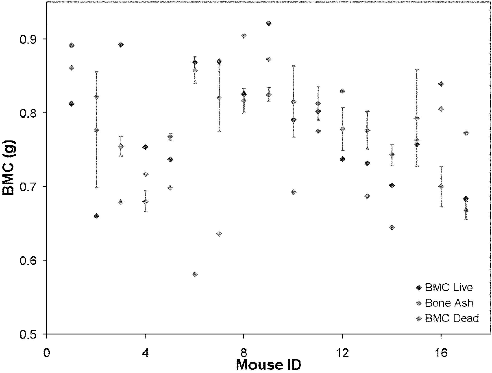

**Fig. 1** BMC of C57BL/6NHsd mice maintained on TD 95217 diet determined by ashing (measurement), DEXA live (one measurement), and DEXA dead (five measurements). Bone ash estimates were obtained by reducing the total carcass ash by a percentage ash assumed for soft tissue [51]

<!-- texto en la figura: eje y: BMC (g) (0.5 a 0.9) · eje x: Mouse ID (0 a 16) · leyenda (abajo a la derecha): ◆ BMC Live (rombo negro) · ◆ Bone Ash (rombo gris claro) · ◆ BMC Dead (rombo gris medio) · barras de error verticales en varios puntos -->

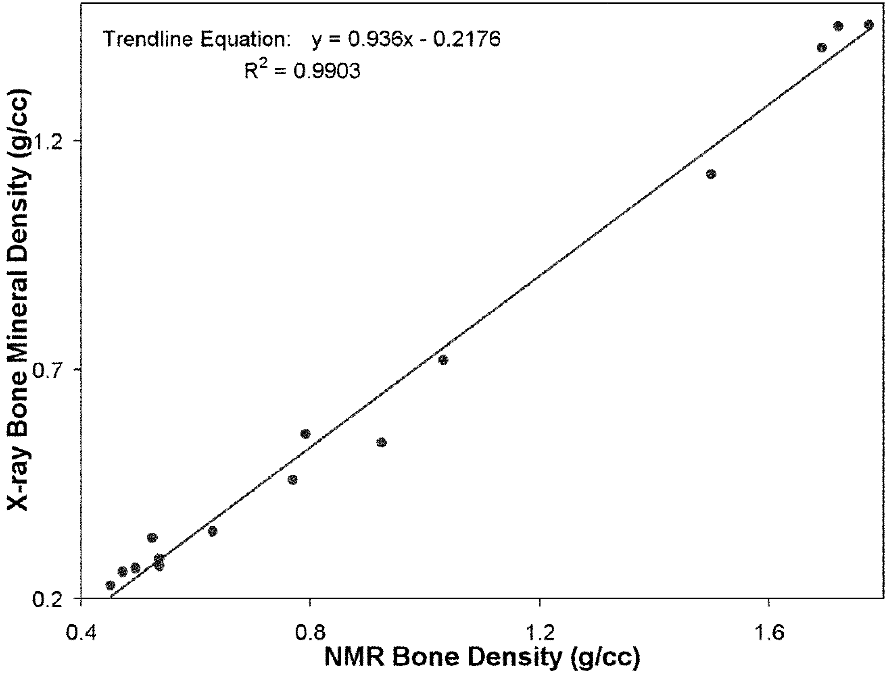

**Fig. 2** Correlation of NMR-determined bone-matrix density with X-ray determined bone-mineral density

<!-- texto en la figura: anotación (arriba a la izquierda): Trendline Equation: y = 0.936x - 0.2176 / R² = 0.9903 · eje y: X-ray Bone Mineral Density (g/cc) (0.2 a 1.2) · eje x: NMR Bone Density (g/cc) (0.4 a 1.6) · puntos: círculos negros y recta de tendencia -->

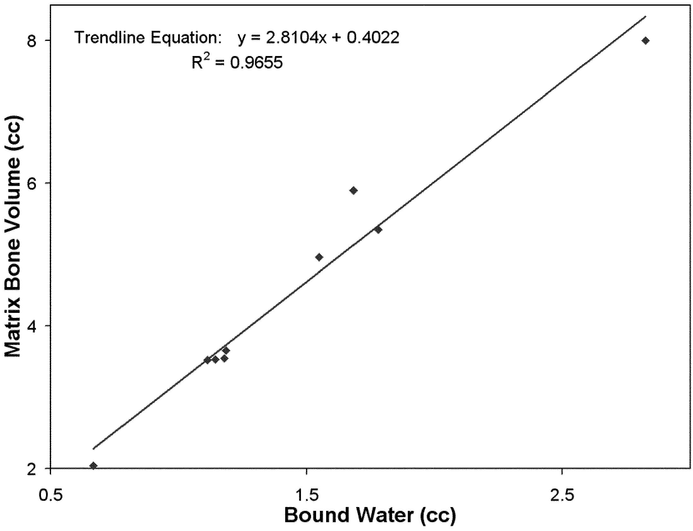

**Fig. 3** NMR-determined bone-matrix volume is highly correlated with NMR-determined bound-water volume

<!-- texto en la figura: anotación (arriba a la izquierda): Trendline Equation: y = 2.8104x + 0.4022 / R² = 0.9655 · eje y: Matrix Bone Volume (cc) (2 a 8) · eje x: Bound Water (cc) (0.5 a 2.5) · puntos: rombos negros y recta de tendencia -->

### Discussion

BMC values determined by DEXA both live and post mortem are similar to those calculated from body ashing. The most consistent estimate of BMC was obtained as a mean of five measures made on dead mice by DEXA. Single measurements made on live mice by DEXA and chemical analysis of carcasses were more variable. Single measurements on a group of live mice made by DEXA were more variable than when the same animals were measured using five replicates to obtain a post mortem value. Unfortunately none of the three methods employed provided the accuracy or precision needed to detect small differences in BMC.

The QMR method for analyzing the bulk properties of bone involves measuring the NMR signal, which corresponds to the amount of hydrogen within a selected, known, discrete volume of bone. The bone-matrix volume is then determined from the NMR signal. This measurement may be repeated to detect changes in bone-matrix volume, which correspond to the condition of the bone. The bone-matrix volume, as previously explained in the introduction, is the difference between the total volume occupied by the discrete volume and the fluid volume within the discrete volume.

Mineralized bone includes chemically bound water. Hydrogen nuclei contained in this water induce NMR signals having a very short decay-time spectrum. The NMR signal from bound water has typically been ignored in NMR techniques used in conventional MRI, primarily because of the relatively long system dead time of typical MRI equipment. As a result, the significance of the short decay-time signal has previously gone unnoticed. Using equipment and techniques having a short dead-time allows for measurement of the rapid-decaying portion of the hydrogen signal. The particular measurement which has diagnostic value is the bone-matrix volume.

It has been determined that in bone tissue there is a strong correlation between NMR hydrogen signal, which <!-- página 6 | impresa: 995 | encabezado: 995 --> may include the short decay-time signal, and bone-mineral density as measured by X-ray techniques. This correlation can be used to identify bone tissue which has a lower than normal bone-mineral fraction and consequent increased risk of stress-induced failure. We established this correlation by analysis of bovine tibia samples using both NMR and DEXA.

NMR relaxation spectra from the bovine tibia experiments have a relatively large component with a relaxation time of about 0.7 ms. This large amplitude signal corresponds to bound water in mineralized bone. Slower relaxation time components of the spectra correspond to blood, fat, water, and other hydrogen-rich fluids present in the bone sample.

The correlation between bone-matrix volume and bone-mineral density for human bone can be similarly established by experiments on human bone from cadavers. A correlation between the NMR hydrogen signal amplitude and the bone-mineral density can thus be established for any particular type of bone under examination. The amplitude of the NMR hydrogen signal can then be used to directly determine bone-mineral density, which is equivalent to the bone-mineral density determined by DEXA.

## Whole-body composition

### Introduction

The amount of total body mass that is composed of adipose tissue is the variable that is best associated with the risk of pathology [37]. Advanced models of body composition [38] and newer technologies [39] that precisely and accurately calculate adipose mass may eventually replace body-mass index (BMI) or simple body-weight determination.

Measurement of body density by plethysmography and hydrostatic weighing assess whole-body fat content expressed as a percentage of body weight [40]. Modern instrumentation allows for a high degree of precision in volume measurement, but inconsistencies in body density, the necessity for lung volume correction, variation in skeletal mass, and degree of hydration are not accounted for by these methods. Widely used techniques for fat assessment based on body bioelectrical impedance [41] or electrical conductivity [42] have not been implemented in broad populations, largely because of inaccuracy and poor specificity of the technology. Measurements of body composition of experimental animals by plethysmography, hydrostatic weighing, bioelectrical impedance, and electrical conductivity is not practical. In order to provide a quantitative measure of whole-body composition in animals, the DEXA technique is readily available [43, 44, 45, 46, 47, 48, 49, 50, 51, 52, 53] yet precision differs with instrument, species, software, and the methods employed [54]. MRI [55] and QCT [56] have potential to determine spatial properties of body fat. MRS has also been employed to measure whole-body fat and water content of mice [57]. This paper describes in detail the new EchoMRI QMR method (Echo Medical Systems, Houston, TX, USA), which previously has only been described in brief communications [58, 59]. In addition to advantages described herein regarding precision and accuracy, measurements are fast (less than 1 min) and do not require anesthesia.

### Research methods and procedures

#### Body-composition analysis

In order to compare the new QMR technology with DEXA and chemical analysis, mice comprised of different body composition were measured. The mice were 10 to 12 weeks of age and maintained on the diet from the time of weaning. Eighteen wild-type male C57BL/6NHsd mice (Harlan, Indianapolis, IN, USA) were maintained on 5008 (Purina #5008 diet; Purina Mills, St Louis, MO, USA; 16.7% of calories from fat) to provide a standard chow. To study adiposity resulting from a calorie-dense diet (diet-induced obesity, DIO), 18 male C57BL/6NHsd mice were maintained on TD diet of which 40% of the calories were from fat (TD95217; Harlan Teklad, Madison, WI, USA). To examine morbid obese mice, 15 male C57BL/6-Lepob/ob mice maintained on Purina #5008 diet were studied. All mice were measured by QMR and DEXA, both live and post mortem. Ten replicate measurements were made by QMR on live, free-moving mice and again ten times post mortem. Each mouse was measured once by DEXA while under methoxyflurane anesthesia (3%), to eliminate locomotor activity, and they were assayed five times post mortem. Mice were repositioned between DEXA measurements. After QMR and DEXA analysis, mice were frozen, placed in plastic bags and shipped on dry ice to Covance (Madison, WI, USA) for body-composition analysis by standard chemical carcass analytical methods. Covance monitors precision periodically using standard preparations. Covance reports an average of 17.00% fat with a <!-- página 7 | impresa: 996 | encabezado: 996 --> coefficient of variation (*CV*) of 3.4% for the whole-peanut preparation they use as a fat standard (Fig. 4). Similar results for fat analysis by standard chemical methods were reported elsewhere [60]. A cereal preparation was used as a protein standard (22.07% protein *CV* 0.9%). A ground dry dog-food preparation was used as a standard for moisture and ash determinations (8.4% moisture *CV* 2.3% and 6.9% ash *CV* 2.5% respectively). Lean mass was defined as mass of moisture combined with mass of protein and ash. A homogenized carcass aliquot was dried to stable weight in a 100 °C vacuum oven to determine water mass. A separate aliquot was combusted at 550 °C to provide measurement of body ash.

<!-- NOTA-CONV: Fig. 4 impresa al pie de la columna derecha de la página 6; se coloca al terminar el párrafo que cruza a la página 7 -->

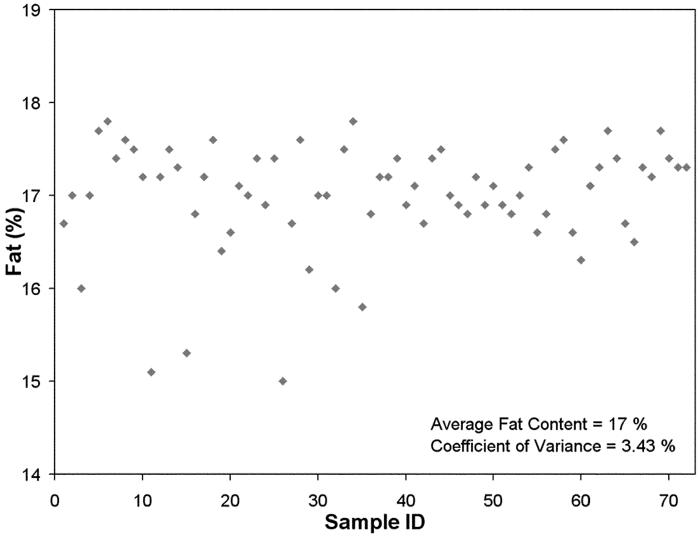

**Fig. 4** Fat of a whole peanut preparation used to monitor assay precision by chemical analysis (petroleum ether extraction)

<!-- texto en la figura: eje y: Fat (%) (14 a 19) · eje x: Sample ID (0 a 70) · anotación (abajo a la derecha): Average Fat Content = 17 % / Coefficient of Variance = 3.43 % · puntos: rombos grises -->

#### Optimization of QMR

Fat, muscle and tissue-free body fluids generate different signals in response to various radio frequency pulses at distinct static magnetic fields. These signals depend on many other material and environmental parameters, but chiefly on temperature. The principles of our method may be demonstrated at any temperature. Room temperature was chosen for convenience and sample stability. Hydrogen density and relaxation behavior of water (saline; Walgreen’s, Houston, TX, USA), canola oil, olive oil, corn oil, and chicken muscle trimmed of all visible fat (all fats and chicken; Randal’s, Houston, TX, USA) were examined at room temperature at an applied static magnetic field corresponding to radio frequency of 20 MHz (Minispec, Bruker-Optics, Billerica, MA, USA). A brief description of NMR techniques used in this study is given in the Appendix. More details can be found elsewhere [25, 26].

The free induction decay (FID) [25] of all five pure samples had a dead time of about 50 µs (Fig. 5). Assuming the hydrogen density of one gram of water to be unity, one gram of chicken muscle had a 90% signal amplitude (10% fewer “liquid” hydrogen nuclei) at 0.9 units per one gram. Thus, the hydrogen density per one gram of canola oil, olive oil, corn oil, and skeletal muscle was 1.27, 1.34, 1.25 and 0.90, respectively.

<!-- NOTA-CONV: Fig. 5 impresa al pie de la columna izquierda de la página 7; se coloca al terminar el párrafo que cruza a la columna derecha -->

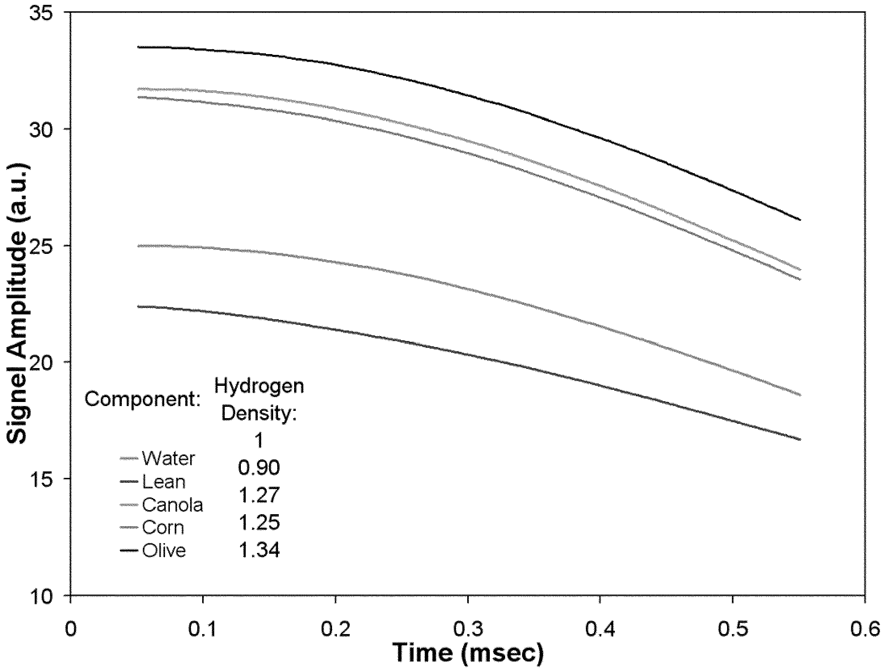

**Fig. 5** Free induction decay for 1 g water, canola oil, corn oil, olive oil, and chicken muscle having a dead time of 50 µs. a.u.–refers to arbitrary units

<!-- texto en la figura: eje y: Signel Amplitude (a.u.) (10 a 35; así impreso, "Signel") · eje x: Time (msec) (0 a 0.6) · leyenda (abajo a la izquierda), dos columnas: Component: — Water · — Lean · — Canola · — Corn · — Olive | Hydrogen Density: 1 · 0.90 · 1.27 · 1.25 · 1.34 (la columna de valores está desplazada verticalmente respecto de la de nombres) · cinco curvas en tonos de gris y negro -->

Preliminary studies indicated that the difference between water and oil (fat) was in $T_1$ relaxation. Therefore, the most appropriate NMR experiment to run is a fast-inversion-recovery (FIR) phase-alternated pulse sequence [26] consisting of up to 30 inversion times (IT) spaced logarithmically from 10 ms to 2 s, with the 90° read-out pulse in the standard inversion recovery (IR) sequence replaced by a Carr–Purcell–Meiboom–Gill (CPMG) sequence [25] having time-to-echo (TE)=1 ms and up to 200 echoes. Each delay in this sequence was optimized for the maximum signal-to-noise differences between fat, muscle and free body fluids.

#### Experiments with pure samples and their mixtures

Three $T_2$ relaxation curves measured by the CPMG technique are shown in Fig. 6. These curves correspond to canola oil (fat), chicken lean muscle, and a sample containing 7.1% canola oil and 92.9% chicken lean muscle. The $T_2$ relaxation (signal amplitude and decay rate) of all three samples are different. More specifically, oil may be represented by a uni-exponential function (two independent parameters – amplitude and decay rate) while chicken muscle may be represented by a bi-exponential function (four independent parameters – two amplitudes and two decay rates). Differences in initial signal amplitude are due to differences in hydrogen density in these materials. Thus canola oil has about 40% more hydrogen per unit weight than chicken muscle. Similar to the hydrostatic weighing method for whole-body-composition analysis, <!-- página 8 | impresa: 997 | encabezado: 997 --> measurement of the NMR initial signal amplitude alone may be sufficient to determine the composition of the two components in mixtures of oil and lean.

<!-- NOTA-CONV: Fig. 6 impresa al pie de la columna derecha de la página 7 y Fig. 7 impresa al inicio de la columna izquierda de la página 8; se colocan al terminar el párrafo que cruza de la página 7 a la 8 -->

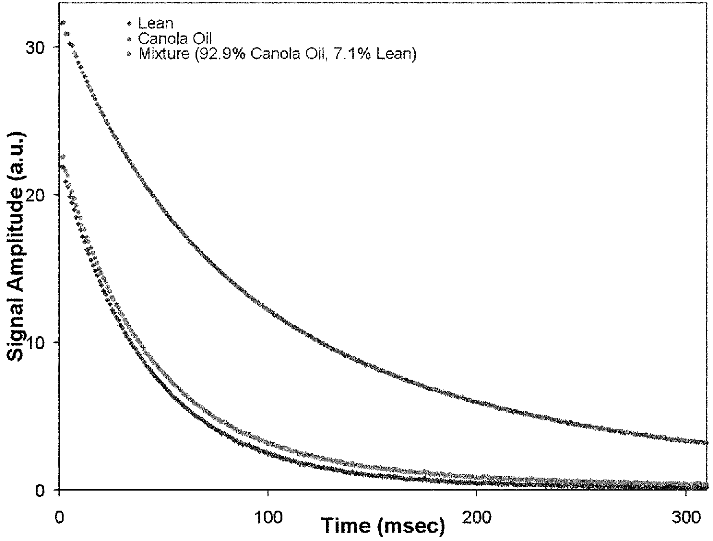

**Fig. 6** Three $T_2$ relaxation curves corresponding to three 1-g samples comprising canola oil (fat), chicken lean muscle, and a sample mixture containing 7.1% canola oil and 92.9% chicken lean muscle. $T_2$ relaxation measured by a CPMG sequence having time-to-echo (TE)=1 ms. a.u.–refers to arbitrary units

<!-- texto en la figura: eje y: Signal Amplitude (a.u.) (0 a 30) · eje x: Time (msec) (0 a 300) · leyenda (arriba a la izquierda): ◆ Lean · ◆ Canola Oil · ● Mixture (92.9% Canola Oil, 7.1% Lean) -->

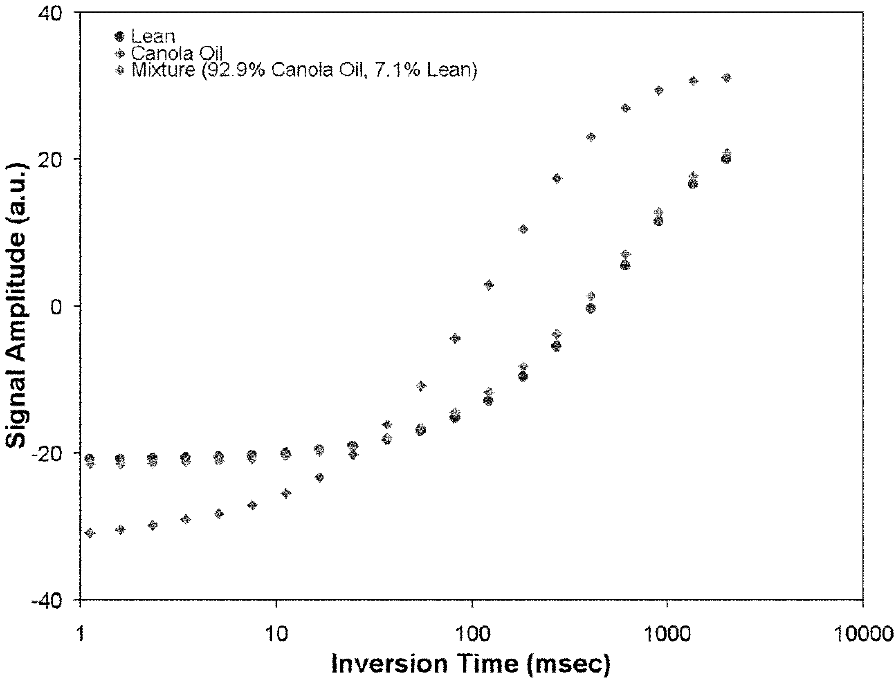

**Fig. 7** Three $T_1$ relaxation curves corresponding to three 1-g samples comprising canola oil (fat), chicken lean muscle, and a sample mixture containing 7.1% canola oil and 92.9% chicken lean muscle. $T_1$ relaxation measured by an inversion recovery phase-alternated pulse sequence having 20 inversion times spaced logarithmically from 10 ms to 2 s. a.u.–refers to arbitrary units

<!-- texto en la figura: eje y: Signal Amplitude (a.u.) (-40 a 40) · eje x: Inversion Time (msec) (1 a 10000, escala logarítmica) · leyenda (arriba a la izquierda): ● Lean · ◆ Canola Oil · ◆ Mixture (92.9% Canola Oil, 7.1% Lean) -->

$T_1$ relaxation curves measured by the IR technique for canola oil, chicken lean muscle, and a mixture of the two containing 7.1% canola oil and 92.9% chicken muscle differ greater (Fig. 7) compared with the $T_2$ relaxation curves. Thus, our preferred measurement method is based primarily on $T_1$ relaxation differentiation, but also includes elements of $T_2$ relaxation.

For validation of three component composition (fat/lean/free body fluid) analysis of mice, 30 mixture samples were prepared from pure fat, muscle trimmed of visible fat, and free body fluids. The average sample weight was 19.5 g (range 8.3–27.0 g) and the average fat fraction was 18.4% (7.5–33.0%). Each sample component was weighed to the nearest 0.001 g using a Mettler balance. Canola oil was the surrogate for pure fat, and saline was used for free body fluids. The average quantity and ranges for mixture components were: 3.6 g (1.4–8.7 g), 14.9 g (5.8–22.6 g), and 1.0 g (0.6–1.8 g) for canola oil, fat free chicken muscle, and saline, respectively. Oil was added to the mixture after chicken muscle and before saline to minimize water absorption by chicken muscle. Mixtures were sealed in glass vials to prevent water evaporation from chicken muscle and saline. All samples were kept at 37 °C for at least 1 h before NMR measurement.

For validation of two-component composition (fat/lean) analysis of small sample sizes such as dissected organs, 18 mixture samples were prepared from canola oil and chicken muscle. The average sample weight was 3.2 g (range 2.1–4.1 g) and the average fat composition was 29.4% (7.5–65.2%). The average quantity and range for canola oil was 0.8 g (0.3–1.9 g) and for chicken muscle was 2.3 g (0.7–3.4 g). Mixtures were sealed in glass vials and kept at 37 °C for at least 1 h before NMR measurement.

The validation of two- and three-component composition, analysis and measurements of whole-body composition of live and dead mice were conducted at 37 °C at an applied static magnetic field corresponding to radio frequency of 7.5 MHz (Minispec, Bruker-Optics, Billerica, MA, USA). Automatic tuning and calibration of the NMR instrument parameters was conducted daily for quality control. These parameters include resonance frequency, temperature, signal amplitude, and decay of a reference sample. Calibration took 2–3 min.

#### Data analysis

Sampled NMR time domain data were analyzed using custom software. The non-negative least-squares algorithm of Lawson and Hanson [61] was used for relaxation time-distribution determination. Components of mixture samples and whole-body-composition analysis were performed utilizing the method of chemometric analysis, specifically, multivariate calibration by partial least-squares regression [62].

#### DEXA

Measurement by DEXA was performed using a Norland p-DEXA (Fort Atkinson, WI, USA) calibrated daily according to the manufacturer’s instructions. Mice were scanned at 20 mm s–1 with a resolution of 0.5 mm×0.5 mm. The Norland p-DEXA, operating in the research mode, allows the histogram averaging width threshold to be set for the size of the animal. A simple linear regression formula (threshold=body wt×0.0005+0.017) was used to determine the appropriate threshold setting. Live mice were placed into a custom built Plexiglass rectangular box (10.4 cm wide×24.3 cm long×8 cm high; 0.3 cm thick panels) that permits anesthetic gas to flow in one end and out the opposite end to a vent. Anesthetized mice were positioned prone with forelimbs cephalic and hind limbs directed caudal. The tail was wrapped to one side. Dead mice were positioned in the same manner and placed into the anesthetic chamber, but gas was not used.

#### Statistics

The coefficient of variation (*CV*) from repeated measurements was calculated to provide a measure of precision. Pearson product moment correlations were performed using Sigmastat to compare methods for body-composition analysis.

<!-- página 9 | impresa: 998 | encabezado: 998 -->

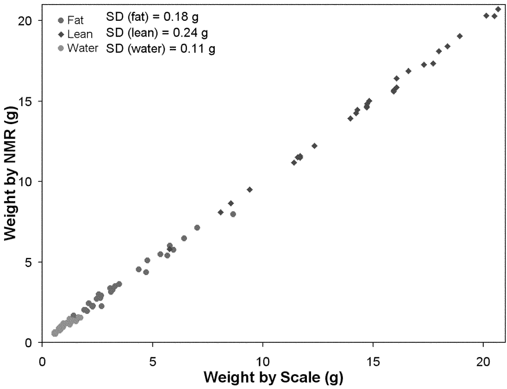

**Fig. 8** Correlation of muscle, fat, and water mass determined by analytical weighing with that measured by QMR. Average sample weight was 19.5 g (range 8.3–27.0 g) and average fat fraction was 18.4% (7.5–33.0%). Each sample component was weighed to the nearest 0.001 g using a Mettler balance. Canola oil was the surrogate for pure fat, and saline was used for free body fluids. Average quantity and ranges for mixture components were: 3.6 g (1.4–8.7 g), 14.9 g (5.8–22.6 g), and 1.0 g (0.6–1.8 g) for canola oil, fat-free chicken muscle, and saline, respectively. A fast-inversion-recovery phase-alternated pulse sequence was used. It consisted of 28 inversion times spaced logarithmically from 10 ms to 2 s and 90° readout pulse followed by a CPMG sequence having TE=1 ms and 120 echoes

<!-- texto en la figura: eje y: Weight by NMR (g) (0 a 20) · eje x: Weight by Scale (g) (0 a 20) · leyenda (arriba a la izquierda): ● Fat SD (fat) = 0.18 g · ◆ Lean SD (lean) = 0.24 g · ● Water SD (water) = 0.11 g -->

<!-- NOTA-CONV: Fig. 9 impresa en la parte superior de la columna derecha de la página 9, a la altura de la Fig. 8 -->

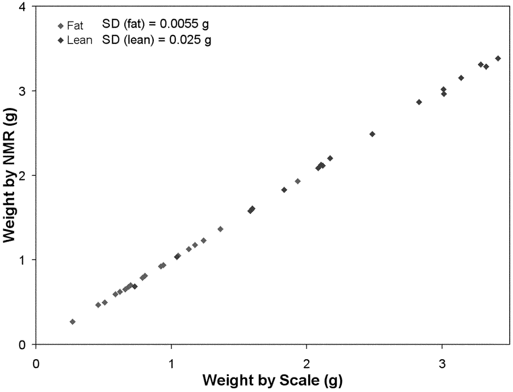

**Fig. 9** Correlation of fat and muscle mixture masses determined by analytical weighing with component masses determined by QMR. Average sample weight 3.2 g (range 2.1–4.1 g). Average fat composition was 29.4% (7.5–65.2%). Average quantity and ranges for canola oil were 0.8 g (0.3–1.9 g) and for chicken muscle were 2.3 g (0.7–3.4 g). A fast-inversion-recovery phase-alternated pulse sequence was used. It consisted of 28 inversion times spaced logarithmically from 10 ms to 2 s and 90° readout pulse followed by a CPMG sequence having TE=1 ms and 120 echoes

<!-- texto en la figura: eje y: Weight by NMR (g) (0 a 4) · eje x: Weight by Scale (g) (0 a 3) · leyenda (arriba a la izquierda): ◆ Fat SD (fat) = 0.0055 g · ◆ Lean SD (lean) = 0.025 g -->

### Results

#### Testing of prepared mixture samples

QMR analysis of 30 prepared mixtures of chicken muscle, canola oil, and saline were in excellent agreement with their component masses weighed with an analytical balance (Fig. 8). Excellent agreement between balance weight and QMR values was also achieved with small mass mixtures of canola oil and chicken muscle (Fig. 9). For both sets of samples the correlation coefficient, $R^2$, was unity for each mixture component.

#### Body composition of obese mice

Multiple measures of body composition from three phenotypes were determined by QMR, DEXA, and chemical carcass analysis. The precision of QMR measurements was better than that for DEXA (Table 1). The *CV* for fat mass of mice fed the high-fat diet measured post mortem by QMR and DEXA were 0.34% and 9.59%, respectively. Some loss of QMR precision was observed when mice were analyzed live and free moving. However, live measurements by QMR were less variable than when analyzed post mortem by DEXA. Fat mass determined post mortem or live by DEXA and QMR was similar and not significantly different within phenotype, except for fat mass of 5008 fed C57BL/6NHsd measured on live mice by DEXA (Table 2). This mean was significantly lower than other measurements utilizing QMR or DEXA and was not different from chemical analysis. Fat mass by chemical analysis was always lower and significantly different from QMR and DEXA values (*P*&lt;0.02) (Table 2). The three phenotypes were differentiated statistically by all methodologies (*P*&lt;0.001). The correlation coefficients and *P* values when comparing fat by QMR to chemical analysis were 0.74 (*P*&lt;0.001) for 5008 fed C57BL/6NHsd <!-- página 10 | impresa: 999 | encabezado: 999 --> mice, 0.84 (*P*&lt;0.001) for TD fed C57BL/6NHsd mice, and 0.94 (*P*&lt;0.001) for Lepob/ob mice. The corresponding values correlating QMR to DEXA were 0.81 (*P*&lt;0.001), 0.92 (*P*&lt;0.001) and 0.60 (*P*=0.02) while the values correlating DEXA to chemical analysis gave 0.59 (*P*=0.01), 0.89 (*P*&lt;0.001), and 0.57 (*P*=0.03).

<!-- NOTA-CONV: Tabla 1 impresa en la columna derecha de la página 9 (bajo la Fig. 9) y Tabla 2 impresa al inicio de la columna izquierda de la página 10; se colocan al terminar el párrafo que cruza de la página 9 a la 10 -->

**Table 1** Coefficient of variance (%) for lean and fat measurement

<table>
<thead>
<tr><th>Mice group – tissue</th><th>QMR livea</th><th>QMR deadb</th><th>DEXA deadc</th></tr>
</thead>
<tbody>
<tr><td>BL/6 5008d diet – lean</td><td>2.19</td><td>0.58</td><td>7.55</td></tr>
<tr><td>BL/6 DIOe diet – lean</td><td>3.24</td><td>0.67</td><td>5.49</td></tr>
<tr><td>ob/ob 5008d diet – lean</td><td>3.70</td><td>0.98</td><td>5.80</td></tr>
<tr><td>BL/6 5008d diet – fat</td><td>1.55</td><td>0.71</td><td>12.60</td></tr>
<tr><td>BL/6 DIOe diet – fat</td><td>1.43</td><td>0.34</td><td>9.59</td></tr>
<tr><td>ob/ob 5008d diet – fat</td><td>0.86</td><td>0.34</td><td>3.06</td></tr>
</tbody>
</table>

aLive mice were not anesthetized

bDead mice were thawed and placed in a water bath at 37 °C for 1 h prior to QMR

cDead mice were thawed and scanned at room temperature for DEXA

d5008 diet is Purina 5008 and 16.7% of its calories are from fat

eDIO refers to diet-induced obesity (TD95217 custom diet; 40% of its calories are from fat)

Lean is all tissues and fluids with a density greater than fat and less than bone when measured by DEXA. Lean is apparent muscle mass when determined by QMR

ob/ob is leptin-deficient Lepob/ob mice of a C57BL6 genetic background

BL/6 refers to C57BL/6NHsd strain mice

Imagen original

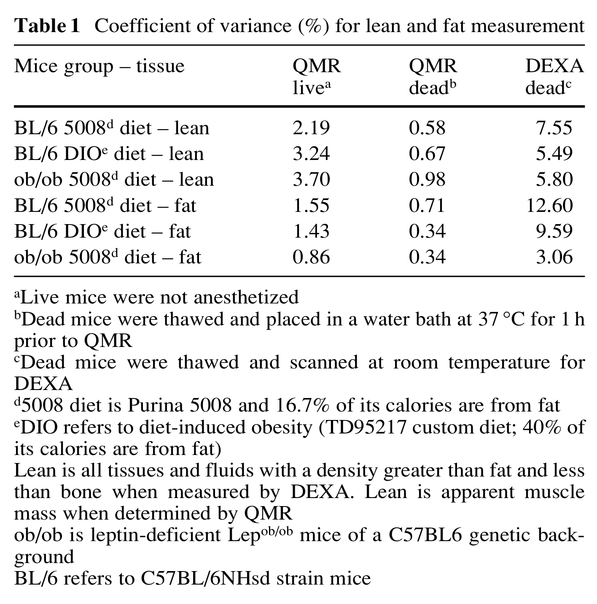

**Table 2** Comparison of fat mass values

<table>
<thead>
<tr><th rowspan="2">Phenotype</th><th colspan="3">Post Mortema</th><th colspan="2">Livea</th></tr>
<tr><th>QMR</th><th>DEXA</th><th>Chemical</th><th>QMR</th><th>DEXA</th></tr>
</thead>
<tbody>
<tr><td>C57BL6b</td><td>12.8±0.7</td><td>12.6±1.0</td><td>9.0±0.6c</td><td>12.0±0.7</td><td>9.6±0.7c</td></tr>
<tr><td>DIOb</td><td>18.0±0.5</td><td>18.0±0.5</td><td>14.0±0.4c</td><td>17.5±0.5</td><td>16.8±0.5</td></tr>
<tr><td>Obeseb</td><td>30.1±0.9</td><td>30.2±1.3</td><td>24.1±0.9c</td><td>29.6±1.1</td><td>31.3±1.9</td></tr>
</tbody>
</table>

aFat mass was different for each phenotype within a method, *P*&lt;0.001

bC57BL/6NHsd strain was fed either Purina 5008 diet or TD95217 (DIO)

cSignificantly (*P*&lt;0.05) lower than groups within phenotype not having the same superscript

Lepob/ob mice were fed Purina 5008 diet (obese) and were of the C57BL/6 genetic background

Values are in grams: average±SEM

Imagen original

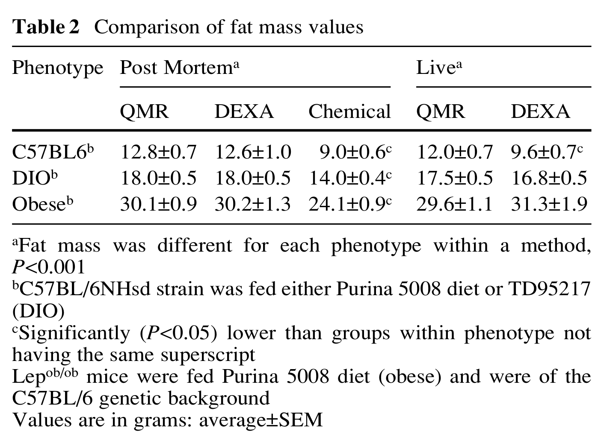

Lean mass is more difficult to compare because each methodology measures different components of the body composition. The values obtained by chemical analysis were greatest but include masses of carcass water, ash, and protein (Table 3). The lowest lean mass was measured by QMR, but it is that mass with physical characteristics identical to lean chicken breast muscle that was measured. Measurement of lean mass by DEXA is calculated from all tissue whose density is greater than fat and less than bone. Lean mass for the three phenotypes was similar when measured by chemical analysis. Lean mass of the C57BL/6NHsd mice was similar when fed either diet and when measured by QMR or DEXA. However, lean mass of Lepob/ob mice was less (*P*&lt;0.001) when determined by either non-invasive method than when measured by chemical methods. Lean mass measured by DEXA was better correlated to lean mass determined by chemical analysis (5008, 0.51 *P*=0.03, TD, 0.70 *P*=0.001, Lepob/ob, 0.83 *P*&lt;0.001) than lean mass defined by QMR (5008, 0.37 *P*=0.13, TD, 0.65 *P*=0.004, Lepob/ob, 0.53 *P*=0.04).

**Table 3** Comparison of lean mass values – post mortem

<table>
<thead>
<tr><th rowspan="2">Phenotype</th><th colspan="3">Post Mortem</th><th colspan="2">Live</th></tr>
<tr><th>QMRa</th><th>DEXA</th><th>Chemical</th><th>QMRa</th><th>DEXA</th></tr>
</thead>
<tbody>
<tr><td>C57BL/6b</td><td>18.4±0.2</td><td>22.5±0.5</td><td>25.3±0.5d</td><td>19.3±0.3</td><td>22.8±0.6</td></tr>
<tr><td>DIOb</td><td>19.6±0.3</td><td>22.0±0.3</td><td>25.9±0.4d</td><td>19.8±0.3</td><td>22.3±0.5</td></tr>
<tr><td>Obesec</td><td>15.5±0.9</td><td>17.2±1.5</td><td>23.6±0.6d</td><td>15.5±0.4</td><td>16.1±1.7</td></tr>
</tbody>
</table>

aQMR lean mass is not equivalent to non-fat mass

bC57BL/6NHsd strain was fed either Purina 5008 diet or TD95217 (DIO)

cLepob/ob (obese) mice were fed Purina 5008 diet and were of the C57BL/6 genetic background

dSignificantly (*P*&lt;0.001) different than when measured by QMR or DEXA

Values are in grams: average±SEM

Imagen original

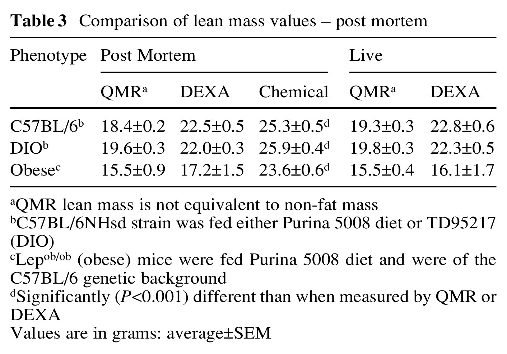

### Discussion

The system and the quantitative whole-body composition method for non-invasive measurement and calculation of total adipose mass and apparent skeletal muscle mass of an unanesthetized mouse are based on NMR. Differences in the NMR properties of water and fats suggest the possibility of using spectroscopic or relaxometric NMR methods for non-invasive whole-body composition (WBC) analysis. Mitchell et al. [63] demonstrated these techniques both in vivo and in vitro. The spectroscopic method is based on the fact that the two major peaks on the NMR absorption spectrum representing hydrogen in the water and hydrogen in the CH2 groups of fat are separated by 3.5 ppm. Relaxometric methods are dependent on differences in $T_1$ relaxation of water in muscle and hydrogen in fat. Although the spectroscopic method is more direct and precise, relaxometric methods allow for large volume imaging and determining distribution of fat deposits in the body or for measuring size and shape of specific organs.

There are limitations to the application of NMR to WBC analysis. Separating hydrogen peaks of water and CH2 groups in spectroscopy is limited by the strength and homogeneity of the magnetic field, making whole-body spectroscopy applicable to very small animals only. NMR imaging of the whole body is less precise and time-consuming. The equipment is quite expensive to acquire, operate, and maintain.

There are no good “gold standards” of WBC to calibrate or compute accuracy. Furthermore, “pure fat” or “pure muscle” tissue would possess different properties for different parts of the body and could even differ between different samples from the same body site. In such situations a multivariate statistical analysis has substantial advantages over univariate calibration since absolute accuracy is less important than reliability and precision.

The accuracy of QMR measurements can be addressed by comparison to DEXA and chemical methods. Values for fat mass are the easiest to compare. Chemical analysis was based on petroleum ether extraction which efficiently extracts fats that are in the form of triglycerides but fails to measure another 17% present as structural fats [51]. QMR is a measurement based on calibration with a set of standards containing known amounts of a standard fat (canola oil), lean chicken breast muscle, and saline. Thus, QMR and DEXA should give comparable values for fat mass while chemical analysis may be expected to give a lower value. Indeed in this set of experiments QMR and DEXA give virtually the same average value for fat mass (Table 2) and chemical analysis yields about 15% lower average values.

Lean mass cannot be easily compared across the three methods. Chemical analysis provides a value for protein mass, moisture, and ash as a measure of total body mineral content. These can be combined to produce a value that compares with DEXA lean mass plus BMC. This avoids the difference between whole-body ash by chemical analysis and BMC by DEXA. QMR on the other hand provides a value for lean tissue which is more accurately <!-- página 11 | impresa: 1000 | encabezado: 1000 --> described as muscle mass equivalence, while no value for bone mass and no independent measure of water bound in tissues is available. Thus, QMR can be expected to provide a measure of lean mass that is lower than by DEXA or chemical analysis. Since the QMR is calibrated with lean muscle it should provide a more representative measure of skeletal muscle mass. Additional insight was provided by the Pearson product-moment analysis. Lean mass as measured by DEXA is better correlated to lean mass by chemical analysis than lean mass measured by QMR. This is not surprising, since lean by chemical analysis accounts, on average, for over 98% of the total body mass while DEXA partitions total body mass into fat and lean. Body fat was highly correlated between the three methods with the exception that the correlation between fat for obese leptin-deficient mice by DEXA and by chemical analysis was lower. The superior precision afforded by the QMR approach to body-composition analysis was demonstrated experimentally, where the *CV* ranged from 0.3% to 0.7% for measurement of fat mass and 0.6–1.0% for measurement of lean mass in dead mice (Table 1). Precision (in terms of *CV*) assigned for chemical analysis of fat provided by periodic replicate analysis of a whole peanut preparation is 3.4%. Therefore, precision of chemical analysis of fat in animal tissue is expected not to be better. Live free moving mice were measured by QMR with less but still very good precision (0.9–1.6% for fat and 2.2–3.7% for lean). This precision was better than that observed using DEXA. The error introduced by movement can be largely overcome by making measures in triplicate. Total body fat was consistently measured by QMR with superior accuracy and excellent precision when compared with gravimetric mass of oil. The accuracy of lean measurement is dependent in part on the association of water to protein and glycogen in muscle tissue, since the QMR lean measurement is based on calibration with chicken muscle. To the extent that water molecules in other tissues and organs show the same physicochemical characteristics, their aggregate mass will be included in the lean measurement. Further study is required to better understand the use of this technology for measuring all lean tissue mass. Nevertheless, the lean measure made by QMR should be a more representative measure of muscle mass than the DEXA measurement of lean mass.

## Summary

Bone density measured by a new QMR technique was highly correlated to bone-mineral density determined by X-ray absorptiometry. The method for QMR analysis of bone may be applied to anatomical bones such as the radius, calcaneus, tibia, spine, femur, and others. Results of such analyses can be used in conjunction with other clinical risk factors as an aid to physicians in diagnosing and monitoring of osteoporosis and other medical conditions which lead to reduced bone strength.

Results of body composition measured by QMR were found to correlate well with both DEXA and chemical analysis. Results for average fat mass by QMR and DEXA were virtually identical. Precision was markedly improved by using QMR, particularly when measuring fat mass. QMR was particularly well suited to measuring smaller quantities of fat than DEXA. Lean mass measured by QMR differs from the lean mass defined for DEXA or chemical analysis. Values for lean mass by QMR analysis exhibit very good precision and are well correlated with DEXA and chemical analysis. Measurements made by QMR are much faster (less than 1 min) compared to DEXA (15–20 min) and the *CV* was largely improved. Use of QMR to monitor changes in body composition of mice with great precision should be of great value when characterizing phenotypes and studying drugs affecting obesity.

## Appendix: basics of nuclear magnetic resonance

When hydrogen nuclei are placed in an applied static magnetic field, a small majority of spins are aligned with the applied field in the lower energy state, since it is more stable than the higher energy state. The individual spins precess about the applied static magnetic field at a resonance frequency, also termed the Larmor frequency. This frequency is characteristic of a particular nucleus and proportional to the applied static magnetic field. An alternating magnetic field at the resonance frequency in the radio frequency (RF) range, applied by a transmitting antenna to a subject or specimen in the static magnetic field, flips nuclear spins from the lower energy state to the higher energy state. When the alternating field is turned off, the nuclei return to the equilibrium state with emission of energy at the same frequency as that of the stimulating alternating magnetic field. This RF energy generates an oscillating voltage in a receiver antenna, whose amplitude and electronic rate of decay depend on the physicochemical properties of tissue and the magnetic environment of the nuclei. The applied RF field is designed to perturb the thermal equilibrium of magnetized nuclear spins, and the time dependence of emitted energy is determined by the manner in which this system of spins returns to equilibrium magnetization. The return is characterized by two parameters: $T_1$, the longitudinal or spin–lattice relaxation time; and $T_2$, the transverse or spin–spin relaxation time.

Whereas conventional X-ray radiographic and computed tomography images depend on electron density, NMR/MRI depends on the density of hydrogen nuclei and the physical state of the tissue as reflected in the $T_1$ and $T_2$ relaxation times. In general, NMR/MRI instruments create contrast between soft tissues by taking advantage of the differences in relaxation times of the hydrogen spins and (or) hydrogen density in these tissues. NMR signals also depend on diffusion properties and the temperature of the material that is being investigated.

Various sequences (selectable length and duration) of RF magnetic fields are imparted to the tissue to momentarily re-orient nuclear magnetic spins of hydrogen nuclei. RF signals are generated by hydrogen nuclei as they spin <!-- página 12 | impresa: 1001 | encabezado: 1001 --> about their axes due to precession of the spin axes. The amplitude, duration, and spatial distribution of these RF signals are related to properties of the material, which are investigated by the NMR technique used. Tissue contrast is high between fat, body free fluid, and muscle based on NMR signal amplitude and relaxation time, and can be further enhanced by application of certain RF sequences.

High-resolution NMR techniques or MRS methods depend on different proton resonance frequencies for protons in chemically different environments [64]. The magnetic field strength experienced by these protons is usually less than that of the applied static magnetic field due to diamagnetic shielding caused by the motion of their valence electrons and those of adjacent atoms in response to the applied magnetic field. These differences are called chemical shifts and are usually measured with respect to some reference standard. Water can be easily distinguished from oils and fats based on NMR high-resolution spectra. Low-resolution NMR spectra will exhibit one single “wide line” at the weighted mean proton resonance frequency for a mixture of water and oil. This technique is referred to in the literature as “wide-line” NMR [65]. The technique measures the voltage induced in a receiving antenna, which is proportional to the total number of hydrogen nuclei.

## References

1. Robinson RA, Elliott SR (1957) J Bone Joint Surg 39A:167–188

2. Robinson RA (1960) Clin Orthopaed 17:69–76

3. Weiner S, Wagner HD (1998) Annu Rev Mater Sci 28:271–298

4. Cameron DA (1972) The ultrastructure of bone. In: Bourne G (ed) The biochemistry and physiology of bone, vol 1. Academic Press, pp 191–236

5. Camacho NP, Rinnerthaler S, Paschalis EP, Mendelsohn R, Boskey AL, Fratzl P (1999) Bone 25:287–293

6. Reynolds SD, Kunz TH (2001) Standard methods for destructive body-composition analysis. In: Speakman JR (ed) Body-composition analysis of animals: a handbook of non-destructive methods. Cambridge University Press, pp 39–55

7. Nagy TR (2001) The use of dual-energy X-ray absorptiometry for the measurement of body composition. In: Speakman JR (ed) Body-composition analysis of animals: a handbook of non-destructive methods. Cambridge University Press, pp 211–229

8. Nagy TR, Prince CW, Li J (2001) J Bone Miner Res 16:1682–1687

9. Sharp JC, Copps JC, Liu Q, Ryner LN, Sebastian RA, Zeng GQ, Smith S, Niere JO, Tomanek B, Sato M (2000) J Bone Miner Res 15:138–146

10. First guidelines for osteoporosis issues by National Osteoporosis Foundation in collaboration with multidisciplinary physician organizations (news release Nov. 5, 1998)

11. Johnston CC, Melton JL (1996) Bone densitometry measurement and the management of osteoporosis, Primer on metabolic bone diseases and disorders of mineral metabolism. American Society for Bone and Mineral Research, Society Office, pp 93–100

12. Johnston CC, Epstein S (1981) Orthop Clin North Am 12:559–569

13. Cosman F, Herrington B, Himmelstein S, Lindsay R (1991) Osteoporosis Int 2:34–38

14. Dequeker J (1982) Precision of the radiogrammetric evaluation of the bone mass at the metacarpal bones. In: Dequeker J, Johnston CC (eds) Non-invasive bone measurement: methodological problems. IRL Press, Oxford, pp 27–32

15. Vogel JM (1987) Application principles and technical considerations in SPA. In: Genant HK (ed) Osteoporosis update 1987, University of California Printing Services, San Francisco, pp 219–231

16. Kelly TL, Grane G, Baran DT (1994) Calcif Tissue Int 54:212–218

17. Nord RH (1987) Technical considerations in DPA. In: Genant HK (ed), Osteoporosis update 1987, University of California Printing Services, San Francisco, pp 203–212

18. Wahner HW, Fogelman I (1994) The evaluation of osteoporosis: dual energy X-ray absorptiometry in clinical practice, Martin Dunitz, UK

19. Bolotin HH (2001) Bone 28:548–555

20. Hangartner TN, Gilsanz V (1996) J Bone Miner Res 11:1518–1525

21. Leichter I, Karellas A, Shukla SS, Looper JL, Craven JD, Greenfield MA (1985 ) Med Phys 12:466–468

22. Ling SS, Rustgi S, Karellas A, Craven JD, Whiting JS, Greenfield MA, Stern R (1982) Med Phys 9:208–215

23. Hans D, Schott, AM, Meunier, PJ (1993) Eur J Med 2:157–163

24. Nicholson PH, Bouxsein ML (2000) J Bone Miner Res 15:2467–2472

25. Farrar TC, Baker ED (1971) Pulse and Fourier transform NMR. Academic Press

26. Sezginer A, Kleinberg RL, Fumuhara M, Latour LL (1991) J Magn Reson 92:504–527

27. Majumdar S, Genent HK (1995) Osteoporosis Int 5:79–92

28. Beuf O, Newitt DC, Mosekilde L, Majumdar S (2001) J Bone Miner Res 16:1511–1519

29. Ackerman JL, Raleigh DP, Glimcher MJ (1992) Magn Reson Med 25:1–11

30. Wehrli FW, Gomberg BR, Saha PK, Song HK, Hwang SN, Snyder PJ (2001) J Bone Miner Res 16:1520–1531

31. Wehrli FW, Saha PK, Gomberg BR, Song HK, Snyder PJ, Benito M, Wright A, Weening R (2002) Top Magn Reson Imaging 13:335–355

32. Hipp JA, Jansujwicz A, Simmons CA, Snyder BD (1996) J Bone Miner Res 11:286–297

33. Kuhn (1990) Angew Chem Int Ed Eng 29:1–19

34. Wang X, Ni Q (2003) J Orthop Res 21:312–319

35. Ford JC, Wehrli FW, Chung HW (1993) Magn Reson Med 30:373–379

36. Hopkins JA, Wehrli FW (1997) Magn Reson Med 37:494–500

37. Rebuffe-Strife M, Bjorntorp P (1985) Regional adipose tissue metabolism in man. In: Vague J, Bjorntorp P, Guy-Grand B (eds) Metabolic complications of human obesities. Exerpta Medica, Amsterdam, pp 149–159

38. Heymsfield SB, Wang ZM, Baumgartner RN, Ross R (1997) Annu Rev Nutr 17:527–558

39. Heymsfield SB, Hoffman DJ, Testolin C, Wang ZM (2001) Evaluation of human adiposity. In: Bjorntorp P (ed) International textbook of obesity. Wiley

40. Fields DA, Goran MI, McCrory MA (2002) Am J Clin Nutr 75:453–467

41. Bioelectrical impedance analysis in body composition measurement. NIH Technol Assess Statement, December 1994, pp 12–14

42. Unangst ET Jr, Merkley LA (2002) J Exp Biol 205:3101–3105

43. Pietrobelli A, Formica C, Wang Z, Heymsfield SB (1996) Am J Physiol 271:E941–E951

44. Ellis KJ (2000) Physiol Rev 80:649–680

45. Lukaski HC, Hall CB, Marchello MJ, Siders WA (2001) Nutrition 17:607–613

46. Ellis KJ, Shypailo RJ (1998) J Bone Miner Res 13:1613–1618

47. Black A, Tilmont EM, Baer DJ, Rumpler WV, Ingram DK, Roth GS, Lane MA (2001) J Med Primatol 30:94–99

48. Rose BS, Flatt WP, Martin RJ, Lewis RD (1998) J Nutr 128:246–250

<!-- página 13 | impresa: 1002 | encabezado: 1002 -->

49. Bertin E, Ruiz J-C, Mourot J, Peiniau P, Portha B (1998) J Nutr 128:1550–1554

50. Feely RS, Larkin LM, Halter JB, Dengel DR (2000) Exp Gerontol 35:417–427

51. Nagy TR, Clair A-L (2000) Obesity Res 8:392–398

52. Speakman JR, Booles D, Butterwick R (2001) Int J Obesity 25:439–447

53. Brunton JA, Bayley HS, Atkinson SA (1993) Am J Clin Nutr 58:839–845

54. Genton L, Hans D, Kyle UG, Pichard C (2002) Nutrition 18:66–70

55. Ross R, Leger L, Morris D, de Guise J, Guardo R (1992) J Appl Physiol 72:787–795

56. Hildebrandt AL, Kelly-Sullivan DM, Black SC (2002) J Pharmacol Toxicol Methods 47:99–106

57. Mystkowski P, Shankland E, Schreyer SA, LeBoeuf RC, Schwartz RS, Cummings DE, Kushmerick M, Schwartz MW (2000) Int J Obesity 24:719–724

58. Tinsley FC, Gersh Z, Taicher GZ, Heiman ML (2001) Novel NMR technology provides quick and precise body composition measurement of live mice. NAASO, Quebec City, October 2001

59. Taicher GZ, Tinsley FC, Craney S, Heiman ML (2002) Novel NMR technology demonstrates altered body composition after short term dietary change. Nutrition Week Annual Meeting and Conference, San Diego, February 2002

60. Brown RH, Mueller-Harvey I (1999) J AOAC Int 82:1369–1374

61. Lawson CL, Hanson RJ (1974) Solving least squares problems. Prentice-Hall, New Jersey

62. Martens H, Nǽs T (1989) Multivariate Calibration. Wiley, New York

63. Mitchel AD, Wang PC, Elsasser TH (1991) J Sci Food Agric 56:265–276

64. Claridge TD (1999) High-resolution NMR techniques in organic chemistry. Pergamon Press

65. Ruan RR, Chen PL (1997) Water in Foods and Biological Materials, Technomic
